#+TITLE: Harmony UI 导航与参考界面映射
#+STARTUP: show2levels hidestars
#+OPTIONS: author:nil date:nil toc:nil
#+LANGUAGE: zh-CN

* 依据与目标

设计文件 [[file:../../design/Orgzly界面细节.fig][界面图谱]] 包含“Harmony 当前实现”、“Orgzly 参考资料（不代表当前实现）”、“任务编辑交互”、“待确认设计”与“设计规范”五页。“设计规范”页按基础样式、在用图标、菜单与位置浮层、编辑弹窗、底部面板与确认框、交互状态、品牌与保留资源、备忘主色主题分区维护，版本状态与规则索引见 [[file:视觉设计规范.org][视觉设计规范]]；规范已确认，源码已按规范排查并实施删除图标、菜单和备忘主色主题调整，真机动态效果仍需验收。“待确认设计”页现作为任务更多菜单和删除图标对比的历史方案页。“任务编辑交互”页维护任务展开、文字编辑、日期、标签和检查清单的 16 项完整交互规范；共享组件的实现汇总继续维护于当前实现页。当前实现页只维护仍有入口的手机页面及共享组件规范，并接入通知展示、日志备份阅读和单文件冲突处理；旧分类导航、旧收件箱、重复存储库布局、旧分享流程、旧目标托盘和双行同步日志已清理。参考页保留原始应用截图资料，不代表手机交付能力。手机提供本地目录、WebDAV、固定任务视图、外部快速捕捉和后台系统日历接入，不提供独立搜索或已保存查询入口。

全 App 统一使用与侧边栏相同的深灰配色：页面背景 ~#2D2C2B~ ，卡片 ~#343635~ ，输入框与选中背景 ~#3A3E3F~ ，主文字 ~#D8D8D8~ ，辅助文字 ~#AEACA9~ ，强调色 ~#5AC4B9~ ，错误色 ~#FF7592~ ，完成色 ~#65CD7B~ 。侧边栏保留彩色顶部图标和圆角灰色选中行。工具栏高 64vp，图标点击区域 48vp，内容基础边距 16vp。刷新统一使用下拉同步；收件箱底部中央悬浮“+”快速录入，备忘页以相同位置与样式的“+”新增备忘，其他列表不显示新增按钮。共用样式与控件维护于 ~ui/Theme.ets~ 、 ~components/Controls.ets~ 与 ~components/AppShell.ets~ 。

* 功能对应

任务行的项目来源与今天页分类区域内的项目区块已接入，见 [[file:项目分类布局设计.org][项目分类布局设计]]；当前画板为“51 Harmony 项目分类与任务来源（当前实现）”。

收件箱记录合并的方案比较与内容规则见 [[file:记录合并交互方案.org][记录合并交互方案]]，操作顺序维护于“Harmony 当前实现”页的“48 Harmony 收件箱记录合并（当前实现）”画板。

| 参考画板与区域 | Harmony 页面或组件 | 实际功能与边界 |
|-
| 01 导航抽屉 | ~AppShell~ | 不设置顶部关闭按钮；收件箱、今天、计划、随时、某天、备忘、日志簿与存储库整体滚动，底部固定设置。侧边栏只保留一个存储库入口，不提供分类列表或分类多选。页面工具栏不再显示展开侧边栏按钮，仅一级页面的标题图标或文字本身打开抽屉，顶部空白不响应；带返回按钮的二级页面标题只展示。切换主入口替换当前路由；点击功能、空白处、遮罩与系统返回均可关闭抽屉。 |
| 存储库与文件列表 | ~Files.ets~ 与 ~NotebookFileRow~ | 一个仓库一个分区，仓库名与通栏细线沿用今天页面样式；文件项为 56vp 双行，首行显示单行 TITLE、紧跟标题的收件箱／某天／备忘用途标签和行尾笔记数，次行合并相对路径、大小与修改时间，无 TITLE 时以路径兜底。用途按配置仓库 ID 与路径共同匹配，可并列。默认隐藏命中配置忽略规则的文件，仓库名称右侧依次提供隐藏文件显示切换与同步日志图标，操作仅作用于对应仓库；点击仓库名打开对应配置，空仓库与读取失败提示留在各自仓库区内。不提供新增存储库、搜索或新增任务按钮。 |
| 同步日志列表 | ~SyncLog.ets~ | 从 Core 读取所选仓库 ~.sync/history~ 的已完成记录，标题栏显示“仓库名称 · 同步日志”，列表项按开始时间倒序列出结果、时间、文件数和冲突数，不重复仓库信息；成功、失败、取消与中断使用不同状态色。列表支持下拉重新读取；没有历史时显示空状态。 |
| 收件箱记录 | ~Inbox.ets~ 、 ~TaskListItem~ 与 ~TaskSwipeActions~ | 包含配置文件中的全部标题，复用共享任务行和原地展开；收起与展开均可左滑显示移动、将来，也许、备忘和删除。移动使用条目旁的分类位置浮层，选中后确认；保留下拉同步和底部快速录入。 |
| 顶部任务入口 | ~TaskOverview.ets~ 与 ~PlannedTaskList~ | 今天包含当天及过期任务，使用 ~TodayTaskList~ 按分类分区组织通用 ~TaskListItem~ ，仅项目任务在分类内按项目名组成左上角弱角标区块，普通任务直接排列，原地展开直接编辑标题、备注、日期、标签和清单；计划从明天开始，连续 7 天按日显示（空日期也保留），本月剩余日期合并为区间，未来 180 天按月份显示（空月份也保留），更远日期按年份显示；任务行复用 ~TaskListItem~ ，折叠时按配置显示前部日期与文件 CATEGORY，重复标志由任务数据决定，点击标题原地展开后布局与今天一致。随时仅展示无计划、无截止的待办任务，并与今天共用 CATEGORY 分区；某天和备忘来自已配置文件；日志簿按时间线展示完成／取消任务的创建与关闭事件。页面基础结果由 Core 查询产生；今天、随时、某天和备忘允许共享标签筛选条在已加载快照上控制可见记录，其余仅做展示分组。 |
| 01 文件阅读 | ~FileDetail.ets~ | 按配置显示连续文档渲染或完整原文，默认渲染；顶部目录按钮打开底部章节面板，支持层级导航和展开目标父章节；更多菜单及目录均可展开或收起全部章节。TITLE 只在工具栏显示，正文提供仓库与相对路径，无阅读/原文/只读切换行。空文件可正常打开。 |
| 02 任务编辑 | ~TaskEdit.ets~ 与 ~TaskEditor~ | 今天、计划、随时、某天的任务进入独立任务编辑页；保留来源、父标题面包屑、标题、状态、标签、优先级、计划、截止、正文和日志，元数据、正文与日志独立折叠。来源可返回对应笔记本。工具栏可编辑标题与 Org 正文、保存和确认删除；元数据继续展示。 |
| 备忘编辑 | ~MemoEdit.ets~ 与 ~MemoEditor~ | 备忘列表底部中央悬浮“+”进入新建，点击备忘卡片或标题进入独立基础编辑页；标题与返回按钮同排，编辑已有备忘时右侧直接放置紧凑删除图标，新建时右侧为保存；标题与正文可直接编辑，默认与修改时间行不显示；不提供底部编辑按钮或高级编辑能力。 |
| 收件箱整理 | ~TaskSwipeActions~ 与 ~InboxTargetPopup~ | 收件箱左滑提供移动、将来，也许、备忘和删除；移动通过条目旁的位置浮层确认，展开条目可进入任务编辑页。 |
| 02 字段选择器 | ~TaskDateDialog~ 、 ~TaskTagsDialog~ | 原位卡片提供日期和标签浮层，完整新增任务页面与路由已删除，列表、详情与空态均不提供新增入口。 |
| 04 日程分组 | 当前不提供独立入口 | 未接入导航的旧日程页面及路由已删除；今天与计划继续由顶部任务入口提供。 |
| 04 批量与滑动菜单 | ~TaskSwipeActions~ | 收件箱左滑并列提供移动、将来、备忘、删除与多选；多选后在底部胶囊栏按选择顺序合并。 |
| 05 设置分组 | ~Settings.ets~ | 首页的笔记与笔记本、应用程序两个入口只显示图标、名称和箭头，不显示描述行；子页面继续展示设置值与填写说明。应用程序提供通知与角标的授权状态与系统设置入口。目标日历与后台间隔仍由配置和后台作业使用，但不在界面提供同步分组或手动同步页面。外观切换、提醒和小部件没有虚设入口。 |
| 06 WebDAV 表单 | ~RepositorySettings.ets~ | 地址、用户名、密码和本地目录纵向排列；配置页标题固定为“仓库”，返回时自动保存，移除工具栏和浮动保存按钮。应用管理的本地缓存目录由宿主创建，目录有效性由 core 验证。保存前可独立测试当前草稿的认证与目录访问，结果在表单内展示；修改地址或凭据后清除旧结果，测试期间禁止重复测试和返回保存。测试不保存配置或执行同步，不提供证书导入按钮。 |
| 存储库文件同步 | ~RepositorySyncView~ 、 ~RepositorySyncService~ 与 ~RepositorySyncBanner~ | 今天、收件箱、计划、随时、某天、备忘、日志簿和存储库均可下拉执行文件同步；统一控件显示标题下方 2vp 进度线，失败仅提示一次。数据更新由 Core 通知驱动，不请求日历权限或写入日历。 |
| 同步冲突处理 | ~CoreNotificationsView~ 、 ~SyncLog.ets~ 、 ~SyncLogDetails~ 与 ~ConflictFile.ets~ | 每个冲突文件独立一条通知；与仓库文件行统一按配置仓库 ID 和原文件路径进入逐点解决页。全部冲突卡片嵌入正文，操作位于各卡内部；底部左右操作仅定位卡片。交互方案见 [[file:冲突解决界面设计.org][冲突解决界面改进设计]]。 |
| Harmony 系统日历 | ~SyncWorkExtension.ets~ 与 ~CalendarSync.ets~ service | 不提供独立页面或设置入口；后台作业按现有配置读取本地任务并写入系统日历。 |

* 页面流

#+begin_example
今天（默认入口）
  抽屉 -> 收件箱（全部记录数） -> 收件箱任务列表 -> 左滑菜单 -> 移动位置浮层 / 将来，也许 / 备忘 / 删除
       -> 今天 / 计划 / 随时 / 某天 -> 任务列表 -> 任务编辑
       -> 日志簿 -> 创建／完成／取消事件 -> 原位只读展开
       -> 备忘 -> 备忘列表 -> 新增备忘 / 备忘编辑（标题、正文与删除）
       -> 存储库（按库分区的文件清单） -> 按配置阅读文件（渲染或原文）
                -> 点击分区名称 -> 存储库配置 -> 确认删除配置与密码
                -> 名称同行的显示图标 -> 切换该仓库隐藏文件
                -> 名称同行的日志图标 -> 该仓库同步日志列表
       -> 设置 -> 收件箱文件 / 某天文件 / 备忘文件 / 日历名称 / 后台间隔
               -> 后台作业按配置读取本地任务并写入日历
  今天 / 收件箱 / 计划 / 随时 / 某天 / 备忘 / 日志簿 / 存储库下拉
           -> 标题下方细进度线 -> 当前列表刷新
           -> 同步失败 -> 当前可见页面显示一次 toast；冲突文件通知／仓库冲突文件 -> 正文、详情卡与树形目标 -> 应用操作组
  卡片 / 上滑卡片 / 长按快捷操作 / 分享 / 小艺意图 / 外部调用 -> 独立快速捕捉窗口
#+end_example

存储库统一使用 ~pages/Files~ 页面，旧工作区重定向页及路由已删除。任务列表与笔记本在页面重新显示时读取最新数据，收件箱保留快速录入，备忘页支持新增。任务与备忘编辑页支持保存标题与正文，返回列表后重新查询当前视图。

* 同步日志页面

存储库页在每个仓库名称同行右侧依次提供显示图标和同步日志图标，点击日志图标携带配置仓库 ID 进入独立的 ~pages/SyncLog~ 页面，仅读取对应仓库的历史。页面沿用统一深色工具栏和列表样式，标题栏显示“仓库名称 · 同步日志”，带返回按钮，不打开导航抽屉；每条记录以单行标题呈现上传／下载数量或已有错误，标签与日期位于行尾，不重复仓库信息，按开始时间从新到旧排列。仓库配置失效时显示读取失败，不回退到其他仓库。成功使用完成色，失败使用错误色，取消与中断使用辅助色。记录由 Core 从仓库的 ~.sync/history~ 读取，ArkTS 不读取目录或解析 JSON。页面可下拉重新读取，加载中、读取失败和无历史分别展示对应状态。

当前仓库入口维护于 [[file:../../design/Orgzly界面细节.fig][界面图谱]] 的“32 Harmony 仓库图标与通知单句样式（当前实现）”画板，日志列表维护于“30 Harmony 同步日志单行标题与同步详情（当前实现）”画板。仓库行的显示与日志图形均为 20vp，每个按钮宽 40vp、高 48vp，两个按钮相邻排列；日志图形使用回溯箭头与时钟表达历史，沿用原有仓库身份和导航行为。日志行使用独立的 ~SyncLogItem~ ，传输、执行结果与冲突标签遵循本文“同步日志项”一节。

* 数据与显示规则

查询、解析、序列化和同步均由 core 完成。 ~FilterTask.level~ 直接取自 ~orgize~ 标题层级，Rust bridge 同时投影 ~repoId~ 和层级；ArkTS 只将平面结果按层级缩进、折叠，不解析 org 文本。列表按原始字节顺序组织，折叠仅改变显示，不改写文件。

任务逻辑身份使用 Core 返回的 ~Task.id~ ，不使用源字节偏移作为跨刷新身份。列表渲染身份与逻辑身份分开： ~taskRenderKey~ 根据只读且可枚举的完整任务快照生成键，内容变化时重建行和点击闭包；今天分区与计划分组也按新分组快照更新子列表。收件箱下拉同步删除前面的任务后，剩余任务的标题、正文、状态和点击详情页参数立即对应新查询结果，无需退出重进。

任务完成由 Core 的 ~FilterTask.is_done()~ 判断，使用文件有效 TODO 流程与全局、SETUPFILE、文件附加分类， ~Done~ 和 ~Cancel~ 均为终态。完成按钮使用 Core 返回的 ~taskStateOf(Done)~ ，不按状态名称选择目标。

专用“收件箱”入口位于顶部“今天”上方，抽屉显示已选仓库中收件箱文件的标题记录总数。点击打开 ~pages/Inbox~ ，待办、已完成与无 TODO 状态的标题均显示并计数；不会用 ~isDone()~ 排除任何记录。页面移除记录数行及每条记录的所属文件，底部中央“+”打开快速录入面板；文字输入期间隐藏，结束输入后立即恢复，即使任务卡片仍展开也可使用；点击时先保存并收起当前卡片，保存失败保留草稿且不打开捕捉面板。按钮保留同一控件，仅切换可见性；抽屉、移动浮层、捕捉面板和多选期间继续隐藏。保留下拉同步，点击标题原地展开，右滑打开移动位置浮层。记录仍保留仓库与文件身份，重复标题不会跨仓库合并；文件不存在或无标题时显示空态。备忘和日志簿保留各自的统计行，计划、随时和某天不显示列表顶部数量行。文件前言和正文不会被伪造为额外记录。

收件箱复用 ~TaskListItem~ ，收起行显示任务状态或笔记图标、标题、标签、正文提示及日期；点击标题原地展开／收起，展开卡片的正文、标签、日期与详情入口和任务界面一致。链接继续使用现有系统打开行为。收起与展开条目均支持左滑，整卡平移且不重新排版正文；收回菜单保持原展开状态。

当前收件箱交互维护于“31 Harmony 收件箱左滑操作（当前实现）”画板，见 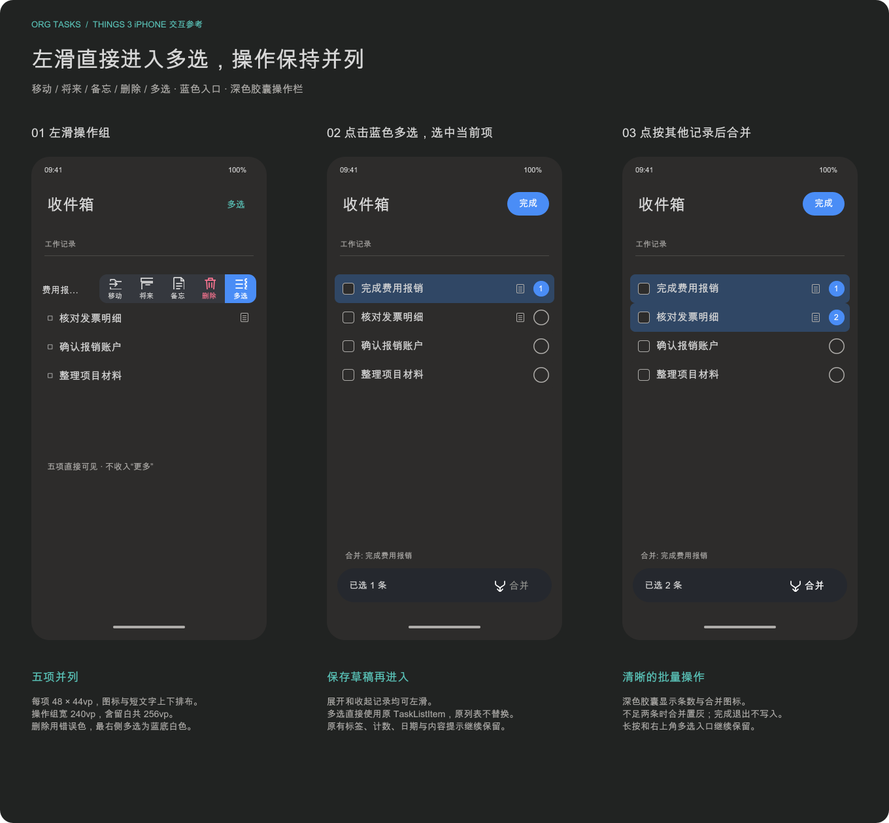。

抽屉顶部不提供搜索或关闭按钮，内容直接从主入口开始。收件箱、今天、计划、随时、某天、备忘、日志簿和存储库位于同一个 Scroll 中；设置固定在底部；选择功能、点击侧边栏空白或外部区域时收起。

文件用仓库 ID 与相对路径联合定位。相同文件名出现在两个存储库时，其笔记、原文、详情与新增任务目标保持隔离。文件列表不将“已读取”误称为“已同步”，也不捏造 core 尚未提供的修改时间或上传状态。

任务日期来自 Core 投影；本轮不按重复器展开后续发生日期。错误、加载中、无存储库、空文件和无匹配结果分别显示可解释的状态。

计划页面的分组边界以设备本地自然日计算：明天至第 7 天逐日生成标题；第 8 天至本月末使用“月份 日期–日期”标题；之后至今天加 180 天按月份生成标题；跨过该边界的任务按年份归组。计划任务同时有 SCHEDULED 与 DEADLINE 时使用较早日期，任务行保留 Core 返回的完整任务快照。

* 收件箱最近三天

收件箱在原有列表后接入最近三个自然日新增的记录。当前画板为 ~design/Orgzly界面细节.fig~ 中的“28 Harmony 收件箱最近三天”，见 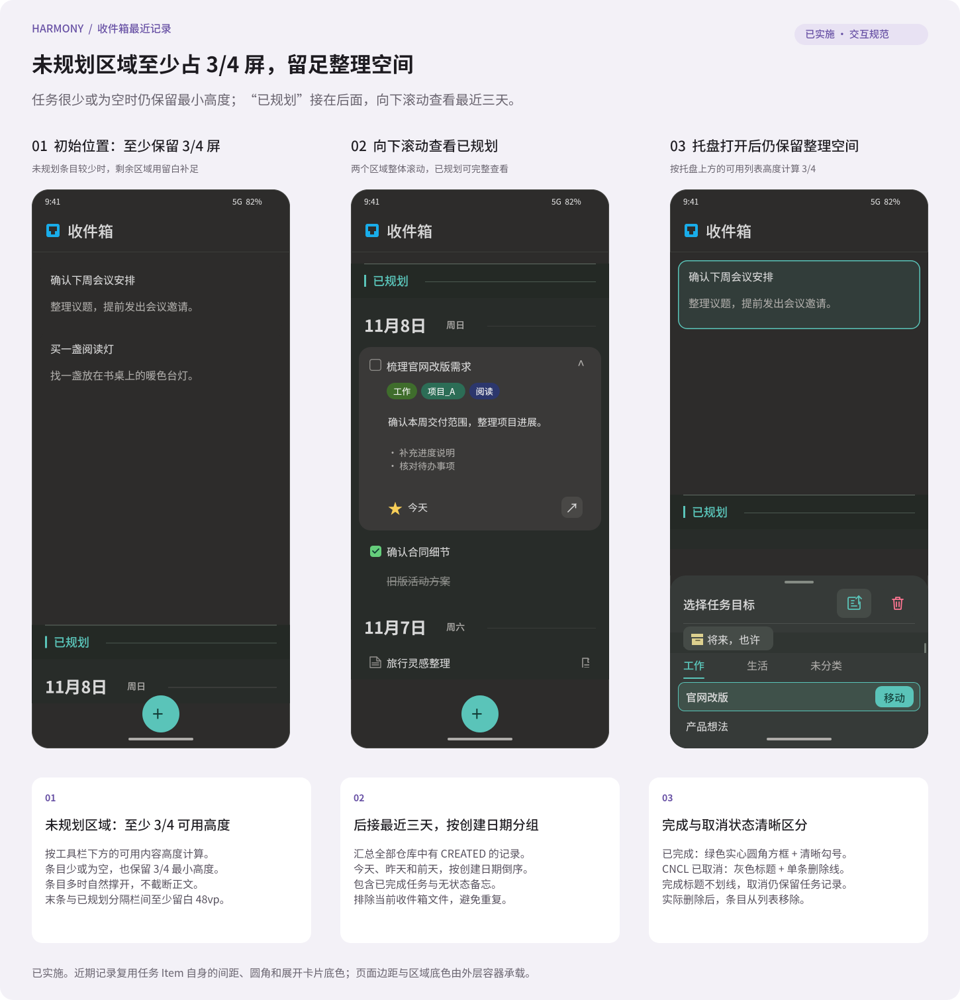 。

页面保留现有收件箱列表，在其后追加最近三天创建的任务与备忘。上方未规划区域使用最小高度约束，至少占工具栏下方可用列表高度的 3/4；即使没有条目或只有少量条目，也用留白补足，不让最近新增区域提前上移。条目较多时按完整内容自然撑开，不截断正文或建立独立滚动窗；末条记录与“最近新增”分隔栏之间至少留白 48vp，该留白计入未规划区域的高度。上方不增加“待规划”标题。分隔栏高 52vp，采用强调色“最近新增”文字、左侧短竖线和右侧横线，区域顶部补充边界线，下方整体使用略深的独立底色。分隔栏后留出 16vp 再进入日期分组，明确表达当前收件箱与最近新增是两个区域。全部内容位于同一个连续滚动列表中，不新增页签或区域折叠；底部中央“+”继续快速捕捉到当前收件箱，下拉同步刷新原列表和近期记录。

原列表使用当前选择的收件箱文件中的全部标题记录，保留无状态和已完成记录，不按创建时间过滤。同样复用 ~TaskListItem~ ，点击标题原地展开，右滑打开移动位置浮层。

后追加的记录查询全部已配置仓库中自身具有有效 ~CREATED~ 属性的任务与备忘，包括已完成任务和无 TODO 状态的备忘。当前收件箱文件按仓库 ID 与相对路径联合排除，避免与原列表重复；未配置收件箱时不根据同名文件推断排除对象。创建时间不从父标题继承，不使用移动时间、计划日期、截止日期或完成时间替代；无创建时间或值无效的记录不纳入。

最近三天按今天、昨天和前天三个本地自然日解释，通过现有 ~expression = "cr.ge.-2d cr.le.today .o.created"~ 查询。前天全天和今天全天都属于范围，不使用滚动 72 小时，也不增加独立创建时间范围参数；未来日期不纳入。只有日期时按本地当天 00:00 投影。追加记录按创建时间的本地日期分组，日期倒序，同一天以创建时间倒序作为展示输入，时间相同时保留稳定的仓库、文件与源位置顺序；项目任务再按下述规则组织为区块。

日期分隔参考计划界面的按日标题：较大日期文字、辅助星期和右侧细横线，例如“11月8日 周日”；跨年时补充年份。不显示没有匹配记录的空日期，也不按任务状态或是否为备忘再分组。日期标题只说明该组的创建日期，任务行自身的计划／截止日期仍按共享组件规则显示。

每个创建日期内，项目任务按 CATEGORY 与 Core 提供的项目名共同分组，使用与今天页一致的弱角标、深灰底、细描边和 12vp 圆角；单任务项目也显示区块，空项目名显示“未命名项目”。区块放在该项目第一条记录的位置，内部保持输入顺序；同名但分类不同的项目分别显示，不跨创建日期合并。普通任务和备忘直接排列；项目文件中的备忘、已完成及取消记录也进入对应项目区块。项目区块只组织展示，不增加点击或折叠行为，区块内保留任务自身日期与分类来源文字。

追加记录直接复用 ~TaskListItem~ ，其任务状态框、无状态笔记图标、标题计数、标签、正文提示、日期和原地展开效果沿用共享组件。最近新增任务行与计划页面一致：收起时在标题前显示计划与截止日期中的较早日期，标题下显示文件 CATEGORY，重复标志按任务数据展示；无日期或分类时不补占位。分组标题仍表示创建日期，因此任务行保留自身日期。最近新增区域的 20vp 左右边距与计划页面对齐，区域底色放在外层容器，不直接覆盖任务 Item 根节点的 padding 或背景；收起行与展开卡片自身的间距、圆角及卡片底色与计划页面一致。原收件箱条目保留 12vp 外层页面边距，直接复用同一任务 Item 的标题、正文、字号和行距。已完成图标使用共享任务项统一呈现：使用 18vp 透明背景的白色矢量勾号，保留透明底方框，完成标题保持正常文字，不加删除线。 ~Cancel~ 分类表示已取消（默认值为 ~CNCL~ ），标题使用灰色及单条删除线，与已完成状态区分，不显示白色完成勾号；该条目仍保留在 Org 文件中，满足创建时间范围时继续展示。普通已完成任务标题不划线。实际删除会移除 Org 记录，并从列表移除，不新增删除记录或删除历史。点击标题原地展开并保留详情入口，不打开原收件箱条目的目标托盘。示例同时包含未完成任务、已完成任务和无状态备忘，展开态也使用现有共享任务卡片。

原收件箱文件没有记录时仍保留未规划区域的 3/4 最小高度，区域内显示简短空态，最近新增分隔栏接在该区域后；没有近期记录时不追加分隔栏或日期标题；两部分都没有记录时沿用整页空态。普通移动、整理到备忘或删除后重新查询整个列表；保留的 ~CREATED~ 决定是否出现在追加记录中，超过窗口的旧记录不会因刚刚移动而重新进入。

页面显示期间每分钟刷新一次自然日窗口；详情返回、快速捕捉、移动、备忘整理、删除和同步完成后也重新查询，持续停留跨日时不保留过期日期。位置浮层不占用列表布局高度，未规划区域始终按完整列表可用高度计算最小高度。3/4 是滚动内容的最小布局高度，不是固定占据屏幕的分屏区域；向下滚动后最近新增记录可以使用整个列表视口。

Core 已补齐 ~CREATED~ 到 ~FilterTask.created~ 的属性投影，沿用现有 ~cr.*~ 自然日查询语法；当前收件箱的排除使用 ~OrgFileRef~ 数组，按 Core 仓库 ID 与路径精确匹配。宿主仅分组和展示，不解析 Org 或补做领域筛选。

* 收件箱目标托盘

当前位置选择已改为条目旁的浮层，由 ~InboxTargetPopup~ 承载。设计为“31 Harmony 收件箱左滑操作（当前实现）”，见  。本节标题保留作为已有文档链接锚点，旧底部托盘不再使用。

** 左滑操作与展开卡片

配置收件箱中的记录直接复用 ~TaskListItem~ ，字号 16vp，收起行高至少 44vp。原生 ~ListItem.swipeAction~ 在条目右侧显示“将来、备忘、删除、多选”四项并列操作，不收入“更多”。每项宽 48vp、高 44vp，使用 20vp 图标与 11vp 短标签；四项共 192vp，连同左右留白共 208vp。操作组采用深灰连体底色和 12vp 圆角，删除图标与文字使用错误色，最右侧“多选”采用蓝底白色，参考 Things 3 iPhone 的选择入口。将来与备忘仍保留原语义，短标签之外的辅助功能名称和长按提示保持完整。

展开卡片整体向左平移，原宽度、高度、正文和标签排版不变，右侧四项操作沿卡片垂直居中，不因内容变长而增高按钮。收回菜单不改变展开状态；纵向滚动继续交给外层列表。切换操作时先收回侧滑菜单，再打开浮层或确认对话框。移动、将来、备忘与删除均先等待当前原位编辑保存成功，再读取源任务最新快照，避免沿用列表重排前的旧文件版本；保存或读取失败不继续动作，原记录已移走或删除时不提交旧路径。打开移动浮层与删除确认后，继续使用本次取得的源快照和目标快照校验版本，不在提交失败后自动重试。点击蓝色“多选”先保存卡片草稿，成功后进入多选并选中当前记录，失败保留输入。

** 就近位置选择与确认

收件箱与某天页统一由共享任务卡片的右滑手势直接打开移动位置浮层，不露出工具栏、按钮或图标提示栏；收件箱左滑仍保留将来、备忘、删除、多选四项菜单。右滑后，在当前条目旁打开同一原生锚定浮层，默认位于条目下方；下方空间不足时由 ArkUI 自动调整到可用位置。源条目高亮，浮层不挤压原列表或改变未规划区域的 3/4 最小高度。浮层宽度最多 350vp，并随窄窗口收缩，标题为带青绿图标的“移动到”。标题栏不提供某天、备忘或删除入口。

REFILE 目标按所在文件 CATEGORY 分 Tab；Tab 栏固定高 40vp，标题与目标沿用任务 16vp 字号，目标行高 44vp，无额外行间距。高度按项目最多的 Tab 计算，最多显示四行，多余内容在浮层内滚动；切到目标更少的分类时高度保持一致。目标只显示最后一段标题，不显示仓库、文件、祖先路径或下一步箭头。

点击目标仅设置选择，以青绿描边和底色高亮，并在行尾出现 58vp × 32vp 的“移动”按钮；只有点击该按钮才写入。切换分类、源快照变化或目标失效时清除旧选择。点击浮层外或系统返回关闭，不执行移动。提交期间禁用分类、选择与关闭；失败保留浮层并展示错误及刷新重试入口，成功关闭并刷新列表。源记录刷新后不存在时关闭浮层。

目标来源为 Core 的 ~OrgWorkspace.query_refile_targets(&RefileTargetQuery)~ 。普通目标查询通过 ~excludedFiles~ 按 Core 仓库 ID 与相对路径排除配置的收件箱和某天文件，排除发生在读取 CATEGORY 前。CATEGORY 只组织展示，不再筛除目标；同名目标保留完整快照身份。点击确认后移动为目标的第一个直属子节点，保留目标自身内容与原有子节点顺序。

** 其余操作与写入边界

左滑的“将来，也许”复用某天配置文件的首个 REFILE，将源记录放在该节点下第一个子节点，根状态设置为 TODO，并清除根计划、截止和关闭信息。文件未配置、失效、被忽略或无 REFILE 时拒绝写入；目标不支持 TODO 时同样拒绝。

“转换为备忘”使用已配置的备忘文件，清除根任务状态、优先级和规划信息；“删除”先弹出确认对话框，取消不写入。所有移动保留正文、标签、创建时间和子条目，通过既有 ~OrgWorkspace.execute_task_operations~ 提交，不在 ArkTS 中解析 Org 或实现领域规则。版本过期、备份和 outbox 边界见 [[file:../core/接口文档.org::*统一任务操作组执行][统一任务操作组执行]] 。

* 共享标签筛选条

今天、随时、某天和备忘在标题下接入同一个 ~TaskTagFilter~ ，筛选条留在列表上方，列表滚动时保持可见。默认“全部”为灰底深色文字胶囊；未选标签为辅助色文字，选中标签用蓝底深色文字胶囊区分。标签区域横向滚动，长名称单行省略，辅助功能说明保留完整标签；“全部”和右侧“…”保持可见，至少保留 44vp 点击高度。

标签按扁平结构展示，不提供级联。标签候选来自本页完整任务快照的 ~tags~ 并集，去重后稳定排序，包含 Core 已投影的继承标签；不因当前筛选而缩减，也不解析 Org 或从名称猜测层级。点击标签切换多选，多个标签按并集匹配；再次点击取消，全部取消回到“全部”。点击“全部”清空所有条件。“…”菜单提供“无标签”，可以与已选标签取并集；选中后在条中显示可取消的“无标签”胶囊，菜单显示选中标记。

本控件是已明确要求的展示层过滤例外。保留 Core 返回的本页完整 ~tasks~ ，由 ~TaskTagFilterPresentation~ 生成可见记录；切换选择不请求 Core、不修改原始快照、不改变侧边栏计数。今天与随时先筛选可见任务，再按 CATEGORY 分区，空分类不占位；某天使用平铺的可见记录列表；备忘还消费文件头 TAGS 配置，按下文的互斥组规则筛选。计划、收件箱与日志簿不接入此控件。

没有匹配记录时保留筛选条，并显示恢复“全部”的入口；无任务时也不显示额外的来源或数量行。返回详情和下拉同步后保留当前页面仍有效的选择，刷新时移除已不存在的标签，条件为空时自动回到“全部”；不保存到 Preferences，不跨入口共享选择。文件未配置、读取失败与加载状态仍沿用原提示。

当前布局与交互维护于“24 Harmony 共享标签筛选”画板，见 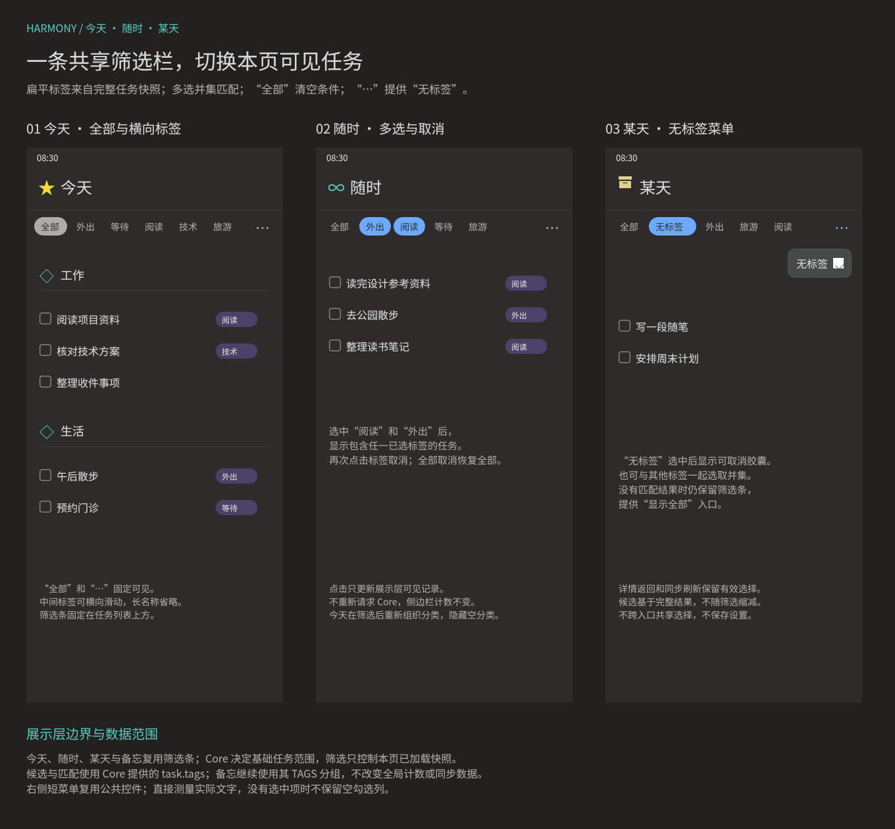 。

* 公共弹出操作菜单

短操作菜单统一由 ~PopupMenuButton~ 管理触发、原生 Popup、窗口宽度上限、关闭与焦点恢复，由 ~PopupMenu~ 管理实际菜单行的测量和排列；调用方只提供 ~PopupMenuItem~ 列表及触发图标，不再各自计算文字宽度。替换原 ~CompactMenuButton~ 后，以下入口共用同一实现。

| 入口 | 调用方 | 内容 |
|-
| 今天、随时、某天、备忘顶部标签筛选 | ~TaskTagFilter~ | “无标签”与勾选标记。 |
| 各页面展开任务卡片的“更多” | ~TaskListItem~ | 带图标的“重复…”。 |
| 文件阅读工具栏 | ~AppShell~ 、 ~FileDetail~ | 展开全部章节、收起全部章节。 |
| 冲突处理工具栏 | ~AppShell~ 、 ~ConflictFile~ | 危险操作与文档章节操作。 |

菜单直接测量原生文字节点，并先为图标、可见勾选列和内边距预留空间；所有菜单行使用最长一行的实际宽度，边框在外层单独计入。文字靠左，勾选列靠右；没有选中项时不预留空勾选列，菜单随文字收紧；存在选中项时，各行统一保留勾选列以保持对齐。字体、字号缩放或内容变化时由布局重新测量，完整单行显示短文字；到达窗口宽减 32vp 的上限后，长文字完整换行，行高自然增大，图标和勾选不会被挤掉。最小行高 44vp，透明原生按钮覆盖整行，统一触摸、键盘焦点与无障碍名称。

原生 Popup 保持右侧对齐触发按钮、优先向下与自动避让；点击外部或系统返回关闭，选择先关闭再执行动作。每个入口使用独立焦点 ID，卸载后取消迟到的打开请求，不将焦点移到其他菜单入口。

项目中的其他弹出入口已按用途核对：收件箱移动目标是带分类 Tab 的位置选择列表；日期、标签和重复规则是表单弹窗；地图与目录使用底部面板；设置和清单顺序使用系统 ActionSheet，重复单位使用系统 Select。它们保留各自的容器与业务交互，短操作菜单的宽度和排版只由公共控件维护。当前样例维护于“55 Harmony 公共弹出菜单（当前实现）”画板，见 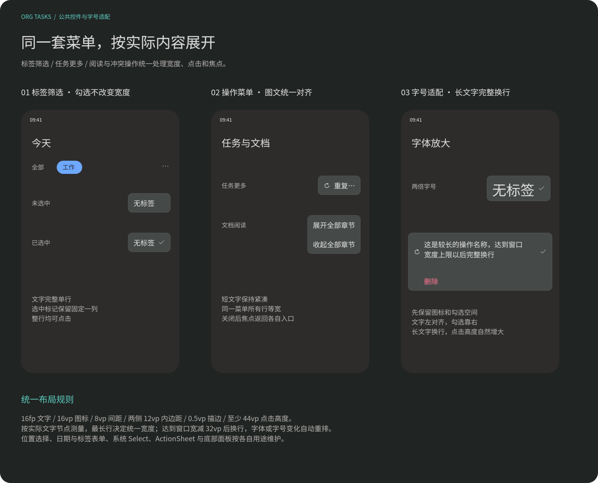 。

* 日志簿时间线

日志簿保持单次 ~it.done~ 查询与 ~includeDone=true~ ，由 Core 根据 ~TaskState.category~ 判断，只包含 ~Done~ 与 ~Cancel~ 分类任务，不按状态名字判断，也不纳入未完成任务的创建事件。侧边栏和顶部统计按任务数计数，同一任务的两个事件不重复计数。

~LogbookTaskList~ 按时间倒序展示，最近七个自然日按日分组，过去 180 天内更早事件按月分组，再早按年分组；只显示有事件的分组。日标题沿用计划页的 25fp 日期、14fp 辅助文字和 48vp 高度，月／年标题沿用分隔线及 15fp 标题；事件之间保留 8vp 间隔。日内显示时刻，月／年组中的事件补充月日。当前标题、状态和内容来自最新任务快照，不伪造历史正文。

创建事件使用 ~createdAt~ ，缺失时不补造；关闭事件使用 ~closedAt~ ，根据分类标为“完成”或“取消”。没有关闭时间的终态任务放到末尾“时间未记录”分组，不以创建、修改或文件时间补齐。真实时间由 Core 的 Org 语法树投影，宿主只负责时间分组和文案。

点击事件内任务使用共享 ~TaskListItem~ 原位展开，传入 ~readOnly=true~ 与事件独立的 ~instanceKey~ ，同一任务的创建和关闭事件不会共享展开身份。展开显示完整标题、只读正文与清单、日志、标签、计划／截止与重复摘要；标题可再次点击收起，外部点击或系统返回沿用共享会话收起。只读模式不创建文字输入、清单勾选／排序／增删、属性编辑或更多菜单，状态按钮不可修改；写入入口另设只读防护。整个日志簿关闭左右滑动，下拉同步仍可刷新。

当前画板为“56 Harmony 日志簿事件时间线（当前实现）”，见 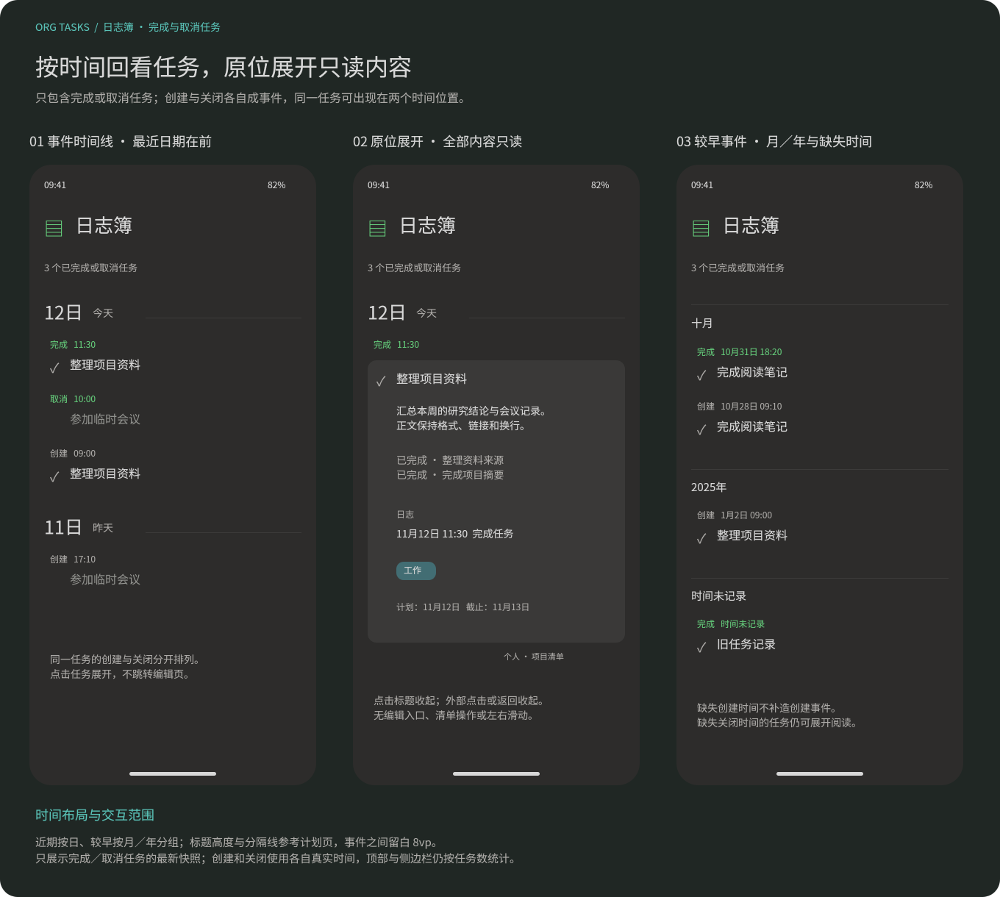 。

* 共享任务项与折叠态配置

今天、计划、随时与某天统一使用 ~TaskListItem~ 。折叠行前部日期由 ~dateDisplay: TaskDateDisplay~ 策略控制，默认 ~None~ ；分类由 ~showCategory~ 开关控制，不增加页面模式、日期文字或分类文字参数。四种日期策略如下。

| 策略 | 日期来源 |
|-
| ~Creation~ | Core 的 ~task.createdAt~ ，按设备本地日期展示。 |
| ~Schedule~ | Core 的 ~task.scheduled~ 。 |
| ~Deadline~ | Core 的 ~task.deadline~ 。 |
| ~None~ | 不显示前部日期，也不预留日期宽度。 |

所选字段缺失或无效时隐藏，不回退到其他日期。文字、显示条件与行宽预算使用同一策略。计划页按日分组使用 ~None~ ，区间、月和年分组由调用方选择有效计划／截止日期中较早者对应的策略；收件箱最近新增使用 ~Creation~ 。今天、随时、某天与日志簿默认不显示前部日期，日志簿的事件时间由时间线单独呈现。CATEGORY 来自 Core 的只读 ~task.category~ ，今天继续按该字段分区，计划不逐文件补查分类。策略与分类开关均不作为用户设置或持久化配置。日期策略示例维护于“57 Harmony 任务日期显示策略（当前实现）”画板，见 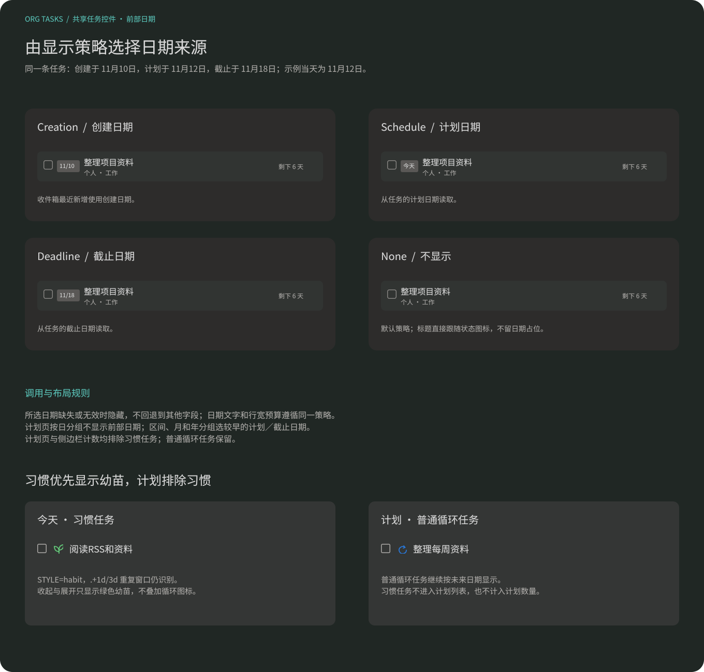 。

折叠态沿用统一的 18vp 状态框／笔记图标、标题字号、标题计数、标签与正文／列表提示；列表正文只显示列表标志，列表之外存在可读文字时追加正文标志。分类非空且开启时在标题下增加一行辅助文字。标题前的任务类型标记优先采用 Core 的 ~isHabit~ ：习惯任务显示绿色幼苗图标，不显示循环图标；其他重复任务根据 ~isRepeating~ 显示蓝色循环箭头，去掉圆底与时钟。两种图标互斥，沿用同一 20vp 位置，不在尾部重复显示；普通任务不占位。习惯标志来自当前标题自身的 ~STYLE=habit~ ，不继承、不要求重复器；展开后的重复规则文字继续显示，习惯任务的规则行隐藏循环图标。重复语义识别当前标题 SCHEDULED／DEADLINE 中符合 Org-mode 的 ~+Nunit~ 、 ~++Nunit~ 、 ~.+Nunit~ 及可选 ~/N~ 或 ~/Nunit~ 重复器，不从正文或子任务推断，也不展开未来发生日期。任务正文不重复显示标题开头的规划行。

点击标题及其空白区域原地展开，已支持的标题链接继续打开系统应用。计划与其他入口共用展开状态、动画、正文测量、完整标题、计数、标签、计划／截止日期和详情按钮；展开时不再显示折叠态的前部日期和分类。点击展开标题或收起图标恢复折叠。展开内容按实际高度撑开任务项，长正文随外层列表整体纵向滚动；从正文区域拖动也能滚动整列。卡片内不建立独立纵向滚动区，嵌入阅读内容将纵向手势交给外层列表，收起动画只裁切显示高度。共享任务展开卡片的详情入口沿用设计稿中的右上箭头图案：32vp 深灰圆角底、20vp 浅灰箭头，外层保留 44vp 点击区域；点击进入任务详情。

截止信息固定在折叠行右侧。按设备当前本地自然日计算：未来显示“剩下 N 天”，图标与文字均为灰色；当天显示“今天截止”，逾期显示“逾期 N 天”，两者使用截止强调色。已完成任务和无效日期使用中性色。展开态保留完整截止日期，图标与文字复用同一颜色规则；不因任务存在 DEADLINE 就一律标红。日期文字更新后重新测量右侧宽度，前部日期与重复标志一并计入宽度预算。

当前两态与日期颜色示例维护于“23 Harmony 共享任务项与日期状态”画板，见 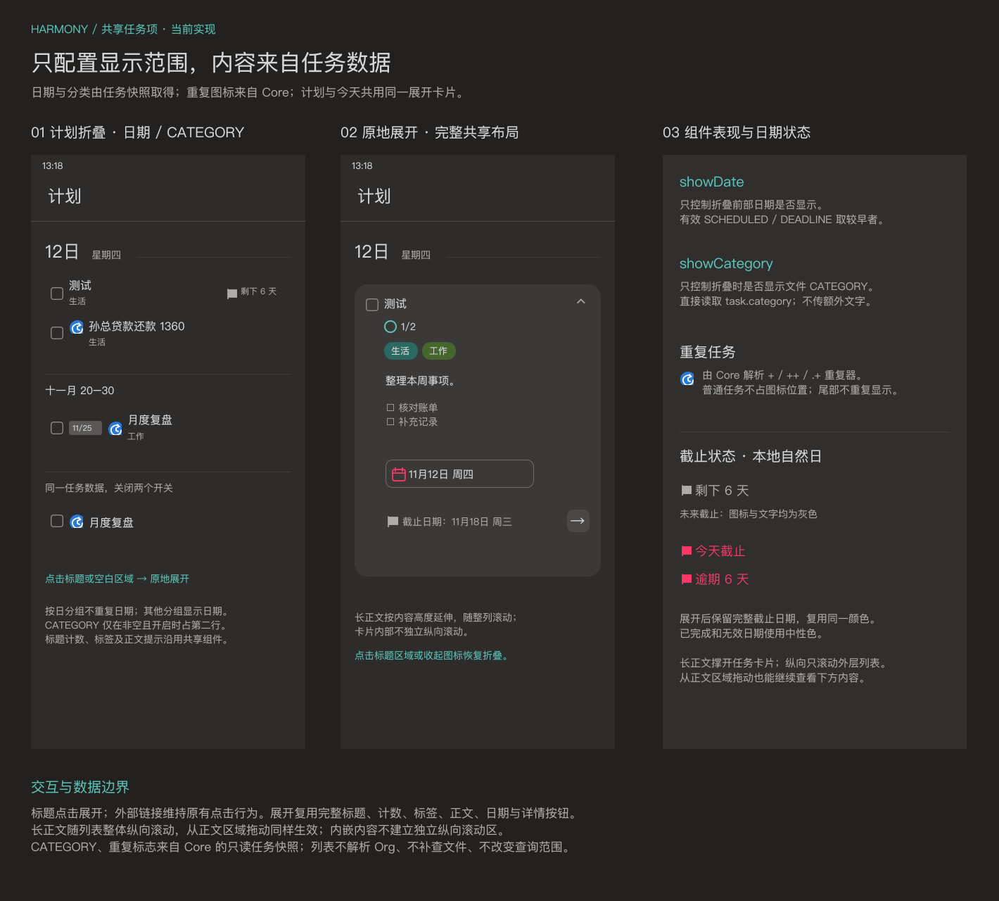 。

* 备忘卡片列表

备忘列表在标题下方接入共享 ~TaskTagFilter~ ，固定在滚动内容上方；支持“全部”、再次点击取消及“无标签”。候选合并本页完整任务快照的有效标签和所选备忘文件元信息的 ~tagOptions~ ，来自文件头 ~#+TAGS:~ 的未使用候选同样保留。花括号声明的互斥组由 Core 通过 ~tagGroups~ 提供，界面按声明顺序区分各组；每组最多选一项，同组切换替换原选择，不同组取交集，未分组标签按并集匹配。“无标签”可与已有条件取并集；没有匹配时显示可恢复“全部”的空态。配置中的快捷键不作为标签文字， ~SVR~ 这样没有快捷键的标签正常显示。配置只定义候选，不给记录赋标签；实际匹配仍使用条目已有的有效标签。

刷新或编辑返回后保留仍有效的选择，配置组变化时按当前互斥约束整理选择；筛选不重发查询、不改变修改时间排序或全局计数。通知区域仍位于滚动列表顶部，与首条记录保留 12vp 间距；标签筛选条不替代通知区域。

备忘列表使用独立的固定两行卡片，不复用 ~TaskListItem~ 或任务状态布局。有通知时，由备忘页面在通知列表项底部保留 12vp 间距，再显示首条备忘，与卡片之间的间距一致；不修改共享通知控件或其他页面。页面头部只保留工具栏标题，不显示备忘总数；卡片没有展开箭头、展开正文或详情按钮，不显示图片缩略图。第一行以主应用强调色 ~#5AC4B9~ 竖线标记标题，单行溢出截断；点击卡片任意位置直接进入“备忘编辑”，包括标题中的链接文字。

第二行按“修改日期（缺失时用创建日期） · 标签 · 正文第一行”的顺序组成单行摘要，使用辅助文字色并在溢出时截断。两个日期均缺失时不显示日期，标签为空时省略标签；标签使用 Core 返回的有效标签，显示为 ~#标签~ 。正文通过 Core 的 ~FilterTask.body_first_line()~ 提供首个非空段落的第一行，跳过头部空行、规划、属性与 drawer，不包含子标题正文；行内 Org 样式与链接由 Core 转为可读文字，宿主不解析 Org，也不以完整正文代替摘要。无摘要时第二行保留空白，不伪造正文占位。

备忘查询在具体文件范围后增加 ~.o.modified~ ，由 Core 按最后修改时间倒序排列，缺失修改时间的记录统一置末，不用创建时间补排序；时间相同时保留文件中的顺序。任务修改时间只使用 Core 接口返回的标题自身 ~LAST_MODIFIED~ 属性值，缺失时为 ~null~ ，不读取文件 mtime。日期回退只影响展示。

左滑卡片只显示一个 44vp 圆形删除图标按钮，垂直居中；点击后确认删除该备忘及其子记录，通过既有 ~NoteService.remove~ 和 Core 操作组执行。保存期间禁用重复删除、卡片跳转、新增与下拉同步；成功后重新查询，失败用 toast 提示并保留记录，不在宿主乐观删除或解析文件。

新增备忘使用底部中央悬浮“+”，与收件箱一致：按钮直径 56vp、距底部 24vp，使用强调色背景、28vp 图标与阴影，无障碍名称为“新增备忘”；点击打开已有新建备忘编辑页。工具栏不再提供新增按钮，抽屉展开时隐藏悬浮按钮；列表末尾保留 104vp 滚动留白，末条卡片可滚动到按钮上方。

备忘卡片只消费 Core 查询快照，不在展示层重新查询或排序；仅共享标签筛选条按明确例外控制本页记录可见性。返回编辑页及下拉同步后的刷新沿用现有入口。列表样式与左滑删除维护于“25 Harmony 备忘卡片列表”，编辑页维护于“18 Harmony 任务与备忘编辑”画板，见 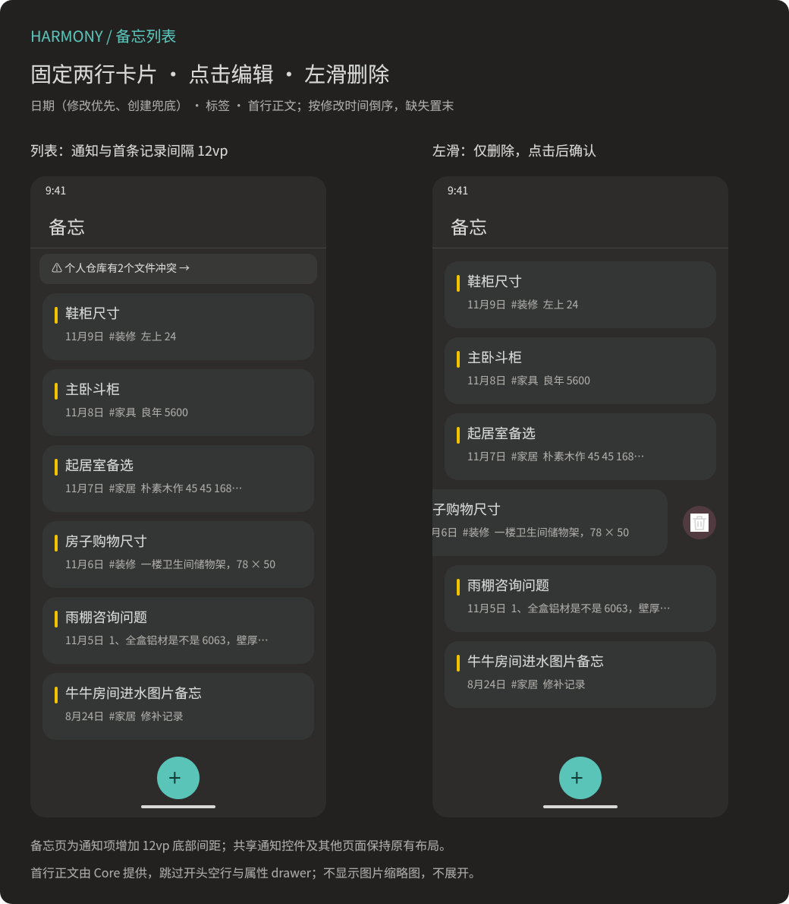 。

* 配置与操作反馈

存储库表单仅修改当前存储库；全局设置维护收件箱文件、某天文件、备忘文件、TODO 默认流程、日历名称和后台间隔。保存时重新读取其他配置，避免返回旧页面后覆盖新设置。后台间隔最小为 20 分钟；保存后由 ~BackgroundSyncService~ 更新同一系统作业；实际执行时间仍受 WorkScheduler 调度约束。

WebDAV 密码由 ~CredentialService~ 保存到 Asset Store。已有待上传意图和条件上传规则沿用 Core；任务通过收件箱快速捕捉创建，备忘通过独立编辑页新增。

手动下拉只执行文件同步，不写入系统日历。后台作业使用已保存的日历名称，按现有流程先读取本地文件或同步 WebDAV，再写入日历。

合并以远端文件为基准，接受对应本地版本，丢弃对应远端版本。Core 使用最近成功同步日志的完整文件快照识别本地变更，再与当前远端比较；只有远端变化的任务直接保留。任务优先按 Org ID 对应，没有 ID 时按标题层级对应；改名与重名不由 UI 猜测。所有任务及历史状态均由 Core 提供。

当前冲突按原路径独立处理，远端备份与解决结果归属于该次日志目录，详见本文“同步日志展开与备份阅读”。旧的整作业合并页面、路由与网络比较接口已移除。

笔记本详情显示 TODO 状态来自本文件还是全局默认，以及有效状态名称。列表根据 Rust 投影的类型区分完成与未完成颜色，支持 DONE 之外的完成状态。新增任务读取目标收集箱的有效初始状态，切换存储库后重新读取，避免异步结果覆盖较新的选择。

设置中的 TODO 编辑器使用多行 Org 声明，默认值从 Rust 获取。文件内 TODO/SEQ_TODO/TYP_TODO 整组覆盖全局默认，空声明可以清空识别。当前提供配置与元信息，不新增现有任务的状态切换或日志写入入口。

* 冲突任务比较与交互

独立解决页在完整文件中预览逐项取舍，Core 记录临时操作，结束后由应用通过统一数据接口提交。当前交互详见本文“文件预览与逐点合并”。

* 布局变更维护

调整布局、入口位置或交互范围时，必须同时修改 ArkUI 实现、 [[file:../../design/Orgzly界面细节.fig][.fig 设计画板]] 和本文；手机用户可见功能同步更新 [[file:../手机应用功能清单.org][手机应用功能清单]] 。当前存储库布局在“27 Harmony 存储库紧凑分区（02 列表、03 空态与配置标签）”维护；侧边栏在“09 Harmony 顶部任务入口”与“15 Harmony 下拉同步与底部设置”维护。

所有任务过滤条件只在 Core 中求值；收件箱页使用文件表达式并包含完成与组合任务。侧边栏不再发起分类导航查询。

* 顶部入口视觉与查询契约

顶部按参考图依次显示收件箱（蓝色收件箱图标）、今天（黄色星形）、计划（粉色日历）、随时（青色层叠）、某天（米色归档盒）、备忘（主色备忘纸），留出间隔后显示日志簿（绿色记录本）。存储库使用青绿色立方体图标，设置使用紫色齿轮图标，与侧边栏其他彩色入口统一风格。侧边栏所有入口、分类、计数与分组文字统一 16vp，主行高 44vp，图标 22vp，选中行使用 12vp 圆角。深色背景为 ~#2D2C2B~ ，选中背景为 ~#3A3E3F~ ；其余页面也统一采用上述深色配色。侧边栏只保留固定任务入口、存储库和设置。

| 入口 | UI 组装的 Core 查询 | 显示含义 |
|-
| 今天 | ~(s.le.today or d.le.today)~ ， ~includeDone=false~ | 计划或截止任一实际日期已到、已过期或进入 Org-mode 预警期即命中；deadline 仍按实际日期展示。 |
| 今天红色徽标 | ~(s.le.yesterday or d.le.yesterday)~ ， ~includeDone=false~ | 仅显示过期数量；旁边灰色数字为今天的总数，徽标零时隐藏。 |
| 计划 | ~(s.ge.tomorrow d.ge.tomorrow) or (s.ge.tomorrow d.none) or (s.none d.ge.tomorrow)~ ， ~includeDone=false~ | 有日期且最早的计划/截止日期从明天开始；与今天不重叠。 |
| 随时 | ~it.todo s.none d.none~ ， ~includeDone=false~ | 仅有效待办状态，计划日期和截止日期均为空；按 CATEGORY 分区。 |
| 某天 | 配置文件的 ~b."相对路径" it.todo~ ， ~includeDone=false~ | 只展示所选仓库 ~somedayFile~ 文件中具有有效待办状态的任务，不包含普通标题与已完成任务；侧边栏计数使用相同查询。 |
| 备忘 | 配置文件的 ~b."相对路径"~ ， ~includeDone=true~ | 展示 ~memoFile~ 文件中的全部标题记录，包含无 TODO 与已完成记录。 |
| 日志簿 | ~it.done~ ， ~includeDone=true~ | 按文件有效状态定义展示完成任务，包括 ~Cancel~ 分类的取消任务。 |

以上入口当前均设置 ~includeComposeTasks=true~ ，保留原文件的组合标题；查询由 Core 求值，UI 不对返回任务做日期、状态或文件过滤。任务同时具有两个日期时按较早日期归入今天或计划，禁止先查后由 UI 去重。日期以运行设备的本地自然日为准。

收件箱、某天和备忘文件均在“设置 → 笔记与笔记本 → 文件入口”通过应用内 ~FileTargetPicker~ 选择，按仓库分区展示 Core 返回的文件元信息并过滤 ~is_ignore=true~ 文件。选择时保存具体仓库 ID 与相对路径，行尾显示已选状态，底部支持清除选择；不使用系统文件选择器或自由路径输入。未选择、仓库或文件失效、文件被忽略时提示重新选择，可跳转设置；已选文件没有记录时显示空列表，不伪造文件，也不把空目标作为全局查询。查询和计数只包含所选仓库的文件。画板见 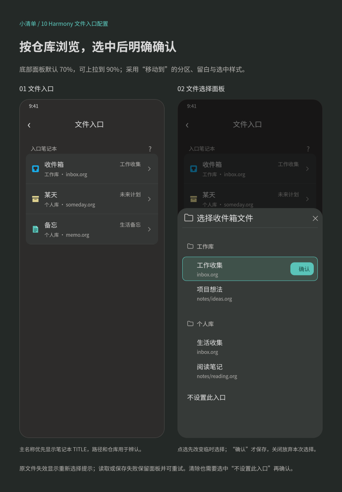 。

最新顶部设计见 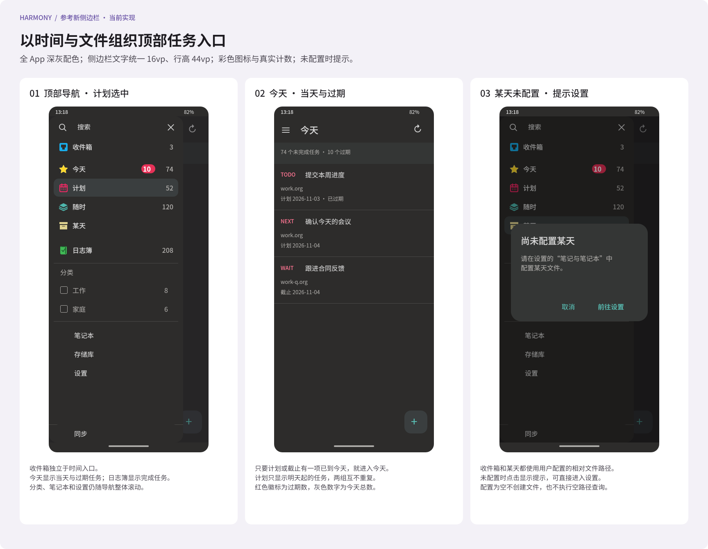 ，配置与提示见  。

* 任务列表共享布局

今天与随时共用 ~TodayTaskList~ 分类列表组件；收件箱、计划和某天直接复用同一任务项展示控件。今天不复用旧的 ~TaskRow~ 。顶部标题带黄色星形图标，今天、计划、随时和某天不显示列表上方的任务数量条。任务按所属文件的 ~CATEGORY~ 分区，同名分类跨文件、跨存储库合并；具名分类按名称排序，无分类记录放在末尾的“未分类”区块。只为实际返回的任务建立区块，不显示空分类；没有无分类记录时不显示“未分类”。显式命名为“未分类”的分类与缺少分类的记录仍保持独立身份。

区块标题使用青绿色立方体图标、18vp 文字、至少 44vp 行高，全部区块在同一个列表内滚动。今天、计划、随时和某天的列表项均使用通用 ~TaskListItem~ ，有 TODO 状态时显示完成状态框，待办任务可点击完成，无任务状态时显示同尺寸的笔记图标；收起时单行展示标题、彩色标签、提示标志、持续天数与最右侧截止日期。点击标题原地展开，直接编辑标题、备注、日期、标签和检查清单；独立任务编辑页继续用于已有外部跳转和日志阅读。收件箱同样复用 ~TaskListItem~ ，通过右滑打开移动位置浮层，左滑菜单执行某天、备忘、删除或多选。支持下拉同步与侧边栏导航。

UI 仍提交今天的通用查询，由 Core 负责日期、完成状态等全部筛选。 ~TodayPresentation~ 仅通过 ~Repo.file(path).category()~ 取得 Core 已解析的分类元信息，并组织查询结果的展示区块，保留每一条任务及其来源身份，不重新筛选任务、不解析 Org 源文。持续天数仅从有效计划日期计算，与设备本地当天的自然日求差；未设置有效计划日期、当天和未来日期均隐藏，即使存在截止日期也不显示。计算使用 UTC 日序号，避免跨夏令时产生少一天或多一天，不展开重复器。页面每次查询成功及用户切换任务项状态时更新展示日期。

** 任务列表项两态展示

今天页的收起行与展开卡片右滑超过 48vp 后直接切换进行中状态，不显示操作菜单：当前为 ~Doing~ 时切回 Core 提供的第一个 ~Todo~ 状态，其他未完成任务切到第一个 ~Doing~ 状态。状态值使用文件有效配置，不硬编码 TODO 或 DOING；无状态记录、已完成或取消记录、缺少目标状态时不提交。操作先保存已有草稿，再校验最新快照的状态与目标配置；保存失败或状态已变化时不继续切换，提交期间禁用重复操作，版本冲突不覆盖。成功后保留原展开状态，并通过既有快照刷新显示或移除透明黄色底。文字输入和清单触摸／拖动期间不触发整卡切换；清单条目左滑仍为删除。该状态手势只在今天页启用；今天页左滑不切换状态，也不打开计划日期。随时、计划和收件箱最近新增右滑分配计划时间；收件箱主列表与某天页右滑移动。各页面的收起行与展开卡片遵循相同策略。

无任务状态记录使用独立笔记图标，外框为 18vp，图形减少内部留白，视觉尺寸与完成状态框一致；收起与展开状态使用相同资源，标题起点保持对齐。正文提示标志继续使用原有文档图标。

任务行提取为通用 ~TaskListItem~ ，支持收起与原地展开。收起状态整行不换行：完成状态框、标题、彩色标签、正文／列表／循环等提示标志、非当天的持续天数在可用宽度内紧凑排布。标题与标签列表均可压缩并用省略号截断；标签过多时显示首个标签与“…”胶囊，单个标签过长同样省略；标志过多时合并为省略号，不挤出整行。优先为标题保留阅读空间，根据余宽分配标签和标志区域。完成状态、标题、标签、标志、持续天数与截止日期均以任务行的垂直中线对齐；标题在至少 44vp 高的点击区域内垂直居中。标签宽度由文字与左右内边距决定，只设置最大宽度，短标签不拉伸填满预留区域。

收起状态若有 ~DEADLINE~ ，粉色旗帜与紧凑日期始终固定在最右侧，不受标题或标签长度影响；当天显示“今天”，其他日期显示“11/10”等紧凑格式。日期区域由图标、间距与实际文字宽度自适应撑开，文字右边缘与任务行内容右边缘对齐，不设置固定宽度或在文字右侧保留空白。按日期区域的实际测量宽度预留空间，再分配其余宽度；没有截止日期时释放该区域。持续天数采用中性文字，收起时以“3天”并入同一行，非当天显示，当天隐藏；计算口径沿用上文的仅使用有效计划日期规则，今天查询与抽屉过期徽标的既有语义保持不变。

展开卡片采用 Things 的内容层次：任务状态与完整标题同排，不设置收起按钮；标题下显示备注、检查清单、已有标签，内容和长标签换行。底部左侧为计划日期，右侧依次为标签、清单、截止入口；未设置日期时保留图标。计划为今天显示黄色星形，其余显示日历与日期；截止使用旗帜，今天及过期沿用截止颜色。来源在卡片外右侧显示。

点击标题或备注直接输入，文字失焦保存；清单文字同样失焦保存。点击卡片外或系统返回可收起，输入时返回先结束输入，右上角“完成”结束输入并保留展开态。操作完成即执行修改，收起不是另一次保存动作。窗口只保留一个展开会话，切换前保存，失败保留原输入和错误，重新载入需确认放弃未保存输入；正文、清单与其他元数据不在 ArkTS 重建。编辑期间推迟列表数据重查，防止任务快照键变更销毁输入。

展开卡片不禁用下拉同步。列表到达顶部后继续下拉，松手触发时先等待当前文字与清单保存，成功后收起卡片，再启动共享同步会话；保存失败保留卡片、草稿和错误，不启动同步。保存期间的连续下拉不重复执行，等待结束后重新检查页面可见性、忙碌状态与同步状态，避免在已经离开的页面发起操作。

阅读和编辑复用同一套自然高度卡片布局，聚焦仅显示输入光标，不改变标题、备注、清单和属性入口的内边距、间距或相对位置，不再通过固定内容高度填充留白。键盘展开后由外层列表避让与滚动，长卡片可滚动访问属性入口；访问日期或标签前使文字失焦保存并结束输入。标题、备注使用无背景输入区，长内容随可用宽度换行。旧独立任务编辑页保留原入口，不恢复列表底部详情按钮。

“重复…”与顶部标签筛选的“无标签”使用上文的公共弹出操作菜单，在窗口允许时完整单行显示，字号缩放后直接重测实际文字节点。

** 日期浮层

日历或旗帜分别打开计划、截止浮层；今天、明天位于顶部并显示实际日期，中央显示月份导航与周一至周日七列、固定六行的月历。今天描边、已选日期实心，计划为青绿、截止为粉色；切换月份支持跨年，浏览不提交修改。已有日期时定位选中月份并提供清除入口；无日期时定位当前月。点日期立即修改并关闭，清除只影响对应规划字段，另一日期保留。关闭或点击遮罩不修改。

随时、计划和收件箱最近新增的任务右滑直接打开计划浮层，无需展开；日志簿关闭左右滑动；取消不修改，选择后更新当前任务快照，保留原展开状态。计划和截止修改只改变自然日，保留原时刻、重复器与预警。

** 标签窗口

已有标签在备注与检查清单下完整展示。点击标签或底部图标打开窗口；保持原 90% 宽度、最大 360vp、16vp 内边距、20vp 圆角及最大 360vp 的内部滚动高度。内容改为换行胶囊：上方显示当前已选与继承标签，下方“全部标签”按 Core 的 ~Task.supportTags.groups~ 分块排列，以细线分隔，未分组标签独立成块。已选胶囊使用绿色深底与强调色文字；继承标签标记“继承”，只能在来源标题修改。长名称换行。点选添加、再次点选移除，每次立即修改且窗口保持打开；选择互斥组的另一项替换本组自身标签，其他组与普通标签保留；已有继承项时阻止在子任务选择另一同组项，并提示到父标题修改。右上勾只关闭窗口。新建窗口输入名称后点勾创建并赋给当前任务，空名称不可提交，取消不创建。候选只来自任务自己的可空配置及已有标签，不混入其他文件已使用标签；无配置时仍能查看已有标签与新建。窗口不提供下拉搜索、分组管理或批量任务操作。

** 检查清单

底部清单图标添加首个条目，已有清单下方可连续添加；条目文字原位编辑并失焦保存，键盘“下一项”保持键盘与编辑状态并进入下一输入行，空白输入不生成条目。新增或切换条目时仅在输入控件挂载、完成布局并可见后聚焦；结束输入或组件离开时取消过期请求，聚焦失败保留输入而不退出应用。键盘收起不直接销毁待输入的空行，由显式结束输入清理空草稿。点击状态圆圈立即完成或恢复，完成文字变灰并带删除线，条目位置不变，不改变任务 TODO 状态。左滑单条露出红色删除入口，点按后立即移除，其他条目上移，不弹确认；删除最后一条隐藏清单区域，底部添加入口保留。支持下述手柄排序，不提供多选操作。

混合普通项目的复杂列表继续完整保留在备注中；独立 checkbox 列表由 Core 投影，嵌套条目保留深度，删除父条目会删除其嵌套内容。LOGBOOK 和其他 drawer 不进入备注编辑，原独立详情页可继续阅读日志。

完成状态切换、增加与删除条目时，Core 在同一事务内更新标题中已有的执行进度，例如 ~[0/2]~ 随勾选更新为 ~[1/2]~ ，不改变 TODO 状态。卡片订阅 ~coreDataChanges~ ，收到事件后串行重查 Core 快照并更新标题计数、条目位置与文件版本。每次修改提交成功后先失效提交前的共享查询缓存，再在本次写入队列中读取任务与通知的新快照，下一次修改等待读取完成，避免事件延迟时沿用旧版本或旧条目 ID；提交前排队的卡片刷新不再回写旧快照。写入成功但重读失败时保留已提交状态并暂停后续写入，待事件重读或手动重新载入成功后恢复，不重复提交已保存的修改。未编辑的标题草稿随新进度更新，正在输入的标题与备注保留。无 TODO 标题通过 Core 逻辑身份取得新路径，该身份已区分同名记录，避免进度变化导致旧完整标题路径失效。外层列表仍在编辑会话结束后消费待处理的数据事件。

*** 检查清单排序

采用 Things 3 的行尾常显三横线手柄，长按后上下拖动，松手保存顺序；圆圈勾选、文字编辑与左滑删除沿用现有分工。同一 Org 列表内只调整同级顺序，父项携带嵌套内容移动；编辑与保存期间暂停拖动，失败恢复可靠顺序，版本变化不自动覆盖。Core、bridge 与共享卡片已接入，失败时恢复可靠顺序；已提交但重读失败时停用旧快照写入。

参考依据、三态界面、手势参数、结构保真、接口与验收范围见 [[file:检查清单排序交互方案.org][检查清单排序交互方案]] ；图谱当前 Harmony 页的“49 Harmony 检查清单排序（当前实现）”画板记录当前排序交互，41、42 号画板保留完成状态与删除的专项说明。

* 全 App 深色配色

启动背景、系统状态栏、底部导航栏和 ArkUI 页面采用统一深灰背景与浅色内容。应用通过 ~ApplicationContext.setColorMode(COLOR_MODE_DARK)~ 固定为深色，让系统选择菜单、日期选择器与确认弹窗也采用深色，不受手机当前浅色模式影响。

列表、卡片、输入框、任务详情、设置、存储库和同步反馈都从 ~UiColor~ 获取语义颜色；旧浅色图标描边改为浅灰，输入文字与 placeholder 显式提供深色主题颜色。主色按钮采用青绿色背景配深色文字 ~#123D37~ ，避免白字在亮色背景上对比不足。红色过期徽标保留白字以区别于普通计数。当前为统一固定配色，不新增主题切换设置。

侧边栏紧凑布局尺寸统一维护于 ~UiSize~ ：文字 16vp、导航行高 44vp、图标 22vp。七个主入口、普通导航和计数使用同一字号；通过字重与颜色区分层级，不再混用标题大小。收件箱后与日志簿前间隔分别为 6vp、12vp，分隔线外边距 4vp，分类行纵向内边距 8vp；勾选与关闭符号作为图标独立处理。整体内容仍在一个 Scroll 中，空间不足时滚动，底部设置固定。

备忘入口紧接某天下方，显示配置文件中的记录总数；记录仅来自所选仓库中的所选文件。未配置或文件失效时提示重新选择，不创建或修改文件。备忘是查看记录的入口，不显示写入收件箱的“新增任务”按钮，避免误认新增任务会写入备忘文件。

* 下拉同步与入口收拢

独立文件同步页面与 ~pages/Index~ 路由已移除。各列表页面通过共享 ~RepositorySyncView~ 内的 ~Refresh~ 接受下拉手势，调用 ~RepositorySyncService.start~ 执行前台文件同步；空任务列表和读取错误状态也可下拉。Refresh 使用空自定义指示器，避免同时出现圆形加载器；触发距离 64vp，下拉阻尼比例 0.4；松手后内容复位，同步状态由共享进度线承载。列表先处理滚动，到顶部后将下拉交给 Refresh，避免叠加回弹。侧边栏没有同步入口，设置固定在原底部操作位置。

~RepositorySyncBanner~ 只在同步期间显示标题下方的 2vp 细进度线：青绿色前景与深灰轨道，使用平滑进度、未知总数时的扫光及 150ms 淡入淡出，不显示文字状态、百分比或完成提示。文件总数确定后按 Core 的实际处理事件计算；成功后收起并刷新当前列表；已有任务列表在重载时继续显示，不切换到居中的加载提示。会话在页面间共享，重复下拉不创建第二次前台同步。

失败只由当前可见页面领取一次错误并显示 toast；缺少存储库或存在未解决冲突时展示对应说明，冲突通知进入日志展开项后可打开单文件比较。处理一次错误后其他页面不会重复弹出。启动和成功同步不显示历史错误横幅或成功提示；后续同步仍由 Core 恢复历史并报告未解决冲突。

全局设置入口只保留侧边栏底部的“设置”，未配置提示中的“前往设置”导航保留。页面工具栏去掉展开侧边栏按钮，仅一级页面的标题图标和文字作为抽屉入口；标题文字按内容宽度响应，顶部空白不打开抽屉。仓库配置、文件详情、任务详情等带返回按钮的二级页面只保留返回导航，标题图标和文字只展示，辅助功能也不提示“打开导航”。侧边栏顶部搜索、关闭、分类过滤和同步按钮均已移除；选择功能立即收起，点击空白处、外部遮罩或系统返回也可关闭。

* 存储库与文件合并入口

存储库文件列表采用与今天页面一致的深色、紧凑分区样式，一个已配置仓库对应一个分区，区内只展示该仓库文件，不按任务分类再分组。存储库名称与青绿色线框图标组成分组标题，下方使用通栏细分隔线，文件行不重复仓库名。仓库名称来自宿主 ~RepoConfig.name~ ，空白或旧配置缺失时使用根目录末级名称。身份仍由配置 ID、Core 仓库 ID 和根目录定位，重名仓库不合并。空存储库保留仓库标题，在区内用辅助色显示“暂无 Org 文件”；仅含隐藏文件时显示“暂无可见 Org 文件”。批次读取失败时保留各存储库标题，在区内显示统一错误并提供重试，空仓库与失败仓库均可点击标题进入配置。

文件行由 ~NotebookFileRow~ 展示，透明底色、高 44vp，沿用今天任务收起时的紧凑布局。首行优先显示 Core 返回的文件头 ~TITLE~ ，16vp、单行省略，笔记数以 12vp 辅助文字固定在行尾。次行以 12vp 辅助文字显示相对路径与大小，路径空间不足时省略，大小保留；右侧以 11vp 显示本地修改时间。缺少或空 ~TITLE~ 时主文字使用相对路径，次行不重复路径。计数沿用原来的标题记录口径，包含无 TODO 和已完成记录，命中任务忽略规则的文件显示零记录。大小以原始 UTF-8 字节数格式化为 B/KB/MB/GB；当年修改时间显示月日与时分，跨年显示年月日，未知时显示“时间未知”，辅助功能仍读取完整路径与年月日时分。文件快照变化时更新标题、元信息与点击目标。仓库名称右侧依次放置隐藏文件显示切换与同步日志两个 48vp 点击区域的图标按钮，不再提供页面级“…”菜单。显示切换按仓库独立维护，默认隐藏，切换时不影响其他仓库；图标在眼睛与划线眼睛之间变化，辅助功能标签说明下一步操作。点击日志图标只查看该仓库历史。名称区域独立打开配置，图标操作不触发配置导航；窄屏优先省略仓库名称，保留两个按钮。文件行按仓库 ID 和相对路径打开原笔记本。

已在设置中绑定为收件箱、某天或备忘的文件，首行显示对应的用途胶囊标签：11vp 文字、左右内边距 6vp、上下 2vp，收件箱使用青绿色底、某天使用紫色底、备忘使用棕色底。标签距标题 6vp，随标题实际宽度前移，不贴近行尾笔记数；多个用途按收件箱、某天、备忘顺序并列，间隔 4vp，窄屏优先缩短标题并保持单行。匹配必须同时满足 ~NotebookGroup.configId~ 与配置入口仓库 ID 相同、文件相对路径相同，不能用 Core 仓库 ID 或同名文件推断。返回页面或同步重载后重新读取配置；普通文件不显示标签。标签只表达宿主文件入口用途，不写入 Org 文件，也不改变文件查询与仓库分区。

~NotebookService.list~ 提交一个 File 与 Notification 混合批次 ，Core 扫描文件、加载语法树并提供 ~OrgFileMetadata~ 。列表响应包含 ~repoId~ 、 ~path~ 、 ~title~ 、 ~titleParts~ 、 ~taskCount~ 、 ~byteLength~ 和 ~modifiedAt~ ，不携带完整正文或任务；UI 不解析源文，也不按标题重新筛选文件。本批加载由 Core 在仓库锁内完整解析所需文件，标题读取复用已有语法树，惰性遍历文件头关键字并在第一条 ~TITLE~ 处返回，不额外读取或解码全文。

当前布局见 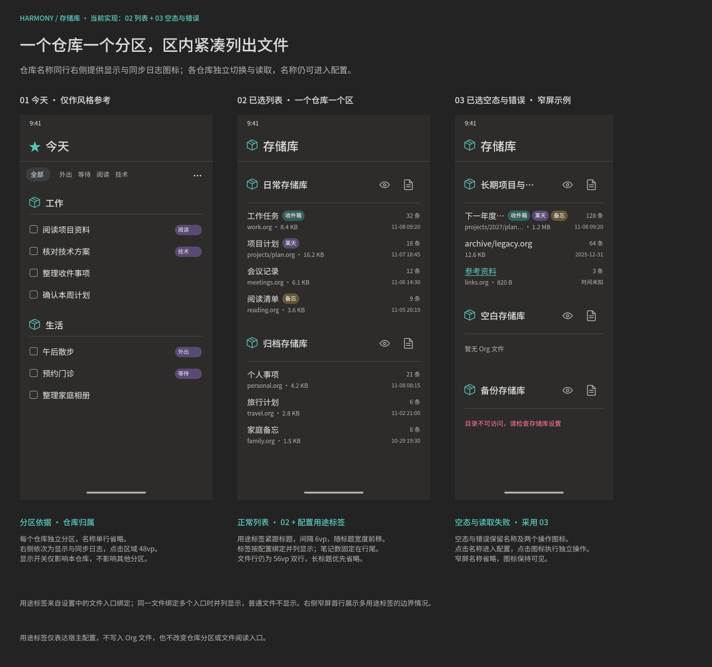 ，对应 ~.fig~ 中“27 Harmony 存储库紧凑分区（02 列表、03 空态与配置标签）”画板：02 为正常文件列表，03 为窄屏、空仓库与读取失败的表现。仓库配置及删除状态维护于“13 Harmony 仓库配置”画板。

点击仓库分区标题直接进入 ~pages/RepositorySettings~ 。界面以该仓库的根目录关联宿主配置 ID，再传递配置 ID；不把 Core 仓库 ID 当作 Preferences 配置 ID，重名仓库仍分别打开各自的配置。返回后重新读取名称和文件信息。文件同步从支持下拉的列表页面执行，完成后刷新当前可见列表。

* 导航精简与配置内删除

原“笔记本”页面改名为“存储库”，仍使用 ~pages/Files~ 路由。删除原独立 ~Repositories.ets~ 页面及注册路由，所有旧配置提示与导航转入合并后的存储库页面；侧边栏不再有两个入口。应用内不提供新增存储库入口，已有仓库仍可点击分区标题打开配置。

已保存存储库的配置页底部提供“删除存储库”。确认弹窗说明只移除配置和安全存储中的密码，保留本地 Org 文件与远端文件；取消不修改数据。删除期间禁止重复提交与返回，失败保留页面供重试，成功返回合并列表。删除过程重新读取全局设置，保留其他存储库、收件箱、某天、备忘、TODO 流程和日历设置。

侧边栏分类选项、计数、选择状态及分类结果页面已移除，打开导航不再发起分类摘要查询。Core 的通用分类查询能力和“今天”的分类分区仍由各自既有接口提供，UI 不重新实现任务过滤。

统一入口与精简侧边栏见“09 Harmony 顶部任务入口”和“15 Harmony 下拉同步与底部设置”画板。

* 返回自动保存与统一分组样式

存储库配置页标题固定为“仓库”，不随 WebDAV 或本地类型变化。移除顶部保存对勾和浮动保存按钮；工具栏返回与系统返回都触发同一保存流程，保存成功后返回。已加载配置没有变化时直接返回；新建草稿没有编辑时返回不创建存储库。校验或保存失败时留在配置页，提示继续编辑或放弃修改并返回。测试连接、恢复默认过滤目录与删除存储库作为独立操作继续提供，删除成功不再保存未提交草稿。

“今天”使用 ~ListSectionHeader~ ，存储库文件列表沿用相同样式：22vp 青绿色线框立方体图标、18vp 分组标题、10vp 图文及标题与线的间隔；标题下方是贯穿内容宽度的 0.5vp 分隔线，顶部留白 24vp、底部 8vp。内容左右边距同为 20vp。存储库标题行高 48vp，名称右侧加入显示与同步日志按钮，名称区域继续可点击进入配置，文件行保留所需元信息。

** 共享文件同步控件

今天、收件箱、计划、随时、某天、备忘、日志簿、存储库共用 ~RepositorySyncView~ 。 ~AppShell~ 通过 ~pullToSync~ 开启下拉入口，将页面内容交给控件的 ~content~ 插槽，并将 ~onDataInvalidated~ 转接到页面现有的 ~synchronized~ 回调及抽屉计数更新。页面只组装并执行自身查询、展示结果，不订阅同步状态或重复实现失败反馈。配置与详情页面不开启下拉入口，但继续展示共享会话进度及反馈；工具栏和空态不提供新增任务、存储库、新搜索或保存为新搜索入口。

控件封装 ~Refresh~ 、 ~RepositorySyncBanner~ 、数据版本监听和失败反馈。64vp 下拉触发、0.4 阻尼比例与松手立即复位沿用今天页面；进度线位于标题下方，不随列表下拉移动，不展示百分比、文字状态或成功提示。内容插槽覆盖加载中、空列表、未配置文件和读取失败等全部状态，均可下拉；列表使用 ~SELF_FIRST~ 嵌套滚动，在顶部继续下拉时交给外层控件。抽屉展开、页面忙碌或已有同步运行时禁止下拉触发，不重建内容插槽，保留列表位置。 ~AppShell~ 不再提供浮动操作按钮插槽。

~AppShell~ 通过 ~beforePull~ 回调结束原位编辑会话，展开态继续接收下拉；共享控件等待保存结果后再调用同步服务。原位编辑的保存失败由卡片反馈；意外失败显示轻提示并允许重试。交互维护于“46 Harmony 展开卡片下拉同步（当前实现）”画板。

~RepositorySyncService~ 持有独立于页面生命周期的全局会话，统一防止重复执行；文件传输与冲突规则继续由 Core 实现。页面切换不取消同步，其他页面继续展示同一进度。同步控件通过 ~routerPageUpdate~ 处理一次性错误；正文的数据版本独立由通知模块与 ~AppShell~ 处理。错误仍由当前可见控件一次性领取，通过 toast 提示失败，冲突通过独立通知进入对应文件的冲突解决页；未配置存储库时只展示说明，不提供新增入口。

数据版本与同步是否成功独立：成功或部分失败后本地文件均可能变化，通知模块按自身数据版本通知重新查询；冲突处理后的版本变化沿用同一通知路径。每个控件独立记录已处理版本，页面查询使用请求序号防止旧响应覆盖新结果。纯本地存储库执行本地重新加载；下拉范围始终是当前配置的全部存储库，不由页面查询条件缩小。

下拉同步、细进度线与失败 toast 的布局见 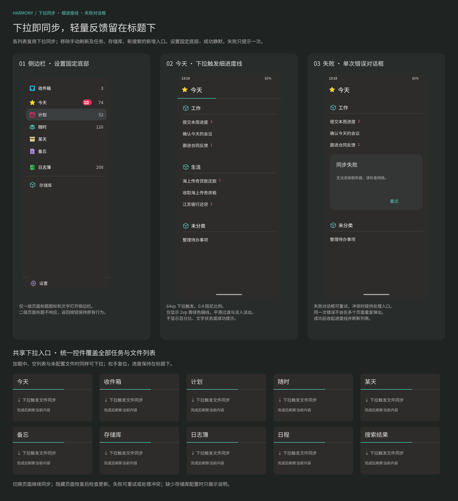 ，对应“15 Harmony 下拉同步与底部设置”画板。

* 文件整篇只读阅读

从存储库点击文件或从任务详情点击来源文件，均进入 FileDetail，按已保存的文件展示方式直接显示内容，默认渲染。工具栏使用文件 TITLE，缺失时回退相对路径；正文不重复生成文件标题，也不显示“阅读 / 原文 / 只读”这一行。移除文件页新增任务、搜索和标题列表摘要，整篇显示文件前言、标题与全部正文，不受任务扫描忽略或完成状态过滤影响。无标题文件正常显示正文，空文件明确显示空白提示，失败仍可重试。

参考 Obsidian 阅读视图的连续文档组织形式，沿用当前深灰与青绿色主题。正文顶部以辅助色显示仓库与相对路径；正文为 16px、1.78 倍行距，最大阅读宽度 740px，手机左右留白 22px。标题用近白色，以 24px、20px、18px 和章节间距表达层级，不用逐级缩进压缩正文宽度。TODO 为小型低饱和度状态标记，标签使用灰绿或青绿底，日期弱化且不显示链接下划线；真实链接仍使用青绿色下划线。

标题左侧的小箭头折叠正文及子标题。工具栏的目录按钮打开原生底部面板，以层级缩进列出章节，标记当前阅读位置；长目录独立滚动，长标题完整换行，无标题文件显示“本文没有章节标题”。点击章节展开目标与所有父章节、定位后关闭面板，重复标题按当前文档内的顺序区分。面板提供“全部展开／全部收起”，工具栏更多菜单同样提供这两个操作。返回键、下滑或点击遮罩关闭面板；切换文件或重新读取时清空旧目录和定位状态，迟到的读取结果不覆盖新文件。

长复选框清单完整换行，不再单行截断；表格使用克制的行分隔与表头底色，数值沿用右对齐，表格内部横向滚动；代码块使用中性深色面板，带语言名，保留换行并独立横向滚动，不撑宽整个正文。引用使用细青绿色竖线，属性与其他 drawer 默认收起；属性以名称与合并后的值展示，普通 drawer 内部渲染 Org 格式、链接与列表，不再整段显示源码。文件元数据由 Core 解析后通过属性提供；配置关键字、表格公式和 Babel 调用不以声明原文出现在渲染正文，未知关键字也不直接展示。代码块、示例及普通文字中的字面内容继续保留。在“设置 → 笔记与笔记本 → 文件展示方式”保存为“原文”后，文件直接显示完整等宽文本，可复制；原文模式不显示目录与更多阅读菜单。

阅读页不提供编辑、TODO 或复选框状态切换、表格计算及附件加载；支持的网页、邮件、电话与地址链接可点击并交给系统应用打开。坐标地址使用 ~geo:~ URI，例如 ~[[geo:39.9042,116.4074][北京市]]~ ；文字地址使用 ~addr:~ URI，例如 ~[[addr:北京市朝阳区][北京市朝阳区]]~ ，点击时转换为 ~geo:0,0?q=...~ 并通过应用内底部地图选择器选择应用；选择器的搜索与坐标状态、支持范围和置灰提示见“地图应用图标资源”小节。没有经纬度时也可以使用 ~[[geo:0,0?q=北京市][北京市]]~ 。渲染由 Core 的同一 orgize 语法树生成，UI 仅负责样式、折叠和从语义 HTML 提取目录，不另行解析 Org。页面仍禁止文内脚本、网络资源和文件访问；宿主只执行读取 DOM、折叠与定位操作，不写回文件。重新打开文件时恢复默认折叠状态。文件阅读样式用于普通全文与冲突预览，任务编辑中的嵌入正文保持卡片版式。

当前布局见 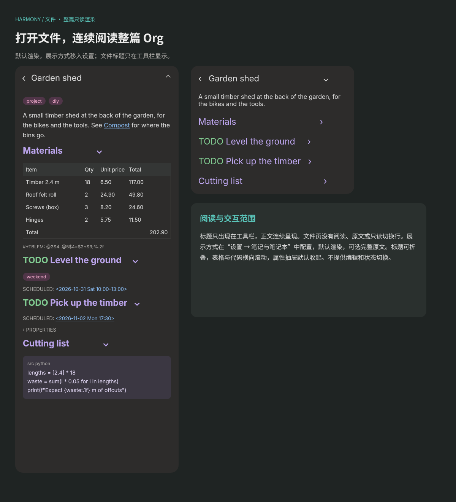，对应设计文件中的“16 Harmony 文件只读阅读”画板。

* 任务编辑与备忘编辑

~TaskDetail.ets~ 与旧路由已移除，文件、页面结构和路由统一改为 ~TaskEdit.ets~ 、 ~TaskEdit~ 与 ~pages/TaskEdit~ ，工具栏标题为“任务编辑”。任务编辑继续显示来源、标题及可折叠元数据；“正文”区域使用 Core 生成的安全 HTML 渲染行内样式、列表、表格、代码块与其他 drawer，按内容高度参与整页滚动，不另设固定高度的阅读窗口。没有正文时显示“没有正文内容”。

Core 从任务正文的真实 LOGBOOK drawer 提取日志，聚合多段日志后放入独立的“日志”区域，默认收起；正文不重复出现这些记录。只出现在代码块、示例或普通文字中的 LOGBOOK 标记不作为日志提取。任务编辑始终渲染，与文件展示偏好相互独立；原始 body、查询内容和源文件保持不变。日志区无内容时不显示入口。

文件展示配置与任务详情见 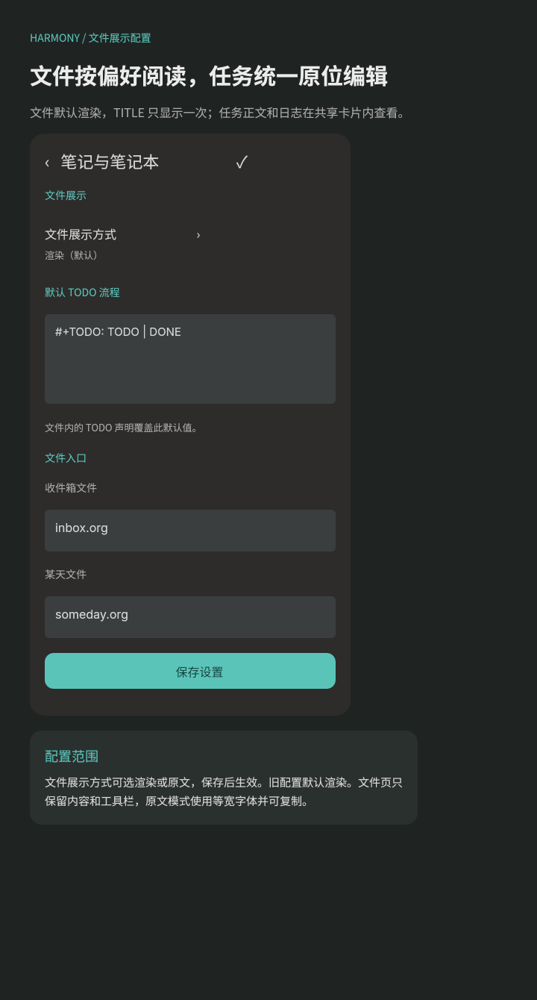，对应“17 Harmony 文件展示配置与任务详情”画板。

任务页 ~TaskEdit~ 与备忘页 ~MemoEdit~ 负责路由参数、工具栏、编辑状态和提交后的导航；任务内容提取为 ~components/TaskEditor.ets~ ，备忘内容提取为 ~components/MemoEditor.ets~ 。两者消费 Core 的同一 ~CoreTask~ 投影，备忘编辑正文使用原始多行文本输入，不在宿主解析 Org，不复制正文展示代码。

任务概览只在页面创建时读取路由中的视图类型；从任务编辑、备忘编辑或来源文件返回时，重新查询当前视图，保留原来的今天、计划、随时、某天或备忘入口，不在恢复显示时重新解析其他页面的路由参数。

备忘编辑与新增备忘在工具栏下方复用 ~CoreNotificationsView~ 展示通知，与正文之间保留 12vp 间距；没有通知时不占位。页面首次显示及从同步详情返回时只刷新通知，不重新读取路由或覆盖标题、正文草稿；通知订阅复用全局服务，保存与删除期间禁用通知跳转。通知读取失败保留已有快照，并用轻提示反馈，不覆盖编辑页的保存错误。

~pages/MemoEdit~ 的工具栏左侧返回，右侧直接放置紧凑删除图标，不使用圆形按钮或二级菜单。标题与返回按钮同排，标题使用单行文字输入，正文使用保留换行的多行纯文字输入，编辑时显示光标；返回时保存标题和正文，删除前要求确认，字数总计固定在页面右下角。默认与修改时间行不显示，不提供底部编辑按钮、来源、元数据、独立日志或高级编辑控件。保存与删除均通过 Core 操作组执行，以完整路径及文件版本校验并登记本地写入意图。没有正文但存在日志时仍显示“没有正文内容”，不把日志拼入正文。来源入口决定页面类型：从备忘进入始终是备忘编辑，不按标题是否有 TODO 状态推断。日志簿改为事件内原位只读展开，不进入任务编辑页面。

任务编辑页初始保留渲染阅读；工具栏右侧提供编辑与删除。点击编辑后标题使用单行输入、正文使用完整 Org 原文多行输入，正文默认展开；此时不另外展示旧日志投影，原文中已有日志仍可编辑。点击保存或返回均调用 Core 修改标题与正文，未改动的字段不提交。备忘新增复用同一基础编辑页，工具栏保存创建无 TODO 状态的标题；空白新建页返回不写入，非空标题不能为空。

任务与备忘的新增、修改和删除统一由宿主 NoteService 组装 Core 操作组，通过工作线程执行。修改和删除携带进入页面时的完整路径及文件版本，创建使用目标文件的当前版本；Core 负责保真写入与上传意图。删除确认明确包含子记录。保存期间禁用重复提交与输入；失败停留并保留输入，文件版本变化不自动换新版本覆盖。已提交但返回失败时，只重试导航，不重复创建、修改或删除。

任务与备忘编辑维护于“18 Harmony 任务与备忘编辑”画板，见 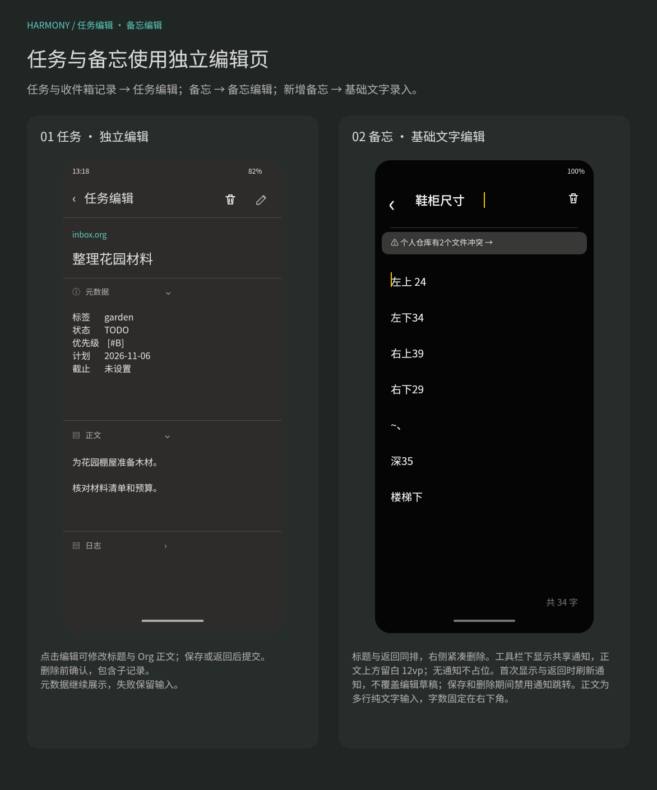 ；备忘新增入口见“25 Harmony 备忘卡片列表”，收件箱整理见“31 Harmony 收件箱左滑操作（当前实现）”。包含旧底部托盘的笔记操作画板及预览已删除。

页面拆分与共享关系见  ，对应“18 Harmony 任务与备忘编辑”画板。

* 标题链接显示与点击

文件顶部工具栏中的 ~TITLE~ 、存储库文件行、任务列表、今天任务行以及任务编辑页的标题共用 ~TitleText~ ，消费 Core 的 ~TitlePart~ 投影。 ~[[https://example.com][参考资料]]~ 显示为“参考资料”，无描述时显示地址；已支持的链接以强调色和实线下划线区别于普通文字，标题原有字号、行数与省略规则保留。点击链接打开系统应用，点击列表行的普通区域仍打开文件或编辑页；二级页面标题的非链接文字保持只展示。

文档内各级标题、正文和日志中的支持链接由 Core 渲染成 HTML 锚点。 ~OrgContentView~ 将用户点击交给统一的 ~ExternalLinkService~ ，不在阅读 Web 中加载目标网页，也不把标题链接点击当作折叠操作。从系统浏览器返回后保留原文档；标题的折叠箭头和批量折叠继续使用现有交互。

当前支持 ~http~ 、 ~https~ 、 ~mailto~ 、 ~tel~ 、 ~geo~ 与 ~addr~ ； ~file:~ 、 ~id:~ 、其他自定义链接和无目标的模糊链接显示描述或原始地址，并使用辅助文字色与虚线下划线表示暂不支持打开。原文模式保持完整 Org 源码。标题与文档链接不改写文件、不触发保存或同步；未安装对应应用或打开失败时给出轻提示。

当前布局与交互见 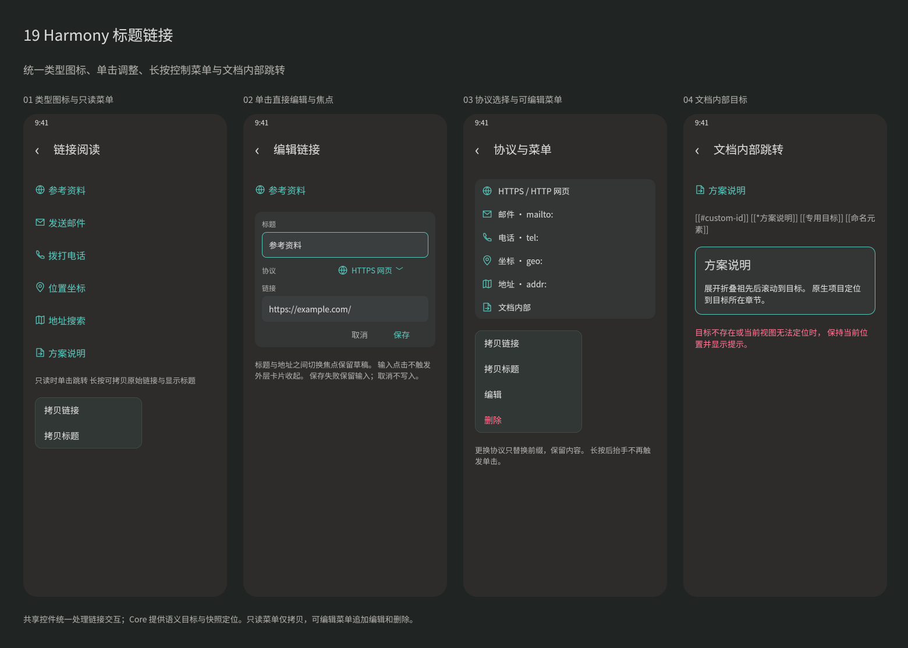 ，对应“19 Harmony 标题链接”画板。

已支持与未支持链接的下划线样式在 ~TitleText~ 与 ~OrgContentView~ 中保持一致：已支持使用原有强调色实线，未支持使用 ~UiColor.secondary~ 与虚线；普通文字不加下划线。未支持链接不绑定跳转操作，文档 HTML 同时标记禁用语义。虚线只表示能力状态，点击行为仍沿用所在标题或列表的原有交互。

** 地图应用图标资源

地图选择器由 ~MapAppSheet~ 统一展示，标题与正文中的地址链接共用。底部面板高度为 300vp，顶部显示“选择地图”和当前搜索或坐标摘要；每行左侧显示 36vp 应用图标，中间显示 20fp 名称和 14fp 能力说明，支持项右侧显示进入箭头。

地址搜索时，高德地图不支持通过当前地址搜索接口打开，图标和名称使用灰度与 0.5 透明度置灰，能力说明固定为“暂不支持地址搜索”，该行不显示进入箭头。点击置灰行只显示轻提示“高德地图暂不支持地址搜索，请选择花瓣地图。”，不关闭底部面板、不拉起高德；花瓣地图保持可选。坐标链接不需要地址搜索，两项均保持彩色图标、正常名称和进入箭头。

图标随应用打包，打开菜单无需联网获取。高德地图使用其 [[https://apps.apple.com/cn/app/id461703208][官方商店页面]] 提供的图标，花瓣地图从 [[https://consumer.huawei.com/en/mobileservices/petalmaps/][官网]] 的 [[https://consumer.huawei.com/dam/content/dam/huawei-cbg-site/common/mkt/mobileservices/petalmaps/img/img-0113/petalmapsicon.svg][图标素材]] 提取内嵌 PNG；两者统一缩放为 256×256 PNG，分别维护于 ~entry/src/main/resources/base/media/map_app_amap.png~ 与 ~entry/src/main/resources/base/media/map_app_petal.png~ 。图标仅用于识别对应地图应用。

交互状态与布局见 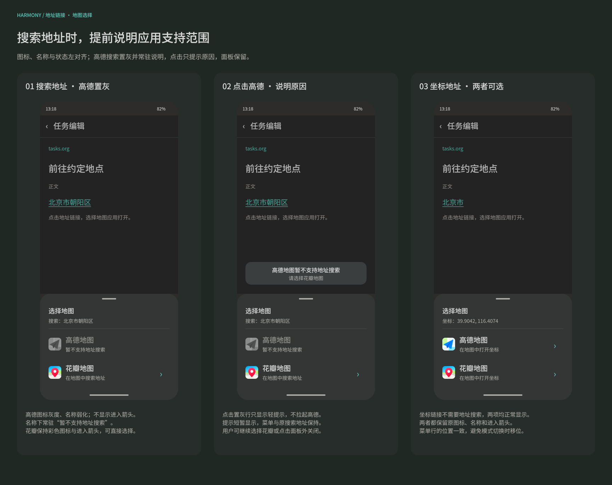 ，对应“23 Harmony 地图应用选择”画板；标题链接画板中的地址入口保持同一菜单组件。

* 分享地址内联更新（交互调整）

点击“创建任务”直接写入已配置的收件箱，不打开二级页面或标题表单；标题取“到 + 分享地点名称”，正文保存地址链接。创建期间禁用按钮，成功后直接打开主窗口的收件箱并关闭分享窗口，由收件箱重新读取列表并显示新记录；不展示创建结果卡片或“完成”确认。写入成功但打开收件箱失败时保留分享页，按钮改为“打开收件箱”，重试只导航，不重复创建。

进入分享页并识别地点后自动查询候选任务，不显示“更新已有任务地址”入口或展开／收起操作。候选查询不阻塞地点卡片和创建任务按钮；查询完成且有结果时，在创建按钮下方直接显示“更新地址”分区，复用今天页面的 ~ListSectionHeader~ 、22vp 分类图标、18vp 标题和 0.5vp 分隔线。候选按任务形成圆角灰色卡片，显示标题、来源文件及各条地址链接；整个内容共用当前页面的纵向滚动。查询中或无候选时隐藏整个分区，不显示空态或预留空白；查询失败仅在当前页面显示错误。新分享请求会清除旧候选和选择，过期查询结果不得覆盖新请求。

用户选择具体链接后，点击“更新选中的地址”直接提交，提交期间禁用重复操作；成功后直接在主窗口打开该任务的“任务编辑”页并关闭分享窗口，不再展示“地址已更新”结果或“完成”确认。编辑页消费 Core 写入后返回的新任务快照，显示更新后的标题与正文；返回进入收件箱。导航失败可直接重试打开编辑页，不再次写入地址。

候选范围为所有已配置仓库中的未完成 TODO，以及配置备忘文件中的无 TODO 状态 note；备忘文件按仓库与相对路径精确确定，未配置或失效时不回退。UI 组装状态、文件和 ~has.address~ 查询条件，由 Core 只返回带有真实 ~geo:~ 或 ~addr:~ 链接的记录，已完成、无地址及仅在字面文本中出现地址写法的记录均不显示；显示全部查询结果，不截取前几条。每条记录列出其自身地址链接，选择具体链接后才允许更新。

候选尚未加载、列表为空或尚未选中具体地址时，不显示“更新选中的地址”按钮；加载完成且选中地址后才显示。成功更新后复用既有 ~TaskEdit~ 页面及其原有布局、元数据、正文和返回行为，不修改任务编辑界面。

候选卡片左右内边距为 16vp，上下为 12vp，卡片内标题区和地址项的间距为 6vp，圆角为 12vp；地址行保留至少 36vp 高度，选中时仅高亮具体链接所在行。勾选标记使用 24vp 固定占位和主文字颜色，选择前后保持相同行高。卡片随任务和地址数量自然增高，并参与整页滚动。

布局见 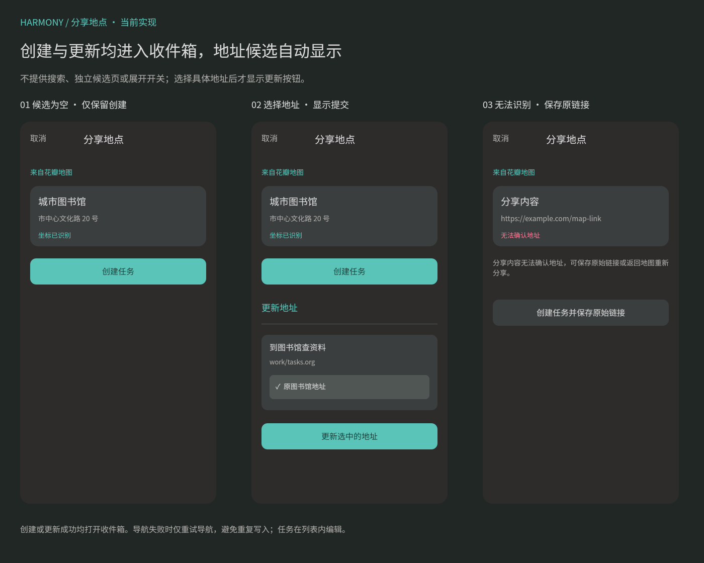，对应“26 Harmony 分享地点与地址更新（当前实现）”画板。

* 标题计数进度

标题计数按确认后的方案实现，设计维护于“22 Harmony 标题计数进度”画板，见 [[file:../../design/previews/22 Harmony 标题计数进度.png][标题计数进度预览]] 。该画板补充任务列表、详情与文件标题的进度表达，其他画板继续维护各页面主体布局。

标题中的分数统计节点（例如 ~[1/2]~ ）从显示标题中提取，以“14vp 细圆环 + 12vp 数值”的紧凑标记展示，使用低对比度深灰背景，与彩色标签区分。任务列表收起时保持至少 44vp 单行，顺序为完成状态、标题、计数、标签、提示标志与日期；标题先省略，计数保持完整，标签及提示沿用既有压缩规则，日期右边缘继续靠齐。极窄空间或多个超长计数无法同时容纳时，收起行改用一个紧凑进度图标，展开查看全部数值，避免遮挡日期或出现横向溢出。

展开卡片中标题完整换行，下一行只展示“圆环 + 1/2”的组合进度标记，省去重复的“已完成 1 / 2”说明，随后展示标签及原有正文、日期。任务编辑页在标题下方共用同款进度标记，不重复显示文字说明；文件渲染模式中的真实标题使用同款标记。原文模式保留完整源码，备忘编辑继续只显示正文。

圆环由显示层根据 Core 提供的结构化计数在运行时绘制：有效总数大于零时，以已完成数除以总数决定弧长，例如 ~1/2~ 绘制半环， ~2/2~ 绘制满环；配色遵循下表。它是可缩放的矢量图形，无需为不同数值准备静态图片。空计数与零总数只绘制中性底环。设计稿中的圆环表达各比例的静态外观，手机使用 ArkUI 进度控件动态绘制，文件阅读使用安全 HTML 与 CSS 渲染。

| 原始计数 | 数值与圆环 | 语义 |
|-
| ~[1/2]~ | 青绿色 1/2 与半环 | 文件记录完成 1 项，共 2 项。 |
| ~[0/6]~ | 辅助灰色 0/6 与空环 | 尚未开始。 |
| ~[2/2]~ | 完成绿色 2/2 与满环 | 仅计数完成，任务自身 TODO 状态保持独立。 |
| ~[/]~ | 辅助灰色 —/— 与空环 | 尚无有效计数，不推断百分比。 |
| ~[0/0]~ | 辅助灰色 0/0 与空环 | 总数为零，不画满环，不作为已完成。 |
| ~[3/2]~ 等异常值 | 原样保留标题文字 | 不截断、不夹取比例，不伪造有效进度。 |

只识别标题语法树中的真实分数统计节点；多个按原文顺序展示，链接、代码等内部的同形文本不提取。本次聚焦分数计数，百分比形式保留现有显示。进度数据读取文件中的已有值，不重新统计子任务或正文 checkbox；不改写文件、不触发保存与同步。无计数时不预留位置。点击进度标记沿用所在标题区域的展开、收起或导航行为，不提供进度编辑或独立操作；无障碍文本读为“已完成 1 项，共 2 项”。

Core 基于现有无损语法树，在标题片段中提供可空的结构化计数，宿主只展示，不使用正则再次解析 Org；字段与边界见 [[file:../core/接口文档.org::*标题文字与外部链接投影][标题投影接口]] 。显示提取与任务逻辑身份的既有归一化规则分别维护，不为展示改变任务 ID 或原文标题。

* 快速捕捉

快速捕捉只提供一个输入框，保存时尝试从完整输入识别地址和时间，复用 Core 的任务创建、目标文件有效初始状态、保真编辑与离线上传意图；不增加日期、正文、标签或优先级表单。通过 ~Creation.position.parent~ 指向收件箱文件根节点，将记录插入文件头配置与前言之后、第一条标题之前。快速捕捉直接复用文件入口中已选择的 ~inboxRepoId~ 与 ~inboxFile~ ，目标与草稿的持久化边界见 [[file:配置项设计.org::*快速捕捉与草稿][快速捕捉与草稿]] ，宿主调用边界见 [[file:Rust bridge设计.org::*快速捕捉复用][快速捕捉复用]] 。界面维护在“20 Harmony 快速捕捉与系统入口”画板，见 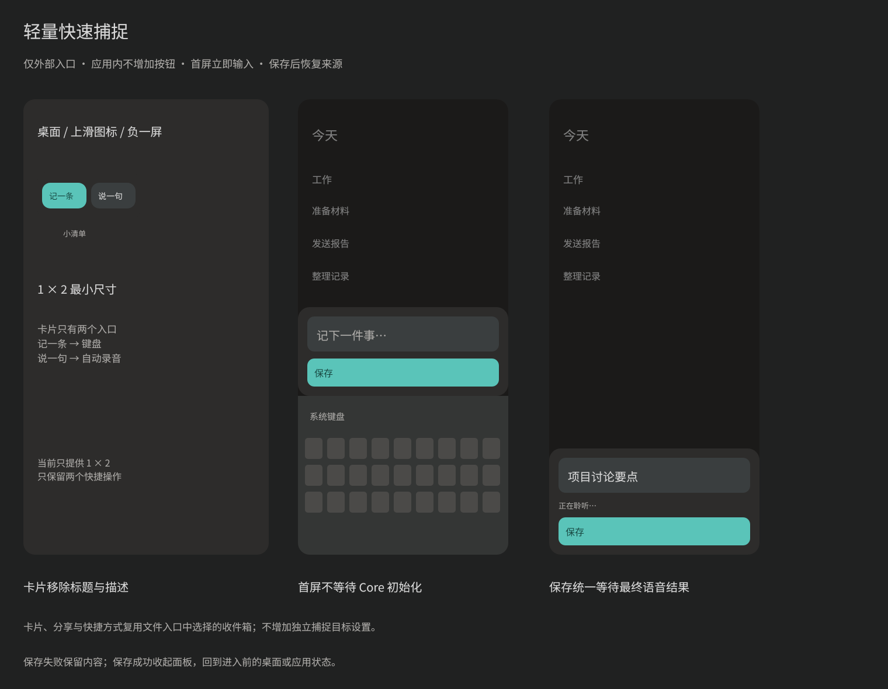 。

保存时由 ~CaptureEntityService~ 调用华为 Natural Language Kit 的 ~textProcessing.getEntity~ ，仅请求 ~EntityType.LOCATION~ 和 ~EntityType.DATETIME~ 。完整输入保留为标题，按实体在原文中的位置组织识别结果：地址去重后以 ~addr:~ 链接逐行插入正文，链接描述保留地址文字；首个可用时间写入 ~Creation.scheduled~ ，由 Core 保存为 ~SCHEDULED~ 。时间解析兼容真机返回的直接时间对象与部分版本文档中的 ~time~ 数组包装；使用平台返回的 ~suggestStart~ 或 ~start~ ，精确到分钟；只有日期或模糊时段时保存日期，不凭空补小时；缺少具体日期、非法或被平台自动修正的时间跳过，不自行推理自然语言或生成重复器。日期与地址随同一个创建操作提交。

实体识别只在保存时运行，语音入口先等待最终转写；草稿和首屏输入不依赖实体服务。同进程调用串行执行，完成后释放引擎；能力不支持、输入超过 1000 字符、无识别结果或服务异常（含平台超时）时沿用完整标题保存。实体原文、输入和结构化结果不写日志或 Preferences。能力依据 [[https://developer.huawei.com/consumer/cn/doc/harmonyos-references/natural-language-text-processing-api/][文本处理 API]] 与 [[https://developer.huawei.com/consumer/cn/doc/doccenter-references/api/natural-language-json-object-api][实体返回结构]] 接入，官方声明仅支持中国大陆设备且不支持模拟器。已在真机验证“明天晚上和老婆宝吃完饭”可识别明天的日期，并通过 Core 写入、重新查询计划时间；“晚上”作为模糊时段仅保留日期，其他地址和时间表达的效果仍按实际设备结果验收。

应用内和外部快速捕捉保存时，由 Core 自动将本地创建时间写入新任务的 ~CREATED~ 属性，使用精确到分钟的非活动时间戳。录入面板不增加时间字段，草稿不保存创建时间，原有记录不回填，后续读取或同步不更新时间。

快速捕捉仅从桌面卡片、上滑卡片、长按图标、系统分享、小艺意图和外部调用进入独立 ~CaptureAbility~ 透明窗口，在来源界面上方显示底部录入面板。小艺意图绑定 ~CaptureAbility~ 的前台执行器，由平台按官方前台意图生命周期提供 ~windowStage~ ；执行器把标题写入同一 Ability 的 ~AppStorage~ 后加载捕捉页面，不再次启动 Ability，也不在启动阶段等待 Core。保存按钮执行时才等待 Core 初始化并提交任务；执行失败直接返回错误，不使用改变页面归属的窗口 fallback。快速捕捉直接使用文件入口配置的 ~inboxFile~ ，不提供独立目标设置。应用内收件箱保留“+”快速录入；备忘列表“+”使用独立备忘编辑页，不接入外部捕捉。其他列表、规划、任务编辑及抽屉不恢复完整新增任务路由。面板只保留标题输入与“保存”，去掉关闭按钮、草稿列表、文件名、目标选择和录入方式切换。点击面板外或系统返回时关闭并保留标题；保存期间阻止重复提交与关闭，成功后收起面板，恢复来源界面的原状态。

桌面服务卡片只提供 ~1*2~ 最小尺寸，内容只有“记一条”和“说一句”两个操作，不显示标题或描述。卡片沿用原有深绿色背景 ~#18221E~ 与两个等宽胶囊入口，保留按钮配色、间距和高度适配方式。边缘仅由根容器使用系统卡片圆角并统一裁切，不叠加内层圆角或独立描边，避免边缘出现色差与轮廓不齐。上滑图标与负一屏复用同一卡片，展示位置由系统宿主决定。长按应用图标提供同名文字与语音入口。

桌面备忘服务卡片提供 ~2*4~ 尺寸，主应用深色强调 ~#174C47~ 标题栏占卡片高度的四分之一，左右内边距分别为 12vp、8vp；“全部备忘”使用 16fp 字号，“+”使用 16vp 细线图形和 28vp 点击区域。下方最多展示配置备忘文件中按 Core 修改时间返回的三条标题：行高 40vp，文字 14fp，主应用强调色 ~#5AC4B9~ 竖线为 3 × 14vp，条目之间使用深色分隔线，超出卡片高度的部分裁切。列表直接响应绑定数据的新增、改名、排序与清空，不保留首次加载时的空布局。点击标题栏通过系统卡片路由打开应用内备忘列表，“+”进入新增备忘页，点击具体条目进入该备忘的编辑页；三个点击区域独立响应。条目路由携带 Core 查询记录身份，应用读取当前备忘文件的最新快照后定位并打开，不按标题文字或卡片行号选择；记录已变更、删除或备忘文件失效时保留列表并提示，不打开其他记录。新增和编辑页返回时回到备忘列表，返回后不重复打开；卡片不在桌面直接编辑正文，也不显示图片缩略图。根容器交给系统宿主裁切圆角，卡片自身不叠加独立描边。

服务扩展在创建、临时卡片转正式卡片、重新可见及系统定时刷新时重新读取 Core 快照。定时配置为一个 30 分钟单位，实际调度由系统控制。扩展进程刷新前清除自身的配置缓存并重新加载备忘所在仓库，以取得应用内保存的最新文件入口与本地内容；请求串行执行，已移除卡片不再写回。首次等待显示“正在读取备忘…”，空文件显示“暂无备忘”，未配置、目标失效与读取失败分别给出对应提示，不再将失败显示为空文件，也不保留过期内容。

桌面长按备忘卡片时，系统菜单通过 ~formConfigAbility~ 提供“编辑”入口，进入独立 ~MemoCardConfigAbility~ 的 ~MemoCardConfig~ 页面，不改变应用主窗口的当前页面。编辑页顶部提供返回与“编辑”标题，中间显示当前范围标题和主应用强调色卡片预览，下方为可滚动的标签单选列表与主色“确定”按钮；页面背景、文字和列表底色沿用应用深色主题。候选包含“全部备忘”、所选备忘文件声明的候选标签及任务的实际有效标签，不引入其他文件的标签，也不增加“收藏”或文件夹概念。默认选择“全部备忘”；选择一个标签后，预览与卡片标题改为该标签，查询为备忘文件范围叠加 Core 的 ~t."标签"~ 条件，再按修改时间倒序取最近三条。自身及继承标签的匹配均由 Core 完成，不在 ArkTS 过滤查询结果。

标签选择按卡片实例独立保存，与应用内备忘页的标签筛选互不影响；每次打开编辑恢复此实例的选择。原选标签已不在候选中时仍保留其选项，零匹配显示“此标签下暂无备忘”，不回退全部记录。切换选择只更新预览，旧请求不能覆盖新选择；返回与系统返回均取消未确认修改。点击“确定”重新确认文件仍有效，持久化选择、更新当前卡片并关闭编辑窗口；保存失败保留页面，已保存但更新失败时说明状态并允许重试，不重复创建卡片。缺失卡片身份或备忘文件不可用时显示中文原因并禁止确认。移除卡片时清理该实例设置。对应预览与长按菜单示意维护于“35 Harmony 桌面备忘卡片”画板。

长按快捷菜单使用独立的透明底单色线条图标：“记一条”为纸笔，“说一句”为麦克风，与系统菜单保持圆角端点及一致线宽。图标维护于 ~shortcut_capture_text.svg~ 与 ~shortcut_capture_voice.svg~ ，逻辑画布为 64 × 64，导出尺寸为 192 × 192，图形约占中央 24 × 24，线宽为 1.6，避免系统按快捷图标区域缩放后明显大于内置操作图标。基础资源使用深灰色， ~dark~ 资源使用浅灰色，适配系统浅色与深色菜单。快捷操作 ID 分别为 ~capture_inbox_text~ 与 ~capture_inbox_voice~ ，使更新安装时桌面重新加载图标。已在模拟器浅色长按菜单验证尺寸、线宽及清晰度；桌面为应用快捷项附加的浅灰圆底由系统控制，资源本身不带底色，深色真机效果仍待验收。

“记一条”立即聚焦标题并展开键盘。“说一句”使用同样的面板，自动准备录音，首次请求麦克风权限；识别内容直接填入标题，录音期间只显示简短状态。点击“保存”时结束录音，等最后的识别结果返回后再提交，不再显示“说一句”、完成录音或取消录音切换按钮。点击面板外关闭会停止录音、释放资源并保留已识别标题。语音不可用时允许直接编辑输入，保存时统一尝试识别地址和时间。

首屏绘制、输入与本地草稿恢复不依赖 Core。 ~CaptureDraftStore~ 只访问轻量 Preferences；页面显示后由 ~CaptureSaveSession~ 异步导入捕捉服务并准备共享 workspace，文字入口不提前加载语音模块。标题在初始化期间始终可输入；用户点击“保存”后才等待语音结束和 Core 初始化。初始化或保存失败只在面板中提示并保留标题，下次保存可重试。

系统分享每次接收一个文字或链接分享项，整理为单行标题后转交捕捉窗口；链接标题与 URL 都并入唯一输入字段；分享扩展不建立正文或附件，保存时统一按实体识别结果补充正文和计划时间。分享扩展不直接操作仓库。小艺前台意图 ~CaptureInboxTitle~ 对外显示为“记到小清单”，只传 ~title~ ，打开统一确认界面；返回信息表示已打开确认界面，不宣称任务已经保存。标题最终统一写入配置的收件箱文件，系统交互文案不要求用户知道该内部文件名。系统是否分发该意图仍取决于设备与平台接入状态。

小艺语音接入按 [[https://developer.huawei.com/consumer/cn/doc/doccenter-capabilities/intents-access-flow][Intents Kit 接入流程]] 与 [[https://developer.huawei.com/consumer/cn/doc/doccenter-capabilities/intents-skill-all-rec-dp-self-validation-con][技能调用开发者测试]] 完成平台侧能力申请和语音联调权限开通。提交的测试应用信息必须对应“小清单”、包名 ~com.example.orgtasks~ 、意图 ~CaptureInboxTitle~ 以及设备登录的华为账号；设备开启意图框架调试后，须确认显示“已切换至真机模式”，再经小艺“意图调试助手”执行端到端联调。官方 [[https://developer.huawei.com/consumer/cn/doc/doccenter-capabilities/intents-introduction][Intents Kit 简介]] 当前说明能力申请和注册仅面向企业开发者。

本地调试器列出意图并返回 ~code: 0~ ，只证明执行器能够打开确认页；外部参数保存成功只证明本地录入链路可用。这两项均不能替代小艺语义匹配和语音分发验收。设备仍显示“未切换至真机模式”、账号未开通语音调试权限，或请求未进入 ~CaptureInboxTitle~ 时，不能将“应用无法操作”判定为 Core 加载或任务保存失败，也不能宣称语音入口已交付。

外部应用可显式启动捕捉窗口并传入 ~title~ ，也可打开 ~orgtasks://capture?title=...~ 。所有外部输入都需要用户确认，不能通过启动参数更换仓库目录或绕过 Core 校验。独立窗口处理冷启动与热启动；新请求传入新标题时先保留旧草稿，再直接显示新标题，不弹出选择界面。关闭或中断保留草稿，成功保存后只清理已提交标题；后续空白捕捉自动恢复剩余的最近草稿，不提供草稿列表，不保存已捕捉任务副本。

* 应用显示名

手机应用显示名统一为“小清单”，覆盖桌面入口、应用信息、分享面板的应用名称、应用程序说明与小艺意图展示文案。小艺打开应用的称呼使用“小清单”。 ~bundleName~ 、工程目录、Rust 包名、仓库身份与凭据别名保持原值；已有日历名称属于用户配置，不随显示名改动迁移。

“打开小清单”属于系统打开应用能力。“用小清单创建任务”使用已注册的 ~CaptureInboxTitle~ 前台意图，需要系统实际分发与设备验收；显示名一致不代表创建意图已经通过验收。

* 同步日志项

独立 ~SyncLogItem~ 采用 48vp 单行，依次显示 18vp 执行结果图标、20vp 传输方向图标、标题、互斥的冲突标签，以及固定靠右的日期。标题直接显示“下载14个文件”“上传2个文件”或“下载3/上传2”；普通无变化示例为“14个文件无变化”。数量缺失时使用“有下载”“有上传”等状态文字，不借文件总数猜测各方向数量；错误记录优先显示旧日志已有的具体错误原因，缺失时合理回退到错误分类或“执行失败”。

正常、冲突与错误记录均点击原地展开文件详情，再次点击收起；一次展开一条，切换记录收起前项。行末日期使用“11-08 09:04”，展开区保留完整时间。窄屏允许标题缩小或单行省略，标签与日期保留可见。展开身份按同步 ID 保留，刷新使用新代次重读详情，使标题、计数和解决状态一起更新。

默认隐藏执行成功且无待处理冲突的普通无变化项；失败、取消、中断与待处理冲突保留可见。标题栏眼睛图标切换全部快照，返回与重新读取保留选择，不写入 Preferences。冲突不算执行失败；仍有冲突优先显示剩余冲突数，冲突数固定为该次历史产生的数量。

当前布局维护于“30 Harmony 同步日志单行标题与同步详情（当前实现）”画板，见 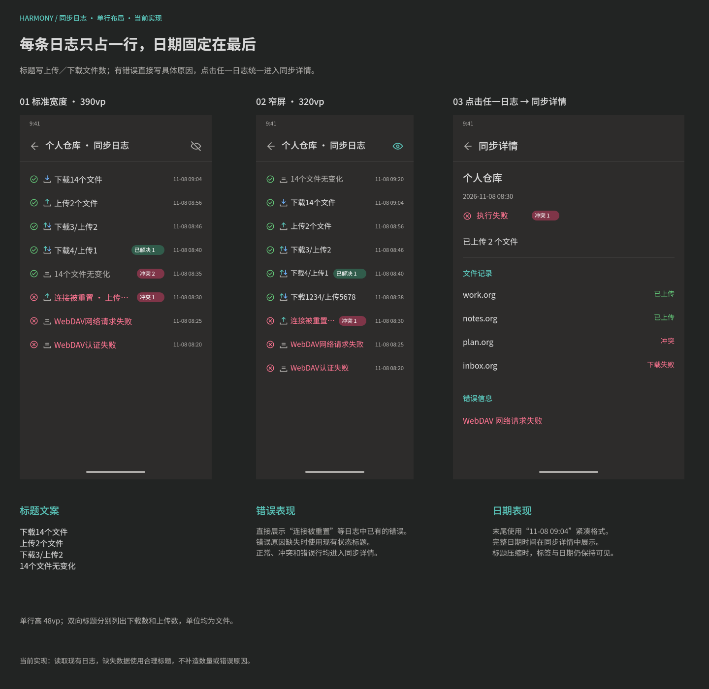 。四态图标继续使用本地托盘、等号和方向箭头，图标规范见 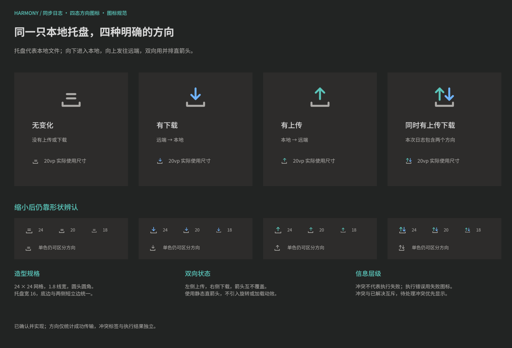 ，对应“29 Harmony 同步方向图标规范”画板；日志布局以单行同步日志画板为准。

* 同步日志展开与备份阅读

移除 ~pages/SyncDetail~ 页面和路由， ~SyncLog~ 中点击日志行原地展开 ~SyncLogDetails~ ，用既有 ~Repo.historyDetail(syncId)~ 获取完整文件投影。保留 48vp 摘要行，展开区在其下方显示完整日期时间、文件列表和已有错误，随整个日志列表滚动，不嵌套独立详情页。

文件列表显示全部状态，包括新增、删除、无变化、更新、合并、冲突及本地上传；由 Core 持久化业务结果投影，页面只映射文案。每个文件项显示标题（缺失时用路径）、原相对路径和状态；仅远端删除且具有备份时显示进入箭头。无变化文件仍列出，不依赖上传／下载分区隐藏。历史结果固定，后续操作不增加已解决状态。

只有远端删除且确有备份的文件在状态后显示右箭头，点击只读打开删除前备份。普通、合并、无变化和冲突历史文件没有箭头，也不响应文件项导航。旧日志缺少删除备份时不可阅读，不以当前工作文件替代。读取失败在展开区显示错误和重试；收起或切换后丢弃过期响应。

冲突通知按当前仓库与文件路径进入解决页，不再绑定历史记录。普通进入列表保持原有无变化日志筛选开关；刷新或从文件阅读／解决页返回后按原展开身份重读。同步日志布局维护于 30 号画板，冲突解决统一维护于 47 号画板。

* 统一事件展示区

共享 ~CoreNotificationsView~ 展示 Core 通知快照，没有通知时零占位；卡片放在可滚动内容顶部，沿用 12vp 圆角、32vp 单行和 13vp 字号。 ~SyncConflictNotificationView~ 以辅助色显示“仓库名 · 文件路径 有冲突”，每个文件独立一条，点击整行直接进入该文件的解决页；通知不绑定历史记录或维护已解决计数。 ~SyncRequiredNotificationView~ 显示“本地有修改，点击同步”，点击普通同步，忙碌时禁止并发。

宿主根据通知附带的根目录映射配置身份，再校验 Core 仓库 ID，不能按同名文件跨仓库跳转。通知读取失败保留已有快照，提交更新经 Core 仓库事件触发正文和通知重读。通知样式维护于 32、34 号画板，文件入口见 44 号画板，解决界面统一见 47 号画板。

* 设备提示计数

桌面应用图标使用系统数字角标，计数为收件箱记录数、收件箱之外截止日期为当天及以前的未完成任务数与冲突文件数之和。收件箱与侧边栏采用相同的记录口径；截止 Task 查询通过 ~excludedFiles~ 排除收件箱的 Core 仓库 ID 与相对文件路径，同一任务只计一次，其他仓库的同名文件不受影响。截止条件使用 ~it.todo d.lt.tomorrow~ ，只按实际截止日期判断，不包含提前预警期； ~syncRequired~ 不计入角标。未配置、已删除或被忽略的收件箱贡献零。

~DeviceBadgeService~ 将收件箱 Task 与 File、截止 Task 和 Notification 组装为一次 ~Workspace.query~ ，使用同批快照求和，再调用 ~notificationManager.setBadgeNumber~ 。任一读取或系统写入失败保留原角标；总数为零时清除角标，超过 99 的显示由系统处理。页面不补做任务过滤，也不从侧边栏已加载计数拼接结果。

服务是调用方进程内的 ArkTS 对象，不是常驻系统服务。 ~EntryAbility.onForeground~ 启动订阅并立即重算，前台 Core 数据变更与配置保存后重新读取；本地午夜重算日期条件。 ~onBackground~ 与 ~onDestroy~ 解除订阅、取消定时器；已在途的单次刷新允许完成。快速捕捉、分享创建、前台文件同步结束及 WorkScheduler 后台同步结束时，执行操作的进程单次重算，包括部分同步成功、日历初始化失败或同步失败后的当前本地状态；后台重算不依赖日历授权，不弹通知授权窗口。

Core 经 C++ 工作线程与 Rust 运行时完成查询，ArkTS 仅编排请求和系统角标写入。同一进程的刷新合并并串行处理，查询期间收到新请求时丢弃旧查询结果并补查；旧订阅注册完成后若生命周期已结束，立即注销。Core 事件不跨进程传递，进程终止后不再监听；外部文件修改在下次前台启动或后台作业读取时可见，后台周期不保证精确执行。桌面可见性同时受应用通知开关与桌面角标设置控制；关闭应用通知时，系统仍可能接受计数写入，但桌面不显示。真机已验证开启小清单通知后显示数字角标。

* 通知授权与系统设置

~NotificationPermissionService~ 仅负责 Harmony 通知状态、首次请求及系统设置跳转，不进入 Core。首次请求指当前应用数据中尚未处理通知授权，而非进程首次启动；使用独立 Preferences 的 ~notificationPromptHandled~ 标记，具体保存边界见 [[file:配置项设计.org][配置项设计]]。

~EntryAbility~ 在主窗口内容加载成功且处于前台时检查授权。已允许则补记首次标记并立即重算角标；未允许且标记为假时，先持久化标记，再调用 ~notificationManager.requestEnableNotification(context)~ 。拒绝属于正常结果，保留标记，后续启动不自动重弹；系统服务异常、弹窗冲突等技术失败撤回标记，保留后续重试机会。持久化失败不发起授权请求。检查或落盘期间退到后台时取消尚未发起的请求，恢复前台仍可处理；已发起的系统窗口允许完成。请求串行执行，旧生命周期尚未发起的请求不得影响新窗口。快速捕捉、分享、角标刷新与后台同步不请求通知授权。

设置 → 应用程序增加“通知与角标”入口，沿用现有设置行与说明文字。用途说明为“在桌面图标显示收件箱、截止任务和冲突的数量。数字角标还需在系统设置中开启桌面角标。”状态与操作如下：

| 状态 | 展示 | 点击行为 |
|-
| 读取中 | 正在读取… | 暂不可操作。 |
| 尚未请求 | 开启通知 | 请求系统授权；允许后立即重算角标。 |
| 未允许 | 通知未开启 · 前往系统设置 | 调用 ~openNotificationSettings(context)~ 。 |
| 已允许 | 通知已开启 · 管理系统通知设置 | 调用 ~openNotificationSettings(context)~ 。 |
| 读取失败 | 状态读取失败 · 点击重试 | 重新读取，不猜测授权结果。 |

打开系统设置前后及再次进入前台均重新检查系统状态。系统半屏设置不保证触发页面或窗口焦点事件，因此设置页可见且当前分组为“应用程序”、主界面仍在前台时，每秒串行检查一次通知状态；只有检测到变为已允许时才重新读取任务并更新角标，其余检查仅调用系统权限接口。页面隐藏或销毁时取消定时器，后台不读取权限，旧读取结果不可覆盖新状态。操作期间禁止重复点击；失败显示错误并保留重试入口。通知已允许不等于桌面角标已开启，界面不声称已检查角标开关，也不自动修改声音、振动或其他通知选项。本流程为现有角标授权，不新增通知栏消息发布。布局及各状态维护于“52 Harmony 通知授权与角标设置（当前实现）”画板，见 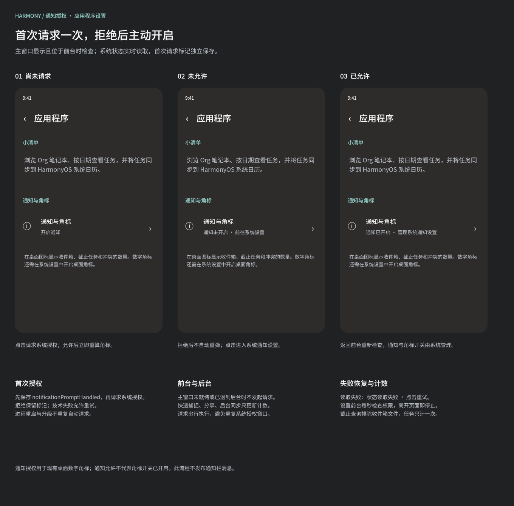 。

真机已验证系统设置入口、关闭与重新开启通知后的状态刷新、关闭后重新启动不重复请求，以及重新开启后的桌面数字角标。首次未授权弹窗由宿主流程测试覆盖，尚待首次未授权的真机环境验收。

* 最近成功同步与通知显示

冲突通知直接来自当前已加载文件的节点标签，每个冲突文件一条，不再依赖最近成功同步或历史中的解决状态。 ~SyncConflictNotificationView~ 用 13vp 辅助色单句显示“仓库名 · 相对路径 有冲突”，点击进入对应 ~ConflictFile~ 。刷新与路由仍校验 Core 仓库身份，读取失败保留快照。

* 原位编辑当前画板

主设计文件“Harmony 当前实现”页的 36–42 号画板分别维护共享任务卡片、键盘与属性入口、月历日期、标签选择、新建标签、清单状态和清单删除；原 11、23 号画板的任务卡片只用于历史布局对照，原位编辑以这些实现汇总画板和主图“任务编辑交互”页的完整交互规范为准。外部任务详情、备忘编辑、收件箱左滑整理仍保留各自既有范围。

原位编辑期间直接更新卡片内部快照，不重建输入控件。标题和备注各自记录编辑状态：正在编辑的字段保留卡片输入，忽略该字段的外部变化；其他字段采用最新快照。保存前读取最新节点，只提交本次编辑字段，同字段由卡片输入覆盖外部值，其他字段保留外部修改；读取与提交之间再次发生变化时仍由 Core 的文件版本校验拒绝，不自动重试。检查清单继续按条目操作提交，不用整篇旧正文覆盖文件。

卡片因数据事件重读任务时，将任务和通知放入同一批次，添加标签后立即更新“本地有修改，点击同步”，无需等待收起卡片。 同一数据版本的来源与关联任务行共享一次包含已完成和无状态条目的批量读取，未展开过的行也更新状态、日期、标签和进度；任务转为无状态时沿用同一记录身份。文字草稿按字段保留，列表重排仍在会话结束后执行。连续事件只应用最新版本；卡片离开后不应用在途结果或错误。节点身份失效只结束对应会话，不补发另一条数据失效事件。外部删除当前节点时关闭浮层、结束会话并移除卡片，不再提交该节点的草稿；读取失败保留卡片和草稿。移动会从源位置移除节点，并通过提交后的仓库数据变更事件触发同一关闭流程；若事件尚未送达，保存前读取已确认源节点不存在时也立即关闭原卡片，不显示“任务已删除”的错误，不向移动后的节点提交旧草稿。当前 Core 逻辑身份依赖标题路径，外部改名或移动导致身份消失时同样结束原会话，不猜测另一个节点承接草稿。

* 冲突解决后的同步提示

同步提示文案改为“本地有修改，点击同步”。Core 用本地字节 hash 与已确认基线索引比较，只要任一仓库不同，workspace 就返回唯一一条 ~syncRequired~ ；不再要求先解决冲突，也不以进程状态维持通知。点击复用普通全仓库同步，忙碌时禁止并发；成功推进基线或本地恢复到基线后提示自然消失，重启后可重新发现。

* 仓库重置与文件冲突入口

仓库配置页在“删除存储库”上方新增“重置本地目录”，沿用全宽 48vp 按钮与错误色文字，和删除入口间距 16vp。只对已保存仓库显示；二次确认展示保存目录与清空范围，说明保留仓库身份、配置和远端文件，确认文字为“重置”。目录草稿与保存值不一致时先提示保存，不能重置另一个未确认目录。

重置中按钮显示“重置中…”，整页表单、返回、测试、保存与删除禁用。Core 成功后提示“本地目录已重置”，刷新内容与通知；失败显示原因，不假装成功，不自动发起远端同步。

存储库文件行保持 56vp 双行布局，在标题后显示 12vp 中等字重的“冲突”标签，使用错误色文字、深红底色和 1vp 错误色边框，圆角 6vp；标签不压缩计数和用途标签，长标题先省略。状态只来自 Core 的 ~hasConflict~ ，界面不扫描正文或冲突目录。

仓库文件行持有所属分区的 configRepoId，点击带标记的文件以配置仓库 ID 进入 ~ConflictFile~ ，不误传元信息中的 Core repoId，也不携带历史 syncId。直接读取当前文件对象和正文预览，进入逐点解决页；进入时不改写源文件。普通文件继续使用 Core 仓库 ID 进入 ~FileDetail~ 。文件入口维护于“44 Harmony 仓库重置与文件冲突入口（当前实现）”，解决页统一使用“47 Harmony 文档内冲突卡片（当前实现）”。

* 文件预览与逐点合并

普通文件和历史备份继续复用 OrgFilePreviewView。冲突解决页使用同一连续文档版式，全部冲突卡片同时嵌入正文；明确目标处以卡片替代原节点，无法定位时由 Core 的展示锚点放在最近仍匹配的父节点下，无父级时放在文档根部。新增、修改、删除分别用文字标签和绿色、暖黄色、暗红色辅助表达；卡片展示完整候选内容，修改先只展示修改后内容，删除展示当前待删子树。

卡片内提供插入／应用／删除与丢弃；底部只有左右定位按钮、当前位置和横向滑动手势，不切换文档快照。目标未明确时从卡片操作打开树形目标面板，展示锚点不充当提交目标。提交仍通过独立预览和统一操作组校验真实文件版本；成功后重读剩余卡片并保留阅读位置，全部完成后保留最终全文。正文不再通过点击打开任务编辑器。

工具栏保留文件 TITLE、合流图标、真实仓库路径、返回与更多菜单。画板为“47 Harmony 文档内冲突卡片（当前实现）”，完整约定见 [[file:冲突解决界面设计.org][冲突解决界面设计]]。

* 收件箱记录合并

仅收件箱提供“左滑点击多选（或长按）→ 按需要的顺序选择记录 → 点击合并 → 原列表显示结果”。左滑和长按入口自动选择当前记录；普通态顶部不提供“多选”按钮，也不提供独立选择页面或空选择入口。标题始终显示“收件箱”，右上角以蓝色“完成”胶囊退出多选。多选直接在原收件箱列表中切换状态，不替换任务行或打开新界面；继续使用原 ~TaskListItem~ ，保留状态、标题、计数、标签、正文／列表／重复提示与日期，原行高和列表滚动位置保持一致，只在右侧追加选择圆圈并给选中行叠加柔和蓝底。圆圈显示选择序号，标题按余宽省略；多选期间原内容只展示，整行点击切换选择，原编辑和完成事件不触发。底部使用深色胶囊操作栏，左侧显示已选条数，右侧为合并图标与文字；不足两条时合并置灰。预期标题“合并: 第一条选择的标题”在操作栏上方以辅助文字显示；取消第一条后，下一条成为新的第一条。最近新增区域不参与，多选期间关闭原位编辑、侧滑和下拉同步，保存已有草稿后才进入选择。

点击合并后在当前页面直接完成，不出现主记录选择、预览、确认或新页面。Core 生成仅含删除与修改的普通操作组，带源文件版本一次提交；正文按选择顺序显示全部记录的列表，子记录转为嵌套列表。结果使用既有控件在收件箱原位高亮并展示列表，之后可原位编辑。失败保留选择，版本失效要求刷新；提交成功后的读取失败不重复提交。内容保留规则见 [[file:记录合并交互方案.org][交互方案]]，界面见 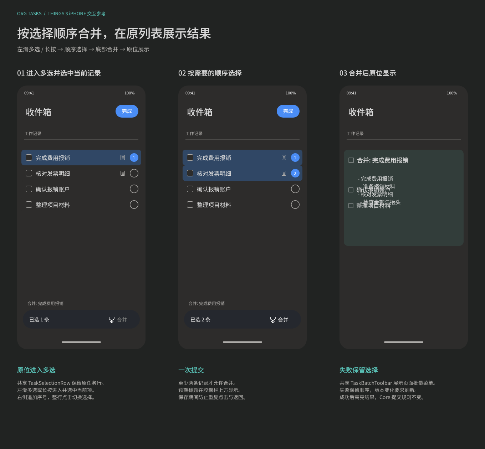。

* 列表 checkbox 完成与重新打开任务

共享 ~TaskListItem~ 收起与展开状态下，标题前部的待办 checkbox 均可点击完成，已完成或已取消的 checkbox 可点击重新打开；图标保持 18vp，垂直响应区域为 44vp。收起时标题区域继续用于展开编辑。完成取自 ~Task.taskStateOf(Done)~ ，重新打开取自 ~Task.taskStateOf(Todo)~ 返回的第一个有效待办状态，不弹出状态选择器；完成使用透明底方框内的白色勾，取消方框绘制贯穿中线，标题显示单条删除线，笔记图标保持无状态语义。没有对应目标状态、快照不可用或正在提交时禁用按钮。

提交前结束其他卡片编辑并保存当前草稿，保存失败则保留原内容与错误；以当前文件版本提交 ~TODO~ 修改，重复点击不重复写入，版本冲突不覆盖新内容；保存草稿期间任务已被外部完成或重新打开时，不执行相反操作。成功后由数据通知更新列表、分类计数与日志簿。重新打开由 Core 清除自身 ~CLOSED~ ，保留旧日志与说明，按目标进入或来源离开标记决定是否新增状态日志；不回退计划、截止、重复日期或 ~LAST_REPEAT~ 。完成重复任务继续遵循 Core 的重复调度规则。 Core 先重新调度重复任务，再执行已有 ~TRIGGER~ 的文件内联动；手机显示最新状态和日期。不支持动作静默跳过，已支持动作失败时整组回滚，入口和界面布局不变。

* 重复任务编辑

以 Things 3 在 iPhone 上的交互为参考：普通任务先展开，点击卡片底部“更多 → 重复…”；已有规则在日期工具栏上方显示蓝色循环图标、计划／截止与中文摘要，点击直接编辑。独立任务详情的元数据区增加“重复”入口，文字编辑期间禁用，先保存文字后再修改规则。设计维护于当前 Harmony 页的“50 Harmony 重复任务编辑（当前实现）”画板，见 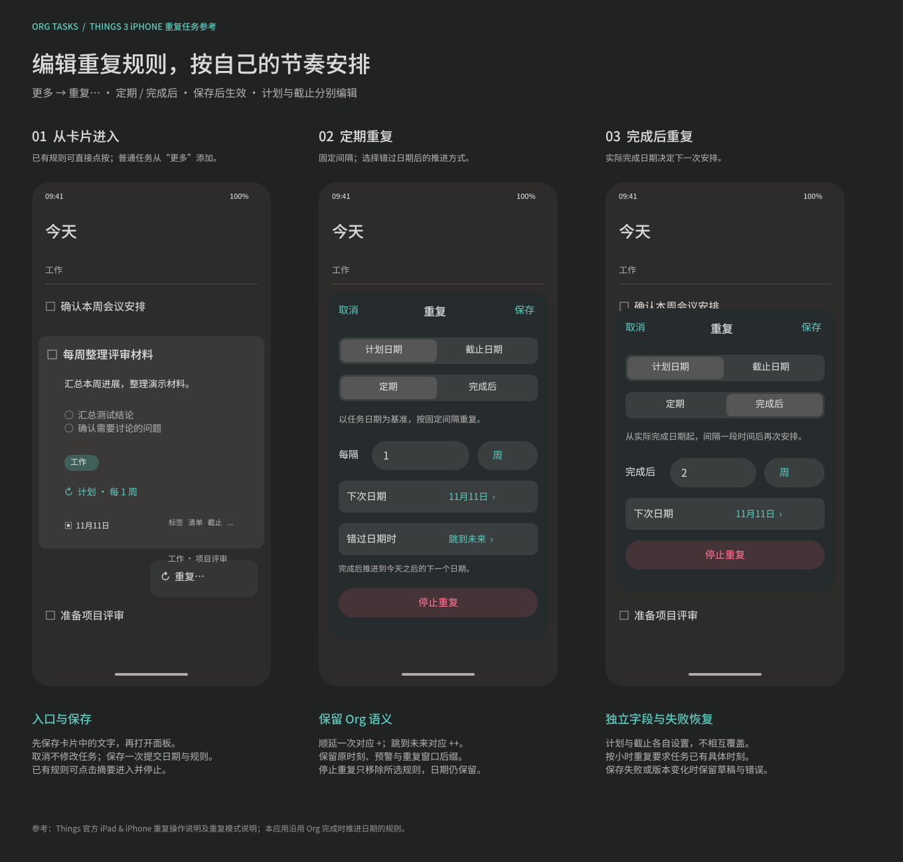。

重复编辑使用轻量圆角面板，顶部“取消／重复／保存”，先按“计划日期／截止日期”选择规则归属，再以“定期／完成后”分段切换。下方按顺序设置正整数间隔、小时／天／周／月／年单位与下次日期；日期沿用六行月历，只更新面板草稿。切换归属重新载入该字段当前规则。定期模式额外提供“错过日期时：顺延一次／跳到未来”，下方解释完成后的日期推进；完成后模式说明从实际完成日期重新计算。没有日期时草稿默认今天，点击保存才创建日期和规则。

保存把当前所选规划字段的日期与规则作为一个操作组提交。取消、点击外部或返回只丢弃面板草稿；已存在规则时提供“停止重复”，仅清除当前规划字段的重复器，保留日期和另一字段。保存期间禁用关闭与重复提交，失败保留面板和错误。小时单位要求任务已有具体时刻，缺少时说明原因；本入口不新增具体时刻表单。保留已有 Org 重复窗口后缀，界面不将其解释为结束日期。

参考来源为 [[https://culturedcode.com/things/support/articles/2803564/][Things 官方重复任务说明]] 的 iPad & iPhone 分支，以及 [[https://culturedcode.com/things/support/articles/3743733][重复模式说明]]。Things 的模板／副本和定期自动生成机制不同于 Org：本应用编辑原任务的重复器，仍在完成时推进原时间戳；不新增模板、副本、多星期规则或重复结束日期。三种 Org 模式的可见含义与文件实际规则保持一致。

* 项目任务的分类内区块

今天页保留 CATEGORY 的标题、图标、分隔线、原有排序与普通任务行。项目任务在所属分类内归入项目区块，左上角用 12vp 弱灰字展示 Core 提供的项目名；区块使用低对比度深灰背景、细描边和 12vp 圆角。普通任务不包区块，项目区块按第一条任务出现位置排列，内部保留 Core 返回顺序；随时页仍只按分类。

收件箱最近新增在每个创建日期内按 CATEGORY 与项目名组织相同样式的项目区块，普通任务直接排列，不跨日期合并。计划页、最近新增等原有分类来源行继续显示项目名，展开卡片底部来源使用相同文字。分类缺失时单独显示项目名，空项目名显示“未命名项目”；来源保持单行并末尾省略。完整边界与预览见 [[file:项目分类布局设计.org][项目分类布局设计]]。

* 页面数据的一次批量读取

收件箱在同一批取得本页记录、最近新增、所选文件元信息和当前通知。今天、计划、随时、日志簿将视图任务与通知合批；某天和备忘再加同批目标文件元信息。侧边栏的八项计数、三个入口文件状态和通知也使用同一批次，不再逐入口加载文件。

文件元信息与任务来自同次快照：有文件但零任务正常显示空态；不存在、被忽略或未配置的入口显示配置提示，不回退到同名文件或全部任务。备忘标签候选随 File 结果返回，标签切换只处理当前快照。整批失败时统一显示读取错误，通知保留最近成功快照。

AppShell 仅注册数据与通知失效订阅，不在页面出现时再发通知读取。抽屉打开期间只刷新抽屉批次，关闭后再刷新被覆盖页面；切换到其他路由时由新页面加载。订阅回调不自行查询通知，避免内容与通知各读一遍。存储库文件清单也使用统一 File 与 Notification 批次，批次失败时各区展示读取失败并统一重试。

收件箱自动刷新只更新已选任务快照，不重复读取已打开移动浮层的目标会话；目标仍按取得时的文件版本提交，由 Core 校验。用户重新打开移动浮层时再取得目标，避免主列表加载中额外发起文件元信息查询。

主列表页面的首次出现和恢复由 AppShell 统一安排一批加载，页面自身不再同时发起同一轮读取。首次加载完成前若出现新的数据版本，仍正常重查，不吞掉更新。抽屉仍打开时由抽屉批次读取，正文延后到抽屉关闭后加载；同一数据版本的并发抽屉加载合并为一轮。

* 任务运行状态分类与设置

任务状态图标仅按 Core 的 ~state.category~ 绘制，用单色图形区分，不为状态添加绿色或黄色；无状态笔记图标保留原资源及颜色。方框统一占用 18vp，进行中保留空方框，不增加圆点，方框和标题起点保持对齐。完成图标保留方框并同步加载，状态按钮关闭系统默认按压效果，点击与切换期间不出现绿色底黑色勾。进行中任务整行及展开卡片使用 ~#18F2C96D~ 透明黄色底，约 9.4% 不透明度，作为当前试用样式；方框仍保持单色。

| 分类 | 图形 |
|-
| ~Todo~ | 空方框。 |
| ~Doing~ | 空方框，整行使用透明黄色底。 |
| ~Wait~ | 方框内的两条单色竖线。 |
| ~Done~ | 透明底方框内的白色勾。 |
| ~Cancel~ | 方框及标题均有单条中划线，收起与展开一致。 |
| 有状态、分类为空 | 普通方框。 |
| 无任务状态 | 原有笔记图标，保留颜色。 |

共享任务项按 Core 的 ~state.category~ 展示五类运行状态：待办为空框，进行中保留空方框并以整行透明黄色底区分，等待在框内显示两条单色暂停线，完成显示透明背景的白色勾号，保留透明底方框，取消在方框中间绘制贯穿的水平线，并对标题使用单条删除线。无状态记录保持笔记图标。前三类可点击完成，使用 Core 提供的第一个 ~Done~ 状态；完成和取消两类可点击重新打开，使用第一个 ~Todo~ 状态。缺少相应目标状态时禁用操作。详情状态行同时显示中文分类名称与实际状态值。完成、逾期颜色和取消样式均使用分类结果。

“设置 → 笔记与笔记本”在默认 TODO 流程与文件入口之间增加“任务状态分类”，五组依次为待办、进行中、等待、已完成和已取消。每组显示中文名称、枚举名和“内置默认状态不可修改”提示；附加值可以添加或移除。输入错误时保留草稿并显示原因，配置保存后刷新活动 workspace。对象设置与文件声明语法见 [[file:配置项设计.org::*任务状态分类设置][状态分类配置]]。

当前界面同步维护于“52 Harmony 任务状态分类（当前实现）”画板，预览见 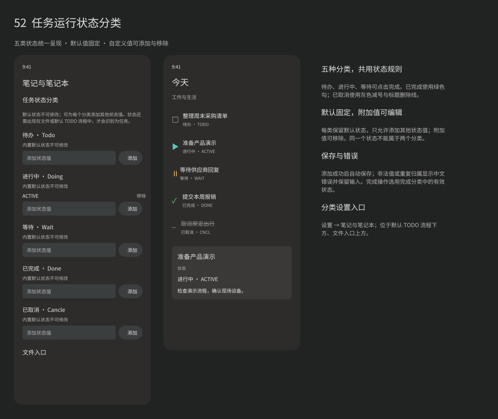。

* 任务左滑与批量编辑共享控件

左滑菜单由 ~TaskSwipeActions~ 绘制，选择状态由 ~TaskSelectionRow~ 呈现，底部操作由 ~TaskBatchToolbar~ 绘制。三个共享控件均以 Task 命名，仅用于任务列表，备忘页保留原有左滑删除控件；收件箱移除页面内重复的选择序号与批量栏代码，保留原任务控件、位置浮层、选择顺序与合并提交流程。

页面代码通过 ~taskPageActionPolicy(page)~ 分别声明以下四项，不新增用户设置入口：

| 字段 | 含义 |
|-
| ~rightSwipeAction~ | 右滑动作：分配计划时间、切换进行中、移动或无操作。 |
| ~swipeActions~ | 左滑按钮的有序列表；空列表不显示菜单。 |
| ~batchEditing~ | 是否开放批量编辑；关闭后隐藏左滑多选入口，长按不进入选择。 |
| ~batchActions~ | 批量操作的有序列表；空列表不显示操作按钮。 |

当前各页面的开放范围如下；“最近新增”是收件箱内的独立展示区域，不继承主列表的多选范围。

| 页面或区域 | 右滑动作 | 左滑菜单（从左到右） | 批量编辑 | 批量菜单 |
|-
| 收件箱主列表 | 移动 | 将来、备忘、删除、多选 | 开启 | 合并 |
| 今天 | 切换进行中状态 | 无 | 关闭 | 无 |
| 计划 | 分配计划时间 | 无 | 关闭 | 无 |
| 随时 | 分配计划时间 | 无 | 关闭 | 无 |
| 某天 | 移动（同收件箱） | 无 | 关闭 | 无 |
| 备忘（独立控件，不接入任务策略） | 无 | 原有左滑删除 | 关闭 | 无 |
| 日志簿 | 无 | 无 | 关闭 | 无 |
| 最近新增 | 分配计划时间 | 无 | 关闭 | 无 |

页面向共享任务卡片显式传入 ~rightSwipeAction~ ，与左滑菜单开关独立。存在原生左滑菜单时，卡片只识别向右的手势，向左仍由外层列表处理；外层不注册右滑提示栏，右滑不平移露出工具栏。今天不再提供左滑状态手势，收件箱左滑菜单移除移动入口，菜单宽度为 208vp。某天页复用 ~InboxTargetPopup~ 与 ~InboxService~ 的目标查询和移动操作：先保存草稿并读取最新源快照，确认后携带源与目标版本提交；失败保留浮层，不自动覆盖冲突，显式重试才重新读取源与目标。

共享控件接收 ~TaskActionItem~ 数组，每项包括稳定标识、标题、辅助功能名称、图标、强调／危险样式与动作回调；批量项还可定义最少选择数及执行中文案。页面可以裁剪或重排已接入动作，也可以直接提供自定义动作描述与回调。左滑按钮每项 48 × 44vp，菜单宽度随实际数量计算，保留深灰连体圆角底、删除错误色和多选蓝底白字。

~TaskSelectionRow~ 只包裹页面提供的原任务内容，不替换任务快照；多选期间屏蔽内部编辑与状态按钮，整行点击切换选择，右侧序号由页面的选择顺序决定。关闭批量入口或正在处理操作时，不触发进入或切换事件。 ~TaskBatchToolbar~ 根据实际选择数、最少选择数、忙碌与失效状态禁用动作；失效时保留错误与“刷新重选”，提交中禁用所有按钮，只对当前动作显示执行中文案。

共享控件仅负责展示与事件，不读取文件、不生成 Org 内容，不内置页面业务。页面负责保存草稿、刷新源快照、确认删除、收起菜单、打开目标浮层及执行回调；增加新的页面动作时同时接入对应回调和既有 Core 操作。批量合并仍由 Core 生成一组普通删除与修改操作，沿用版本校验、失败回滚和单次提交。对应画板为“54 Harmony 任务列表共享操作控件（当前实现）”，见 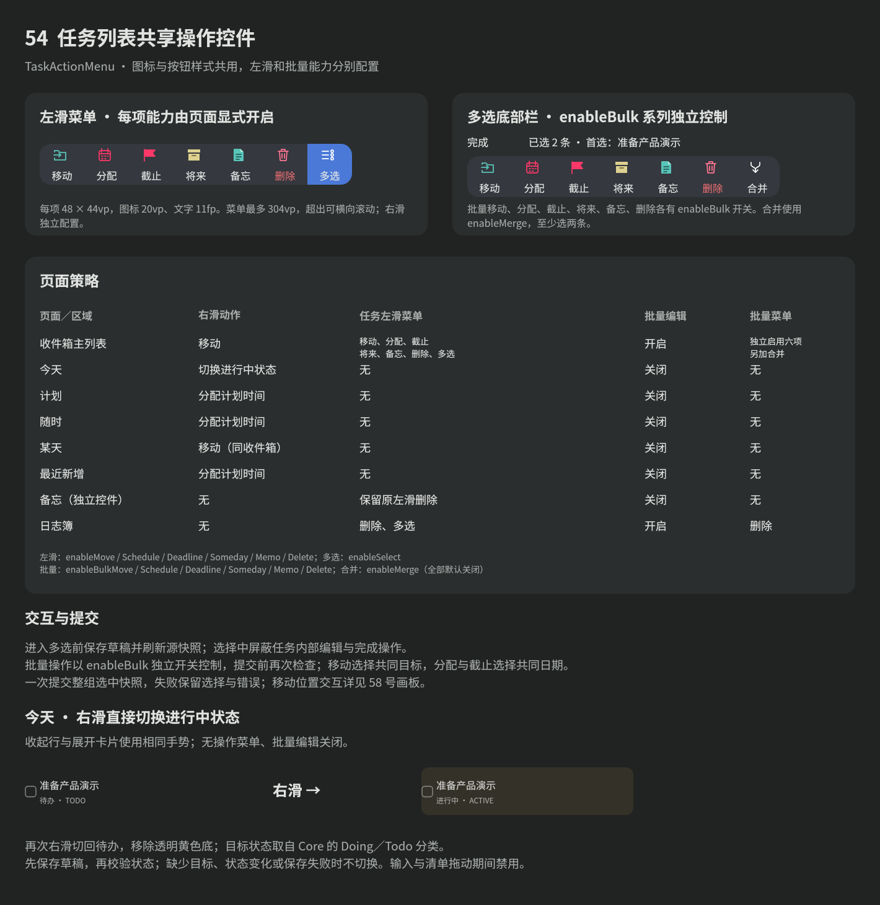 。

* 任务优先级设置

界面与接口见 [[file:任务优先级界面设计.org][任务优先级接口与界面设计]]。当前画板位于界面图谱“Harmony 当前实现”页的 56 号主稿与补充状态画板：优先级以字母底色色块显示在循环／习惯图标之后、标题之前，收起任务行与展开编辑保持相同顺序。Core 提供 TaskPriority 值对象及 PeriodCategory 分类，界面按分类决定色块颜色。

展开后点击色块，或从更多菜单和详情优先级行进入同一紧凑标签式选择器，仅展示“无”和字母，不显示标题或分类说明。当前项描边并显示小勾；点击同值只关闭，点击新值保存后关闭。进入前保存文字草稿，失败保留原值与卡片。更多菜单提供“设为最重要”，由 Core 的分类查找返回目标；无目标或当前已为最高时禁用。默认无优先级，不改变列表排序。
