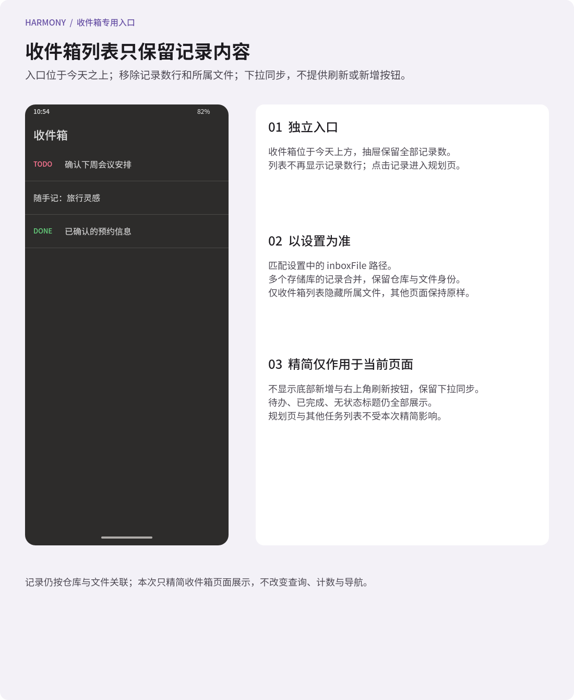
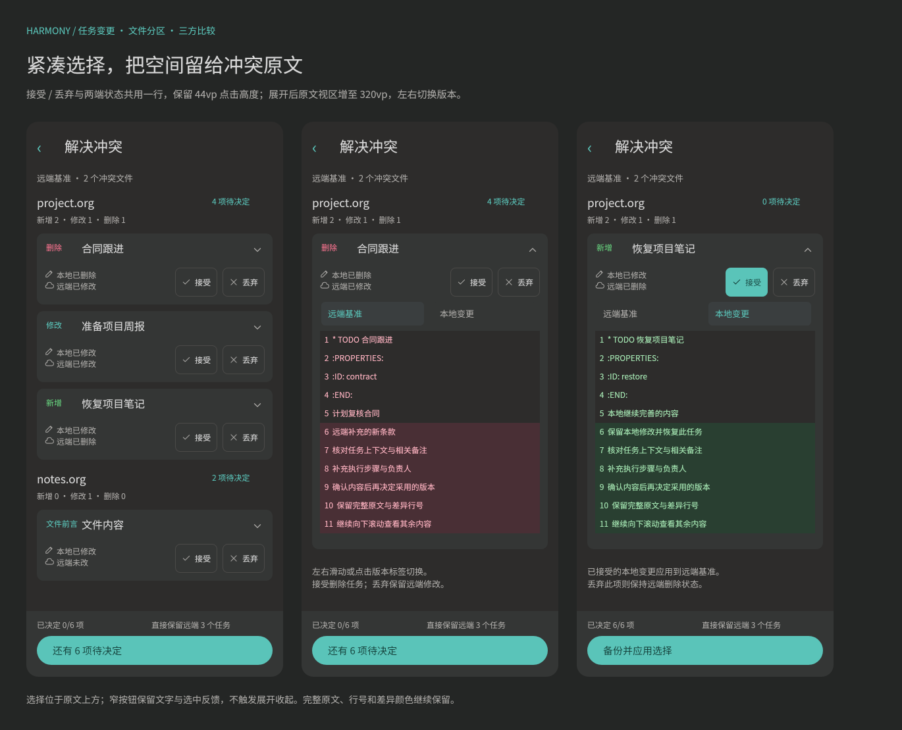
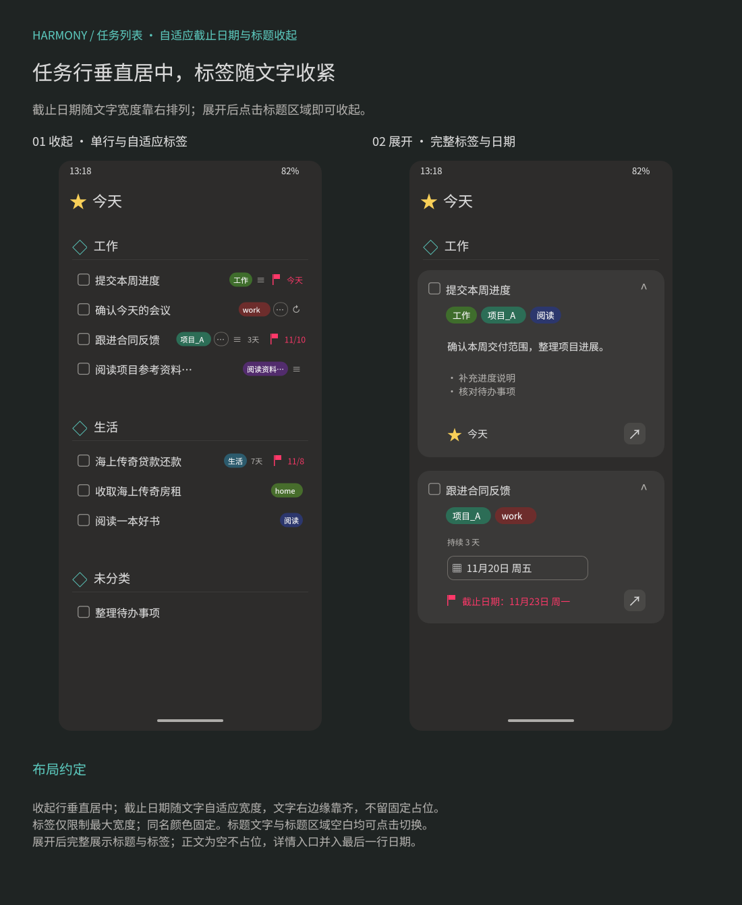
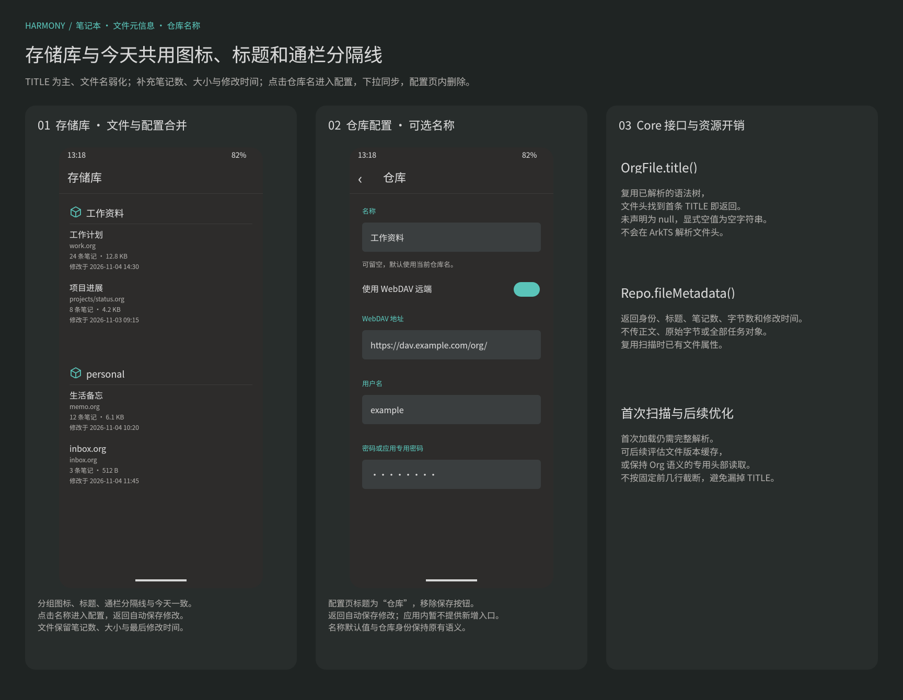
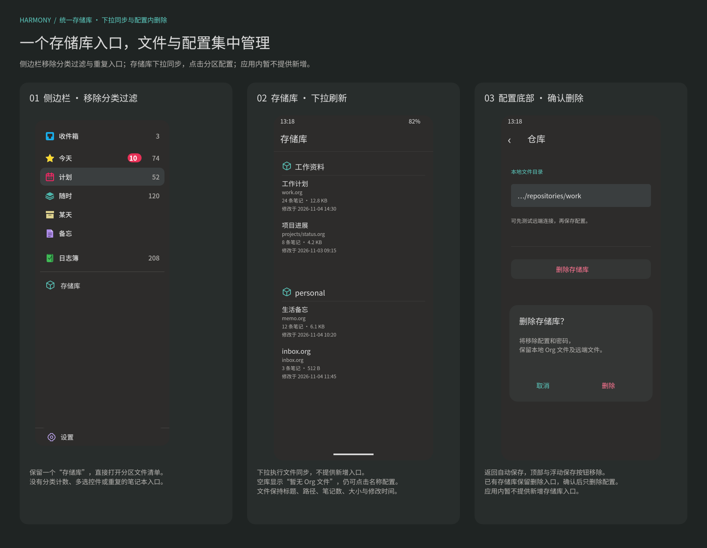
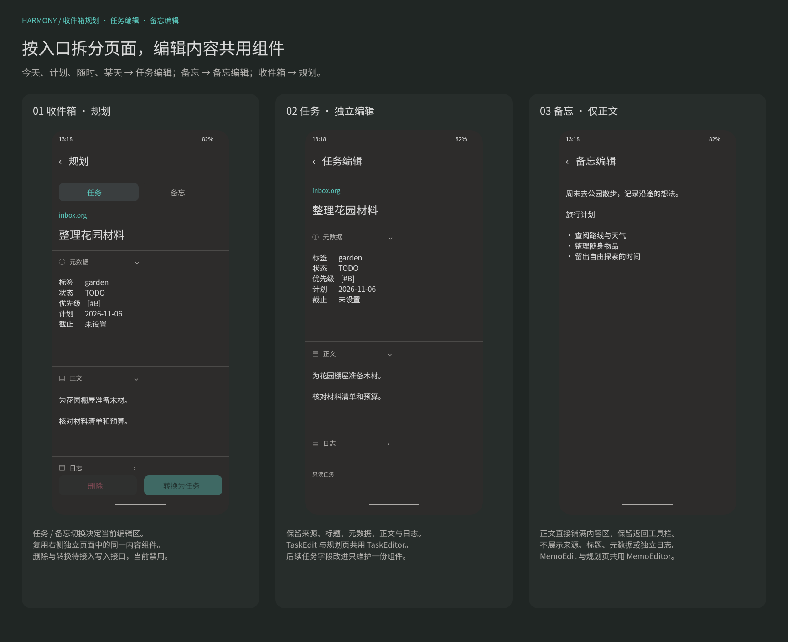

#+TITLE: Harmony UI 导航与参考界面映射
#+STARTUP: show2levels hidestars
#+OPTIONS: author:nil date:nil toc:nil
#+LANGUAGE: zh-CN

* 依据与目标

本轮界面以 [[file:../../design/Orgzly界面细节.fig][界面图谱]] 中的参考画板及其 18 张实机截图为依据；同一 .fig 中的“08 Harmony 收件箱记录”至“21 Harmony 任务变更瀑布”画板维护当前应用布局；“07 Harmony 历史分类任务导航”保留为已移除功能的历史参考。参考版本为 Orgzly Revived 1.23.0 F-Droid Debug。Harmony 提供本地目录、WebDAV、任务查询、外部快速捕捉和系统日历同步能力；应用内不提供新增任务、存储库或已保存搜索的入口。

全 App 统一使用与侧边栏相同的深灰配色：页面背景 ~#2D2C2B~ ，卡片 ~#343635~ ，输入框与选中背景 ~#3A3E3F~ ，主文字 ~#D8D8D8~ ，辅助文字 ~#AEACA9~ ，强调色 ~#5AC4B9~ ，错误色 ~#FF7592~ ，完成色 ~#65CD7B~ 。侧边栏保留彩色顶部图标和圆角灰色选中行。工具栏高 64vp，图标点击区域 48vp，内容基础边距 16vp。应用内移除手动刷新按钮与全部新增入口，不显示浮动新增按钮；列表底部不再为浮动按钮预留空间，刷新统一使用下拉同步。共用样式与控件维护于 ~ui/Theme.ets~ 、 ~components/Controls.ets~ 与 ~components/AppShell.ets~ 。

* 功能对应

| 参考画板与区域 | Harmony 页面或组件 | 实际功能与边界 |
|-
| 01 导航抽屉 | ~AppShell~ | 不设置顶部关闭按钮；收件箱、今天、计划、随时、某天、备忘、日志簿、查询与存储库整体滚动，底部固定设置。侧边栏只保留一个存储库入口，不提供分类列表或分类多选。页面工具栏不再显示展开侧边栏按钮，仅一级页面的标题图标或文字本身打开抽屉，顶部空白不响应；带返回按钮的二级页面标题只展示。切换主入口替换当前路由；点击功能、空白处、遮罩与系统返回均可关闭抽屉。 |
| 存储库与文件列表 | ~Files.ets~ | 按仓库分区，存储库名称位于分组标题，下面使用通栏分隔线；文件 TITLE 为主，文件相对路径以弱化文字显示，无 TITLE 时以路径兜底。“存储库”入口查看全部已配置存储库及其文件，补充笔记数、文件大小和最后修改时间；默认隐藏命中配置忽略规则的文件，工具栏按钮可切换显示；点击仓库名打开对应仓库配置。不提供新增存储库、搜索、菜单或新增任务按钮；空态只展示说明。 |
| 收件箱记录 | ~Inbox.ets~ | 入口位于顶部，抽屉显示所选仓库与收件箱文件中的全部标题记录数；页面不显示记录数行或记录所属文件，不提供新增或手动刷新按钮，保留下拉同步；包含无 TODO 和已完成记录，不使用分类过滤。 |
| 顶部任务入口 | ~TaskOverview.ets~ | 今天包含当天及过期任务，使用 ~TodayTaskList~ 按分类分区组织通用 ~TaskListItem~ ，原地展开后可进入详情；计划从明天开始；随时无计划和截止日期；某天和备忘来自已配置文件；日志簿展示完成任务。所有结果由 Core 查询产生。 |
| 01 文件阅读 | ~FileDetail.ets~ | 按配置显示整篇渲染或完整原文，默认渲染；可折叠单个标题或全部标题。TITLE 只在工具栏显示，没有阅读/原文/只读切换行。空文件可正常打开。 |
| 02 任务编辑 | ~TaskEdit.ets~ 与 ~TaskEditor~ | 今天、计划、随时、某天的任务进入独立任务编辑页；保留来源、父标题面包屑、标题、状态、标签、优先级、计划、截止、正文和日志，元数据、正文与日志独立折叠。来源可返回对应笔记本。当前仍为只读。 |
| 备忘编辑 | ~MemoEdit.ets~ 与 ~MemoEditor~ | 备忘列表进入独立备忘编辑页，仅展示正文内容，空正文显示“没有正文内容”；保留返回工具栏，不展示来源、标题、元数据、正文折叠栏或独立日志。 |
| 收件箱规划 | ~InboxPlan.ets~ | 收件箱记录进入“规划”，任务与备忘切换分别使用 ~TaskEditor~ 与 ~MemoEditor~ ，底部提供删除与转换按钮。 |
| 02 字段选择器 | 当前不提供入口 | 新增任务页面已从路由表移除，列表、详情与空态均不提供新增入口。 |
| 03 简单搜索 | ~Search.ets~ | 文字、排除已完成和状态选择组成核心查询；点击搜索或键盘搜索后进入结果。改变高级查询到简单模式前明确提示恢复简单条件。 |
| 03 高级查询 | ~Search.ets~ | 直接输入 core 支持的查询表达式；结果页展示实际提交表达式与数量，可调整条件和下拉同步，不提供保存为新搜索入口。 |
| 03 已保存搜索 | ~SavedSearches.ets~ | 内建“已计划”和“待办”作为真实查询快捷项；自定义列表显示名称与表达式，点按执行，长按编辑或经确认删除。不提供新建搜索入口，编辑表单仅修改已有搜索。 |
| 04 日程分组 | ~Agenda.ets~ | 默认显示有计划或截止日期的未完成笔记，按“过期”与具体日期分组；日期标题置顶。全部、计划、截止筛选决定用于分组的日期；同时有两个日期时，全部视图使用较早日期且不重复列出。 |
| 04 批量与滑动菜单 | 当前不提供 | 现有修改、完成切换、移动、删除与批量编辑尚未通过领域接口接入，不显示相应按钮或上下文工具栏。 |
| 05 设置分组 | ~Settings.ets~ | 首页的笔记与笔记本、应用程序两个入口只显示图标、名称和箭头，不显示描述行；子页面继续展示设置值与填写说明。目标日历与后台间隔仍由配置和后台作业使用，但不在界面提供同步分组或手动同步页面。外观切换、通知、提醒和小部件没有虚设入口。 |
| 06 WebDAV 表单 | ~RepositorySettings.ets~ | 地址、用户名、密码和本地目录纵向排列；配置页标题固定为“仓库”，返回时自动保存，移除工具栏和浮动保存按钮。应用管理的本地缓存目录由宿主创建，目录有效性由 core 验证。保存前可独立测试当前草稿的认证与目录访问，结果在表单内展示；修改地址或凭据后清除旧结果，测试期间禁止重复测试和返回保存。测试不保存配置或执行同步，不提供证书导入按钮。 |
| 06 命名查询表单 | ~SavedSearches.ets~ | 仅编辑已有搜索的名称与表达式，工具栏和底部保存；保存失败保留草稿，成功后返回列表，不创建新搜索。 |
| 存储库文件同步 | ~RepositorySyncView~ 、 ~RepositorySyncService~ 与 ~RepositorySyncBanner~ | 今天、收件箱、计划、随时、某天、备忘、日志簿、存储库、日程与搜索结果均可下拉执行文件同步；统一控件展示标题下方 2vp 进度线、失败对话框与冲突入口，并通知页面重新查询。成功只刷新列表，不请求日历权限或写入日历。 |
| 同步冲突合并 | ~MergeConflict.ets~ 与 ~MergeTaskCard~ | 按冲突文件分区，纵向连续展示任务变更卡片；每项标明相对远端的新增、删除、修改及两端相对上次成功快照的状态。点击任务项内展开，左右滑动查看远端基准与本地变更；逐项接受或丢弃后备份并应用。 |
| Harmony 系统日历 | ~SyncWorkExtension.ets~ 与 ~CalendarSync.ets~ service | 不提供独立页面或设置入口；后台作业按现有配置读取本地任务并写入系统日历。 |

* 页面流

#+begin_example
今天（默认入口）
  抽屉 -> 已保存查询 -> 结果 -> 任务编辑
       -> 收件箱（全部记录数） -> 收件箱记录列表 -> 规划 -> 任务 / 备忘编辑区
       -> 今天 / 计划 / 随时 / 某天 / 日志簿 -> 任务列表 -> 任务编辑
       -> 备忘 -> 备忘列表 -> 备忘编辑（仅正文）
       -> 存储库（按库分区的文件清单） -> 按配置阅读文件（渲染或原文）
                -> 点击分区名称 -> 存储库配置 -> 确认删除配置与密码
       -> 设置 -> 收件箱文件 / 某天文件 / 备忘文件 / 日历名称 / 后台间隔
               -> 后台作业按配置读取本地任务并写入日历
  今天 / 收件箱 / 计划 / 随时 / 某天 / 备忘 / 日志簿 / 存储库 / 日程 / 搜索结果下拉
           -> 标题下方细进度线 -> 当前列表刷新
           -> 失败对话框 -> 处理冲突 -> 按文件分区的任务瀑布 -> 点击任务、左右比较 -> 接受 / 丢弃 -> 备份并应用
  卡片 / 上滑卡片 / 长按快捷操作 / 分享 / 小艺意图 / 外部调用 -> 独立快速捕捉窗口
#+end_example

原 ~Workspace.ets~ 入口转到统一的 ~pages/Files~ 存储库页面，避免保留第二套工作区导航。日程与笔记本在页面重新显示时读取最新数据，应用内暂不提供新增操作。编辑页面本轮只拆分结构和入口，保留现有只读展示能力。

* 数据与显示规则

查询、解析、序列化和同步均由 core 完成。 ~FilterTask.level~ 直接取自 ~orgize~ 标题层级，Rust bridge 同时投影 ~repoId~ 和层级；ArkTS 只将平面结果按层级缩进、折叠，不解析 org 文本。列表按原始字节顺序组织，折叠仅改变显示，不改写文件。

任务逻辑身份使用 Core 返回的 ~Task.id~ ，不使用源字节偏移作为跨刷新身份。列表渲染身份与逻辑身份分开： ~taskRenderKey~ 根据只读且可枚举的完整任务快照生成键，内容变化时重建行和点击闭包；今天分区与日程分组也按新分组快照更新子列表。收件箱下拉同步删除前面的任务后，剩余任务的标题、正文、状态和点击规划页参数立即对应新查询结果，无需退出重进。

任务完成由 Core 的 ~FilterTask.is_done()~ 判断，使用文件的有效 in-buffer TODO 定义与已有 SETUPFILE 设置，不按 DONE/CNCL 名称硬编码。

专用“收件箱”入口位于顶部“今天”上方，抽屉显示已选仓库中收件箱文件的标题记录总数。点击打开 ~pages/Inbox~ ，待办、已完成与无 TODO 状态的标题均显示并计数；不会用 ~isDone()~ 排除任何记录。页面移除记录数行及每条记录的所属文件，不提供底部新增或右上角刷新按钮，保留下拉同步与点击记录进入规划页的交互。记录仍保留仓库与文件身份，重复标题不会跨仓库合并；文件不存在或无标题时显示空态。上述精简仅作用于收件箱列表，其他页面的计数与文件来源展示保持原样。文件前言和正文不会被伪造为额外记录。

当前收件箱布局见  ，对应设计文件中的“08 Harmony 收件箱记录”画板。

抽屉顶部不提供搜索或关闭按钮，内容直接从主入口开始。收件箱、今天、计划、随时、某天、备忘、日志簿、自定义已保存查询和存储库位于同一个 Scroll 中；设置固定在底部；选择功能、点击侧边栏空白或外部区域时收起。

文件用仓库 ID 与相对路径联合定位。相同文件名出现在两个存储库时，其笔记、原文、详情与新增任务目标保持隔离。文件列表不将“已读取”误称为“已同步”，也不捏造 core 尚未提供的修改时间或上传状态。

日程按 core 投影中的原始计划或截止日期分组；本轮不展开重复器，不合成未来空日期，也不声称提供 Orgzly 的完整 agenda 引擎。错误、加载中、无存储库、空文件和无匹配结果分别显示可解释的状态。

简单与高级搜索保留各自的页面草稿，切换模式不自动猜测复杂表达式的含义。保存的值是完整提交表达式，包含状态限制。已保存查询仅在独立 Preferences 中保存名称、ID 和表达式，不保存任务快照、文件内容、绝对路径或凭据。

* 配置与操作反馈

存储库表单仅修改当前存储库；全局设置维护收件箱文件、某天文件、备忘文件、TODO 默认流程、日历名称和后台间隔。保存时重新读取其他配置，避免返回旧页面后覆盖新设置。后台间隔最小为 20 分钟；保存后由 ~BackgroundSyncService~ 更新同一系统作业；实际执行时间仍受 WorkScheduler 调度约束。

WebDAV 密码由 ~CredentialService~ 保存到 Asset Store。已有待上传意图和条件上传规则沿用 Core；当前 UI 不提供新增任务或其他记录写入入口。

手动下拉只执行文件同步，不写入系统日历。后台作业使用已保存的日历名称，按现有流程先读取本地文件或同步 WebDAV，再写入日历。

合并以远端文件为基准，接受对应本地版本，丢弃对应远端版本。Core 使用最近成功同步日志的完整文件快照识别本地变更，再与当前远端比较；只有远端变化的任务直接保留。任务优先按 Org ID 对应，没有 ID 时按标题层级对应；改名与重名不由 UI 猜测。所有任务及历史状态均由 Core 提供。

按显式确认的备份规则，一次同步的所有冲突原文件保存在 ~.sync/backups/<合并开始时间>/~ ，文件名附带日期时间和随机后缀。备份不进入笔记列表或远端传输；部分失败会显示已有备份，并让用户重新比较剩余冲突。

笔记本详情显示 TODO 状态来自本文件还是全局默认，以及有效状态名称。列表根据 Rust 投影的类型区分完成与未完成颜色，支持 DONE 之外的完成状态。新增任务读取目标收集箱的有效初始状态，切换存储库后重新读取，避免异步结果覆盖较新的选择。

设置中的 TODO 编辑器使用多行 Org 声明，默认值从 Rust 获取。文件内 TODO/SEQ_TODO/TYP_TODO 整组覆盖全局默认，空声明可以清空识别。当前提供配置与元信息，不新增现有任务的状态切换或日志写入入口。

* 冲突任务瀑布与交互

“解决冲突”按冲突文件形成纵向连续区块，所有文件及其需要决定的任务均在同一个列表中展示，不通过文件选择弹窗或逐项提示切换。设计维护于“21 Harmony 任务变更瀑布”画板，见  。每个文件分区显示路径、新增、修改、删除任务数及待决定数；文件前言放在该文件的说明区域，单独决定，不计入任务统计。

每个任务占一张卡片。卡片显示任务标题、相对远端的新增/删除/修改标记、两端相对最近成功快照的状态，以及待决定、已接受、已丢弃状态。标记、展开收起、远端基准、本地变更和接受/丢弃操作均使用与全局工具栏一致的线性图标系统；已选择的操作使用主色背景和深色图标保持清晰对比。点击任务标题在原卡片内展开比较区，保留文件与前后任务上下文；不打开另一套任务选择弹窗。比较区支持左右滑动及点击“远端基准”“本地变更”切换，显示完整任务原文和项内行号，远端被替换的行标红，本地新增或替换行标绿。长行折行，正文在当前版本内纵向滚动；横向手势专用于切换两端。版本不存在与空内容分别展示，CRLF 与末尾无换行差异保留可见标记。

操作区与两端状态共用一行：左侧上下排列本地、远端状态，右侧并排放置宽 64vp、高 44vp 的“接受”和“丢弃”按钮，保留文字、图标和选中反馈；未选中按钮使用透明背景及细边框。操作区位于原文比较上方，选择时不触发卡片展开或收起。取消原先独占整行的等宽大按钮及重复的决定状态文字，决定状态由按钮选中效果与无障碍说明表达。卡片内边距为 12vp、区块间距为 8vp，展开后的原文视区由 260vp 增至 320vp，完整保留行号、折行和纵向滚动。

任务选择只提供“接受”和“丢弃”：接受把此项本地变更应用到远端基准，丢弃保留当前远端状态。远端删除、本地修改时，接受恢复任务、丢弃保留删除；本地删除、远端修改时，接受删除任务、丢弃保留远端修改。两端状态直接显示在任务卡片中，不用额外提示对话框解释每个冲突。保留本地子任务所必需、已被远端删除或层级不兼容的祖先也会列入决定列表；Core 继续拒绝父子选择不完整的组合。

本地未改而仅远端变化的任务、两端已相同的任务直接保留远端，不进入待决定列表。底部固定显示决定进度、直接保留的远端任务数和“备份并应用选择”，所有任务和文件前言决定完成后才能提交。更多菜单保留重新比较和全部丢弃本地变更；已有选择时重新比较须确认清除，全部丢弃须独立确认。提交前仍确认备份和不保留项数；失败或部分完成后作废比较对象，保留备份路径并重新比较。

~MergeTaskCard~ 只负责展开、两端切换、行级展示与接受/丢弃交互。任务匹配、快照解析、三方状态、自动保留、层级校验、完整文件重组和日志持久化均由 Core 完成；ArkTS 不解析 Org，不从两段原文推导历史操作。只读的 ~preamble~ 、 ~kind~ 、 ~localChange~ 、 ~remoteChange~ 与来源内容原样回传，仅修改 ~resolution~ 。

* 布局变更维护

调整布局、入口位置或交互范围时，必须同时修改 ArkUI 实现、 [[file:../../design/Orgzly界面细节.fig][.fig 设计画板]] 和本文；手机用户可见功能同步更新 [[file:../手机应用功能清单.org][手机应用功能清单]] 。当前存储库与侧边栏布局在“13 Harmony 存储库分区与名称”和“14 Harmony 存储库统一入口”维护；“07 Harmony 历史分类任务导航”仅保留历史参考。

所有任务过滤条件只在 Core 中求值；收件箱页使用文件表达式并包含完成与组合任务。侧边栏不再发起分类导航查询。

* 顶部入口视觉与查询契约

顶部按参考图依次显示收件箱（蓝色收件箱图标）、今天（黄色星形）、计划（粉色日历）、随时（青色层叠）、某天（米色归档盒）、备忘（紫色备忘纸），留出间隔后显示日志簿（绿色记录本）。存储库使用青绿色立方体图标，设置使用紫色齿轮图标，与侧边栏其他彩色入口统一风格。侧边栏所有入口、分类、计数与分组文字统一 16vp，主行高 44vp，图标 22vp，选中行使用 12vp 圆角。深色背景为 ~#2D2C2B~ ，选中背景为 ~#3A3E3F~ ；其余页面也统一采用上述深色配色。内建“已计划”“待办”不再重复列在顶部，自定义已保存查询继续保留。

| 入口 | UI 组装的 Core 查询 | 显示含义 |
|-
| 今天 | ~(s.le.today or d.le.today)~ ， ~includeDone=false~ | 计划或截止任一日期为今天或更早即命中；包含当天与全部过期任务。 |
| 今天红色徽标 | ~(s.le.yesterday or d.le.yesterday)~ ， ~includeDone=false~ | 仅显示过期数量；旁边灰色数字为今天的总数，徽标零时隐藏。 |
| 计划 | ~(s.ge.tomorrow d.ge.tomorrow) or (s.ge.tomorrow d.none) or (s.none d.ge.tomorrow)~ ， ~includeDone=false~ | 有日期且最早的计划/截止日期从明天开始；与今天不重叠。 |
| 随时 | ~s.none d.none~ ， ~includeDone=false~ | 计划日期和截止日期都没有安排。 |
| 某天 | 配置文件的 ~b."相对路径"~ ， ~includeDone=false~ | 只展示 ~somedayFile~ 文件中的未完成记录。 |
| 备忘 | 配置文件的 ~b."相对路径"~ ， ~includeDone=true~ | 展示 ~memoFile~ 文件中的全部标题记录，包含无 TODO 与已完成记录。 |
| 日志簿 | ~it.done~ ， ~includeDone=true~ | 按文件有效状态定义展示完成任务，包括被定义为完成的 CNCL。 |

以上入口当前均设置 ~includeComposeTasks=true~ ，保留原文件的组合标题；查询由 Core 求值，UI 不对返回任务做日期、状态或文件过滤。任务同时具有两个日期时按较早日期归入今天或计划，禁止先查后由 UI 去重。日期以运行设备的本地自然日为准。

收件箱、某天和备忘文件均在“设置 → 笔记与笔记本 → 文件入口”通过应用内 ~FileTargetPicker~ 选择，按仓库分区展示 Core 返回的文件元信息并过滤 ~is_ignore=true~ 文件。选择时保存具体仓库 ID 与相对路径，行尾显示已选状态，底部支持清除选择；不使用系统文件选择器或自由路径输入。未选择、仓库或文件失效、文件被忽略时提示重新选择，可跳转设置；已选文件没有记录时显示空列表，不伪造文件，也不把空目标作为全局查询。查询和计数只包含所选仓库的文件。画板见 [[file:../../design/previews/10 Harmony 文件入口配置.png][仓库文件选择预览]] 。

最新顶部设计见 [[file:../../design/previews/09 Harmony 顶部任务入口.png][顶部任务入口预览]] ，配置与提示见 [[file:../../design/previews/10 Harmony 文件入口配置.png][文件入口配置预览]] 。

* 今天专用布局

“今天”使用独立的 ~TodayTaskList~ 展示组件，不复用其他概览入口的 ~TaskRow~ 。顶部标题带黄色星形图标，取消列表上方的任务数量条。任务按所属文件的 ~CATEGORY~ 分区，同名分类跨文件、跨存储库合并；具名分类按名称排序，无分类记录放在末尾的“未分类”区块。只为实际返回的任务建立区块，不显示空分类；没有无分类记录时不显示“未分类”。显式命名为“未分类”的分类与缺少分类的记录仍保持独立身份。

区块标题使用青绿色立方体图标、18vp 文字及下方细分隔线；任务使用 16vp 标题、至少 44vp 行高，全部区块在同一个列表内滚动。任务行使用通用 ~TaskListItem~ ，收起时单行展示标题、弱化标签、提示标志、持续天数与最右侧截止日期；点击标题原地展开，只读查看完整内容，通过详情图标进入任务编辑页。支持下拉同步与侧边栏导航，不提供新增任务入口。

UI 仍提交今天的通用查询，由 Core 负责日期、完成状态等全部筛选。 ~TodayPresentation~ 仅通过 ~Repo.file(path).category()~ 取得 Core 已解析的分类元信息，并组织查询结果的展示区块，保留每一条任务及其来源身份，不重新筛选任务、不解析 Org 源文。持续天数优先从有效计划日期计算，未设置有效计划日期时回退截止日期，与设备本地当天的自然日求差；当天和未来日期隐藏。计算使用 UTC 日序号，避免跨夏令时产生少一天或多一天，不展开重复器。页面每次查询成功及用户切换任务项状态时更新展示日期。

** 任务列表项两态展示

任务行提取为通用 ~TaskListItem~ ，支持收起与原地展开。收起状态整行不换行：只读完成状态、标题、弱化标签、正文／列表／循环等提示标志、非当天的持续天数在可用宽度内紧凑排布。标题与标签列表均可压缩并用省略号截断；标签过多时显示首个标签与“…”胶囊，单个标签过长同样省略；标志过多时合并为省略号，不挤出整行。优先为标题保留阅读空间，根据余宽分配标签和标志区域。

收起状态若有 ~DEADLINE~ ，粉色旗帜与紧凑日期始终固定在最右侧，不受标题或标签长度影响；当天显示“今天”，其他日期显示“11/10”等紧凑格式。先预留截止日期区域，再分配其余宽度；没有截止日期时释放该区域。持续天数采用中性文字，收起时以“3天”并入同一行，非当天显示，当天隐藏；计算口径沿用上文的计划日期优先规则，今天查询与抽屉过期徽标的既有语义保持不变。

展开状态使用圆角卡片，展示只读完成状态、标题、持续天数、正文、已有标签与日期。展开卡片及独立详情页完整展示标题，超长内容自然换行；标签列表完整展示并换行，不沿用收起状态的省略结果。正文继续使用 ~OrgContentView~ 展示 Core 已生成的 HTML，不解析 Org、不提供编辑；正文为空时不显示“备注”或其他占位，不预留正文空白。展开状态的已有标签采用绿色胶囊，紧跟标题，多标签可换行。

~SCHEDULED~ 为今天时显示黄色星形和“今天”；其他日期显示粉色日历图标与“11月20日 周五”格式的圆角描边标签。 ~DEADLINE~ 单独成行，使用粉色旗帜与“截止日期：11月6日 周五”，当天补充灰色“今天”。日期区域不显示删除按钮，也不提供日期、标签或完成状态配置入口。

手机画板按 390vp 宽度设计，不设置独立详情按钮底栏；最后一行日期信息右侧放置查看详情图标按钮，视觉背景为 32vp × 32vp，点击区为 44vp × 44vp，进入现有任务编辑页。两种状态均点击标题区域切换，展开与收起采用 220ms 缓动高度过渡，正文等展开内容同步淡入淡出；相邻任务行随卡片高度平滑移动。正文阅读、标题链接和查看详情各自处理交互，不触发状态切换。

设计见  ，包含收起列表、带正文与今天的展开卡片、其他日期及无正文的展开卡片；对应 ~.fig~ 中“11 Harmony 今天分类布局”画板。“09 Harmony 顶部任务入口”中的今天示意同步维护；本阶段实现只读展示、两态切换与详情导航。

* 全 App 深色配色

启动背景、系统状态栏、底部导航栏和 ArkUI 页面采用统一深灰背景与浅色内容。应用通过 ~ApplicationContext.setColorMode(COLOR_MODE_DARK)~ 固定为深色，让系统选择菜单、日期选择器与确认弹窗也采用深色，不受手机当前浅色模式影响。

列表、卡片、输入框、任务详情、搜索、设置、存储库、同步和冲突处理都从 ~UiColor~ 获取语义颜色；旧浅色图标描边改为浅灰，输入文字与 placeholder 显式提供深色主题颜色。主色按钮采用青绿色背景配深色文字 ~#123D37~ ，避免白字在亮色背景上对比不足。红色过期徽标保留白字以区别于普通计数。当前为统一固定配色，不新增主题切换设置。

侧边栏紧凑布局尺寸统一维护于 ~UiSize~ ：文字 16vp、导航行高 44vp、图标 22vp。搜索、七个主入口、分类、已保存查询、普通导航和计数使用同一字号；通过字重与颜色区分层级，不再混用标题大小。收件箱后与日志簿前间隔分别为 6vp、12vp，分隔线外边距 4vp，分类行纵向内边距 8vp；勾选与关闭符号作为图标独立处理。整体内容仍在一个 Scroll 中，空间不足时滚动，底部设置固定。

备忘入口紧接某天下方，显示配置文件中的记录总数；记录仅来自所选仓库中的所选文件。未配置或文件失效时提示重新选择，不创建或修改文件。备忘是查看记录的入口，不显示写入收件箱的“新增任务”按钮，避免误认新增任务会写入备忘文件。

* 下拉同步与入口收拢

独立文件同步页面与 ~pages/Index~ 路由已移除。各列表页面通过共享 ~RepositorySyncView~ 内的 ~Refresh~ 接受下拉手势，调用 ~RepositorySyncService.start~ 执行前台文件同步；空任务列表和读取错误状态也可下拉。Refresh 使用空自定义指示器，避免同时出现圆形加载器；触发距离 64vp，下拉阻尼比例 0.4；松手后内容复位，同步状态由共享进度线承载。列表先处理滚动，到顶部后将下拉交给 Refresh，避免叠加回弹。侧边栏没有同步入口，设置固定在原底部操作位置。

~RepositorySyncBanner~ 只在同步期间显示标题下方的 2vp 细进度线：青绿色前景与深灰轨道，使用平滑进度、未知总数时的扫光及 150ms 淡入淡出，不显示文字状态、百分比或完成提示。文件总数确定后按 Core 的实际处理事件计算；成功后收起并刷新当前列表；已有任务列表在重载时继续显示，不切换到居中的加载提示。会话在页面间共享，重复下拉不创建第二次前台同步。

失败只由当前可见页面领取一次错误并弹出“同步失败”对话框，可重试；缺少存储库配置时只展示说明与关闭按钮，冲突时可按作业进入原有合并页。处理一次错误后其他页面不会重复弹出。启动和成功同步不显示历史错误横幅或成功提示；后续同步仍由 Core 恢复历史并报告未解决冲突。

全局设置入口只保留侧边栏底部的“设置”，未配置提示中的“前往设置”导航保留。页面工具栏去掉展开侧边栏按钮，仅一级页面的标题图标和文字作为抽屉入口；标题文字按内容宽度响应，顶部空白不打开抽屉。仓库配置、文件详情、任务详情等带返回按钮的二级页面只保留返回导航，标题图标和文字只展示，辅助功能也不提示“打开导航”。侧边栏顶部搜索、关闭、分类过滤和同步按钮均已移除；选择功能立即收起，点击空白处、外部遮罩或系统返回也可关闭。

* 存储库与文件合并入口

存储库文件列表采用与今天页面一致的深色、紧凑分区样式，存储库名称与青绿色线框图标组成分组标题，下方使用通栏细分隔线，文件行不再重复仓库名。仓库名称来自宿主 ~RepoConfig.name~ ，空白或旧配置缺失时使用根目录末级名称。名称用于笔记本分区、存储库列表与删除确认；身份仍由配置 ID、Core 仓库 ID 和根目录定位，重名仓库不合并。空存储库仍显示名称及“暂无 Org 文件”，读取失败的存储库显示错误并保留配置入口。

文件行优先显示 Core 返回的文件头 ~TITLE~ ，16vp 主文字；12vp 辅助文字始终显示文件相对路径，保留嵌套目录以区分同名文件。缺少或空 ~TITLE~ 时主文字使用相对路径。文件名下方用辅助文字显示笔记数、文件大小和本地最后修改时间。计数沿用原来的标题记录口径，包含无 TODO 和已完成记录，命中任务忽略规则的文件显示零记录。大小以原始 UTF-8 字节数格式化为 B/KB/MB/GB，修改时间按设备本地时间显示为年月日和时分，无法取得时明确显示“修改时间未知”。移除手动刷新、全部新增按钮、搜索与菜单；文件行仍按仓库 ID 和相对路径打开原笔记本。

~NotebookService.list~ 调用 ~Repo.fileMetadata()~ ，Core 扫描文件、加载语法树并提供 ~OrgFileMetadata~ 。列表响应包含 ~repoId~ 、 ~path~ 、 ~title~ 、 ~titleParts~ 、 ~taskCount~ 、 ~byteLength~ 和 ~modifiedAt~ ，不携带完整正文或任务；UI 不解析源文，也不按标题重新筛选文件。当前首次加载仍由 ~OrgRepo.load~ 完整解析文件，标题读取复用已有语法树，惰性遍历文件头关键字并在第一条 ~TITLE~ 处返回，不额外读取或解码全文。

当前布局与名称配置见  ，对应 ~.fig~ 中“13 Harmony 存储库分区与名称”画板。

点击仓库分区标题直接进入 ~pages/RepositorySettings~ 。界面以该仓库的根目录关联宿主配置 ID，再传递配置 ID；不把 Core 仓库 ID 当作 Preferences 配置 ID，重名仓库仍分别打开各自的配置。返回后重新读取名称和文件信息。文件同步从支持下拉的列表页面执行，完成后刷新当前可见列表。

* 导航精简与配置内删除

原“笔记本”页面改名为“存储库”，仍使用 ~pages/Files~ 路由。删除原独立 ~Repositories.ets~ 页面及注册路由，所有旧配置提示与导航转入合并后的存储库页面；侧边栏不再有两个入口。应用内不提供新增存储库入口，已有仓库仍可点击分区标题打开配置。

已保存存储库的配置页底部提供“删除存储库”。确认弹窗说明只移除配置和安全存储中的密码，保留本地 Org 文件与远端文件；取消不修改数据。删除期间禁止重复提交与返回，失败保留页面供重试，成功返回合并列表。删除过程重新读取全局设置，保留其他存储库、收件箱、某天、备忘、TODO 流程和日历设置。

侧边栏分类选项、计数、选择状态及分类结果页面已移除，打开导航不再发起分类摘要查询。Core 的通用分类查询能力和“今天”的分类分区仍由各自既有接口提供，UI 不重新实现任务过滤。

统一入口与精简侧边栏见  ，对应 ~.fig~ 中“14 Harmony 存储库统一入口”画板；分类过滤画板仅作为历史参考。

* 返回自动保存与统一分组样式

存储库配置页标题固定为“仓库”，不随 WebDAV 或本地类型变化。移除顶部保存对勾和浮动保存按钮；工具栏返回与系统返回都触发同一保存流程，保存成功后返回。已加载配置没有变化时直接返回；新建草稿没有编辑时返回不创建存储库。校验或保存失败时留在配置页，提示继续编辑或放弃修改并返回。测试连接、恢复默认过滤目录与删除存储库作为独立操作继续提供，删除成功不再保存未提交草稿。

“今天”和存储库文件列表共用 ~ListSectionHeader~ ：统一使用 22vp 青绿色线框立方体图标、18vp 分组标题、10vp 图文及标题与线的间隔；标题下方是贯穿内容宽度的 0.5vp 分隔线，顶部留白 24vp、底部 8vp。内容左右边距同为 20vp。存储库分区标题继续可点击进入配置，文件行保留所需元信息。

** 共享文件同步控件

今天、收件箱、计划、随时、某天、备忘、日志簿、存储库、日程与搜索结果共用 ~RepositorySyncView~ 。 ~AppShell~ 通过 ~pullToSync~ 开启下拉入口，将页面内容交给控件的 ~content~ 插槽，并将 ~onDataInvalidated~ 转接到页面现有的 ~synchronized~ 回调及抽屉计数更新。页面只组装并执行自身查询、展示结果，不订阅同步状态或重复实现失败弹窗。查询表单、配置与详情页面不开启下拉入口，但继续展示共享会话进度及反馈；工具栏和空态不提供新增任务、存储库、新搜索或保存为新搜索入口。

控件封装 ~Refresh~ 、 ~RepositorySyncBanner~ 、数据版本监听和失败反馈。64vp 下拉触发、0.4 阻尼比例与松手立即复位沿用今天页面；进度线位于标题下方，不随列表下拉移动，不展示百分比、文字状态或成功提示。内容插槽覆盖加载中、空列表、未配置文件和读取失败等全部状态，均可下拉；列表使用 ~SELF_FIRST~ 嵌套滚动，在顶部继续下拉时交给外层控件。抽屉展开、页面忙碌或已有同步运行时禁止下拉触发，不重建内容插槽，保留列表位置。 ~AppShell~ 不再提供浮动操作按钮插槽。

~RepositorySyncService~ 持有独立于页面生命周期的全局会话，统一防止重复执行；文件传输与冲突规则继续由 Core 实现。页面切换不取消同步，其他页面继续展示同一进度。控件通过 ~routerPageUpdate~ 监听可见状态，销毁时解除监听；隐藏页面不领取错误或触发查询，恢复可见时检查未处理的数据版本与错误。错误仍由当前可见控件一次性领取，统一提供重试或按同步作业进入冲突处理的操作；未配置存储库时只展示说明，不提供新增入口。

数据版本与同步是否成功独立：成功或部分失败后本地文件均可能变化，控件按 ~revision~ 通知重新查询；冲突处理后的版本变化沿用同一通知路径。每个控件独立记录已处理版本，页面查询使用请求序号防止旧响应覆盖新结果。纯本地存储库执行本地重新加载；下拉范围始终是当前配置的全部存储库，不由页面查询条件缩小。

下拉同步、细进度线与失败对话框的布局见 [[file:../../design/previews/15 Harmony 下拉同步与底部设置.png][下拉同步与底部设置预览]] ，对应“15 Harmony 下拉同步与底部设置”画板。

* 文件整篇只读阅读

从存储库点击文件或从任务详情点击来源文件，均进入 FileDetail，按已保存的文件展示方式直接显示内容，默认渲染。工具栏使用文件 TITLE，缺失时回退相对路径；正文不重复生成文件标题，也不显示“阅读 / 原文 / 只读”这一行。移除文件页新增任务、搜索和标题列表摘要，整篇显示文件前言、标题与全部正文，不受任务扫描忽略或完成状态过滤影响。无标题文件正常显示正文，空文件明确显示空白提示，失败仍可重试。

参考 korgnote 的阅读布局，沿用当前深色主题：标题为紫色，TODO 为绿色，完成状态弱化，标签为粉色胶囊，时间和链接文字为蓝色。标题右侧箭头折叠其正文及子标题，工具栏可全部收起或展开；属性与其他 drawer 默认收起。表格保留网格并横向滚动，TBLFM 在表格下弱化展示，代码块以带语言名的等宽面板呈现，保留原有换行。在“设置 → 笔记与笔记本 → 文件展示方式”保存为“原文”后，文件直接显示完整等宽文本，可复制；仅渲染模式显示工具栏折叠按钮。

阅读页不提供编辑、TODO 或复选框状态切换、表格计算及附件加载；支持的网页、邮件与电话链接可点击并交给系统应用打开。渲染由 Core 的同一 orgize 语法树生成，UI 仅负责样式和折叠，不另行解析 Org。重新打开文件时恢复默认折叠状态。

当前布局见 [[file:../../design/previews/16 Harmony 文件只读阅读.png][文件只读阅读预览]]，对应设计文件中的“16 Harmony 文件只读阅读”画板。

* 任务编辑、备忘编辑与收件箱规划

~TaskDetail.ets~ 与旧路由已移除，文件、页面结构和路由统一改为 ~TaskEdit.ets~ 、 ~TaskEdit~ 与 ~pages/TaskEdit~ ，工具栏标题为“任务编辑”。任务编辑继续显示来源、标题及可折叠元数据；“正文”区域使用 Core 生成的安全 HTML 渲染行内样式、列表、表格、代码块与其他 drawer，按内容高度参与整页滚动，不另设固定高度的阅读窗口。没有正文时显示“没有正文内容”。

Core 从任务正文的真实 LOGBOOK drawer 提取日志，聚合多段日志后放入独立的“日志”区域，默认收起；正文不重复出现这些记录。只出现在代码块、示例或普通文字中的 LOGBOOK 标记不作为日志提取。任务编辑始终渲染，与文件展示偏好相互独立；原始 body、查询内容和源文件保持不变。日志区无内容时不显示入口。

文件展示配置与任务详情见 [[file:../../design/previews/17 Harmony 文件展示配置与任务详情.png][文件展示配置与任务详情预览]]，对应“17 Harmony 文件展示配置与任务详情”画板。

任务页 ~TaskEdit~ 与备忘页 ~MemoEdit~ 仅负责路由参数、工具栏和页面壳；任务内容提取为 ~components/TaskEditor.ets~ ，备忘内容提取为 ~components/MemoEditor.ets~ 。两者消费 Core 的同一 ~CoreTask~ 投影，正文共用 ~OrgContentView~ ，不在宿主解析 Org。规划页直接复用上述内容组件，不复制任务字段或正文展示代码；后续改进对应组件会同时作用于独立页面和规划页。

任务概览只在页面创建时读取路由中的视图类型；从任务编辑、备忘编辑或来源文件返回时，重新查询当前视图，保留原来的今天、计划、随时、某天或备忘入口，不在恢复显示时重新解析其他页面的路由参数。

~pages/MemoEdit~ 的工具栏标题为“备忘编辑”，只使用 ~bodyHtml~ 渲染正文，不显示标题、来源、元数据、独立日志和只读尾注。没有正文但存在日志时仍显示“没有正文内容”，不把日志拼入正文。来源入口决定页面类型：从备忘进入始终是备忘编辑，不按标题是否有 TODO 状态推断。日程、日志簿和搜索结果继续进入改名后的任务编辑页面。

~pages/InboxPlan~ 的工具栏标题为“规划”，收件箱记录进入后可切换“任务”与“备忘”视图。类型切换只影响所显示的共享编辑区，不隐式修改文件；底部删除与转换属于显式操作。当前未接入删除、转换及已有记录保存的 Core/bridge 接口，两个操作按钮暂时禁用，任务与备忘内容保持只读，不伪造写入成功。

页面拆分与共享关系见  ，对应“18 Harmony 规划与独立编辑”画板。

* 标题链接显示与点击

文件顶部工具栏中的 ~TITLE~ 、存储库文件行、任务列表、今天任务行以及任务编辑与规划页的标题共用 ~TitleText~ ，消费 Core 的 ~TitlePart~ 投影。 ~[[https://example.com][参考资料]]~ 显示为“参考资料”，无描述时显示地址；已支持的链接以强调色和实线下划线区别于普通文字，标题原有字号、行数与省略规则保留。点击链接打开系统应用，点击列表行的普通区域仍打开文件或编辑页；二级页面标题的非链接文字保持只展示。

文档内各级标题、正文和日志中的支持链接由 Core 渲染成 HTML 锚点。 ~OrgContentView~ 将用户点击交给统一的 ~ExternalLinkService~ ，不在阅读 Web 中加载目标网页，也不把标题链接点击当作折叠操作。从系统浏览器返回后保留原文档；标题的折叠箭头和批量折叠继续使用现有交互。

当前支持 ~http~ 、 ~https~ 、 ~mailto~ 与 ~tel~ ； ~file:~ 、 ~id:~ 、自定义链接和无目标的模糊链接显示描述或原始地址，并使用辅助文字色与虚线下划线表示暂不支持打开。原文模式保持完整 Org 源码。标题与文档链接不改写文件、不触发保存或同步；未安装对应应用或打开失败时给出轻提示。

当前布局与交互见 [[file:../../design/previews/19 Harmony 标题链接.png][标题链接预览]] ，对应“19 Harmony 标题链接”画板。

已支持与未支持链接的下划线样式在 ~TitleText~ 与 ~OrgContentView~ 中保持一致：已支持使用原有强调色实线，未支持使用 ~UiColor.secondary~ 与虚线；普通文字不加下划线。未支持链接不绑定跳转操作，文档 HTML 同时标记禁用语义。虚线只表示能力状态，点击行为仍沿用所在标题或列表的原有交互。

* 快速捕捉

快速捕捉只收集一个标题，复用 Core 的任务创建、目标文件有效初始状态、保真编辑与离线上传意图；不收集日期、标签、优先级或正文。快速捕捉调用 ~insertAtTop=true~ ，将记录插入收件箱文件头配置与前言之后、第一条标题之前；完整新增任务继续使用文件末尾追加。快速捕捉直接复用文件入口中已选择的 ~inboxRepoId~ 与 ~inboxFile~ ，目标与草稿的持久化边界见 [[file:配置项设计.org::*快速捕捉与草稿][快速捕捉与草稿]] ，宿主调用边界见 [[file:Rust bridge设计.org::*快速捕捉复用][快速捕捉复用]] 。界面维护在“20 Harmony 快速捕捉与系统入口”画板，见 [[file:../../design/previews/20 Harmony 快速捕捉与系统入口.png][入口与捕捉界面预览]] 。

快速捕捉仅从桌面卡片、上滑卡片、长按图标、系统分享、小艺意图和外部调用进入独立 ~CaptureAbility~ 透明窗口，在来源界面上方显示底部录入面板。小艺意图绑定 ~CaptureAbility~ 的前台执行器，由平台按官方前台意图生命周期提供 ~windowStage~ ；执行器把标题写入同一 Ability 的 ~AppStorage~ 后加载捕捉页面，不再次启动 Ability，也不在启动阶段等待 Core。保存按钮执行时才等待 Core 初始化并提交任务；执行失败直接返回错误，不使用改变页面归属的窗口 fallback。快速捕捉直接使用文件入口配置的 ~inboxFile~ ，不提供独立目标设置。应用内的列表、规划、任务编辑、备忘编辑及抽屉保持原有入口，不接入快速捕捉、不恢复新增按钮或完整新增任务路由。面板只保留标题输入与“保存”，去掉关闭按钮、草稿列表、文件名、目标选择和录入方式切换。点击面板外或系统返回时关闭并保留标题；保存期间阻止重复提交与关闭，成功后收起面板，恢复来源界面的原状态。

桌面服务卡片只提供 ~1*2~ 最小尺寸，内容只有“记一条”和“说一句”两个操作，不显示标题或描述。卡片沿用原有深绿色背景 ~#18221E~ 与两个等宽胶囊入口，保留按钮配色、间距和高度适配方式。边缘仅由根容器使用系统卡片圆角并统一裁切，不叠加内层圆角或独立描边，避免边缘出现色差与轮廓不齐。上滑图标与负一屏复用同一卡片，展示位置由系统宿主决定。长按应用图标提供同名文字与语音入口。

“记一条”立即聚焦标题并展开键盘。“说一句”使用同样的面板，自动准备录音，首次请求麦克风权限；识别内容直接填入标题，录音期间只显示简短状态。点击“保存”时结束录音，等最后的识别结果返回后再提交，不再显示“说一句”、完成录音或取消录音切换按钮。点击面板外关闭会停止录音、释放资源并保留已识别标题。语音不可用时允许直接编辑标题，不自动解释日期文字。

首屏绘制、输入与本地草稿恢复不依赖 Core。 ~CaptureDraftStore~ 只访问轻量 Preferences；页面显示后由 ~CaptureSaveSession~ 异步导入捕捉服务并准备共享 workspace，文字入口不提前加载语音模块。标题在初始化期间始终可输入；用户点击“保存”后才等待语音结束和 Core 初始化。初始化或保存失败只在面板中提示并保留标题，下次保存可重试。

系统分享每次接收一个文字或链接分享项，整理为单行标题后转交捕捉窗口；链接标题与 URL 都并入唯一标题字段，不建立正文或附件。分享扩展不直接操作仓库。小艺前台意图 ~CaptureInboxTitle~ 对外显示为“记到小清单”，只传 ~title~ ，打开统一确认界面；返回信息表示已打开确认界面，不宣称任务已经保存。标题最终统一写入配置的收件箱文件，系统交互文案不要求用户知道该内部文件名。系统是否分发该意图仍取决于设备与平台接入状态。

小艺语音接入按 [[https://developer.huawei.com/consumer/cn/doc/doccenter-capabilities/intents-access-flow][Intents Kit 接入流程]] 与 [[https://developer.huawei.com/consumer/cn/doc/doccenter-capabilities/intents-skill-all-rec-dp-self-validation-con][技能调用开发者测试]] 完成平台侧能力申请和语音联调权限开通。提交的测试应用信息必须对应“小清单”、包名 ~com.example.orgtasks~ 、意图 ~CaptureInboxTitle~ 以及设备登录的华为账号；设备开启意图框架调试后，须确认显示“已切换至真机模式”，再经小艺“意图调试助手”执行端到端联调。官方 [[https://developer.huawei.com/consumer/cn/doc/doccenter-capabilities/intents-introduction][Intents Kit 简介]] 当前说明能力申请和注册仅面向企业开发者。

本地调试器列出意图并返回 ~code: 0~ ，只证明执行器能够打开确认页；外部参数保存成功只证明本地录入链路可用。这两项均不能替代小艺语义匹配和语音分发验收。设备仍显示“未切换至真机模式”、账号未开通语音调试权限，或请求未进入 ~CaptureInboxTitle~ 时，不能将“应用无法操作”判定为 Core 加载或任务保存失败，也不能宣称语音入口已交付。

外部应用可显式启动捕捉窗口并传入 ~title~ ，也可打开 ~orgtasks://capture?title=...~ 。所有外部输入都需要用户确认，不能通过启动参数更换仓库目录或绕过 Core 校验。独立窗口处理冷启动与热启动；新请求传入新标题时先保留旧草稿，再直接显示新标题，不弹出选择界面。关闭或中断保留草稿，成功保存后只清理已提交标题；后续空白捕捉自动恢复剩余的最近草稿，不提供草稿列表，不保存已捕捉任务副本。

* 应用显示名

手机应用显示名统一为“小清单”，覆盖桌面入口、应用信息、分享面板的应用名称、应用程序说明与小艺意图展示文案。小艺打开应用的称呼使用“小清单”。 ~bundleName~ 、工程目录、Rust 包名、仓库身份与凭据别名保持原值；已有日历名称属于用户配置，不随显示名改动迁移。

“打开小清单”属于系统打开应用能力。“用小清单创建任务”使用已注册的 ~CaptureInboxTitle~ 前台意图，需要系统实际分发与设备验收；显示名一致不代表创建意图已经通过验收。
