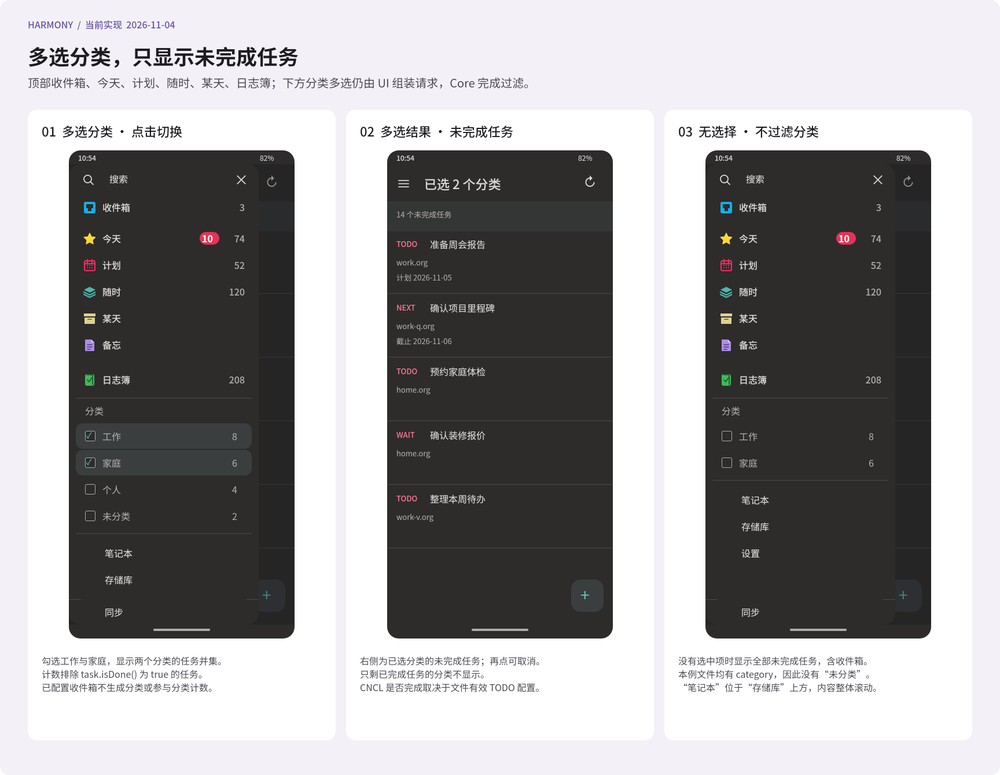

#+TITLE: Harmony UI 导航与参考界面映射
#+STARTUP: show2levels hidestars
#+OPTIONS: author:nil date:nil toc:nil
#+LANGUAGE: zh-CN

* 依据与目标

本轮界面以 [[file:../../design/Orgzly界面细节.fig][界面图谱]] 中的参考画板及其 18 张实机截图为依据；同一 .fig 中的“07 Harmony 分类任务导航”“08 Harmony 收件箱记录”“09 Harmony 顶部任务入口”和“10 Harmony 文件入口配置”画板维护当前应用布局。参考版本为 Orgzly Revived 1.23.0 F-Droid Debug。Harmony 保留本地目录、WebDAV、任务新增、核心查询和系统日历同步能力；页面只呈现已经接入的操作。

全 App 统一使用与侧边栏相同的深灰配色：页面背景 ~#2D2C2B~ ，卡片 ~#343635~ ，输入框与选中背景 ~#3A3E3F~ ，主文字 ~#D8D8D8~ ，辅助文字 ~#AEACA9~ ，强调色 ~#5AC4B9~ ，错误色 ~#FF7592~ ，完成色 ~#65CD7B~ 。侧边栏保留彩色顶部图标和圆角灰色选中行。工具栏高 64vp，图标点击区域 48vp，内容基础边距 16vp。新增操作使用右下 56vp 浮动按钮，列表底部为该按钮留出空间。共用样式与控件维护于 ~ui/Theme.ets~ 、 ~components/Controls.ets~ 与 ~components/AppShell.ets~ 。

* 功能对应

| 参考画板与区域 | Harmony 页面或组件 | 实际功能与边界 |
|-
| 01 导航抽屉 | ~AppShell~ | 顶部搜索入口替代应用标题，旁边保留关闭按钮；收件箱、今天、计划、随时、某天、备忘、日志簿、查询、分类、笔记本、存储库与设置整体滚动，底部固定同步。“笔记本”紧接“存储库”上方。分类跨存储库合并并显示未完成任务数，支持多选与再次点击取消；无选择时不过滤分类。切换主入口替换当前路由；关闭按钮、遮罩与系统返回均可关闭抽屉。 |
| 01 笔记本列表 | ~Files.ets~ | 文件名、所属存储库、笔记数量与字节数组成卡片；“笔记本”入口查看全部文件；菜单提供刷新、同步和存储库入口。浮动加号创建任务，写入全局配置的收集箱。 |
| 收件箱记录 | ~Inbox.ets~ | 入口位于顶部，显示按配置收件箱路径汇总的全部标题记录数；包含无 TODO 和已完成记录，不使用分类过滤。 |
| 顶部任务入口 | ~TaskOverview.ets~ | 今天包含当天及过期任务，使用独立的 ~TodayTaskList~ 按分类分区展示标题与过期天数；计划从明天开始；随时无计划和截止日期；某天和备忘来自已配置文件；日志簿展示完成任务。所有结果由 Core 查询产生。 |
| 分类任务列表 | ~CategoryTasks.ets~ | 多选分类后展示并集中的未完成任务，排除配置的收件箱文件；无选择时显示全部未完成任务（包含收件箱）。支持刷新、来源显示和任务详情入口。 |
| 01 层级列表 | ~FileDetail.ets~ | 使用 core 返回的真实标题层级缩进；可折叠单个节点或全部节点。笔记与原文视图共存，空文件可正常打开。 |
| 02 笔记详情 | ~TaskDetail.ets~ | 展示来源、父标题面包屑、标题、状态、标签、优先级、计划、截止和正文；元数据与正文独立折叠。来源可返回对应笔记本。现有笔记为只读。 |
| 02 字段选择器 | ~AddTask.ets~ | 新增任务复用详情的元数据布局；优先级使用选择菜单，日期使用系统日期选择器，已有日期与优先级可清除。目标存储库独立选择，状态显示并使用目标文件有效初始状态，无可用未完成状态时禁用保存并提示。 |
| 03 简单搜索 | ~Search.ets~ | 文字、排除已完成和状态选择组成核心查询；点击搜索或键盘搜索后进入结果。改变高级查询到简单模式前明确提示恢复简单条件。 |
| 03 高级查询 | ~Search.ets~ | 直接输入 core 支持的查询表达式；结果页展示实际提交表达式与数量，可调整条件或保存完整表达式。 |
| 03 已保存搜索 | ~SavedSearches.ets~ | 内建“已计划”和“待办”作为真实查询快捷项；自定义列表显示名称与表达式，点按执行，长按编辑或经确认删除。加号打开独立表单状态。 |
| 04 日程分组 | ~Agenda.ets~ | 默认显示有计划或截止日期的未完成笔记，按“过期”与具体日期分组；日期标题置顶。全部、计划、截止筛选决定用于分组的日期；同时有两个日期时，全部视图使用较早日期且不重复列出。 |
| 04 批量与滑动菜单 | 当前不提供 | 现有修改、完成切换、移动、删除与批量编辑尚未通过领域接口接入，不显示相应按钮或上下文工具栏。 |
| 05 设置分组 | ~Settings.ets~ | 笔记与笔记本、同步、应用程序三个可打开分组；收集箱、TODO 默认流程、目标日历与后台间隔保持全局设置；“同步”分组提供“同步到系统日历”入口。外观切换、通知、提醒和小部件没有虚设入口。 |
| 06 存储库 | ~Repositories.ets~ | 单独管理本地目录与 WebDAV 存储库；空状态提供两种新建入口，已有项目进入配置，保存返回后显示最新目录、类型与远端地址，删除前明确确认仅移除配置与密码。 |
| 06 WebDAV 表单 | ~RepositorySettings.ets~ | 地址、用户名、密码和本地目录纵向排列；工具栏与浮动对勾提交。应用管理的本地缓存目录由宿主创建，目录有效性由 core 验证。保存前可独立测试当前草稿的认证与目录访问，结果在表单内展示；修改地址或凭据后清除旧结果，测试期间禁止重复测试和保存。测试不保存配置或执行同步，不提供证书导入按钮。 |
| 06 命名查询表单 | ~SavedSearches.ets~ | 名称与表达式输入，工具栏和底部保存；保存失败保留草稿，成功后返回列表。 |
| 存储库文件同步 | ~Index.ets~ | 抽屉底部与笔记本菜单中的“同步”打开文件同步页面；“立即同步”调用 core 同步 WebDAV 并刷新本地笔记，不请求日历权限或写入日历。展示笔记数量与真实 WebDAV 进度。 |
| 同步冲突合并 | ~MergeConflict.ets~ | 同步页按作业展示冲突入口，比较该同步的全部未解决文件；未变化任务自动保留，统一列表逐项显示新增、修改与删除候选，支持展开两端原文并选择本地、远端或不保留。全部差异确认后 apply，也可整次采用远端。提交前备份全部本地文件，显示本次同步的备份路径；仓库或远端变化时拒绝旧对象并提供重新比较。 |
| Harmony 系统日历 | ~Index.ets~ | 从“设置 → 同步 → 同步到系统日历”进入，提供返回按钮；读取本地笔记、展示目标日历与上次日历同步时间，用户明确点击后请求日历权限并展示写入统计。进入页面不自动同步，也不发起 WebDAV 请求。 |

* 页面流

#+begin_example
今天（默认入口）
  抽屉 -> 顶部搜索 -> 简单或高级查询 -> 结果 -> 笔记详情
       -> 收件箱（全部记录数） -> 收件箱记录列表 -> 记录详情
       -> 今天 / 计划 / 随时 / 某天 / 备忘 / 日志簿 -> 任务列表 -> 任务详情
       -> 分类多选（未完成任务数） -> 分类任务并集 -> 任务详情
       -> 笔记本（位于存储库上方） -> 层级列表 / 原文 -> 笔记详情
       -> 存储库 -> 本地目录 / WebDAV 配置
       -> 设置 -> 收件箱文件 / 某天文件 / 备忘文件 / 日历名称 / 后台间隔
               -> 同步 -> 同步到系统日历 -> 读取本地任务并写入日历
       -> 同步 -> WebDAV 文件同步
               -> 处理同步冲突 -> 比较统一变化列表 -> 选择 -> 备份并 apply
  加号 -> 新增任务 -> 选择存储库 -> 保存到收集箱
#+end_example

原 ~Workspace.ets~ 入口转到存储库管理，避免保留第二套工作区导航。新增任务保存后返回，日程与笔记本在页面重新显示时读取最新数据。详情不提供现有笔记编辑入口。

* 数据与显示规则

查询、解析、序列化和同步均由 core 完成。~FilterTask.level~ 直接取自 ~orgize~ 标题层级，Rust bridge 同时投影 ~repoId~ 和层级；ArkTS 只将平面结果按层级缩进、折叠，不解析 org 文本。列表按原始字节顺序组织，折叠仅改变显示，不改写文件。

侧边栏按 core 的 ~OrgFile.category()~ 结果展示分类和未完成任务数；任务完成由 Rust 的 ~FilterTask.is_done()~ 判断，core 在查询中调用 ~task.is_done()~ ，由所属文件的有效 in-buffer TODO 配置决定，包含已有的仓库内 ~SETUPFILE~ 设置。 ~CNCL~ 等名称不硬编码：在本文件完成集合内才算完成。无 TODO 状态的标题仍属于未完成投影。计数与点击后的列表使用相同筛选，全部完成或没有记录的分类不显示。

分类支持多选；点击行切换选择状态并保持抽屉展开，右侧即时显示已选分类的未完成任务并集。没有选择任何分类时不过滤分类，显示全部未完成任务。多选 key 使用真实分类值派生，不以显示文案作为身份；缺失和空分类归入末尾的“未分类”，无未分类未完成任务时不显示该项。

设置中的 ~inboxFile~ 相对路径用于识别每个存储库的收件箱文件。该文件不生成分类选项，也不参与选中分类的计数或结果；同名分类若由其他文件提供仍保留。没有选择分类时，收件箱的未完成记录仍属于全部任务。更改收件箱路径后重新读取配置即可生效，不按 category 名字猜测收件箱。

专用“收件箱”入口位于顶部“今天”上方，显示全部配置收件箱文件的标题记录总数。点击打开 ~pages/Inbox~ ，待办、已完成与无 TODO 状态的标题均显示并计数；不会用 ~isDone()~ 排除任何记录。列表保留仓库与文件来源，重复标题不会跨仓库合并；文件不存在或无标题时显示零记录。文件前言和正文不会被伪造为额外记录。

分类任务页 ~pages/CategoryTasks~ 在 UI 中维护选择状态，将完整分类值和页面所需参数传给 ~Workspace.query~ ，只使用 Core 返回的任务列表；无选择标题为“全部任务”，多选时显示已选分类数量。返回任务详情后保留选择，刷新时按当前配置组装新请求；选择的分类没有匹配任务时显示空状态，用户取消全部选择后回到全部未完成任务。分类结果为空时显示空状态；“笔记本”仍展示全部文件，位于“存储库”上方。

抽屉顶部搜索入口替代“Org Tasks”，旁边保留关闭按钮。收件箱、今天、计划、随时、某天、备忘、日志簿、自定义已保存查询、分类、笔记本、存储库和设置位于同一个 Scroll 中；分类没有独立滚动容器。同步入口固定在底部。

文件用仓库 ID 与相对路径联合定位。相同文件名出现在两个存储库时，其笔记、原文、详情与新增任务目标保持隔离。文件列表不将“已读取”误称为“已同步”，也不捏造 core 尚未提供的修改时间或上传状态。

日程按 core 投影中的原始计划或截止日期分组；本轮不展开重复器，不合成未来空日期，也不声称提供 Orgzly 的完整 agenda 引擎。错误、加载中、无存储库、空文件和无匹配结果分别显示可解释的状态。

简单与高级搜索保留各自的页面草稿，切换模式不自动猜测复杂表达式的含义。保存的值是完整提交表达式，包含状态限制。已保存查询仅在独立 Preferences 中保存名称、ID 和表达式，不保存任务快照、文件内容、绝对路径或凭据。

* 配置与操作反馈

存储库表单仅修改当前存储库；全局设置维护收件箱文件、某天文件、备忘文件、TODO 默认流程、日历名称和后台间隔。保存时重新读取其他配置，避免返回旧页面后覆盖新设置。后台间隔最小为 20 分钟；保存后由 ~BackgroundSyncService~ 更新同一系统作业；实际执行时间仍受 WorkScheduler 调度约束。

WebDAV 密码由 ~CredentialService~ 保存到 Asset Store。新任务仍通过 ~Repo.createTask~ 写入，不在 ArkTS 拼装 org 文本；WebDAV 待上传意图和条件上传规则沿用 core。保存期间禁用重复提交和返回；成功页明确给出本地保存或后续上传结果。

手动文件同步与日历同步分开：需要将远端最新任务写入日历时，先完成存储库文件同步，再进入设置中的日历入口。日历同步使用已保存的日历名称；设置中的名称草稿需要先保存。后台作业仍按现有流程先读取本地文件或同步 WebDAV，再写入日历。

合并界面以“当前本地内容采用远端内容”标记新增、修改和删除候选，不把没有共同基准的独有项解释成确定的历史删除。文件前言也单独确认；无 ID 的标题改名会显示为新增和删除，重名任务需要逐项核对。界面只修改比较对象的枚举模式与处理选择；core 在 apply 前重新验证整个仓库版本及远端版本。操作期间禁止返回和重复提交；失败后必须重新比较，不沿用旧临时 ID。

按显式确认的备份规则，一次同步的所有冲突原文件保存在 ~.sync/backups/<合并开始时间>/~ ，文件名附带日期时间和随机后缀。备份不进入笔记列表或远端传输；部分失败会显示已有备份，并让用户重新比较剩余冲突。

笔记本详情显示 TODO 状态来自本文件还是全局默认，以及有效状态名称。列表根据 Rust 投影的类型区分完成与未完成颜色，支持 DONE 之外的完成状态。新增任务读取目标收集箱的有效初始状态，切换存储库后重新读取，避免异步结果覆盖较新的选择。

设置中的 TODO 编辑器使用多行 Org 声明，默认值从 Rust 获取。文件内 TODO/SEQ_TODO/TYP_TODO 整组覆盖全局默认，空声明可以清空识别。当前提供配置与元信息，不新增现有任务的状态切换或日志写入入口。

* 布局变更维护

调整布局、入口位置或交互范围时，必须同时修改 ArkUI 实现、 [[file:../../design/Orgzly界面细节.fig][.fig 设计画板]] 和本文；手机用户可见功能同步更新 [[file:../手机应用功能清单.org][手机应用功能清单]] 。当前布局在“07 Harmony 分类任务导航”和“08 Harmony 收件箱记录”画板维护，预览见  和 [[file:../../design/previews/08 Harmony 收件箱记录.png][收件箱记录预览]] 。参考画板保留为来源依据。

分类计数由查询摘要提供。UI 负责多选状态和页面请求组装：分类导航排除设置中的收件箱文件，收件箱页使用文件表达式并包含完成与组合任务。所有过滤条件只在 Core 中求值，界面不对返回的任务列表再过滤。

* 顶部入口视觉与查询契约

顶部按参考图依次显示收件箱（蓝色收件箱图标）、今天（黄色星形）、计划（粉色日历）、随时（青色层叠）、某天（米色归档盒）、备忘（紫色备忘纸），留出间隔后显示日志簿（绿色记录本）。侧边栏所有入口、分类、计数与分组文字统一 16vp，主行高 44vp，图标 22vp，选中行使用 12vp 圆角。深色背景为 ~#2D2C2B~ ，选中背景为 ~#3A3E3F~ ；其余页面也统一采用上述深色配色。内建“已计划”“待办”不再重复列在顶部，自定义已保存查询继续保留。

| 入口 | UI 组装的 Core 查询 | 显示含义 |
|-
| 今天 | ~(s.le.today or d.le.today)~ ， ~includeDone=false~ | 计划或截止任一日期为今天或更早即命中；包含当天与全部过期任务。 |
| 今天红色徽标 | ~(s.le.yesterday or d.le.yesterday)~ ， ~includeDone=false~ | 仅显示过期数量；旁边灰色数字为今天的总数，徽标零时隐藏。 |
| 计划 | ~(s.ge.tomorrow d.ge.tomorrow) or (s.ge.tomorrow d.none) or (s.none d.ge.tomorrow)~ ， ~includeDone=false~ | 有日期且最早的计划/截止日期从明天开始；与今天不重叠。 |
| 随时 | ~s.none d.none~ ， ~includeDone=false~ | 计划日期和截止日期都没有安排。 |
| 某天 | 配置文件的 ~b."相对路径"~ ， ~includeDone=false~ | 只展示 ~somedayFile~ 文件中的未完成记录。 |
| 备忘 | 配置文件的 ~b."相对路径"~ ， ~includeDone=true~ | 展示 ~memoFile~ 文件中的全部标题记录，包含无 TODO 与已完成记录。 |
| 日志簿 | ~it.done~ ， ~includeDone=true~ | 按文件有效状态定义展示完成任务，包括被定义为完成的 CNCL。 |

以上入口当前均设置 ~includeComposeTasks=true~ ，保留原文件的组合标题；查询由 Core 求值，UI 不对返回任务做日期、状态或文件过滤。任务同时具有两个日期时按较早日期归入今天或计划，禁止先查后由 UI 去重。日期以运行设备的本地自然日为准。

收件箱、某天和备忘文件均在“设置 → 笔记与笔记本 → 文件入口”配置，可以留空。未配置时点击对应入口提示配置，可直接跳转设置；已配置但没有文件或记录时显示空列表，不伪造文件，也不把空路径作为全局查询。新增任务在收件箱未配置时明确提示，不能写入未指定的目标。

最新顶部设计见 [[file:../../design/previews/09 Harmony 顶部任务入口.png][顶部任务入口预览]] ，配置与提示见 [[file:../../design/previews/10 Harmony 文件入口配置.png][文件入口配置预览]] 。

* 今天专用布局

“今天”使用独立的 ~TodayTaskList~ 展示组件，不复用其他概览入口的 ~TaskRow~ 。顶部标题带黄色星形图标，取消列表上方的任务数量条。任务按所属文件的 ~CATEGORY~ 分区，同名分类跨文件、跨存储库合并；具名分类按名称排序，无分类记录放在末尾的“未分类”区块。只为实际返回的任务建立区块，不显示空分类；没有无分类记录时不显示“未分类”。显式命名为“未分类”的分类与缺少分类的记录仍保持独立身份。

区块标题使用青绿色立方体图标、18vp 文字及下方细分隔线；任务使用 16vp 标题、至少 44vp 行高，全部区块在同一个列表内滚动。任务行仅显示标题，过期时在标题后紧跟红色数字表示过期天数，当天任务不显示数字；不显示状态词、优先级、正文、文件路径、标签和完整日期。点击整行进入原任务详情，长标题省略显示，辅助功能提供完整标题与“已过期 N 天”的说明。保留刷新、侧边栏与新增任务入口。

UI 仍提交今天的通用查询，由 Core 负责日期、完成状态等全部筛选。 ~TodayPresentation~ 仅通过 ~Repo.file(path).category()~ 取得 Core 已解析的分类元信息，并组织查询结果的展示区块，保留每一条任务及其来源身份，不重新筛选任务、不解析 Org 源文。过期数字取计划与截止日期中较早的自然日，与设备本地当天的自然日求差；计算使用 UTC 日序号，避免跨夏令时产生少一天或多一天，不展开重复器。

当前布局见 [[file:../../design/previews/11 Harmony 今天分类布局.png][今天分类布局预览]] ，对应 ~.fig~ 中“11 Harmony 今天分类布局”画板；“09 Harmony 顶部任务入口”中的今天示意同步维护。

* 全 App 深色配色

启动背景、系统状态栏、底部导航栏和 ArkUI 页面采用统一深灰背景与浅色内容。应用通过 ~ApplicationContext.setColorMode(COLOR_MODE_DARK)~ 固定为深色，让系统选择菜单、日期选择器与确认弹窗也采用深色，不受手机当前浅色模式影响。

列表、卡片、输入框、任务详情、搜索、设置、存储库、同步和冲突处理都从 ~UiColor~ 获取语义颜色；旧浅色图标描边改为浅灰，输入文字与 placeholder 显式提供深色主题颜色。主色按钮采用青绿色背景配深色文字 ~#123D37~ ，避免白字在亮色背景上对比不足。红色过期徽标保留白字以区别于普通计数。当前为统一固定配色，不新增主题切换设置。

侧边栏紧凑布局尺寸统一维护于 ~UiSize~ ：文字 16vp、导航行高 44vp、图标 22vp。搜索、七个主入口、分类、已保存查询、普通导航和计数使用同一字号；通过字重与颜色区分层级，不再混用标题大小。顶部与日志簿前间隔分别为 6vp、12vp，分隔线外边距 4vp，分类行纵向内边距 8vp；勾选与关闭符号作为图标独立处理。整体内容仍在一个 Scroll 中，空间不足时滚动，底部同步固定。

备忘入口紧接某天下方，显示配置文件中的记录总数；记录来自各存储库中相同相对路径的文件，保留来源身份。未配置时提示设置，文件不存在时显示空列表，不创建或修改文件。备忘是查看记录的入口，不显示写入收件箱的“新增任务”按钮，避免误认新增任务会写入备忘文件。
