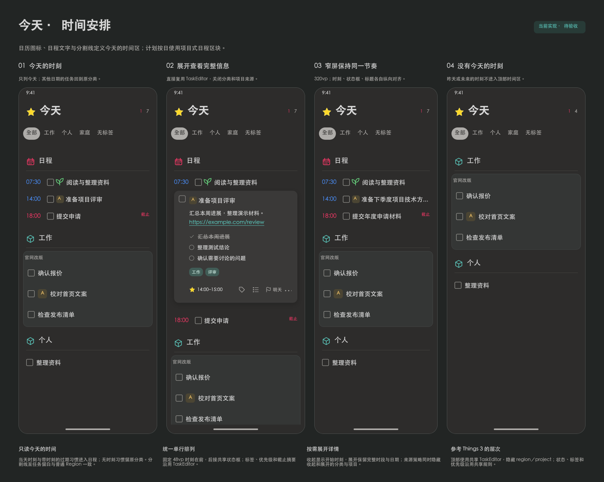
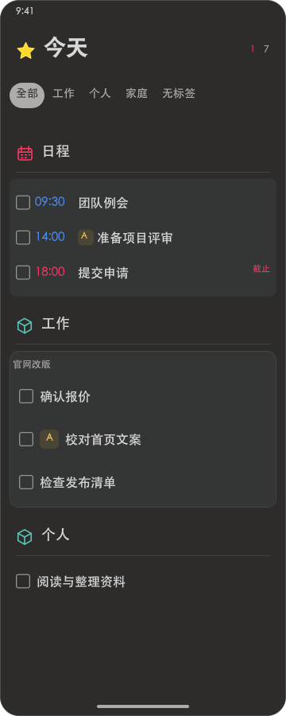
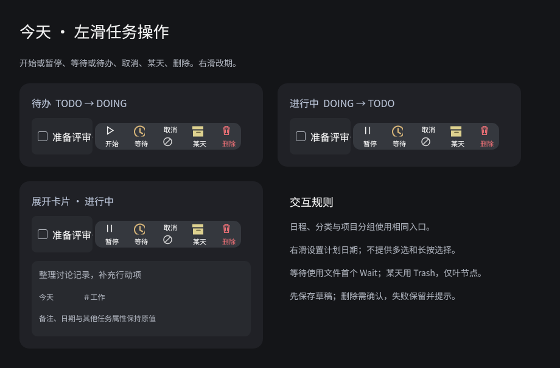

#+TITLE: 今天页面时间安排设计
#+DATE: 2026-11-14
#+STARTUP: show2levels hidestars
#+OPTIONS: author:nil date:nil toc:nil
#+LANGUAGE: zh-CN

* 状态与设计入口

用户已确认“顶部集中展示带时刻任务，下方保留分类与项目任务”的方向。顶部时间区域与分类区域均已接入共享 TaskEditor；顶部收录今天的时刻与带具体时刻的过期习惯任务，并使用来源策略隐藏分类和项目。

可编辑源文件为 [[file:../../design/当前实现/今天时间安排.fig][今天时间安排]]，页面为“Harmony 当前实现”，画板为“65 Harmony 今天时间安排（当前实现）”。 包含今天时刻、原位展开、320vp 窄屏与仅有其他日期时刻四种状态； 用于单屏核对。

展开态保留共享任务卡片的组件实例，文件内的“依赖快照（只读，原件见设计文件索引）”页用于独立打开设计；原件仍为 [[file:../../design/当前实现/共享任务卡片.fig][共享任务卡片]]。实例补充当前优先级、更多入口与时刻展示；顶部的收起和展开均不显示分类与项目来源，样式遵循 [[file:视觉设计规范.org][视觉设计规范]]。

* 分区顺序补充

日程固定在页面顶部且不参与排序；今天页通过“更多 → 排序”调整分类与分类内项目，普通任务固定在项目下方。日程内部的时刻排序、任务范围与共享编辑规则保持本设计。新增项追加末尾与延迟清理失效顺序记录的完整规则见 [[file:UI导航设计.org::*今天分区与项目顺序][UI 导航设计]]；同源文件新增“今天分区与项目排序（当前实现）”画板，维护两级排序面板与确认保存状态。

* 参考依据

[[https://culturedcode.com/things/features/][Things 3 官方功能页]] 将日历事件集中放在今天顶部的圆角区域，事件时间在前、标题在后，普通任务排列在下方。[[https://culturedcode.com/things/support/articles/2803585/][官方提醒说明]] 明确表示任务暂不支持按提醒时间排序。因此本设计借鉴顶部集中阅读时间的形式，结合 Org 任务的计划与截止语义定义排布；顶部条目仍是可勾选、可编辑的任务。

* 页面结构

页面从上到下依次为标题与计数、共享标签筛选条、现有通知区域、时间安排区域、其余任务的分类与项目区域。没有通知时不占位，时间安排成为列表第一块内容。筛选条固定在列表上方，时间安排和分类任务在同一个列表内整体滚动。

时间安排前显示日历图标、“日程”文字和分割线，标题样式与分类层相同。任务紧凑排列在页面底色上，日程分组不增加背景色和内部小标题；计划页的日程改用项目式区块，两种表现分别维护。区域内跨 CATEGORY、仓库和项目平铺今天的带时刻任务及带时刻的过期习惯任务，统一单行排列；收起态省略来源副行，不建立项目子区块。下方仅展示未进入时间安排的记录，沿用原有分类标题、项目区块与优先级排列。每个任务只出现一次，空项目和空分类自然移除。

* 时间范围与排列规则

“带时刻”指任务自身计划或截止日期包含有效的小时与分钟，包含同日时间范围。普通任务进入顶部的日期必须等于设备本地今天；习惯任务允许采用已经过期的计划或截止时刻。普通任务的昨天、更早和未来时刻，以及习惯任务的未来时刻，均不作为顶部排布依据；只有日期、创建时间、关闭时间，以及正文或标题中的其他时间戳，也不作为依据。页面基础范围继续由现有今天查询决定。

| 情况 | 时间安排中的处理 |
|-
| 计划日期等于今天且包含时刻 | 使用计划开始时刻排列。 |
| 没有符合上一行条件的计划时刻，但截止日期等于今天且包含时刻 | 使用截止时刻排列，行尾标注“截止”。 |
| 今天的计划与截止都包含时刻 | 只显示一条，以计划时刻排列；完整截止信息在展开卡片中阅读。 |
| 计划日期是昨天，截止日期是今天且含时刻 | 只采用今天的截止时刻，不能采用昨天的计划时刻。 |
| 习惯任务没有当天时刻，但过期的计划或截止含时刻 | 归入日程，保留原开始时刻，计划优先于截止；不改写日期。 |
| 习惯任务过期但没有具体时刻 | 留在原分类或项目，不归入日程。 |
| 普通任务只有其他日期的时刻，或习惯任务只有未来时刻 | 留在下方原分类或项目内，不借用未来时刻。 |
| 日期或时刻无效 | 不推测、不补默认时刻，记录留在原分类内。 |

顶部按所选开始时刻从早到晚排列。同一时刻沿用 Core 有效优先级顺序，同优先级保留稳定源顺序；结束时刻不参与排序。当天已经过去的时刻仍保留，直到完成、改期或离开页面基础范围；跨天后普通任务回到其应在的分类区域或按基础查询退出；带时刻的过期习惯任务继续归入日程。

时间安排与下方分类是本页快照的互斥展示分区，二者合并必须完整覆盖标签筛选后的所有记录，不丢弃条目，不改变全局任务计数。日期合法性、Org 解析与通用查询排序遵循 Core 契约，宿主消费结构化字段，不另行解析 Org 原文；本次直接消费 Core 已有的 scheduledPlanning、deadlinePlanning 及同批优先级顺序，不扩展 Core 或 bridge 接口。

* 与 Things 3 的视觉对照

参考官方今天页中的日历事件区域，采用紧凑单行与稳定的列边界。任务仍保留独立状态框和现有展开操作。

| 对照点 | Things 3 参考 | 本次修订 |
|-
| 区域层次 | 浅底色块直接承载事件，不增加小标题 | 今天使用日历图标、“日程”文字与分割线，日程任务直接使用页面底色，不增加分组背景和内部小标题。 |
| 时间与标题 | 时间紧邻事件标题，位于同一行 | 固定 48vp 时间列在前，后接共享状态框与标题；时刻列纵向对齐。 |
| 辅助信息 | 事件行保持简洁 | 收起态省略日期副行；完整时段进入展开卡片，来源由策略在两态共同关闭。 |
| 行间节奏 | 多条事件采用一致行距 | 所有收起行固定 44vp，不因来源、时段或截止增加第二行。 |
| 色彩层次 | 时间用颜色引导，正文保持稳定 | 计划时刻沿用蓝色，截止时刻与行尾“截止”沿用截止强调色。 |

顶部不另写任务行；直接复用共享 TaskEditor，保留其状态、优先级、任务类型、标签、正文提示与截止摘要的原有布局。时间使用固定列，分类与项目由来源策略关闭，避免双行来源改变时间区域节奏。

* 时间行与视觉规格

| 部位 | 规格 |
|-
| 列表外侧 | 左右各 12vp，沿用今天列表边界。 |
| 日程标题 | 使用 ~ScheduleRegion~ ，22vp 日历图标、18fp 中等字重“日程”文字与 0.5vp 分割线；上方 24vp、下方 8vp 留白，文字与线间隔 10vp。 |
| 时间安排容器 | 分组透明，沿用页面底色，不额外叠加顶部 margin 或上下 padding；分割线至首条任务保留标题自身的 8vp 留白，与普通 CategoryRegion 一致；左右沿用 TaskEditor 的 8vp 内边距，无内部小标题。 |
| 时间列 | 普通与 320vp 窄屏均为 48vp，15fp，左对齐；位于共享状态框之前，间隔沿用共享控件。 |
| 状态与标题 | 状态框 18vp；标题 16fp，状态框与标题间隔 8vp。 |
| 文本对齐 | 时间与标题使用 24vp 文本行盒，状态框垂直居中；每行各列保持同一中线。 |
| 其余字段 | 沿用共享标题、优先级、类型标记、标签、正文提示与行尾截止摘要；不建立顶部专属的第二套任务布局。 |
| 行高 | 收起态统一 44vp；三条任务时任务组总高 132vp。系统放大字号时可统一增高，不能逐任务随意改变节奏。 |

顶部只显示所选开始时刻，例如“14:00”，不显示“昨天”、具体日期，也不将时间范围拆成上下两行。时间范围的完整起止“14:00–15:00”在原位展开卡片内查看；窄屏采用完全相同的列结构，长标题在剩余空间内单行省略。

计划时刻使用既有蓝色，截止时刻使用截止强调色，截止记录同时在行尾显示“截止”文字，不仅用颜色区分。优先级仍由共享控件在标题前显示色块，重复、习惯、标签与正文提示均按原布局显示；使用截止时刻作为前部时刻时，行尾截止摘要缩为“截止”，其他截止摘要不变。

顶部显式设置 ~regionAreaPolicy=RegionAreaPolicy.None~ ，收起态和展开卡片底部均隐藏分类、项目和文件名回退。下方分类任务沿用原来的来源策略。

* 共享控件接入

顶部先由 ~ScheduleRegion~ 显示日程标题，再由 TodayTaskList 的原生 ListItemGroup 承载任务，每项直接使用 ~TaskEditor~ ，并传入 ~regionAreaPolicy=RegionAreaPolicy.None~ 。 ~timeDisplay: TaskTimeDisplay~ 独立于原有 ~dateDisplay~ ，提供 ~Creation~ 、 ~Schedule~ 、 ~Deadline~ 、 ~Closed~ 和 ~None~ 五种时间来源。计划和截止仅读取 Core 对应规划的开始时刻，创建和完成读取对应本地时分；默认隐藏，来源缺失不回退。日期策略保持原有语义，时间列位于 checkbox 之前。时刻参与共享行宽预算；不解析 Org、不借用另一规划字段，不加入页面名称或固定日期文字参数。

* 原位展开与操作

点击时间、标题、截止摘要或行内留白，展开同一任务。状态框独立完成任务，点击状态框不触发展开。侧滑、多选、链接、日志与下拉同步复用已有共享交互。

展开时隐藏该行外侧时间列，卡片占时间安排容器的全部内容宽度。卡片顺序继续为完整标题、备注、清单、标签及底部属性入口；计划入口完整显示时刻或时段，今天可由星形图标表达，截止入口显示自身日期与时刻。底部保留更多入口，卡片外不显示来源。卡片高度随内容增长，由整个页面滚动承载，不建立卡片内纵向滚动区。

点击卡片外或系统返回先按现有规则保存并收起。保存成功后按最新快照重新归位：改时刻可能调整排序，清除时刻会回到分类区域，改为其他日期时回到分类区域，或按今天查询结果退出。保存失败保留原位卡片、输入和错误，不提前移动条目；删除和完成也以实际成功结果刷新。

* 筛选与边界状态

共享标签筛选同时作用于时间安排和下方分类任务，保留当前全部候选与全局计数。筛选后时间区为空时，连同日程标题、容器和占位一起隐藏，分类自然上移；仅剩带时刻任务时只显示时间安排。整个列表无匹配时保留筛选条，沿用可恢复“全部”的空态。

页面可见时每分钟检查本地自然日；跨天且没有原位编辑会话时刷新基础查询，编辑期间延后到会话结束后的下一次检查，避免重建卡片丢失输入。同步更新与返回页面继续使用既有刷新机制，普通任务昨天的时刻不再进入新时间区；带时刻的过期习惯继续留在日程，无时刻习惯仍留原分类。多任务同一时刻仍各占一行，不合并、不叠放，也不暗示彼此冲突。放大字号时先保障时间、状态框和操作区域，任务标题允许缩短，按共享可访问性规则统一增高时间行；读屏按日期、计划或截止、起止时刻、标题、来源与状态读取。

* 任务左滑操作

日程、普通任务与项目任务的收起行和展开卡片使用相同菜单，顺序为“开始／暂停、等待、某天、删除”。待办和等待显示“开始”，进行中显示“暂停”；对应状态从文件有效流程取得。“等待”仅设置首个有效 Wait 状态，成功后任务通过 Core 查询订阅退出今天并进入等待页；今天的普通列表、优先级列表、灰色计数与红色徽标均排除 Wait 分类，保留原计划与截止日期。已有等待状态不重复写入，缺少状态时提示；“某天”通过 Trash 归入配置的某天文件，仅支持叶节点并保留状态、日期与来源；删除需确认，取消不写入。先保存当前草稿，修改组由共享控件交给 DataSet 一次提交，失败保留快照并提示。

右滑保持设置计划日期。今天批量操作关闭，不传选择控制器，不展示“多选”或底部批量栏，长按不进入选择模式。画板沿用“今天左滑开始与暂停（当前实现）”，预览同步维护于 。

某天操作保留原计划与截止日期，今天仍按通用日期查询展示，归入某天后继续符合查询条件的任务仍显示在今天。
