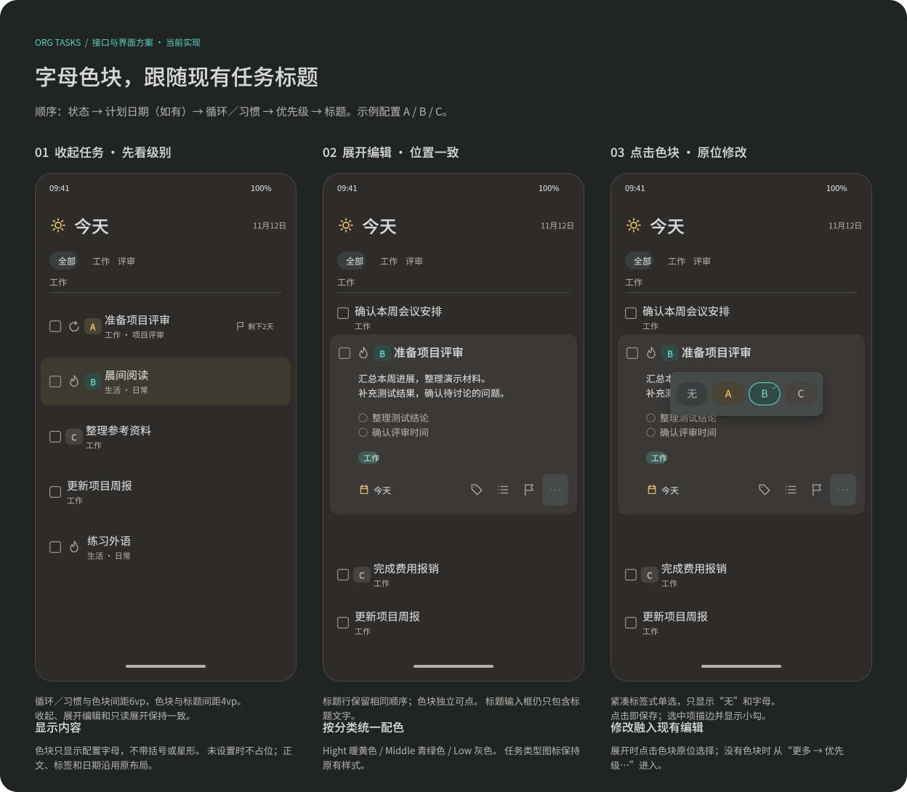
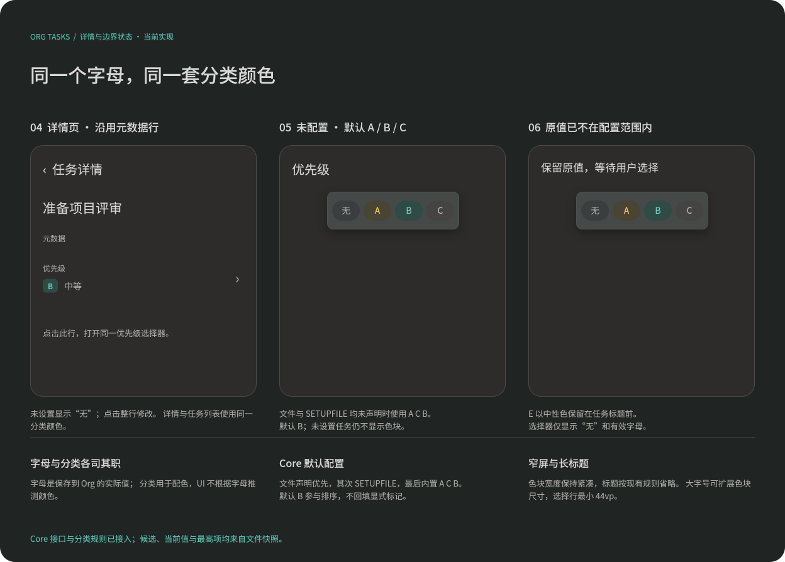

#+TITLE: 任务优先级接口与界面设计
#+DATE: 2026-11-12
#+STARTUP: showall
#+LANGUAGE: zh-CN

* 实现状态与入口

本方案已接入 Core、bridge 与现有任务界面，接口形态参考 TaskStateCategory、TaskState 和 taskStateOf；分类名使用 PeriodCategory，枚举值为 Hight、Middle、Low。已通过自动化验证和 HarmonyOS Debug 构建，尚未进行本轮真机视觉验收。

设计维护于 [[file:../../design/Orgzly界面细节.fig][界面图谱]] 的“Harmony 当前实现”页，画板为“56 Harmony 任务优先级 · 交互主稿（当前实现）”与“56 Harmony 任务优先级 · 补充状态（当前实现）”。

- 。
- 。

* 接口契约

** 值对象与分类

#+begin_src rust
pub enum PeriodCategory { Hight, Middle, Low }

pub struct TaskPriority {
    pub name: String,
    pub category: Option<PeriodCategory>,
}

impl FilterTask {
    pub fn priority(&self) -> Option<&TaskPriority>;
    pub fn default_priority(&self) -> &TaskPriority;
    pub fn effective_priority(&self) -> &TaskPriority;
    pub fn priority_options(&self) -> Vec<TaskPriority>;
    pub fn task_priority_of(&self, category: PeriodCategory) -> Option<TaskPriority>;
}

impl OrgFileMetadata {
    pub fn priority_options(&self) -> Vec<TaskPriority>;
    pub fn task_priority_of(&self, category: PeriodCategory) -> Option<TaskPriority>;
}
#+end_src

~name~ 为任务实际保存的字母， ~category~ 为 Core 根据所属文件有效配置产生的语义分类。当前任务没有显式优先级时， ~priority()~ 返回 ~None~ ；已有原值不在有效配置范围时仍返回对象，但分类为空。优先级与循环、习惯类型独立，PeriodCategory 不承担重复任务或习惯任务的分类。

~priority_options()~ 返回有效候选对象，按字母升序排列。任务与共享文件元信息的结果来自同一文件配置快照。 ~task_priority_of(category)~ 返回首个匹配分类的候选副本，没有匹配项时返回 ~None~ ，与现有 ~task_state_of~ 的使用方式一致。

最高优先级通过 ~task_priority_of(PeriodCategory::Hight)~ 取得。UI 不自行求最小字母，不增加另一套最高值计算规则。

** 宿主投影

#+begin_src typescript
export type PeriodCategory = 'Hight' | 'Middle' | 'Low';

export interface TaskPriority {
  name: string;
  category: PeriodCategory | null;
}

// 以下仅列出加入现有对象的优先级成员。
export interface Task {
  readonly priority: TaskPriority | null;
  readonly defaultPriority: TaskPriority;
  readonly priorityOptions: TaskPriority[];
  taskPriorityOf(category: PeriodCategory): TaskPriority | null;
}

export interface OrgFileMetadata {
  readonly defaultPriority: TaskPriority;
  readonly priorityOptions: TaskPriority[];
  taskPriorityOf(category: PeriodCategory): TaskPriority | null;
}
#+end_src

Task 的当前优先级由原字符串投影调整为可空值对象；现有调用方在实施时统一改为读取 ~priority.name~ 和 ~priority.category~ ，不保留平行的字符串判断。Bridge 仅传递 Core 生成的快照及分类查找结果，方法返回独立副本，不执行额外 I/O。

选择或清除继续提交既有 ~PRIORITY~ 字段，值为目标对象的 ~name~ 或空值；操作协议保持字母值，不提交分类或颜色。Core 在实际写入时依据当前文件配置校验，复用文件版本约束、操作组回滚、outbox 和数据变化事件。

** 配置与分类规则

配置由 Core 从文件及 SETUPFILE 的有效配置读取，文件内声明优先。不新增宿主自定义分级、字母或颜色配置。任务默认无显式优先级；读取配置不会给任务写入默认字母。

Org 原生 ~#+PRIORITIES: A C B~ 的三个位置分别表示最高、最低和默认优先级，候选为最高至最低之间的字母范围；不是任意三个候选字母。Core 按 Org 语义解析范围，第三项作为未设置任务的有效值参与排序，不回写显式标记。当前写入模型仅支持单个大写字母，本方案不扩大为数字优先级。

默认优先级来自 [[info:org#Priorities][Org Info：Priorities]]：未声明时使用 B，文件头 ~#+PRIORITIES~ 的第三项覆盖 SETUPFILE 默认值。Core 在同次解析中生成 ~OrgFileMetadata.default_priority~ ，任务通过 ~default_priority()~ 读取共享快照， ~effective_priority()~ 取显式值或此默认值；Harmony 投影为任务和文件元信息的只读 ~defaultPriority: TaskPriority~ 。文件与 SETUPFILE 均未声明时使用 Core 内置 ~A C B~ 配置，候选 A、B、C 分别归为 ~Hight~ 、 ~Middle~ 、 ~Low~ ，默认 B 归为 ~Middle~ ；默认值不产生标题色块、不写入 Org 原文。优先级升降序与 ~p.<letter>~ 使用有效字母， ~ps.<letter>~ 只查询显式值，相同优先级沿用源次序。

*** Org 原生配置核对

依据本机 Emacs Org 9.8.10 的 [[info:org#Priorities][Priorities]] 手册、 ~org.el~ 的变量定义与 ~org-set-regexps-and-options~ 实现核对：Org 原生默认可选 A、B、C，A 最高、C 最低，没有显式标记的条目按 B 参与优先级排序。默认值不等于自动向标题插入 ~[#B]~ ，显式标记写在 TODO 关键字之后，例如 ~* TODO [#A] 准备评审~ 。

全局配置使用以下变量；Org 9.8 以前的名称 ~org-highest-priority~ 、 ~org-lowest-priority~ 、 ~org-default-priority~ 在 9.8.10 中仍作为别名保留。

#+begin_src emacs-lisp
(setq org-priority-highest ?A
      org-priority-lowest ?E
      org-priority-default ?C)
#+end_src

单文件可用下列声明覆盖全局值，三个位置依次是最高、最低、默认；该例候选是连续的 A 至 E，不是仅 A、E、C 三项。修改声明后，在该行执行 ~C-c C-c~ 使 Emacs 重新读取。

#+begin_src org
,#+PRIORITIES: A E C
,* TODO [#A] 准备评审
,* TODO 未设置显式优先级，排序时按 C 处理
#+end_src

共用声明可放入 ~SETUPFILE~ 。Org 原生还支持 0–64 的数字优先级，例如 ~#+PRIORITIES: 1 10 5~ 。当前应用仅支持单个大写字母，未声明时由 Core 使用内置 ~A C B~ ，与 Org 的默认字母范围和默认值一致；不读取用户本机 Emacs 的全局变量。

*** 应用分类规则

Core 使用以下分类规则：

| 有效候选（升序） | 分类结果 |
|-
| A、B、C | A 为 Hight，B 为 Middle，C 为 Low。 |
| B、C、D | B 为 Hight，C 为 Middle，D 为 Low。 |
| A、B、C、D、E | A 为 Hight，B、C、D 为 Middle，E 为 Low。 |
| 两档 | 最小字母为 Hight，最大字母为 Low；Middle 查找返回空。 |
| 一档 | 唯一字母为 Hight；Middle 与 Low 查找返回空。 |
| 无候选 | 所有分类查找返回空；已有显式值的分类为空。 |

候选数量来自 Core 对有效配置的解析；表中少量候选同时定义投影与选择器的退化行为，不放宽 Org 配置校验。文件与 SETUPFILE 均未声明时，由 Core 使用内置 ~A C B~ ，不向 Org 原文补写配置。无效声明在读取选项时返回中文配置错误，不自动补全或静默改写原文。

** 对象关系

\begin{tikzpicture}
\umlclass[x=0,y=0,type=enumeration]{PeriodCategory}{Hight \\ Middle \\ Low}{}
\umlclass[x=6,y=0]{TaskPriority}{name: String \\ category: Option\textless PeriodCategory\textgreater}{}
\umlclass[x=0,y=-5]{FilterTask}{priority: Option\textless TaskPriority\textgreater}{priority() \\ default\_priority() \\ effective\_priority() \\ priority\_options() \\ task\_priority\_of(category)}
\umlclass[x=9,y=-5]{OrgFileMetadata}{default\_priority: TaskPriority}{priority\_options() \\ task\_priority\_of(category)}
\umlassoc{TaskPriority}{PeriodCategory}
\umldep{FilterTask}{TaskPriority}
\umldep{OrgFileMetadata}{TaskPriority}
\end{tikzpicture}

* 任务展示

** 在现有标题行中显示

优先级显示为类似标签的小底色色块，内容只包含 A、B、C 这样的实际字母。展示顺序为“状态框 → 原有计划日期（如有）→ 循环／习惯图标 → 优先级色块 → 标题”。没有任务类型图标时，色块仍位于标题之前；没有显式优先级时不占位。

沿用当前类型标记规则：习惯优先显示习惯图标，否则循环任务显示重复图标。优先级紧随此图标，与任务类型保持两个独立信息。收起任务行和展开编辑卡片保持相同顺序；标题输入框只编辑标题文字，色块是独立控件。

色块采用 12fp 中等字重、最小 24vp 视觉宽度、22vp 视觉高度、6vp 圆角，与前方循环／习惯图标间距为 6vp，与后方标题间距收紧为 4vp。收起、展开编辑及只读展开均使用相同间距；循环图标 20vp、色块 22vp 在单行标题中垂直居中，组合占位同步纳入标题宽度预算。操作入口使用至少 44vp 点击高度，不通过扩大标题行的水平占位实现点击区。大字号时尺寸随文字自然增大，字母不裁切。

类型图标保留现有颜色。优先级色块的文字与底色由 ~TaskPriority.category~ 决定，具体色值如下；选择器与详情中出现同一优先级时使用同一颜色。

| PeriodCategory | 字母颜色 | 底色 | 语义 |
|-
| Hight | #F2C96D | #4A4435 | 最重要 |
| Middle | #78CEC4 | #304A45 | 中等 |
| Low | #C1BFBC | #454443 | 较低 |
| 空分类 | #AEACA9 | #454443 | 原值未能归类 |

配色依据分类，字母只决定显示内容。更换文件配置后，例如 B 成为最高项时，B 使用 Hight 配色，不能因为字母为 B 而在 UI 固定为 Middle。

** 融入现有列表与原位编辑

收起行的色块位于标题之前。标题、标签、统计、正文提示、持续时间与右侧截止信息继续遵循共享任务行的宽度预算；优先级是固定的语义标记，先为其预留紧凑宽度，再按现有规则分配标题及其他提示。来源文字位置保持原规则。

展开卡片的色块保留在标题行，循环／习惯标记位于其前。备注、清单、标签、计划日期、截止和底部工具行保持现有布局；优先级不放入标签区域。点击色块打开原位选择浮层。

普通点击收起行的标题或色块均先展开，避免滑动浏览时误开选择器；展开后色块成为独立编辑入口。无障碍文案为“优先级 A，最重要”等内容，不依赖颜色。

** 今天页区块内排序

今天页在同一批 Core 查询中读取来源顺序与 ~o.priority~ 顺序，共用同次文件加载快照。CATEGORY 分区与项目区块沿用来源顺序确定位置；同一 CATEGORY 内不属于项目的普通任务按 Core 优先级顺序填入原普通任务位置，每个项目内部单独按该顺序排列。不同分类、不同项目不混排，未命名项目也作为独立项目处理。同优先级使用 Core 的文件与源位置顺序。

未设置显式优先级时按所属文件默认值排序；默认配置为 B，有文件或 SETUPFILE 声明时使用其默认字母。宿主只使用 Core 返回的任务 ID 顺序，不比较字母或重新计算分类。标签筛选只控制已加载任务可见性，再用同一顺序重组，切换标签不重发查询。随时页继续沿用来源顺序。

* 修改界面

** 入口与选择器

已有优先级时，展开卡片点击色块修改；未设置时从现有“更多 → 优先级…”进入。更多菜单只提供“优先级…”与“重复…”两项，移除“设为最重要”快捷项。“优先级…”及详情元数据行使用三条由长到短的圆端横线图标，24vp 画布、1.8vp 线宽，与“今天”的星形区分。

选择器采用紧凑的标签式单选，只展示“无”和 Core 返回的字母色块，按 ~priorityOptions~ 的顺序排列；不显示“优先级”标题、分类说明、分隔线或确认按钮。“无”清除显式值，不向任务写入默认字母。选中项保留分类底色，增加青绿色描边和右上角小勾；所有选项尺寸固定，不因选中而移动。分类描述与选中状态保留在无障碍文案中。

点击不同选项即保存，成功后关闭浮层并保持卡片展开；点击当前项只关闭。点击外部或系统返回关闭，未选择不改变值。进入前先保存现有文字草稿，保存失败时保留草稿与原优先级。

浮层依附当前入口，默认向下，空间不足向上避让；不与更多菜单叠加。沿用标签选择的胶囊样式：字母 14fp、标签视觉宽 44vp、高 32vp、圆角 16vp，每项点击区域为 44vp × 44vp，选项之间间距 6vp。浮层内边距 8vp、圆角 10vp、描边 0.5vp；四个选项时约为 210vp × 60vp，按内容收紧，最多为窗口宽减 32vp。候选较多时按每行最多六项换行，超过三行时在浮层内滚动。

** 详情页

沿用现有“优先级”元数据行，将当前字母改为同款色块；未设置显示“无”。整行可点击并显示进入箭头，打开同一选择器。详情与原位卡片使用相同任务快照和 Core 接口。

* 边界与反馈

| 场景 | 界面行为 |
|-
| 防御性空候选快照 | 选择器仅保留“无”标签，不补充候选或说明文字。 |
| 当前值不在配置中 | 在任务标题前以空分类的中性色块显示原字母；浮层仅展示“无”和有效候选，不把原字母加入选项，可清除或改选，不自动替换。 |
| 多于三档 | 展示全部字母，不把相同分类的选项合并；相同分类使用相同配色。 |
| 分级较多 | “无”为首个标签，与候选一起按行排列；每行最多六项，超过三行时在浮层内滚动。 |
| 读取配置失败 | 保留任务原值，显示读取失败与重试入口，不提供固定候选替代。 |
| 保存期间 | 禁止重复操作，原位等待；数据更新仍通过既有通知与快照机制接入。 |
| 保存或版本校验失败 | 保留原值、卡片和错误，不自动重试覆盖；提供重新载入或重试入口。 |

优先级编辑复用现有数据变化通知与快照刷新，重新查询后按当前 Core 排序规则显示。
