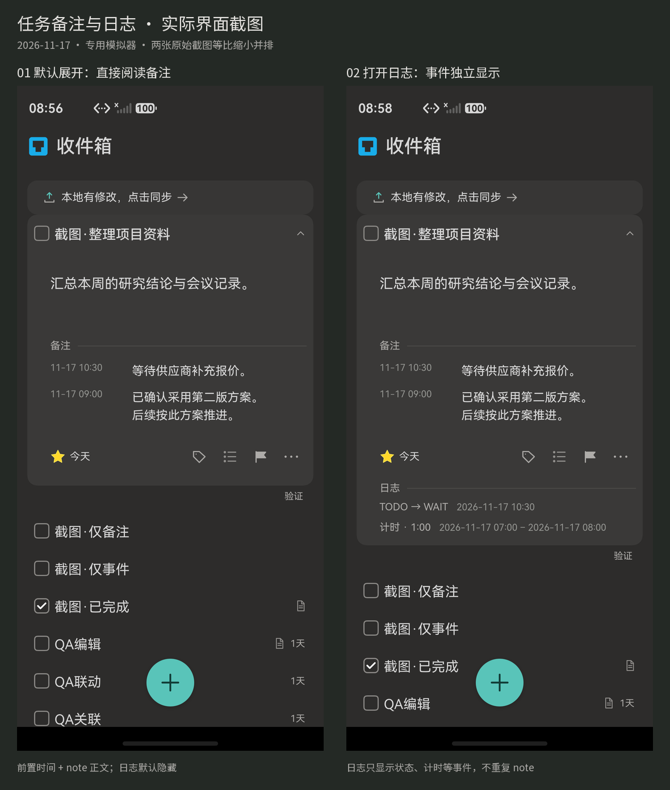
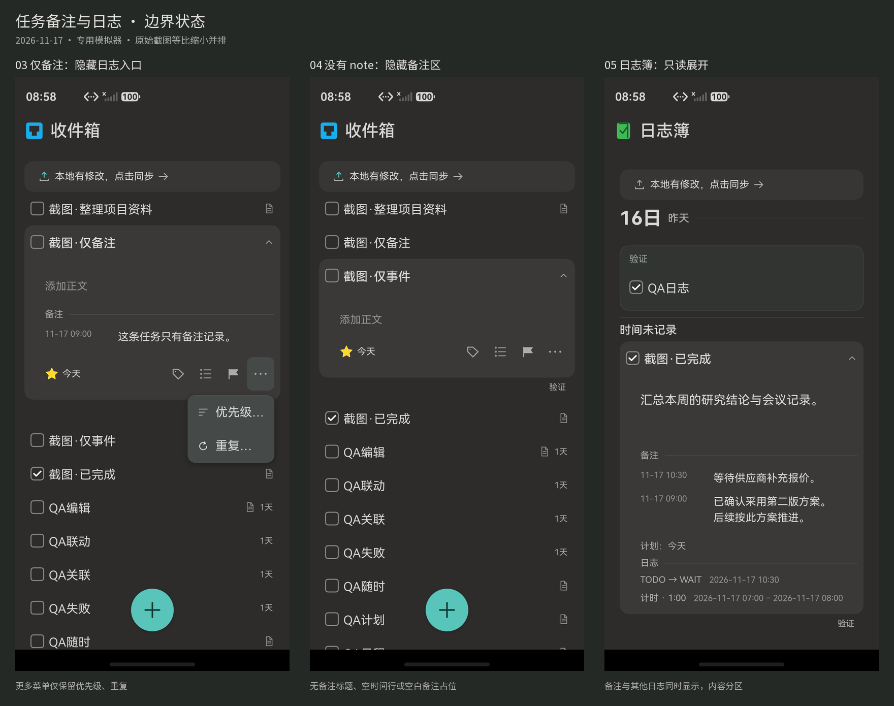
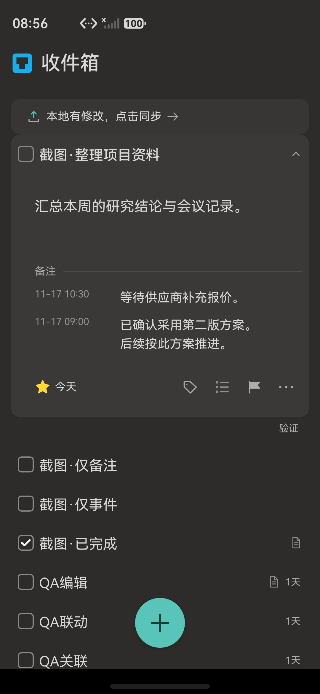
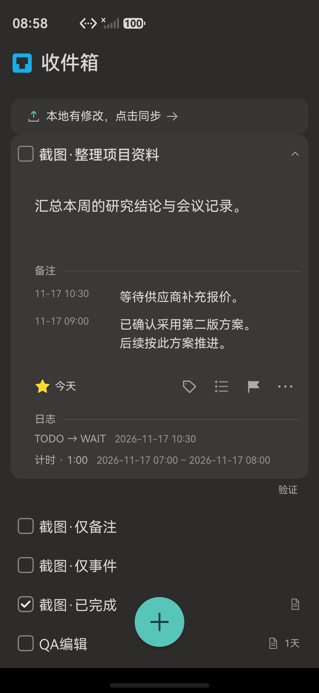
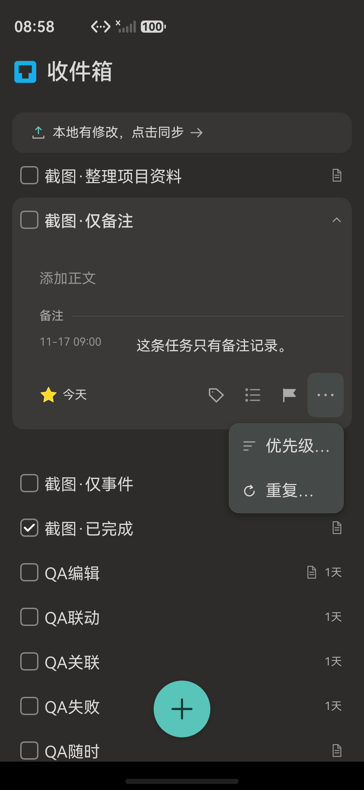
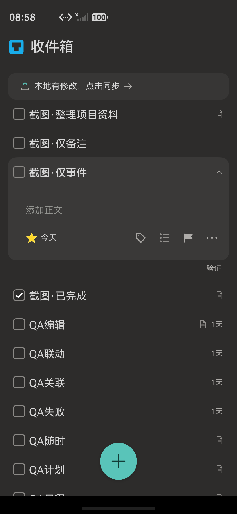
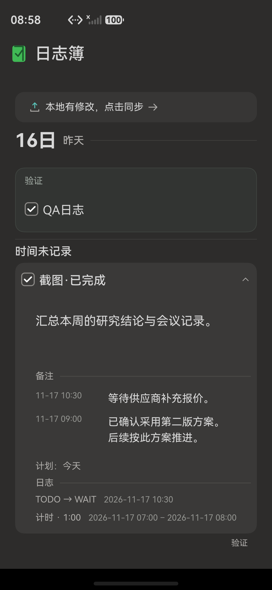

#+TITLE: 任务备注与日志分区截图报告
#+DATE: 2026-11-17
#+STARTUP: show2levels hidestars
#+OPTIONS: author:nil date:nil toc:nil
#+LANGUAGE: zh-CN

* 结论与范围

当前 Debug 包在专用 HarmonyOS 模拟器中实际运行，五种状态均符合已确认设计：备注展开即显示，每条只有前置时间与 note 正文；其他日志独立显示，不重复 note。没有备注时隐藏备注分区，只有备注时不提供日志入口；日志簿只读展开同时显示两个分区。

截图来自已安装应用的真实页面，分辨率为 1080 × 2340。原始截图未裁剪、未改写界面；对照图只在原图外增加说明，并将整屏截图等比缩小。日期为 2026-11-17，模拟器状态栏时间为 08:56—08:58。截图中的“本地有修改，点击同步”为隔离测试仓库的既有同步提示。

设计依据见 [[file:UI导航设计.org::*展开任务的结构化日志][备注与结构化日志设计]]，可编辑设计源文件见 [[file:../../design/当前实现/任务展开日志.fig][任务展开日志.fig]]。

* 核心状态对照

#+CAPTION: 默认展开与打开日志，备注内容保持一致，日志只显示其他事件。
#+ATTR_ORG: :width 1000

| 状态 | 截图中的实际结果 | 结论 |
|-
| 默认展开 | 两条备注分别以前置时间开始；第二条正文多行对齐；操作栏下方没有展开的日志 | 通过 |
| 打开日志 | 备注保留；下方独立日志分区仅显示状态变更与计时，两条 note 正文没有重复出现 | 通过 |

* 边界状态对照

#+CAPTION: 仅备注、无备注和日志簿只读展开。
#+ATTR_ORG: :width 1200

| 状态 | 截图中的实际结果 | 结论 |
|-
| 只有备注 | 显示备注正文；“更多”菜单仅有“优先级…”和“重复…”，没有“日志” | 通过 |
| 事件没有附注 | 事件的空 HTML 容器没有生成备注标题、时间行或备注占位；正文编辑入口保留 | 通过 |
| 日志簿只读展开 | 任务已完成；备注和日志分别展示，其他日志直接可见，没有日志开关或编辑操作栏 | 通过 |

* 原始截图

** 01 默认展开

#+ATTR_ORG: :width 420

** 02 日志展开

#+ATTR_ORG: :width 420

** 03 仅备注菜单

#+ATTR_ORG: :width 420

** 04 无备注

#+ATTR_ORG: :width 420

** 05 日志簿只读

#+ATTR_ORG: :width 420

* 数据与构建核对

截图任务通过应用内嵌 HTTP 接口写入隔离仓库，页面与查询使用同一个 Workspace。截图前后比较四条任务的正文与文件版本，核对阅读、展开和日志切换没有产生任务写入。截图任务在报告生成后删除，临时 HTTP 服务随验收结束停止。

本次实现只调整显示，复用现有日志条目及 noteHtml，没有修改 Core、bridge 数据结构、存储格式或 Org 原文的编辑规则。前一轮实现验收另覆盖跨年时间、链接和外部修改后的界面自动更新，见 [[file:../手机应用功能清单.org::*正文共享区块][功能清单验收记录]]；这些结果不以本报告的五张截图替代。

当前 Debug 构建成功且没有编译告警，93 项相关自动化检查通过。截图所用安装包的 SHA-256 为 cf202af79e6a21f05c5985763ba2a2ad1fc56a5e94197c801b468d42cd83e694。
