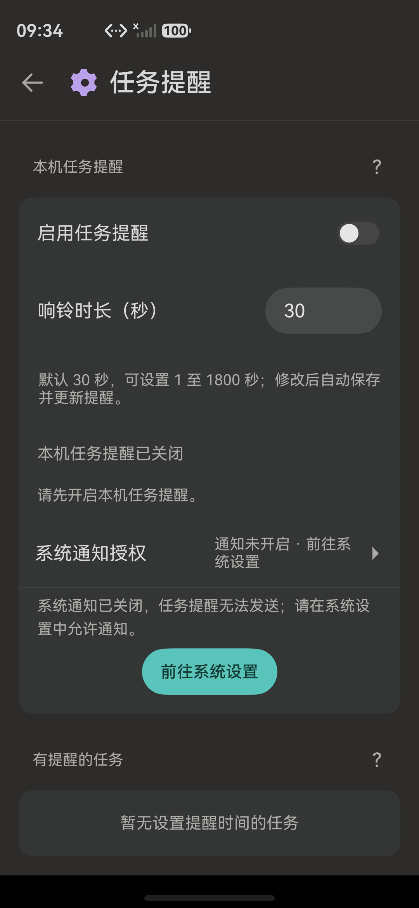
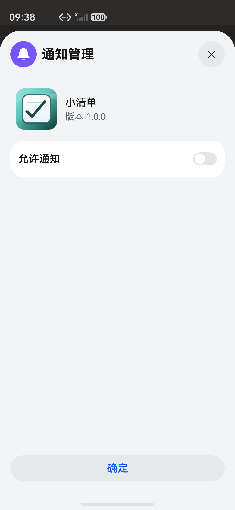
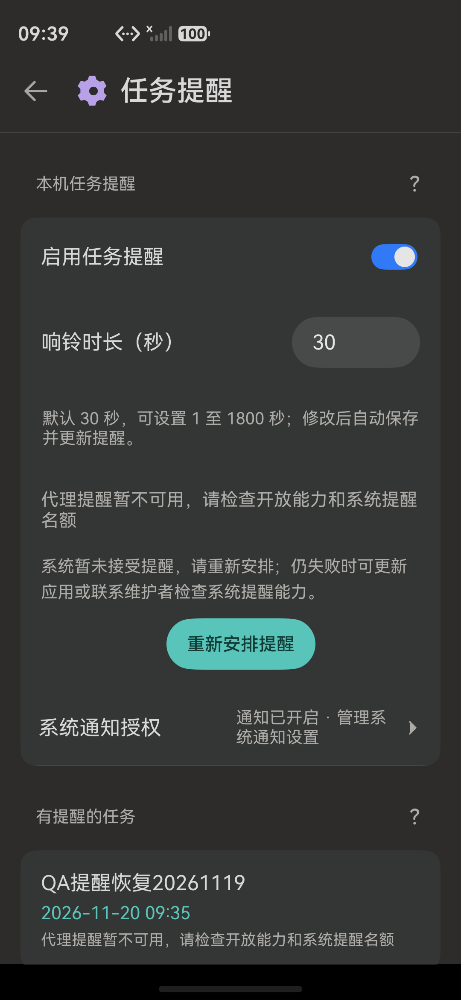
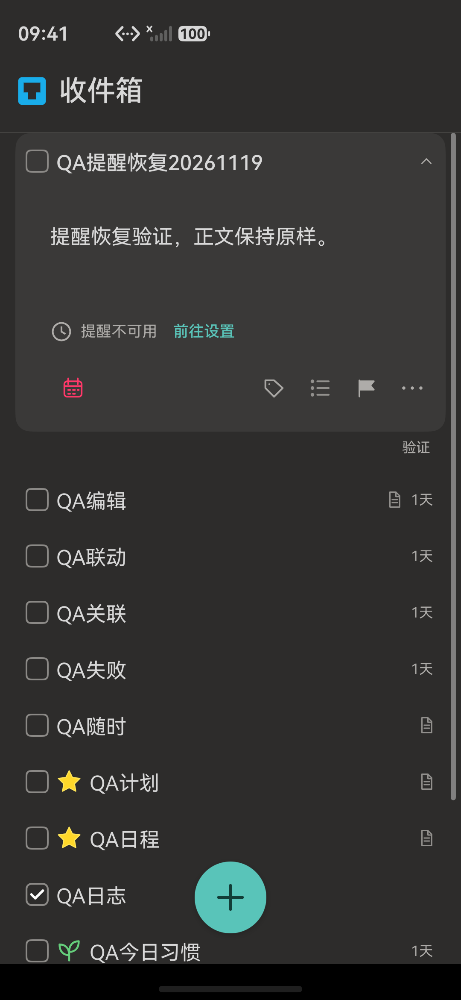
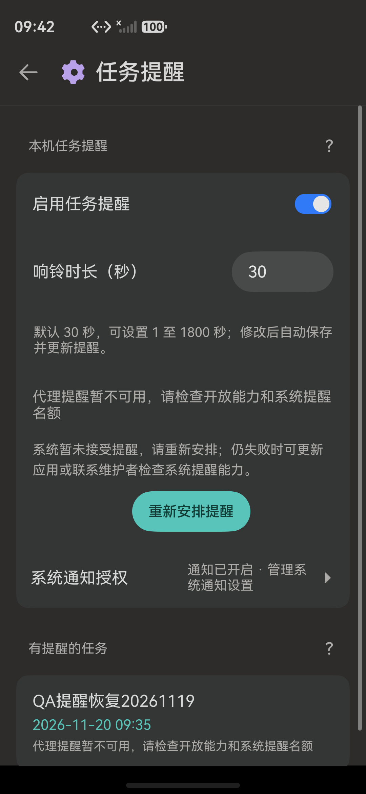
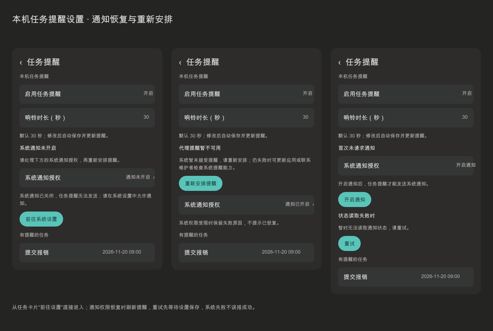

#+TITLE: 任务提醒配置与通知恢复验收
#+DATE: 2026-11-19
#+STARTUP: show2levels hidestars
#+OPTIONS: author:nil date:nil toc:nil
#+LANGUAGE: zh-CN

* 验收结论

在独立的 OrgPageDataQA 模拟器、API 24 环境验证了任务卡片到任务提醒配置页的真实跳转，以及配置页内通知授权恢复与重新安排提醒的操作。测试数据通过同一 Workspace 的 APP 内嵌 HTTP 接口准备，未接入个人仓库。

“通知未开启”可以从任务提醒配置页直接打开应用的系统通知管理；开启“允许通知”并确认后，页面自动刷新为“通知已开启”，无需重开页面。已开启通知时提供“重新安排提醒”，点击后复用现有提醒服务，不修改任务正文或文件版本。

当前调试环境的代理提醒登记仍被系统拒绝，状态保持“代理提醒暂不可用”，并显示重新安排及后续处理说明。通知授权恢复已实际验证，但不能据此认定该安装版本的代理提醒能力已经恢复；此前对错误码和签名开放能力的核对见 [[file:任务提醒设计.org][任务提醒设计]]。本次修改提供恢复操作并准确展示结果，不绕过系统限制，也不误报登记成功。

* 实际界面

** 通知关闭时的恢复入口

#+ATTR_ORG: :width 420

任务提醒配置页显示关闭原因，并提供“前往系统设置”。首次未请求权限与读取失败分别显示“开启通知”“重试”，对应服务行为由自动化检查覆盖。

** 打开系统通知管理

#+ATTR_ORG: :width 420

打开的是当前应用的通知管理，能够修改“允许通知”；确认更改后自动重读状态。

** 通知恢复与重新安排

#+ATTR_ORG: :width 420

恢复后显示“通知已开启”，提供“重新安排提醒”；当前系统继续拒绝代理提醒时保留真实失败摘要。

#+ATTR_ORG: :width 420

重新安排后仍明确显示系统限制与后续处理说明；前后 API 查询确认正文和文件版本一致。

** 从任务卡片直接进入配置

#+ATTR_ORG: :width 420

#+ATTR_ORG: :width 420

真实点击卡片的“前往设置”后，导航路径保留收件箱并追加任务提醒配置页，直接显示通知状态与恢复动作，没有打开任务提醒时间编辑窗口。

* 验证与收尾

设置、通知权限、自动保存与提醒服务的 51 项检查，以及卡片跳转的 1 项检查通过。覆盖拒绝后打开系统设置、授权恢复后重算提醒、重复点击、读取失败、保存失败、页面失效以及系统拒绝时不误报成功。Debug 构建成功，无编译告警。

验收后恢复本机提醒开关和系统通知开关的原状态，删除独立测试任务，停止临时 HTTP 服务并撤销端口转发。设计源文件与预览同步更新于 [[file:../../design/当前实现/设置.fig][设置.fig]] 和 。
