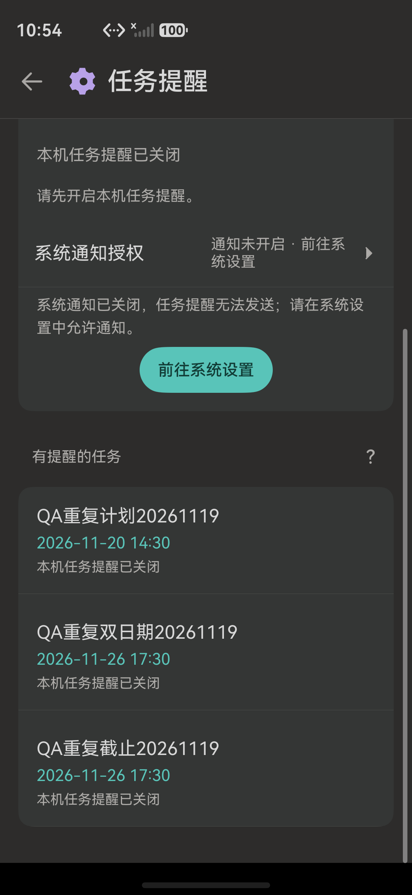

#+TITLE: 任务提醒设计
#+STARTUP: show2levels hidestars
#+OPTIONS: author:nil date:nil toc:nil
#+LANGUAGE: zh-CN
#+LATEX_HEADER: \usepackage{tikz}
#+LATEX_HEADER: \usepackage{tikz-uml}

* 范围与职责

每个任务只有一个提醒时间，没有任务级次数、间隔或开关。Core 负责属性时间解析、查询及保真写入，Harmony 负责本机设置、系统代理提醒与恢复。应用使用 Background Tasks Kit 的 ~reminderAgentManager~ ，每项任务对应一个 ~ReminderRequestCalendar~ ，应用退出后已经登记的提醒由系统执行。

* Core 读取与修改接口

提醒读取与 ~CREATED~ 共用 ~property_time~ 处理流程：只读当前标题自身属性，不继承父标题或文件默认值；缺失、无效时间或时间范围返回 ~None~ ，只有日期时按本地零点解释，夏令时重叠取较早值、不存在的时刻忽略。查询不会生成或回填时间。

#+begin_src rust
impl FilterTask {
    pub fn reminder_at(&self) -> Option<TimestampMs>;
}

pub enum TaskModification {
    SetReminder(Option<TimestampMs>),
    // 其余既有修改项省略。
}
#+end_src

~SetReminder(Some(timestamp_ms))~ 设置唯一提醒时间， ~SetReminder(None)~ 清除。输入为 Unix 毫秒时间戳，Core 按本地时区写入精确到分钟、包含星期的非活动 Org 时间戳；超出有效年份范围的输入使整组失败，未涉及字节保持原样。继续通过 ~OrgWorkspace.execute_task_operations~ 提交，沿用版本校验、事务、回退与数据通知。

JSON 修改项为 ~{"field":"SET_REMINDER","value":1795136400000}~ 或 ~{"field":"SET_REMINDER","value":null}~ 。公开接口不要求调用方知道属性名，也不要求调用方拼接 Org 原文。实现内部使用自身 ~REMIND_AT~ 属性，与 ~CREATED~ 使用同一属性抽屉及时间解析入口；通用 ~PROPERTY~ 修改不能绕过专用入口。界面只交换日期时间控件数据与可空毫秒时间戳，不生成 ID。旧次数、间隔和开关属性按未知普通属性保留，读取提醒时忽略。

\begin{tikzpicture}
\umlclass[x=0,y=0]{FilterTask}{reminder\_at : Option<TimestampMs>}{reminder\_at()}
\umlclass[x=7,y=0]{TaskModification}{SetReminder(Option<TimestampMs>)}{}
\umlclass[x=0,y=-4]{TaskReminderService}{本机恢复日志}{reconcile()}
\umlclass[x=7,y=-4]{ReminderAgentManager}{一个任务一个实例}{publishReminder() \\ cancelReminder()}
\umldep{TaskModification}{FilterTask}
\umldep{TaskReminderService}{FilterTask}
\umldep{TaskReminderService}{ReminderAgentManager}
\end{tikzpicture}

* 查询表达式

~reminder.<interval>~ 与简写 ~r.<interval>~ 沿用 ~cr~ 的自然日条件规则，支持 ~eq~ 、 ~ne~ 、 ~lt~ 、 ~le~ 、 ~gt~ 、 ~ge~ ，省略关系时为 ~le~ 。例如 ~reminder.ge.today reminder.lt.tomorrow~ 查询当天的任务， ~reminder.none~ 查询缺失或无效的提醒时间。与既有创建日期条件一致， ~now~ 表示当前自然日，不额外引入按当前分钟比较的规则。

~has.reminder~ 匹配有效提醒时间， ~.has.reminder~ 取反。排序 ~o.reminder~ / ~o.r~ 按完整毫秒时间升序，前置点号为降序；缺失值及同值的次序沿用 ~created~ 排序规则。条件与其他状态、文件和布尔条件自由组合。

系统协调使用 ~it.todo has.reminder~ ，排除终态和系统废纸篓。设置列表使用 ~.it.none has.reminder o.reminder~ ，包含所有设置了有效提醒时间的任务，包括已结束与已过期记录；两者共享 Core 查询语义，不在 UI 二次过滤。

* 设置入口与任务编辑

设置首页“应用程序”分组提供“任务提醒”入口。进入后显示本机总开关、统一响铃时长、系统授权状态与任务列表。总开关默认关闭；响铃时长默认 30 秒，允许 1 至 1800 秒，修改后自动保存并更新未来系统提醒。全局设置仅影响本机，不写入任务属性、不随 WebDAV 同步。

任务列表在进入子页后异步启动独立 DataSetManager，共用应用当前的 Workspace，禁用页面磁盘缓存；提供加载、空列表、错误及重试状态。按 Core 返回顺序展示标题、提醒时间与实际安排状态；点击条目打开共享日期时间选择器，可修改或清除唯一时间。修改只提交一次 ~SET_REMINDER~ ，不覆盖任务其他字段；外部变化通过原订阅刷新，清除时间后自动移出列表。离开子页关闭列表订阅与编辑窗口。

任务展开卡片“更多 → 提醒…”直接打开同一日期时间选择器，不再套提醒配置窗口；不提供次数、间隔和任务级开关，不支持时间范围。清除日期后确认会取消该任务提醒，取消窗口不提交。现有时间未修改时不重复提交。

* 本机状态与系统协调

Preferences ~org_tasks_reminders~ 保存设备偏好 ~enabled~ 与 ~ringDuration~ 。独立 Preferences ~org_tasks_reminder_state~ 的 ~journal~ 保存版本 1 恢复日志，包括递增通知 ID，以及单个实例的 key、目标时间、内容指纹和可空系统 ID；不进入 Org、Core 同步目录或 WebDAV。

系统协调只使用已确认且版本大于零的任务快照，不消费编辑草稿或版本 0 缓存。查询或系统库存读取失败不等于空任务，不误删已有提醒。总开关关闭时无需任务查询成功即可撤销本服务管理的实例。任务完成、取消、删除、改期或清除提醒时间后撤销旧实例。

实例 key 使用 Core 任务逻辑身份与唯一时间，指纹包括任务标题与统一响铃时长。改名或移动使逻辑身份改变时撤销旧实例再登记新实例，不额外建立 Org ID 规则。每次协调读取系统实际记录，只管理带本服务标记的实例；发布前落盘意图，发布成功后保存系统 ID，崩溃后依据系统 key 恢复，避免重复登记。

过去的提醒不补发。当前仍响铃的实例保留至响铃结束，清除时间或结束任务时立即取消。应用进程存活时清理过期实例并补位，退出后已经登记的实例继续由系统执行，尚未安排的任务和远端修改需等下次运行或文件同步后处理。

* 重复完成后的提醒推进

完成带重复器的任务时，如果已有有效提醒，Core 在修改前选择带重复器的规划字段作为提醒基准：优先 DEADLINE，其次 SCHEDULED；仅有一个字段带重复器时只使用该字段，普通规划日期不参与选择。以规划时间戳的开始时刻计算原提醒的有符号毫秒差，只有日期时按本地零点；时间范围使用起点。重复器推进完成后，新提醒时间等于新基准时刻加原时间差，保持提前或延后的偏移。支持累加、追赶、完成后重复与重复窗口，具体推进仍复用原有规则。

日期推进、提醒写入、状态恢复、清单重置和联动处于同一事务；新提醒超出有效范围或后续操作失败时整体回滚，不产生部分日期或提醒。没有有效提醒、没有带重复器的规划字段、非首次进入完成状态时不移动提醒；正文内重复时间戳不作为规划基准。无效旧提醒保留原文，不生成默认提醒。此行为仅更新现有提醒属性，不增加接口字段或持久化结构。

Harmony 不自行计算规划时间差。Core 的同次已确认快照携带推进后的 reminderAt，现有提醒订阅协调取消旧时间的实例并登记新时间的实例；已响铃的旧实例同样因新提醒时间不同而取消，不重复登记。普通任务完成后从待办提醒查询移出，由同一协调器取消系统实例，保留任务原提醒属性供历史查看。

* 平台条件与容量

手机、平板和 PC 需要申请华为代理提醒开放能力，获批后开启能力并更新 Profile，使用手动签名。应用声明 ~ohos.permission.PUBLISH_AGENT_REMINDER~ ，复用已有前台通知授权流程，不在后台弹窗。

API 24 单个普通应用最多保留 30 个有效提醒，一个任务占一个名额。扣除其他用途实例和当前响铃实例后，优先安排最近的任务；其余显示等待名额。系统拒绝创建时显示实际失败状态，不报告成功。 ~maxScreenWantAgent~ 为预留接口，不承诺系统时钟的全屏闹钟体验。

* 官方依据

- [[https://developer.huawei.com/consumer/cn/doc/doccenter-capabilities/agent-powered-reminder][代理提醒开发指南]]
- [[https://developer.huawei.com/consumer/cn/doc/harmonyos-references/js-apis-reminderagentmanager][后台代理提醒 API]]

* 验证记录

2026-11-18 在独立 API 24 模拟器与隔离仓库验证：设置列表显示已结束与过期任务；通过 HTTP 的 ~SET_REMINDER~ 改期后，列表立即更新文字和排序；列表内清除时间后任务移出，HTTP 读到 ~reminderAt=null~ ，其他属性与正文保留且未生成 ID。统一响铃时长可保存为 45 秒，重启后仍为 45 秒，提醒成员与排序保持；超出 1 至 1800 秒的值被拒绝。验收后恢复默认 30 秒和隔离仓库原文，清空列表自动显示空态，并关闭临时 HTTP 接口。持续响铃与应用退出后的系统交付仍待代理提醒权益获批的真机验收。

* 设置自动保存与提醒图标

任务提醒与废纸篓设置不再显示保存按钮。任务提醒开关立即写入；响铃秒数与保留天数在停止输入约 300 毫秒后合并保存，失焦或返回时立即刷新待保存修改。保存串行，同类尚未开始的修改只保留最新值；输入和其他控件不因保存而禁用。失败保留数字草稿并显示错误，提醒开关恢复已确认值，Preferences 恢复原值，后续修改可继续重试；外部导航在未保存完成时拒绝跳转。

提醒统一使用灰色时钟图标。收起任务行按今日星标、时钟、循环／习惯标记的顺序展示，并预留时钟宽度；时钟只取决于是否配置提醒时间，与系统发布成功与否无关。展开标题不显示时钟，而是在底部日期入口上方的提醒说明行前显示，图标与文字间距 6vp；说明使用“提醒已关闭”“已设置提醒”“提醒不可用”等简短文字。设置废纸篓使用灰色普通图标，任务菜单的备注、优先级、提醒、重复统一为 24×24 画布与相近 1.8 线宽的灰色图标，删除操作的危险色保持专用语义。

* 模拟器能力诊断

2026-11-19 在新建的独立 API 24 模拟器验证：通知授权已开启， ~PUBLISH_AGENT_REMINDER~ 的权限检查结果为已授予；应用已有提醒为 0 条时，最小倒计时、日历和闹钟请求均返回 ~1700002~ ，错误原文为 ~The number of reminders exceeds the limit.~ 。因此失败不只来自任务请求字段或重复创建，当前运行环境在系统侧拒绝登记。当前调试 Profile 的 ~app-privilege-capabilities~ 为空；官方要求代理提醒开放能力获批后重新生成 Profile，并使用手动签名。基础权限检查通过不能据此认定开放能力权益已经生效。

* 图标与自动保存验收

2026-11-19 在独立 API 24 模拟器验证：收起行的今日星标、时钟和循环图标横坐标依次为 132、210、288 像素，时钟占位计入宽度预算；展开标题无时钟，说明行时钟位于文字之前、日期入口上方，状态说明缩短为“提醒不可用”。任务菜单和设置入口的图标已按实际截图核对灰色风格。

提醒开关修改后立即持久化，响铃时长输入 45 秒和废纸篓保留 7 天后，无需点击保存按钮，重启仍恢复 45 秒和 7 天；输入非法的 0 秒被拒绝，已保存的 45 秒保持。验收结束恢复默认值并清理独立测试数据，临时 HTTP 接口关闭。

* 提醒不可用时跳转设置

展开任务的提醒说明为“提醒不可用”时，在其后同行显示“前往设置”按钮，直接追加打开 ~pages/Settings~ 的“任务提醒”子页。点击前先保存当前编辑并等待 DataSet 已提交操作完成；保存失败、任务失效或页面离开时保留原页面，不跳转。按钮独立处理点击，不触发外层提醒时间编辑，其他状态不显示按钮。

任务提醒子页直接提供通知恢复操作：首次未请求时显示“开启通知”，通知已关闭时显示“前往系统设置”，状态读取失败时显示“重试”。授权行继续允许管理已开启的系统通知；操作期间禁用重复点击，失败显示原因并允许再次尝试。从系统半屏设置返回后持续重读权限，恢复开启时刷新角标与任务提醒安排。

通知已开启且本机提醒开关开启时，提供“重新安排提醒”，先刷新待保存设置并重新读取通知权限，再复用现有提醒服务协调已确认任务。保存失败、页面离开或权限未开启时不重试。重试后显示服务的真实结果，不把请求完成等同于安排成功。系统提醒权限或开放能力受限时说明更新应用或联系维护者，不能以通知开关已开启冒充代理提醒能力已恢复。

2026-11-19 已在独立模拟器验证卡片直达任务提醒配置、系统通知开关恢复与重新安排动作，截图及系统限制见 [[file:任务提醒恢复验收.org][通知恢复验收]]。

* 重复完成后的提醒验收

2026-11-19 在专用模拟器的隔离仓库中，通过 APP 内嵌 HTTP 接口准备三条重复任务。双日期任务通过真实界面点击完成，另外两条通过同一 Workspace 的修改入口完成，随后对比 API 返回值与任务提醒配置页。

| 重复器位置 | 完成前提醒 | 完成后提醒 | 核对结果 |
|-
| SCHEDULED 每天、DEADLINE 每周 | 11-19 17:30 | 11-26 17:30 | 选择 DEADLINE，保留提前 30 分钟 |
| 仅 SCHEDULED 每天 | 11-19 14:30 | 11-20 14:30 | 保留相对计划时间提前 30 分钟 |
| 仅 DEADLINE 每周 | 11-19 17:30 | 11-26 17:30 | 保留相对截止时间提前 30 分钟 |

#+ATTR_ORG: :width 420

三条任务均恢复 TODO，其他正文保留，提醒列表读取到已推进时间。此次保持本机提醒开关关闭，系统实例替换由提醒服务自动化检查验证；实际代理提醒投递仍受前述系统开放能力条件限制。Core 的 339 项单元、44 项相关集成检查与宿主提醒服务的 13 项检查通过；覆盖三种重复模式、小时与月末、重复窗口、缺失／无效提醒、日期越界和联动失败回滚。Debug 构建无告警。验收后删除测试任务并停止临时服务。

* Loki 后继提醒

后继创建也处理目标自身的有效 reminder：目标已有 SCHEDULED 时，以“目标提醒时间减目标计划开始时刻”为偏移，新节点提醒为新 SCHEDULED 开始时刻加该偏移。日期范围使用首端、同日时刻范围使用开始时刻，纯日期按本地零点；提前与延后提醒均保留。提醒属于复制目标，~source~ 只决定日期及其时刻来源，不改变提醒读取对象；不读取父级或文件级提醒。

目标没有计划日期时，使用本次动作的日期基准：~today~ 按本次完成自然日零点，~source~ 使用来源计划开始时刻。例如本次完成日期为 2026-11-19，原目标提醒为 2026-11-19 09:00，执行 ~self loki-spawn-next!(today "+6m")~ 后，新 SCHEDULED 为 2027-05-19，新提醒为 2027-05-19 09:00。缺失或无效提醒不创建属性；旧任务保留原提醒作为历史，新节点不直接复制旧提醒时刻。新提醒越界或后续动作失败时，完成、创建与提醒写入整体回滚。

计算仅在 Core 内部完成，写入复用 ~SetReminder~ ，不新增创建参数或公开结构。新节点的同次 Created 事件即携带 reminderAt；Harmony 的已确认提醒查询移出已完成来源并纳入后继，现有协调器取消旧系统实例、安排新实例，不由 UI 再次拼接写入。

2026-11-19 在专用模拟器隔离仓库中，用 ~self loki-spawn-next!(today "+6m")~ 验证带计划与无计划两种任务。带计划任务在真实界面完成后，新节点计划为 2027-05-19 10:00，提醒为 09:30，保留提前半小时；只有当天 09:00 提醒的任务完成后，新节点计划为 2027-05-19，提醒为当天 09:00。API 与任务提醒配置页均读到新节点时间，原节点为 DONE、新节点为 TODO，TRIGGER 保留，正文未复制，未生成 ID。系统实例替换由提醒服务检查验证；实际投递仍受既有代理提醒能力限制。

344 项 Core 单元、46 项状态／触发器／提醒集成和 14 项宿主提醒检查通过，Debug 构建无告警。提醒越界与创建后续失败均验证整组回滚；验收后清理四条来源／后继记录并停止临时接口。
