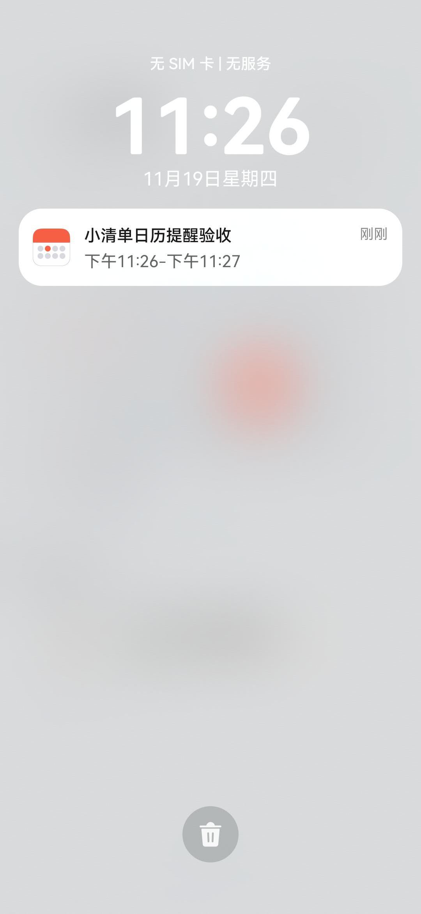
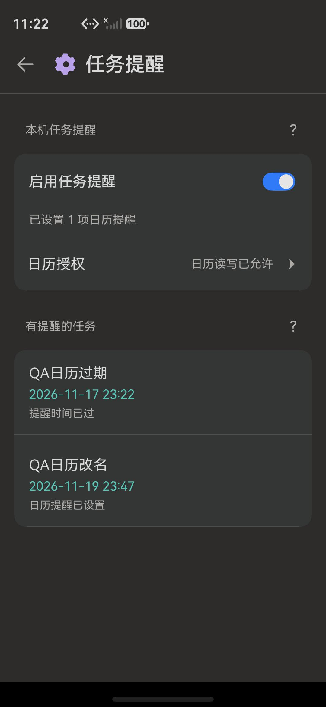

#+TITLE: 任务提醒设计
#+STARTUP: show2levels hidestars
#+OPTIONS: author:nil date:nil toc:nil
#+LANGUAGE: zh-CN
#+LATEX_HEADER: \usepackage{tikz}
#+LATEX_HEADER: \usepackage{tikz-uml}

* 范围与职责

每个任务只有一个提醒时间，没有任务级次数、间隔或开关。Core 负责属性时间解析、查询及保真写入，Harmony 负责本机设置、全局事件管理和 Calendar Kit 接入。每项任务的提醒对应应用专用本地日历中的一个事件，应用退出后已登记事件由系统日历交付通知。当前实现不使用代理提醒开放能力。

* Core 读取与修改接口

提醒读取与 ~CREATED~ 共用 ~property_time~ 处理流程：只读当前标题自身属性，不继承父标题或文件默认值；缺失、无效时间或时间范围返回 ~None~ ，只有日期时按本地零点解释，夏令时重叠取较早值、不存在的时刻忽略。查询不会生成或回填时间。

#+begin_src rust
impl FilterTask {
    pub fn reminder_at(&self) -> Option<TimestampMs>;
}

pub enum TaskModification {
    SetReminder(Option<TimestampMs>),
    // 其余既有修改项省略。
}
#+end_src

~SetReminder(Some(timestamp_ms))~ 设置唯一提醒时间， ~SetReminder(None)~ 清除。输入为 Unix 毫秒时间戳，Core 按本地时区写入精确到分钟、包含星期的非活动 Org 时间戳；超出有效年份范围的输入使整组失败，未涉及字节保持原样。继续通过 ~OrgWorkspace.execute_task_operations~ 提交，沿用版本校验、事务、回退与数据通知。

JSON 修改项为 ~{"field":"SET_REMINDER","value":1795136400000}~ 或 ~{"field":"SET_REMINDER","value":null}~ 。公开接口不要求调用方知道属性名，也不要求调用方拼接 Org 原文。实现内部使用自身 ~REMIND_AT~ 属性，与 ~CREATED~ 使用同一属性抽屉及时间解析入口；通用 ~PROPERTY~ 修改不能绕过专用入口。界面只交换日期时间控件数据与可空毫秒时间戳，不生成 ID。旧次数、间隔和开关属性按未知普通属性保留，读取提醒时忽略。

\begin{tikzpicture}
\umlclass[x=0,y=0]{FilterTask}{reminder\_at : Option of TimestampMs}{reminder\_at()}
\umlclass[x=7,y=0]{DataSet}{已确认快照和增量}{subscribe()}
\umlclass[x=0,y=-4]{TaskEventManager}{唯一来源 DataSet \\ 上次已应用快照}{start() \\ maintain()}
\umlclass[x=7,y=-4]{CalendarSync}{仅内存的事件索引}{synchronize() \\ apply()}
\umldep{TaskEventManager}{DataSet}
\umldep{DataSet}{FilterTask}
\umldep{TaskEventManager}{CalendarSync}
\end{tikzpicture}

* 查询表达式

~reminder.<interval>~ 与简写 ~r.<interval>~ 沿用 ~cr~ 的自然日条件规则，支持 ~eq~ 、 ~ne~ 、 ~lt~ 、 ~le~ 、 ~gt~ 、 ~ge~ ，省略关系时为 ~le~ 。例如 ~reminder.ge.today reminder.lt.tomorrow~ 查询当天的任务， ~reminder.none~ 查询缺失或无效的提醒时间。与既有创建日期条件一致， ~now~ 表示当前自然日，不额外引入按当前分钟比较的规则。

~has.reminder~ 匹配有效提醒时间， ~.has.reminder~ 取反。排序 ~o.reminder~ / ~o.r~ 按完整毫秒时间升序，前置点号为降序；缺失值及同值的次序沿用 ~created~ 排序规则。条件与其他状态、文件和布尔条件自由组合。

* 全局事件数据集与同步过程

~TaskEventManager~ 是应用级单例，持有唯一的 ~events/tasks~ DataSet，查询为 ~it.todo has.reminder o.reminder~ ，通过 Core 排除完成、取消、无状态和系统废纸篓，按提醒时间排序。该数据集独立于普通页面基础数据集，复用应用同一个 Workspace，不启用磁盘页面缓存。设置页的“有提醒的任务”直接消费这份数据，不新建管理器、查询或过滤；页面离开只解除自身监听。

应用启动后加载一次来源 DataSet，首次已确认快照就绪后执行一次完整日历同步。后续来源数据的增、删、改及文件同步后的快照变化，转换为对应事件的增、删、改，不再次遍历完整系统日历。调用方不提交人工同步请求；恢复前台复用同一管理器，不重复初始化查询或完整同步。权限恢复、开关重新启用及系统写入失败后的恢复允许重新核对库存。

事件维护只使用已确认、版本大于零且范围有效的快照，忽略乐观事件。DataSet 的 complete 确认同样触发维护，避免乐观显示与最终确认相同而漏处理。任务查询失败或范围换代时保留已登记事件，不把失败当作空集合。维护串行并合并连续快照；过期批次停止后续操作，已经成功的系统写入仍记录到内存索引，供下一批准确修正。

* 日历事件身份与恢复

日历账号固定为 ~org-tasks.reminders~ ，类型为 ~LOCAL~ ，显示名称为“小清单提醒”。只查询该账号，且只维护 ~identifier~ 中 owner 为 ~org-tasks~ 的事件，保留用户或其他来源的事件。

#+begin_example
identifier = JSON({ owner: "org-tasks", taskKey, contentHash })
taskKey = SHA256(Core task.id)
contentHash = SHA256(JSON([task.heading, task.reminderAt]))
#+end_example

Core 逻辑身份不要求 Org 中存在 ID 属性；哈希仅用于日历标记，不改变 Core 身份规则、不写回任务原文。标题进度或提醒时间改变时，taskKey 相同则更新现有事件；改名、跨文件移动或重名序号变化导致身份改变时，删除旧事件并创建新事件，不猜测永久身份。

事件为非全天普通事件，开始时间使用 ~reminderAt~ ，结束时间为开始后一分钟， ~reminderTime=[0]~ 表示到点提醒。指纹不同或系统事件实际标题、时刻、提醒参数不同，都需要更新。启动时根据系统返回的事件 id 重建内存索引，清理已失效和重复的本应用事件；不将 eventId、指纹或映射写入 Preferences、Org、Core 同步目录或 WebDAV。库存查询失败、属于本应用的标记无效时，不执行清理。

没有新建过去的提醒，也不把改期到过去的提醒补发。已经到点的原事件在对应任务仍有效且内容未变时保留，避免与系统通知交付竞争；任务完成、取消、删除、清除提醒或关闭本机开关后删除。事件创建成功而应用退出时，下次可直接从标记恢复，不重复创建。关闭或退出管理器只停止监听，不删除仍应交付的事件。

* 设置入口与授权

设置首页“应用程序 → 任务提醒”仅保留本机总开关、简短状态、日历授权行和共享任务列表，不再显示响铃秒数、事件间隔或“重新安排”按钮。本机开关默认关闭，修改后自动保存；开启时由用户操作请求日历读写权限，拒绝时保持原开关值，不报告开启成功。授权行支持重新管理权限，恢复授权后自动核对事件，无额外同步入口。

说明统一置于标题“?”帮助中：事件会写入系统日历，提醒声音和响铃时长由系统日历控制，首次使用需打开系统日历完成初始化，并允许系统日历发送通知。本应用的通知与角标授权仍保留在原入口，与系统日历通知分别管理；小清单授权开启不代表系统日历通知开启。

提醒列表保留已过期但未完成的任务。点击任务使用既有日期时间控件修改或清除 ~SET_REMINDER~ ，不重复提交其他字段；完成和取消后由 Core 查询成员变化实时移出。列表的加载、错误重试和空态只影响展示，不关闭或重建全局事件管理器。

本机偏好只有 Preferences ~org_tasks_reminders~ 的 ~enabled~ 键。移除代理提醒恢复日志和日历 eventId 映射的读写，不保留旧后端的运行时分支。事件同步不弹出权限窗口；日历授权仅在设置页明确操作时请求。

* 重复完成后的提醒推进

完成带重复器的任务时，如果已有有效提醒，Core 在修改前选择带重复器的规划字段作为提醒基准：优先 DEADLINE，其次 SCHEDULED；仅有一个字段带重复器时只使用该字段，普通规划日期不参与选择。以规划时间戳的开始时刻计算原提醒的有符号毫秒差，只有日期时按本地零点；时间范围使用起点。重复器推进完成后，新提醒时间等于新基准时刻加原时间差，保持提前或延后的偏移。支持累加、追赶、完成后重复与重复窗口，具体推进仍复用原有规则。

日期推进、提醒写入、状态恢复、清单重置和联动处于同一事务；新提醒超出有效范围或后续操作失败时整体回滚，不产生部分日期或提醒。没有有效提醒、没有带重复器的规划字段、非首次进入完成状态时不移动提醒；正文内重复时间戳不作为规划基准。无效旧提醒保留原文，不生成默认提醒。此行为仅更新现有提醒属性，不增加接口字段或持久化结构。

Harmony 不自行计算规划时间差。Core 的同次已确认快照携带推进后的 reminderAt，现有提醒订阅协调取消旧时间的实例并登记新时间的实例；已响铃的旧实例同样因新提醒时间不同而取消，不重复登记。普通任务完成后从待办提醒查询移出，由同一协调器取消系统实例，保留任务原提醒属性供历史查看。

* 平台条件

使用 Calendar Kit 的 ~ohos.permission.READ_CALENDAR~ 与 ~ohos.permission.WRITE_CALENDAR~ ，不申请代理提醒开放能力，也不声明 ~PUBLISH_AGENT_REMINDER~ 。创建专用日历时开启日历提醒。系统日历的通知开关、声音与交付行为由系统及用户控制；事件登记成功与到点通知实际交付分别验证。

* 官方依据

- [[https://developer.huawei.com/consumer/cn/doc/harmonyos-references/js-apis-calendarmanager][Calendar Kit 日历管理 API]]

历史代理提醒方案参考：

- [[https://developer.huawei.com/consumer/cn/doc/doccenter-capabilities/agent-powered-reminder][代理提醒开发指南]]
- [[https://developer.huawei.com/consumer/cn/doc/harmonyos-references/js-apis-reminderagentmanager][后台代理提醒 API]]

* 历史代理提醒验证记录

2026-11-18 在独立 API 24 模拟器与隔离仓库验证：设置列表显示已结束与过期任务；通过 HTTP 的 ~SET_REMINDER~ 改期后，列表立即更新文字和排序；列表内清除时间后任务移出，HTTP 读到 ~reminderAt=null~ ，其他属性与正文保留且未生成 ID。统一响铃时长可保存为 45 秒，重启后仍为 45 秒，提醒成员与排序保持；超出 1 至 1800 秒的值被拒绝。验收后恢复默认 30 秒和隔离仓库原文，清空列表自动显示空态，并关闭临时 HTTP 接口。持续响铃与应用退出后的系统交付仍待代理提醒权益获批的真机验收。

* 设置自动保存与提醒图标

任务提醒与废纸篓设置不再显示保存按钮。任务提醒开关立即写入；废纸篓保留天数在停止输入约 300 毫秒后合并保存，失焦或返回时立即刷新待保存修改。保存串行，同类尚未开始的修改只保留最新值；输入和其他控件不因保存而禁用。失败保留数字草稿并显示错误，提醒开关恢复已确认值，Preferences 恢复原值，后续修改可继续重试；外部导航在未保存完成时拒绝跳转。

提醒统一使用灰色时钟图标。收起任务行按今日星标、时钟、循环／习惯标记的顺序展示，并预留时钟宽度；时钟只取决于是否配置提醒时间，与系统发布成功与否无关。展开标题不显示时钟，而是在底部日期入口上方的提醒说明行前显示，图标与文字间距 6vp；说明使用“提醒已关闭”“已设置提醒”“提醒不可用”等简短文字。设置废纸篓使用灰色普通图标，任务菜单的备注、优先级、提醒、重复统一为 24×24 画布与相近 1.8 线宽的灰色图标，删除操作的危险色保持专用语义。

* 历史代理提醒能力诊断

2026-11-19 在新建的独立 API 24 模拟器验证：通知授权已开启， ~PUBLISH_AGENT_REMINDER~ 的权限检查结果为已授予；应用已有提醒为 0 条时，最小倒计时、日历和闹钟请求均返回 ~1700002~ ，错误原文为 ~The number of reminders exceeds the limit.~ 。因此失败不只来自任务请求字段或重复创建，当前运行环境在系统侧拒绝登记。当前调试 Profile 的 ~app-privilege-capabilities~ 为空；官方要求代理提醒开放能力获批后重新生成 Profile，并使用手动签名。基础权限检查通过不能据此认定开放能力权益已经生效。

* 历史图标与自动保存验收

2026-11-19 在独立 API 24 模拟器验证：收起行的今日星标、时钟和循环图标横坐标依次为 132、210、288 像素，时钟占位计入宽度预算；展开标题无时钟，说明行时钟位于文字之前、日期入口上方，状态说明缩短为“提醒不可用”。任务菜单和设置入口的图标已按实际截图核对灰色风格。

提醒开关修改后立即持久化，响铃时长输入 45 秒和废纸篓保留 7 天后，无需点击保存按钮，重启仍恢复 45 秒和 7 天；输入非法的 0 秒被拒绝，已保存的 45 秒保持。验收结束恢复默认值并清理独立测试数据，临时 HTTP 接口关闭。

* 提醒不可用时跳转设置

展开任务的提醒说明为“提醒不可用”时，在其后同行显示“前往设置”按钮，直接追加打开 ~pages/Settings~ 的“任务提醒”子页。点击前先保存当前编辑并等待 DataSet 已提交操作完成；保存失败、任务失效或页面离开时保留原页面，不跳转。按钮独立处理点击，不触发外层提醒时间编辑，其他状态不显示按钮。

任务提醒子页提供日历授权行，首次启用请求日历读写权限；恢复授权后自动核对事件。系统日历通知与本应用通知分别管理，说明位于标题“?”帮助。页面没有重新安排或额外同步按钮。

旧代理提醒方案的通知恢复验收作为历史记录保留，见 [[file:任务提醒恢复验收.org][通知恢复验收]]。

* 重复完成后的提醒验收

2026-11-19 在专用模拟器的隔离仓库中，通过 APP 内嵌 HTTP 接口准备三条重复任务。双日期任务通过真实界面点击完成，另外两条通过同一 Workspace 的修改入口完成，随后对比 API 返回值与任务提醒配置页。

| 重复器位置 | 完成前提醒 | 完成后提醒 | 核对结果 |
|-
| SCHEDULED 每天、DEADLINE 每周 | 11-19 17:30 | 11-26 17:30 | 选择 DEADLINE，保留提前 30 分钟 |
| 仅 SCHEDULED 每天 | 11-19 14:30 | 11-20 14:30 | 保留相对计划时间提前 30 分钟 |
| 仅 DEADLINE 每周 | 11-19 17:30 | 11-26 17:30 | 保留相对截止时间提前 30 分钟 |

#+ATTR_ORG: :width 420
[[file:images/重复任务提醒验收-20261119/完成后提醒时间.png]]

三条任务均恢复 TODO，其他正文保留，提醒列表读取到已推进时间。此次保持本机提醒开关关闭，系统实例替换由提醒服务自动化检查验证；实际代理提醒投递仍受前述系统开放能力条件限制。Core 的 339 项单元、44 项相关集成检查与宿主提醒服务的 13 项检查通过；覆盖三种重复模式、小时与月末、重复窗口、缺失／无效提醒、日期越界和联动失败回滚。Debug 构建无告警。验收后删除测试任务并停止临时服务。

* Loki 后继提醒

后继创建也处理目标自身的有效 reminder：目标已有 SCHEDULED 时，以“目标提醒时间减目标计划开始时刻”为偏移，新节点提醒为新 SCHEDULED 开始时刻加该偏移。日期范围使用首端、同日时刻范围使用开始时刻，纯日期按本地零点；提前与延后提醒均保留。提醒属于复制目标，~source~ 只决定日期及其时刻来源，不改变提醒读取对象；不读取父级或文件级提醒。

目标没有计划日期时，使用本次动作的日期基准：~today~ 按本次完成自然日零点，~source~ 使用来源计划开始时刻。例如本次完成日期为 2026-11-19，原目标提醒为 2026-11-19 09:00，执行 ~self loki-spawn-next!(today "+6m")~ 后，新 SCHEDULED 为 2027-05-19，新提醒为 2027-05-19 09:00。缺失或无效提醒不创建属性；旧任务保留原提醒作为历史，新节点不直接复制旧提醒时刻。新提醒越界或后续动作失败时，完成、创建与提醒写入整体回滚。

计算仅在 Core 内部完成，写入复用 ~SetReminder~ ，不新增创建参数或公开结构。新节点的同次 Created 事件即携带 reminderAt；Harmony 的已确认提醒查询移出已完成来源并纳入后继，现有协调器取消旧系统实例、安排新实例，不由 UI 再次拼接写入。

2026-11-19 在专用模拟器隔离仓库中，用 ~self loki-spawn-next!(today "+6m")~ 验证带计划与无计划两种任务。带计划任务在真实界面完成后，新节点计划为 2027-05-19 10:00，提醒为 09:30，保留提前半小时；只有当天 09:00 提醒的任务完成后，新节点计划为 2027-05-19，提醒为当天 09:00。API 与任务提醒配置页均读到新节点时间，原节点为 DONE、新节点为 TODO，TRIGGER 保留，正文未复制，未生成 ID。系统实例替换由提醒服务检查验证；实际投递仍受既有代理提醒能力限制。

344 项 Core 单元、46 项状态／触发器／提醒集成和 14 项宿主提醒检查通过，Debug 构建无告警。提醒越界与创建后续失败均验证整组回滚；验收后清理四条来源／后继记录并停止临时接口。

* 提醒列表完成状态筛选验收

2026-11-19 在独立 OrgPageDataQA 模拟器与隔离仓库，通过 APP 共享 Workspace 的 HTTP 接口创建带提醒时间的待办、完成、取消和已过期未完成任务。设置列表仅显示待办与已过期未完成任务；API 完成任务后实时移出，恢复待办后实时移入，取消与恢复同样按 Core 状态分类更新，正文和提醒时间保持。

在列表内打开提醒时间并清除，API 确认提醒时间为空、待办状态与正文保留，列表实时移出。重启后完成、取消和清除结果保持，已过期未完成记录继续显示；清理验收任务后自动显示未完成任务的空态。验收期间未改动本机提醒开关或通知授权，结束后清理独立数据、停止临时 HTTP 接口并撤销端口转发。Debug 与专用测试包构建无告警，提醒调度 14 项与 Core 提醒 5 项既有检查通过。

* Calendar Kit 与共享数据集验收

2026-11-19 在专用 OrgPageDataQA 模拟器（HarmonyOS 6.1.1、API 24）和独立仓库中，通过 APP 内嵌 HTTP 接口与真实设置界面交替验证。系统授权仅使用本应用日程的读写权限，没有申请整个日历的读写权限。设置页只显示总开关、状态、日历授权和任务列表，没有时长、间隔或额外同步按钮。

| 验证范围 | 实际结果 |
|-
| 共享任务来源 | 待办与过期未完成任务显示，DONE 和 CNCL 不显示；外部修改立即更新列表与系统事件 |
| 事件指纹 | identifier 保留 owner、Core 任务身份的 SHA256 和标题／提醒时间内容的 SHA256；任务未生成 ID 属性 |
| 改期与改名 | 改期保持事件 275，内容指纹更新；改名后删除旧事件并创建事件 276，库存始终只有一个有效任务事件 |
| 完成与恢复 | 完成后系统事件删除，恢复 TODO 后重新创建事件 277 |
| 设置页清除 | 清除日期并确认后列表移出、系统事件删除；API 确认 reminderAt 为空，TODO、正文与其他任务信息保留 |
| 冷启动恢复 | 恢复提醒后创建事件 278；强制停止并重启后仍为事件 278，完整指纹一致，没有重复创建 |
| 关闭与清理 | 关闭总开关自动删除任务事件；API 删除验收任务后共享列表自动进入空态，恢复关闭偏好 |

独立日历事件还验证了 identifier 往返、同一事件更新以及实际通知交付：完成系统日历初始化并允许其通知后，强制停止小清单，系统在预定时间显示“小清单日历提醒验收”通知。该项证明模拟器上应用进程退出后的系统交付；真机锁屏、声音和设备重启后交付仍待验收。

#+ATTR_ORG: :width 420

#+ATTR_ORG: :width 420

15 项事件维护检查通过，覆盖唯一 DataSet、启动核对、后续增删改、重启恢复、重复与失效事件清理、外来事件保留、权限恢复、失败保留、过期提醒和写入竞争。正式与专用测试包构建无告警，设计源文件与预览同步更新。验收后清理独立数据与测试事件，关闭临时 HTTP 接口并撤销转发。
