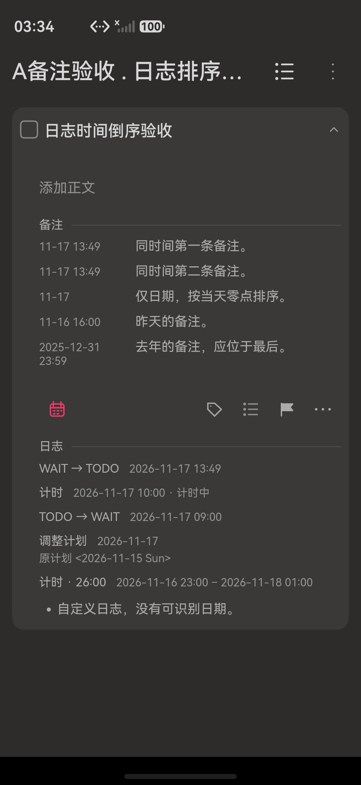

#+TITLE: 备注布局模拟器验收
#+STARTUP: show2levels hidestars
#+OPTIONS: author:nil date:nil toc:nil
#+LANGUAGE: zh-CN

* 调整与环境

2026-11-17 在专用 HarmonyOS 模拟器 127.0.0.1:5557 验收，截图原始分辨率为 1080 × 2340。通过 APP 内嵌 HTTP 接口，在隔离测试仓库中新建两条任务与八条 LOGBOOK 备注，再通过今天页的真实任务卡片展开、阅读和滚动。

备注正文与日志摘要统一使用辅助灰色，链接与列表文字继承同一颜色。正文由 14fp 缩至 13fp，行高进一步由 1.35 缩至 1.25，即约 16.25vp；备注条目间隔由 6vp 缩为 4vp。时间保持 11fp、86vp 列宽，消息列前间隔 10vp。两列在同一 Grid 内按首行基线对齐，多行消息继续在右列换行。 备注与日志在手机展示层分别按时间倒序，计时使用开始时间，仅日期按当天零点比较，同时间保留原序，无时间记录置末；Core 返回顺序与 Org 原文不变。

* 日期与多行备注

| 场景 | 实际结果 |
|-
| 日期与时刻 | 11-17 13:49 与单行消息首行对齐。 |
| 只有日期 | 11-17 正常显示，不补造时刻。 |
| 跨年日期 | 2025-12-31 保留年份，23:59 在时间列内换行，消息从首行开始。 |
| 显式三行文字 | 三行保持原换行，统一消息列起点，行距紧凑且不重叠。 |
| 长段落自动折行 | 长中文段落自然换行，不进入时间列，不覆盖下一条。 |
| 链接与列表 | 链接图标、下划线和两项列表完整显示，列表缩进保留。 |

布局快照中，相邻备注阅读器边界间距为 12 个物理像素，对应 4vp；三行消息区域高度约 147 个物理像素，对应每行约 16.3vp，与 13fp、1.25 行高一致。

* 同时带计划和截止日期

任务计划为 2026-11-17 10:00，截止为 2026-11-18。展开后，底部日期操作栏显示“今天 10:00”和“明天”；两条带时刻备注均完整显示，多行消息在消息列内折行，与日期操作栏保持独立布局。

* 时间倒序与同时间稳定性

另通过同一接口在隔离仓库创建一个乱序日志任务。备注按 11-17 13:49、11-17、11-16 16:00、2025-12-31 23:59 显示；两个 13:49 的条目仍保持“第一条、第二条”顺序。日志按事件时间与计时开始时间倒序，结束时间较晚不改变计时位置，无可识别时间的自定义记录位于末尾。普通任务页与项目文档复用同一展示排序。

* 数据核对与验收状态

展开、滚动及收起操作前后，经同一 Workspace 的完整文件查询确认，模拟文件原文与文件版本均未变化，版本为 9195423b036bc10b。 新增的乱序日志验收文件同样在查看前后保持原文与版本一致，版本为 6ce77d855bb02618。此次只修改显示布局；模拟数据仍保留于专用模拟器，便于复查。

缩小字号后，链接图标引起的自动换行需要重新测量阅读器高度，已在链接排版完成后触发测量，并核对列表末项完整显示。

Debug 构建成功且无告警，相关展示、正文区块、阅读及链接回归共 152 项通过。截图保存后已关闭临时测试服务，并确认数据与导航接口不可连接。
