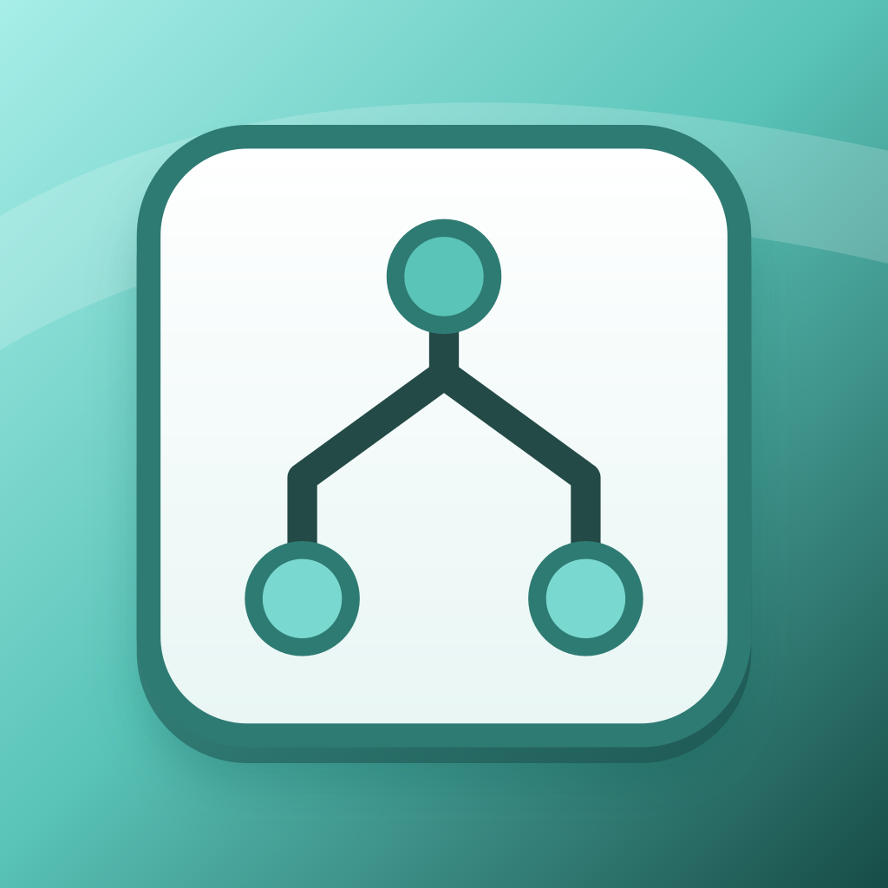

#+TITLE: 应用图标设计
#+DATE: 2026-10-20

* 设计来源与方案

本机参考应用为 =/Applications/Things3.app= ，图标位于其 =Contents/Resources/AppIcon.icns= 。项目借鉴蓝色渐变底板、白色任务卡片和深色描边的视觉语言，以独立 SVG 源文件维护，未将参考应用的位图复制进项目。

- 主方案：，以勾选与浅色文本线表达任务完成。
- 备用方案：，以树形节点表达 Org 标题层级。

高光裁剪在圆角底板内，两套方案保持相同卡片边距、外轮廓和阴影位置。透明画布不包含桌面背景，小尺寸下仍以深色符号和白色卡片保持对比度。

* 资源接入

[[file:../../scripts/export-harmony-icons.py][导出脚本]]将 SVG 渲染为 PNG。依赖 Python 3，以及 librsvg 提供的 =rsvg-convert= 或 ImageMagick 提供的 =magick= ，优先使用前者。

运行 =make icons= 可重新生成两套方案的 256、512 和 1024 像素资源；自定义尺寸与输出目录通过脚本的 =--help= 查看。

资源统一位于 =AppScope/resources/base/media/= ，供应用与 entry 模块共享，避免同名资源重复定义。主方案的 256 像素资源名为 =app_icon.png= ，由应用清单、桌面入口及启动窗口的 =$media:app_icon= 引用；备用方案为 =app_icon_outline.png= 。较大尺寸使用 =_512= 和 =_1024= 后缀，未作为默认入口。备用方案作为设计资产交付，应用内未提供图标切换设置。
