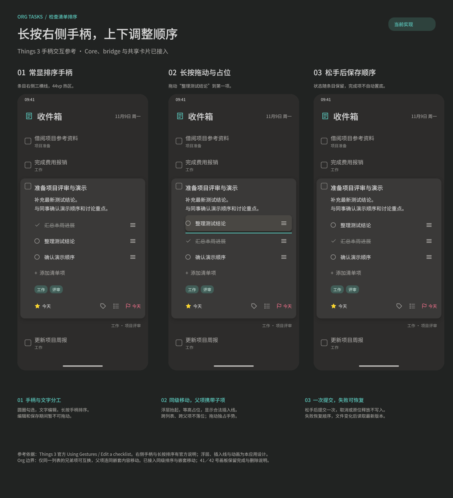

#+TITLE: 检查清单排序交互方案
#+DATE: 2026-11-10

* 状态与范围

已按用户确认的方案接入 Core、Harmony bridge 与共享任务卡片。本方案补充 [[file:UI导航设计.org::*检查清单][检查清单交互]] ，适用于共享任务展开卡片及消费同一组件的任务编辑页；只读正文不显示排序手柄。界面图谱在 [[file:../../design/Orgzly界面细节.fig][Harmony 当前实现页]] 的“49 Harmony 检查清单排序（当前实现）”画板维护，预览见  。41、42 号画板继续记录已交付的完成状态与删除交互。

* Things 3 的已确认行为

2026-11-10 查阅 Cultured Code 的 [[https://culturedcode.com/things/support/articles/2803582/#bpaiw][Using Gestures / Edit a checklist]] 。官方原文：

#+begin_quote
Tap and hold on the grip (three horizontal lines) on the far right of a checklist item to drag it up or down. Tap the circle in front to complete it, or swipe left to delete it.
#+end_quote

由此确认 iPhone／iPad 的入口是条目最右侧的三横线手柄，长按后上下拖动调整顺序；圆圈、文字和手柄承担不同操作，左滑删除继续可用。不是按标题或完成状态自动排序。

同一节的 [[https://culturedcode.com/frozen/2026/01/gestures-editchecklist.mp4][官方演示视频]] 可见展开任务中的逐行清单、行尾常显的浅灰手柄、左侧状态圆圈，以及勾选后文字变灰、条目留在原位、左滑露出删除入口。视频主要演示勾选与删除，没有完整展示拖动排序过程。不可据此断言 Things 3 的拖动阴影、动画时长、触发阈值、自动滚动、错误反馈或内部保存实现；下面这些参数均为本应用拟定方案。Things 3 的内部代码与持久化方式没有公开证据，本方案不推测其实现。

* 界面与手势

** 正常状态

保留任务标题、备注、清单、标签和底部日期入口的现有顺序。每个可排序条目在右侧常显三条水平短线，图形宽 14vp、高 10vp，描边 1.5vp，颜色沿用次要文字色；热区 44vp × 44vp，长文字为其预留空间，窄屏时先让文字换行。清单行最小高度 44vp，内容增加时自然增高。左侧圆圈只切换完成状态，点文字只编辑，长按文字仍交给系统文本选择。

至少两个同组兄弟项时显示手柄；单条、没有同级兄弟的嵌套项、尚未保存的空白新增行和“添加清单项”行不显示手柄。已完成与部分完成项同样可以排序，状态不因移动改变；勾选后不自动置底。手柄无独立点按动作，无障碍名称为“调整顺序：条目文字”，无障碍激活后打开“上移”“下移”操作选择，边界方向不提供。

** 拖动状态

只在手柄热区长按约 350ms 后启动，启动前超过 8vp 的移动交给原滚动或滑动手势。已启动后由清单独占本次手势，不触发条目左滑删除、整卡快捷操作、卡片收起、外层下拉同步或文字输入；若已有删除菜单则先关闭。

选中条目的完整可见行成为浮层，保留圆圈、文字、缩进和手柄。浮层使用稍亮的深灰底、8vp 圆角与轻阴影，不缩放；原位置留下等高空位。到达合法落点时显示青绿色 2vp 插入线，相邻条目约 150ms 平移让位。行高以实际布局测量，不固定为 44vp；父项携带子项时浮层包含整个可见分组，占位使用分组总高度。

拖动范围限定在当前任务、当前同级列表。指针接近外层可见滚动区域上下各 40vp 时，按离边缘距离平滑滚动，最长约 240vp/s；滚动只帮助到达当前同组的落点。跨父项、跨列表及任务外不生成落点，最后停在无效范围后松手取消。长清单可移到首项之前或末项之后；“添加清单项”行不能被拖动或作为条目目标。

** 落位与保存

合法位置松手后，浮层约 150ms 回到列表，立即显示新顺序，提交一次移动。原位释放、系统取消、拖出合法范围后释放或离开页面不写入排序；恢复拖动前顺序，不丢弃任何已有草稿。排序提交期间手柄变淡、清单编辑与再次排序暂不可用，卡片保持展开。

成功后重新读取 Core 的最新任务快照，恢复手柄，不显示成功 toast。已写入但重读失败时明确提示“顺序已保存，读取最新内容失败，请重新载入”，保留最后有效快照并暂停写入；普通失败恢复原快照顺序，保留展开态并提示“排序未保存，请重试”；版本冲突先提示“文件已变化，请刷新后重新排序”，再读取最新版本，禁止覆盖外部修改或携带旧 ID 自动重试。重读失败保留最后有效快照并暂时停用写入，提供重试读取；不将未保存的新顺序标为成功。

** 与输入共存

文字编辑期间手柄保留位置但变淡，不启动排序，键盘“下一项”、失焦保存和焦点恢复沿用现有机制。结束输入并保存成功、重新取得快照后才恢复拖动；输入保存失败时保留草稿。这样不会在手指按住期间因失焦保存而改变条目 ID。排序期间不唤起键盘，不创建新的输入焦点请求。

* Org 结构与保真边界

- 只允许同一 Org 列表的直接兄弟项互换次序。由不同段落分隔的独立清单不互相混排，即使界面上连续展示。
- 嵌套项可在自己的兄弟之间移动，不改变父项、深度或缩进；移动父项时携带所有后续段落和嵌套内容。
- 完成、部分完成、文字、项目符号、编号及其计数修饰保持原样，不为排序重编号，不自动汇总或改变任务 TODO 状态。
- Core 按 orgize AST 定位完整条目范围，移动原始字节片段；条目之间的分隔空行保留在原槽位，避免相邻空行堆叠而拆散列表；目标清单外的备注、空白分隔、drawer、子标题与文件其余字节原样保留。LF／CRLF 均保留；末项缺少终止换行时只在移动片段连接处补足必要的原样式换行，不能合并两行或吞并标题。
- 混合普通项、描述列表和代码块仍沿用当前投影边界，不转换成可编辑清单。

* 接口与接入

以下接口已接入，并同步维护 [[file:../core/数据模型.org::*卡片编辑正文与检查清单][数据模型]] 、 [[file:../core/接口文档.org::*任务卡片编辑][Core 接口]] 和 [[file:Rust bridge设计.org::*任务卡片原位编辑][bridge 设计]] 。

#+begin_src rust
// 其余字段保持现状；本字段由 Core 从当前 AST 生成。
pub struct TaskChecklistItem {
    pub id: String,
    pub sibling_group: String,
    // text、checked、partial、depth 保留。
}

// 新增分支；其他分支保持现状。
pub enum TaskChecklistChange {
    Move { id: String, before_id: Option<String> },
    // Add、Edit、SetChecked、Remove 保留。
}
#+end_src

~sibling_group~ 表示当前快照内同一个直接父列表的身份，序列化为 ~siblingGroup~ 。列表是否可排序、条目能否成为落点以该 Core 投影为依据，ArkTS 不解析 Org、不猜测父子归属。父项移动时，UI 只按已有深度展示分组预览；完整源范围及最终结构由 Core 验证。

~Move~ 表示将 ~id~ 所指条目及其嵌套内容插入 ~before_id~ 之前；空值表示放到原同级列表末尾。目标必须与来源属于相同直接父列表，自己作为目标视为原位操作，跨组目标及过期 ID 均拒绝。ID 和分组身份都只在当前 ~TaskFileVersion~ 有效，操作携带既有文件版本；不新增持久化排序字段或旁路顺序文件。

\begin{tikzpicture}
\umlclass[x=0,y=0]{TaskChecklistItem}{id: String \\ sibling\_group: String \\ text: String \\ checked: bool \\ partial: bool \\ depth: usize}{}
\umlclass[x=7,y=0,type=enumeration]{TaskChecklistChange}{Add \\ Edit \\ SetChecked \\ Remove \\ Move(id, before\_id)}{}
\umldep{TaskChecklistChange}{TaskChecklistItem}
\end{tikzpicture}

ArkTS 提交值使用以下形式，仍复用 ~CHECKLIST~ 修改字段与异步 ~Workspace.executeTaskOperations~ ：

#+begin_src typescript
{ type: 'move', id: string, beforeId: string | null }
#+end_src

C++、Rust Harmony bridge、native 类型声明、ArkTS wrapper 和调用方一并接入；宿主只传结构化对象。拖动时只更新本地展示顺序，松手才写入一次，成功后按最新投影整体替换清单。共享编辑会话负责暂缓页面重查询并协调通知；真正版本变化由 Core 拒绝，不能静默升级版本。

* 验收边界

| 场景 | 预期 |
|------+------|
| 首项移到末尾、末项移到首项 | 落位预览与重读结果一致，离开页面后顺序仍保留 |
| 完成项、部分完成项参与移动 | 状态与文字不变，勾选不另行自动排序 |
| 父项携带两个嵌套项 | 整组移动，嵌套项相对顺序与缩进不变 |
| 嵌套同级移动、跨父项拖动 | 同级可移动，跨父项不显示落点 |
| 两段清单之间存在备注 | 仅本列表可排序，备注与分隔字节不变 |
| 只有一个同级项、空新增行 | 没有手柄，不产生空条目 |
| 长文字、320vp 窄屏、长清单 | 手柄不挤占文字，浮层等高，可滚动到首尾 |
| 编辑中、左滑菜单打开、整卡手势 | 编辑期间不启动拖动；拖动时不误删、不改期、不下拉同步 |
| 拖回原位、系统取消、页面离开 | 不提交排序，无状态或字节变化 |
| 保存失败、外部文件版本变化、重读失败 | 恢复或读取可靠顺序，保留展开与草稿，拒绝旧 ID 重试 |
| LF、CRLF、无末尾换行、Unicode、编号列表 | 原字节移动，连接处合法，其他内容保持原样 |
| 无障碍上移／下移 | 与拖动使用同一操作，边界方向不可用 |

* 实施顺序

Core 已实现移动、同级分组和保真改写，bridge 与共享卡片已接入，49 号画板和手机功能清单同步记录当前实现。验证覆盖同级与嵌套移动、空行槽位、LF／CRLF 与无末尾换行、版本冲突、实际行高预览及提交失败；应用可构建为签名 Debug HAP。

模拟器已验证完成项移到末尾、父项携带两个子项整体移动、长文字自然换行及拖出任务范围取消；移动后的文件保留完成与部分完成状态，取消时文件字节不变。验证使用的文件与配置均已恢复原字节，本轮未进行真机验收。
