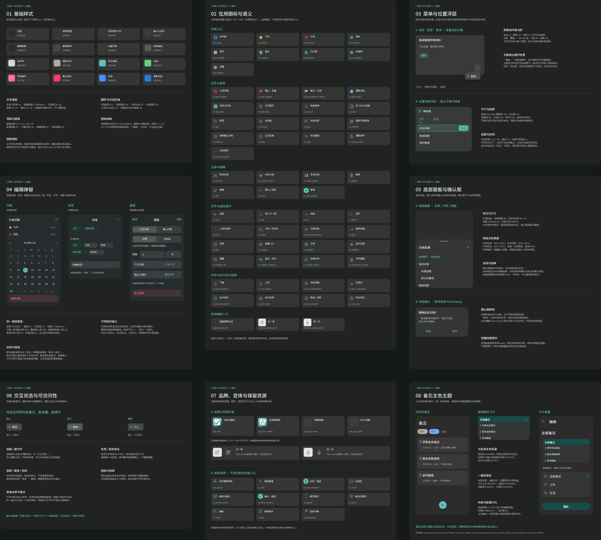
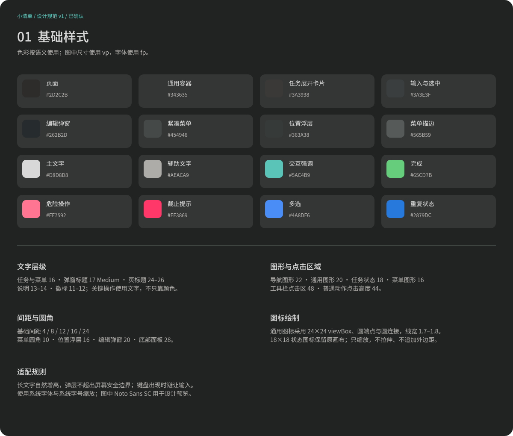
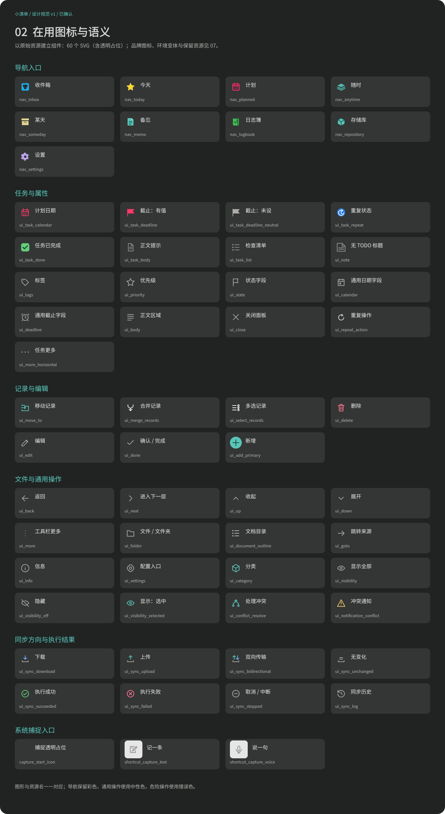
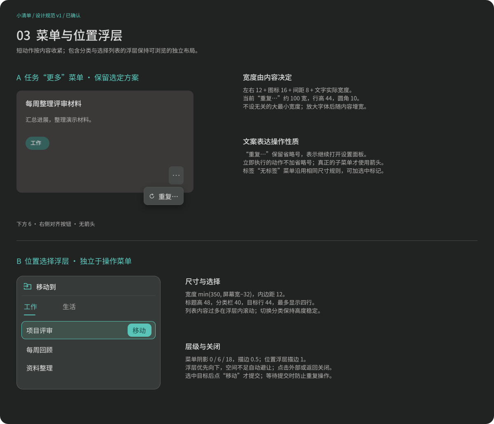
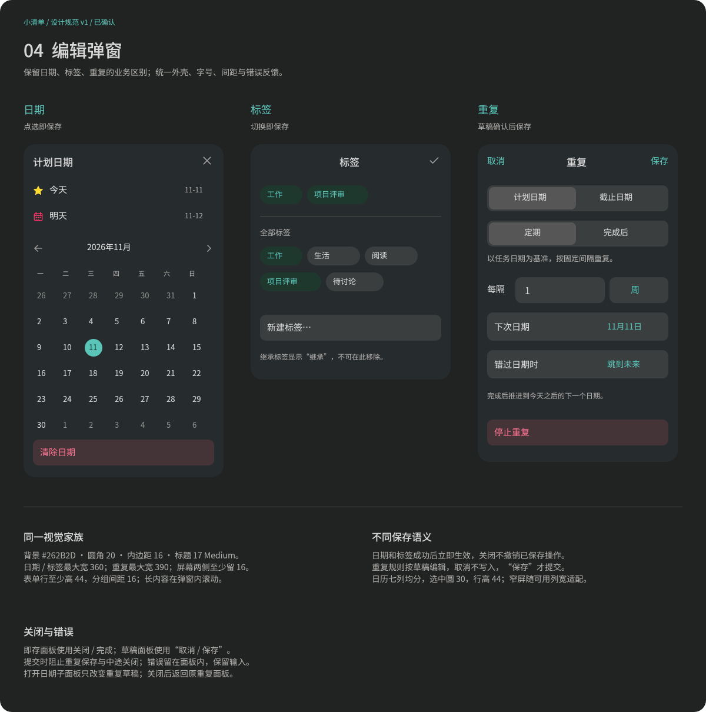
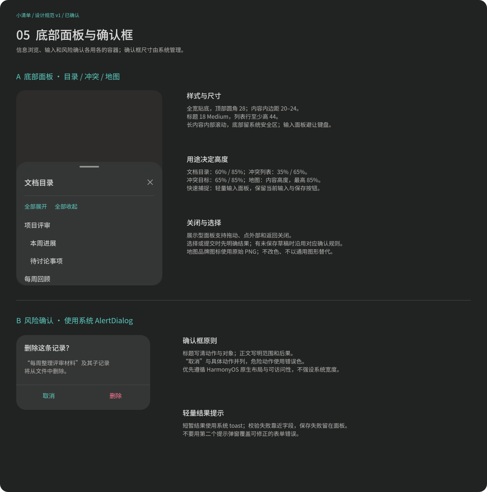
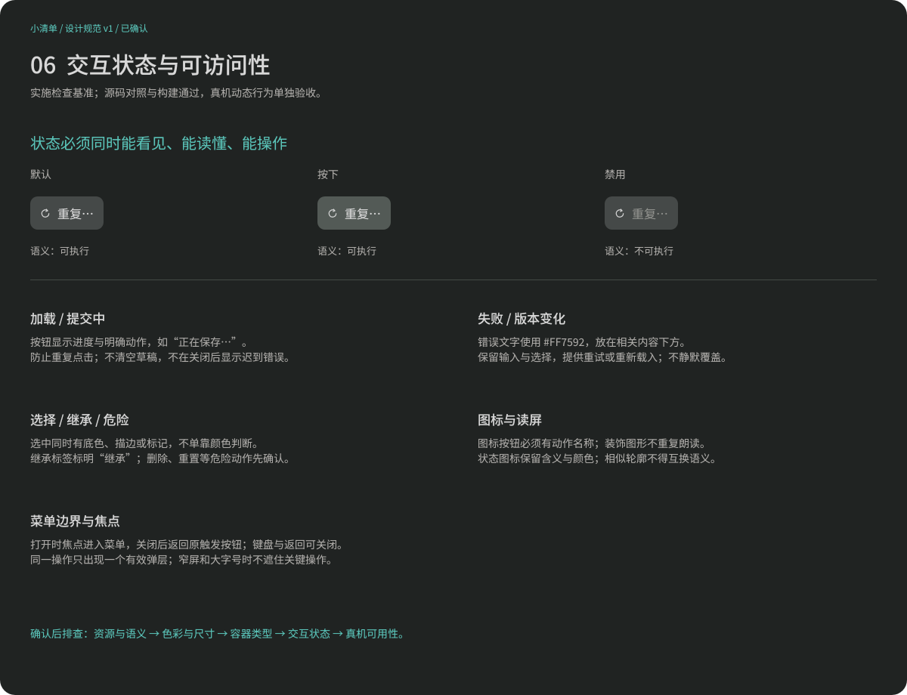
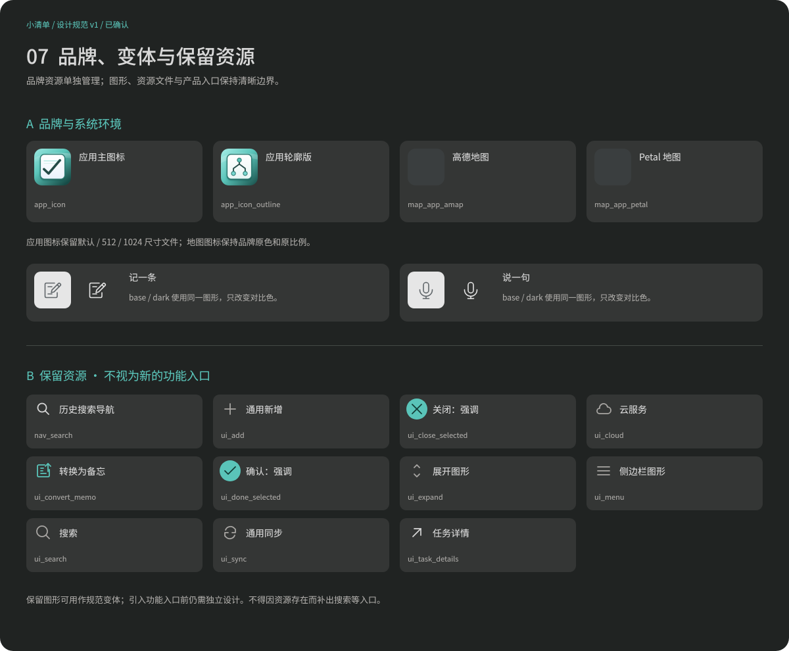
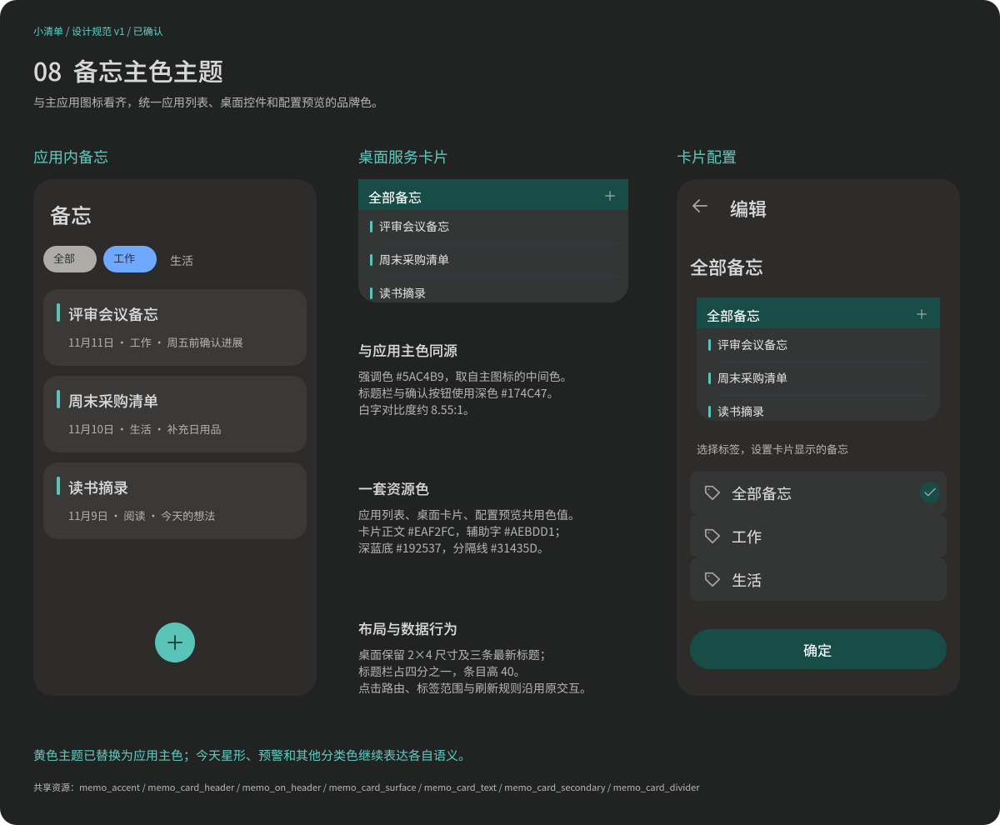
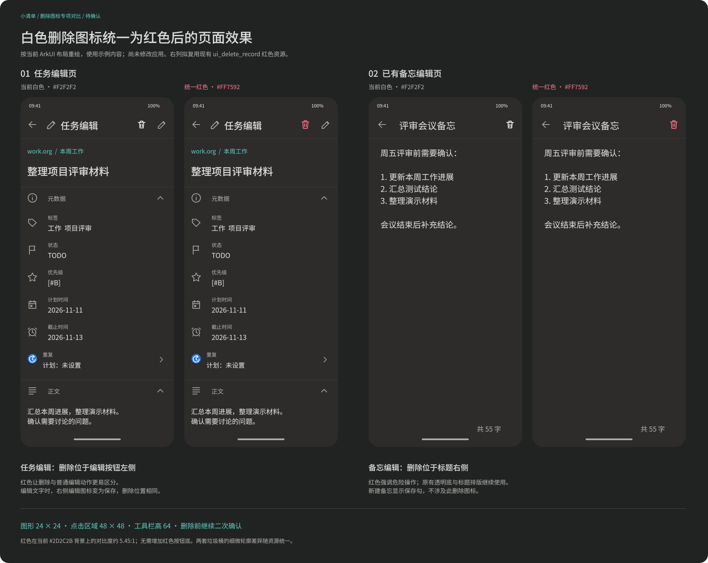

#+TITLE: 小清单视觉设计规范
#+STARTUP: show2levels hidestars
#+OPTIONS: author:nil date:nil toc:nil
#+LANGUAGE: zh-CN

* 状态与维护入口

版本为 v1，用户已确认作为实现对照基准。任务“更多”菜单沿用用户选定的紧凑方案，保留“重复…”省略号；删除图标统一使用危险色；备忘应用内页面、桌面卡片和配置预览统一使用应用主色。源码与构建设计已按规范调整，动态真机行为仍需设备验收。

视觉源文件为 [[file:../../design/Orgzly界面细节.fig][界面图谱]] 的“设计规范”页；“待确认设计”页继续保留 52 号任务更多菜单和删除图标对比的完整上下文图。规范页按用途划分以下区域，尺寸使用 vp，字体使用 fp；预览使用 Noto Sans SC，应用沿用系统字体和字号缩放。

规范页包含 69 个可复用组件与 42 个色彩、字号、圆角和菜单尺寸变量，变量只绑定本规范页的样例，不改变当前实现画板。总览见 ，分区图与源文件一起维护。

| 分区 | 固定内容 |
|-
| 01 基础样式 | 色彩语义、文字层级、图形尺寸、点击区域、间距与圆角。 |
| 02 在用图标与语义 | 项目引用的 60 个 SVG 资源，含捕捉能力的透明占位；图形对应原始资源名，以组件形式维护。 |
| 03 菜单与位置浮层 | 任务更多菜单、标签短菜单、按分类选择位置的浮层。 |
| 04 编辑弹窗 | 日期、标签、重复规则的外壳与各自保存语义。 |
| 05 底部面板与确认框 | 文档目录、冲突、地图、快速捕捉、风险确认和提示的容器边界。 |
| 06 交互状态与可访问性 | 默认、按下、禁用、加载、失败、选中、焦点与读屏规则。 |
| 07 品牌、变体与保留资源 | 应用主图标及轮廓版、地图品牌图标、快捷方式深浅色变体、11 个保留资源。 |
| 08 备忘主色主题 | 应用内备忘列表、桌面服务卡片和卡片配置页的主应用强调色方案。 |

分区预览：、、、、、、、。

* 基础样式

| 语义 | 颜色 |
|-
| 页面 | ~#2D2C2B~ |
| 通用容器 | ~#343635~ |
| 任务展开卡片 | ~#3A3938~ |
| 输入与选中 | ~#3A3E3F~ |
| 编辑弹窗 | ~#262B2D~ |
| 紧凑菜单 / 描边 | ~#454948~ / ~#565B59~ |
| 位置浮层 / 描边 | ~#363A38~ / ~#555E57~ |
| 主文字 / 辅助文字 | ~#D8D8D8~ / ~#AEACA9~ |
| 强调 / 完成 | ~#5AC4B9~ / ~#65CD7B~ |
| 危险操作 / 截止提示 | ~#FF7592~ / ~#FF3869~ |
| 多选 / 重复状态 | ~#4A8DF6~ / ~#2879DC~ |

任务和菜单文字为 16，弹窗标题为 17 Medium，说明为 13–14，徽标为 11–12。基础间距为 4、8、12、16、24。菜单、位置浮层、编辑弹窗、底部面板的圆角分别为 10、16、20、28。

导航图形为 22，通用图形为 20，任务状态图形为 18，紧凑菜单图形为 16；工具栏点击区域为 48，普通动作点击高度为 44。图形视觉尺寸与点击区域分开维护，不用扩大图形代替扩大点击区域。

* 图标语义与资源

以规范页中的原始图形和资源名为索引。同一含义复用同一图标，不用相似轮廓、Unicode 字符或 emoji 临时替代图形。通用线性图标使用 24×24 viewBox、圆端点与圆连接，线宽为 1.7–1.8；原始 18×18 状态图标保留画布。彩色导航、品牌资源和任务状态标志保留各自风格，不统一改成线性单色图形。

任务标题前的 ~ui_task_repeat~ 为蓝底白色循环时钟，表示任务已经重复；菜单中的中性循环箭头表示“设置重复”动作，两者分别维护，不互换。无 TODO 状态使用 ~ui_note~ ，完成状态使用 ~ui_task_done~ 。计划日期、截止日期与普通日期字段按用途选用对应资源，不因轮廓相近而混用。

规范中的“图标/菜单重复”和“图标/任务更多”组件分别固定中性循环箭头与水平三点图形；工具栏 ~ui_more~ 保留竖向三点形态。任务“更多”不使用文本字符临时绘制三点。

同步的传输方向与执行结果分别展示；下载、上传、双向、无变化不能替代成功、失败、取消／中断状态。图形与文字共同解释结果，不能只用颜色区分。

应用图标保留默认、512、1024 尺寸及轮廓版。地图品牌图标使用原始 PNG，不改色、不改变比例。快捷方式 ~shortcut_capture_text~ 与 ~shortcut_capture_voice~ 的 ~base~ / ~dark~ 资源保持同一图形，仅适配对比色，并保留 64×64 viewBox 与系统入口所需留白。 ~capture_start_icon~ 是透明占位，不作为可见操作图形。保留资源不代表新的搜索、同步等产品入口。

* 菜单与位置浮层

** 紧凑操作菜单

任务“更多”保留“重复…”操作。省略号表示继续打开设置；立即执行的操作不加省略号，真正的子菜单才使用箭头。标签筛选的“无标签”等短菜单沿用相同外观；需要选中标记时，宽度计入该标记及间距。

菜单以实际文字宽度计算：左右内边距各 12，可选图标宽 16，图文间距 8，文字为 16；单项“重复…”约 100 宽。行高为 44，圆角为 10，不设置无关的大最小宽度。最大宽度受屏幕安全边界约束，长文字和字号缩放后按内容适配。

菜单右侧对齐触发按钮，优先在下方展开，距离为 6；空间不足时自动避让。无箭头、无额外标题，描边为 0.5，阴影为向下 6、模糊 18 的柔和黑色。点击外部或返回关闭；选择动作后关闭菜单再打开下一面板，不挤动列表，保留任务卡片展开状态。

** 位置选择浮层

位置选择包含分类和目标列表，不套用短操作菜单的内容宽度。宽度为 350 与屏幕宽减 32 的较小值，圆角为 16，内边距为 12；标题、分类栏、目标行分别高 48、40、44，最多直接展示四行。内容更多时在浮层内滚动，切换分类保持高度稳定。

选中目标后出现“移动”按钮，点击该按钮才提交；按钮视觉高 32，但所在目标行的选择高度保持 44。浮层外点击与返回只关闭，不提交；提交期间阻止重复操作，失败保留选择与错误信息。

* 编辑弹窗

日期、标签、重复规则使用同一外壳：背景为 ~#262B2D~ ，圆角为 20，内边距为 16，标题为 17 Medium，分组间距为 16，表单行高至少为 44。日期与标签最大宽为 360，重复规则最大宽为 390，屏幕两侧至少留 16；长内容在弹窗内滚动，输入时避让键盘。

日期和标签的选择成功后立即保存，关闭不撤销已经保存的选择。重复规则使用草稿，“取消”丢弃草稿，“保存”才提交。即存面板提供关闭／完成，草稿面板提供取消／保存，不把两种语义合并。

日历保持七列均分，行高为 44，日期选中圆为 30；窄屏按可用列宽适配，不让七列撑破面板。重复规则中的日期子面板只修改重复草稿，关闭后返回原面板。

* 底部面板、确认与提示

底部面板全宽贴底，顶部圆角为 28，内边距为 20–24，标题为 18 Medium，列表行高至少为 44，底部保留系统安全区。文档目录使用 60%／85% 高度，冲突列表使用 35%／65%，冲突目标使用 65%／85%；地图按内容高度展示，最高为 85%。快速捕捉属于轻量输入面板，键盘出现后保留输入与保存按钮。

风险确认使用 HarmonyOS 原生 ~AlertDialog~ ，不强设系统宽度。标题说明动作与对象，正文说明范围和后果；并列提供“取消”和具体动作，危险动作用错误色。已有未保存草稿的关闭确认沿用具体业务规则。

短暂结果使用系统 toast，校验错误靠近字段，保存失败留在当前面板。提交期间阻止重复点击，失败保留输入与选择，提供重试或重新载入。图标按钮必须有可访问名称，装饰图形不重复朗读；菜单关闭后焦点返回触发按钮。

* 删除图标专项核对（已实施）

原白色 ~ui_delete~ 与红色 ~ui_delete_record~ 都是线性垃圾桶，主差异为颜色，路径也有细微差异。已将原白色工具栏按钮和红色左滑按钮统一为红色 ~ui_delete~ 资源，并移除旧的 ~ui_delete_record~ 资源，保持四处尺寸、点击区域、透明底和确认流程不变。

| 现有资源 | 使用位置 | 图形 / 点击区域 / 背景 |
|-
| ~ui_delete~ ， ~#FF7592~ | [[file:../../entry/src/main/ets/pages/TaskEdit.ets::113][任务编辑页工具栏]]，位于编辑／保存图标左侧。 | 24 / 48 / 透明按钮叠在 ~#2D2C2B~ 页面上。 |
| ~ui_delete~ ， ~#FF7592~ | [[file:../../entry/src/main/ets/pages/MemoEdit.ets::119][已有备忘编辑页工具栏]]，位于标题右侧。 | 24 / 48 / 透明按钮叠在 ~#2D2C2B~ 页面上。 |
| ~ui_delete~ ， ~#FF7592~ | [[file:../../entry/src/main/ets/components/InboxSwipeActions.ets::33][收件箱左滑删除]]。 | 20 / 48×44 / 连体操作组 ~#35383E~ ，文字同为错误色。 |
| ~ui_delete~ ， ~#FF7592~ | [[file:../../entry/src/main/ets/pages/TaskOverview.ets::117][备忘列表左滑删除]]。 | 24 / 44 / 圆形按钮 ~#513A40~ 。 |

两个白色工具栏按钮已复用现有红色资源，包含资源路径中的细微轮廓统一。图形仍为 24×24，点击区域仍为 48×48，工具栏仍高 64，使用原有透明底和删除前确认流程。红色强调危险操作，无需增加红色按钮底或扩大图标；任务编辑页的删除与普通编辑动作更易区分，备忘编辑页的标题与删除动作也有更清晰的语义区分。

按标准 sRGB 相对亮度计算，在 ~#2D2C2B~ 背景上，白色图标对比度约为 12.45:1，红色图标约为 5.45:1。新建备忘使用保存图标；存储库删除是文字按钮，均不在本次图标替换范围内。

对比维护于“待确认设计”页的“53 Harmony 删除图标统一红色对比（已实施）”，见 。图中以当前 ArkUI 布局与示例内容重绘，不是真机截图；实现已按红色方案更新。

* 备忘主色主题（已实施）

应用内备忘列表的标题竖线、桌面服务卡片的标题栏与条目竖线、卡片配置页的预览标题栏、选中标记和确认按钮统一使用主应用图标的主色语义：强调 ~#5AC4B9~，标题栏与确认按钮深色主色 ~#174C47~，标题文字 ~#D8D8D8~，备忘卡片底色 ~#343635~，正文 ~#D8D8D8~，辅助字 ~#AEACA9~，分隔线 ~#4B4A48~ 。备忘页的新增按钮、标签筛选和通知等通用控件仍遵循全局强调色；今天星形等其他入口颜色继续表达各自入口语义。

实现资源 token 为 ~memo_accent~ 、~memo_card_header~ 、~memo_on_header~ 、~memo_card_surface~ 、~memo_card_text~ 、~memo_card_secondary~ 和 ~memo_card_divider~，统一维护于 ~entry/src/main/resources/base/element/color.json~ 。

桌面 ~2*4~ 卡片仍保留标题栏四分之一高度、三条记录、40vp 行高、标题栏加号和按记录身份路由；只替换黄色视觉 token。卡片配置页的预览、选中状态和“确定”按钮与桌面卡片使用同一组 token，确认按钮文字在深色主色底上的对比度约为 8.5:1。

* 实施排查记录

源码排查已覆盖图标资源、颜色 token、任务更多菜单、标签菜单、文件更多菜单、日期／标签／重复弹窗、底部地图面板、确认框危险动作、备忘页面和桌面卡片。当前构建与脚本回归通过；需在真机继续验收系统字体缩放、菜单避让、Popup 焦点返回、桌面卡片裁切和备忘主色在不同系统主题下的实际效果。
