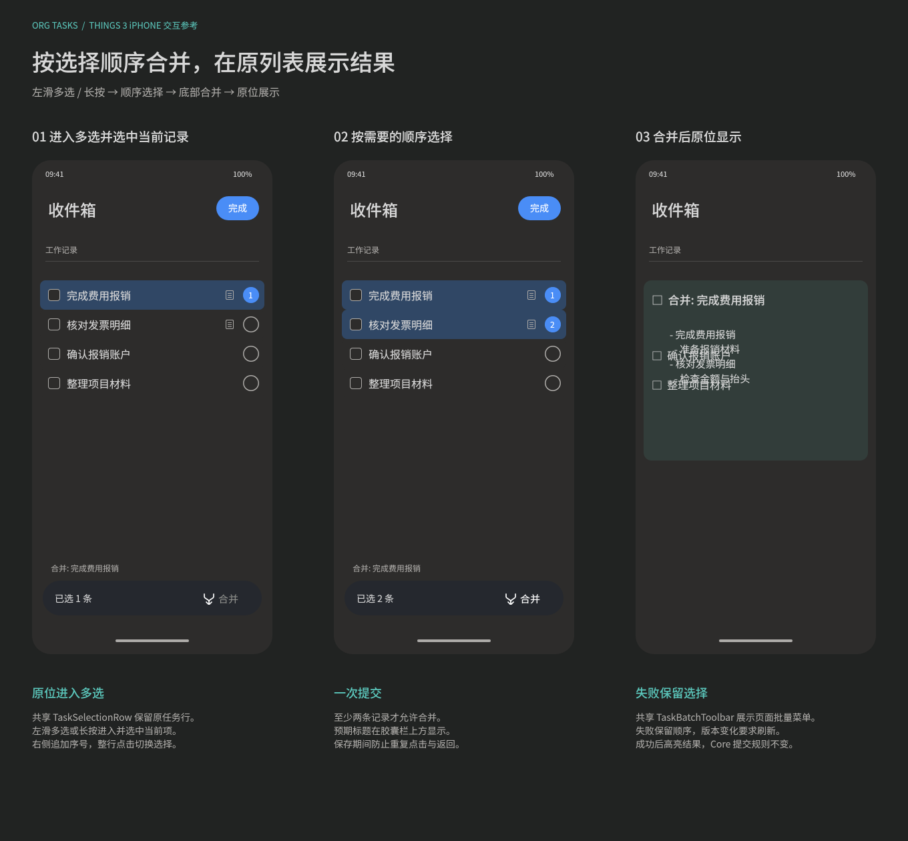
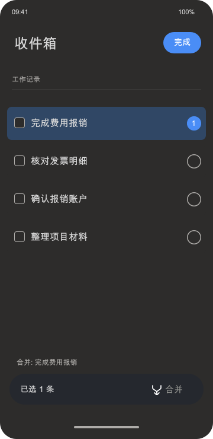
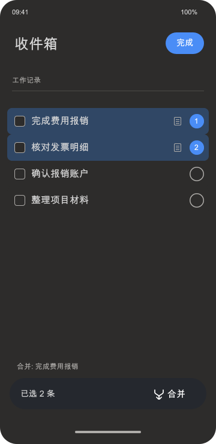
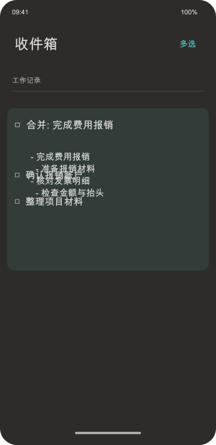

#+TITLE: 收件箱记录合并交互
#+STARTUP: show2levels hidestars
#+OPTIONS: author:nil date:nil toc:nil
#+LANGUAGE: zh-CN

* 范围与结果

合并入口仅在收件箱提供，最近新增区域和其他任务页面不参与。全部所选记录按用户点击的顺序转换为一条记录中的正文列表；标题固定为“合并: 第一条选择的记录标题”。第一条记录提供保留位置及状态、日期、优先级和自身属性。

用户选择完毕后直接点击底部“合并”，在当前收件箱完成操作并展示结果列表，不出现选择主记录、预览、二次确认或新页面。

设计见 [[file:../../design/Orgzly界面细节.fig][界面图谱]] 的“Harmony 当前实现”页，画板为“48 Harmony 收件箱记录合并（当前实现）”； 展示进入多选、按顺序选择、原位显示合并结果三个步骤。

分步图：、、。

左滑菜单、选择序号和底部操作栏分别复用 ~TaskSwipeActions~ 、 ~TaskSelectionRow~ 与 ~TaskBatchToolbar~ ，由收件箱页面策略启用多选并声明合并菜单；其他页面分别定义自己的菜单和批量开关，不复用收件箱专属业务回调。完整控件契约见 [[file:UI导航设计.org::*任务左滑与批量编辑共享控件][共享控件与页面策略]] 。

* 操作顺序

1. 左滑收件箱记录，点击最右侧蓝色“多选”进入并选中该条；也可长按记录进入并选中当前项。已有草稿先保存，失败保留输入并停留原编辑状态。
2. 多选在原列表原任务行上显示，继续复用 ~TaskListItem~ ，不替换为独立选择行。保留状态、标签、计数、日期和内容提示，原行高及列表位置不变，仅在右侧追加序号圆圈并叠加选中背景；整行点击追加或取消选择，原任务编辑和完成交互暂停。至少选择两条才允许合并；底部深色胶囊栏显示已选条数与合并按钮，栏上方显示将生成的标题。右上角“完成”或系统返回退出选择，不执行合并。取消第一条后，下一条自动成为新的第一条。
3. 点击“合并”，页面冻结选择并显示“合并中…”，禁止重复提交和返回；由 Core 生成普通操作组，再通过原入口一次提交。
4. 成功后退出多选、刷新、滚动并高亮结果，在原记录下使用已有正文控件展示合并列表。点击记录继续原位编辑，不改变当前页面与路由。

* 内容规则

- 所有选中的记录，包括第一条自身，都成为列表项；其正文缩进到所属项，真实子记录递归转换为嵌套列表，不保留另外的任务标题节点。
- 第一条的标题改为“合并: 原标题”，状态、规划、优先级和属性保持原值。其他记录的属性不自动覆盖第一条。
- 原标题、属性、规划和日志保存到带内部标记的标准 Org comment 块，使用逗号转义保护标题与块结束符；阅读及备注编辑不展示归档，编辑备注仍保留这些字节。再次合并平铺保留旧归档，避免复制整份历史。
- 所选记录不能重复或互为祖先与后代。将转换为列表的节点带有 ID／CUSTOM_ID、当前文件存在其标题链接引用，或涉及受保护冲突节点时拒绝。第一条自身 ID 保留；其他文件及仓库外的标题定位链接不自动迁移。
- 未涉及的文件范围保持原始字节。合并数据与同步规则由 Core 实现，宿主不解析或拼接 Org。

* 操作组与失败处理

Core 接受按选择顺序排列的完整路径和文件版本，返回普通 Deletion 与 Modification 组成的操作组及结果路径，不新增任务写入操作种类。删除按原文逆序执行，修改使用删除后的正确路径，避免重名记录序号变化定位错误；标题和正文由一次 Modification 完成。

宿主只补充需要上传的 Core 仓库身份，并通过原批量入口一组提交。普通失败保留原选择顺序和错误信息；版本变化要求刷新重选，不覆盖新内容。成功反馈只在完整提交后出现，提交成功但刷新失败时只重读，不再次合并。

* 方案取舍

| 方案 | 优点 | 代价 |
|-
| 当前采用的原位列表合并 | 路径短、选择顺序明确，不增加界面；结果只有一条记录 | 第一条承担结果属性，其他独立任务变为列表；标题定位引用不自动迁移 |
| 选择主记录并预览 | 可在写入前检查复杂结构 | 多一个选择面板和预览步骤，不符合当前直接操作要求 |
| 新建父记录 | 保留每条独立任务与层级 | 增加一层结构，没有真正合并成一条记录 |

左滑操作组参考 Things 3 iPhone 的蓝色多选入口，将“移动、将来、备忘、删除、多选”五项按 48vp 等宽并列，不收入“更多”；组底色统一为深灰，删除采用错误色，最右侧多选采用蓝底白色。整体宽 256vp，收起和展开卡片均可使用。保留长按入口，移除顶部普通态“多选”按钮与空选择入口，合并规则、选择顺序与失败恢复仍沿用原流程。
