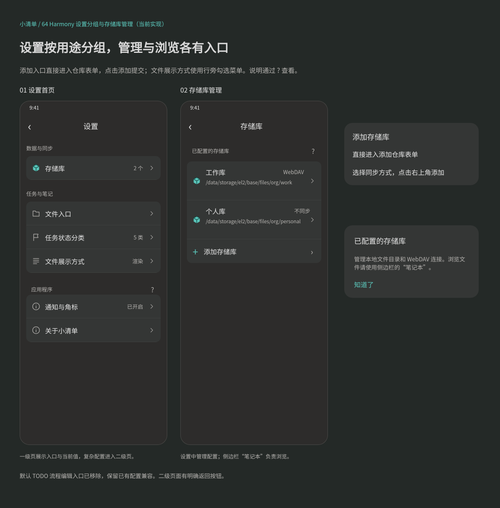
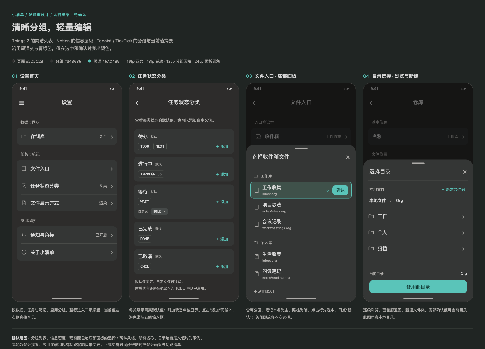

#+TITLE: 设置界面设计
#+DATE: 2026-11-14
#+LANGUAGE: zh-CN
#+OPTIONS: author:nil toc:2

* 状态与实施范围

风格已确认并接入设置、状态分类、文件入口和仓库配置。侧边栏“笔记本”用于浏览，设置“存储库”用于管理；对应当前源文件见 [[file:设计文件索引.org][设计文件索引]]。原四屏提案图及其 HTML 保留为调研记录，不作为当前画板。

；

* 已确认的风格

采用 Things 3 的简洁列表结构，结合 Notion 的文字层级和 Todoist、TickTick 的分组方式。沿用项目暖深灰背景与青绿色强调色，使用单色线框图标。设置首页显示分组入口与必要的当前值；复杂编辑进入独立页面，文件和目录选择从底部展开。

| 项目 | 建议 |
|-
| 页面与分组背景 | 沿用现有 #2D2C2B 与 #343635，以轻微明度差区分层级。 |
| 强调与选中 | 沿用 #5AC4B9；选中行使用“移动到”的 #3F514A 底色、细描边与明确选中标记。 |
| 字号 | 正文 16fp，辅助文字 13fp，分组标题 13fp；状态值使用等宽字体。 |
| 间距与触控 | 页面左右 16vp，分组间距 24–28vp；设置行约 56vp，文件两行内容约 60vp，触控区域至少 44vp。 |
| 圆角 | 分组 12vp，选中行 10vp，底部面板顶部 24vp；复用现有样式而统一细节。 |
| 长名称与大字体 | 标题优先展示，摘要必要时换行；行高允许增长，确认动作保持可达。 |

* 设置的信息组织

| 首页分组 | 入口 | 摘要与承载方式 |
|-
| 数据与同步 | 存储库 | 显示仓库数量，进入现有仓库列表和仓库设置。 |
| 任务与笔记 | 文件入口 | 二级页展示收件箱、某天、备忘当前绑定的笔记本。 |
| 任务与笔记 | 任务状态分类 | 独立页直接显示五类默认值和自定义值。 |
| 任务与笔记 | 文件展示方式 | 当前值为渲染或原文，使用紧凑选择器。 |
| 应用程序 | 通知与角标 | 显示当前授权状态，进入现有系统管理流程。 |
| 应用程序 | 关于小清单 | 承载现有应用说明。 |

默认 TODO 流程的编辑框和恢复默认按钮从配置界面移除。已有全局配置的兼容、默认来源仍遵循 Core 的配置规则；移除设置入口时不能顺带清空用户原有配置。预览中不新增主题、账户、订阅或其他尚未交付的功能入口。

* 配置备份与恢复

设置首页右上角“更多”菜单提供“备份”。选择“存储为文件”打开系统文档保存器，选择“备忘录”打开系统分享面板并可将配置文件存入华为备忘录。备份名包含设备本地日期和时间，分享附件时同步复制去掉后缀的名称，在备忘录的“存储为”标题框中可直接粘贴。

在文件管理中用小清单打开 .orgtasks 文件进入恢复。华为备忘录的附件在系统预览中通过“更多”菜单用小清单打开。导入页预览文件入口、存储库、文件展示方式与自定义状态数量。目录不可用或 WebDAV 需要重新启用时显示待处理项。点击底部“应用配置”提交，成功后进入小清单主窗口。字段与凭据边界见 [[file:配置项设计.org::*配置备份与恢复][配置项设计]]。

* 任务状态分类

默认值依据 [[file:../core/数据模型.org::*任务运行状态分类][Core 任务运行状态分类]]，每类明确展示：

| 分类 | 默认状态值 |
|-
| 待办 | ~TODO~ 、 ~NEXT~ |
| 进行中 | ~INPROGRESS~ |
| 等待 | ~WAIT~ |
| 已完成 | ~DONE~ |
| 已取消 | ~CNCL~ |

每类以独立分组显示默认状态标签及“添加”入口，自定义标签与默认标签分行。默认值只读，自定义值可移除。点击添加后才显示输入，重复或非法值保留草稿并显示具体原因。添加状态分类仅设置映射，仍由笔记本的有效 TODO 声明决定是否识别为任务；界面用一句简短说明交代这一点。

预览中的 ~HOLD~ 仅为等待分类的自定义值示例。实现通过 Core 只读接口获取固定映射，宿主不重新定义领域规则。

* 文件入口的底部面板

- 从收件箱、某天或备忘配置行打开同一款底部面板，标题随入口变化。
- 仓库作为分区标题；每行以笔记本名字为主，文件相对路径为辅，无标题时回退到文件名。同名文件仍由仓库与路径区分。
- 初次打开标记已保存的绑定；点选其他行只更新面板内的选择，选中行出现与“移动到”一致的底色、描边和右侧“确认”。
- 点击“确认”才保存并关闭；下滑、返回或关闭按钮放弃本次选择，不改变原绑定。
- “不设置此入口”也作为可选目标，选中后确认才清除；不会点一下就删除绑定。
- 面板固定顶部标题，列表独立滚动；长列表可上划扩展高度，确认动作随当前选中行显示。
- 未配置仓库、空仓库、读取失败、原目标失效分别显示可理解的说明。失败保留选择，可重试，不跨仓库回退到同名文件。

* 地址与目录选择

本地 Org 文件目录已通过底部面板选择，提供应用文件快捷入口、逐级进入、上一级返回和新建文件夹。底部“使用此目录”确认当前目录，取消不修改仓库配置；系统外部目录授权尚未接入。

WebDAV 服务器地址、用户名与密码继续直接编辑并可测试连接。已有本地仓库启用 WebDAV 时，保存前提示首次同步会覆盖同路径的本地 Org 文件，取消后保留草稿。本轮目录浏览与新建仅覆盖本地应用可访问范围，未接入远端目录浏览与新建。

* 应用关联

沿用设置子页的返回栏。页面按链接名称合并本机关联与工作区任务引用中能匹配已配置目录项的 ~app:~ 名称并去重。列表从标题栏下方开始排列，行标题和选择面板只显示链接名称。已绑定行优先显示系统图标，读取不到时显示目录自带的彩色图标，系统确认目标未安装时显示“未安装”。未绑定行使用等宽的中性色占位图标，使名称与已绑定行对齐。选择应用面板中的候选显示应用图标。点任一行可打开选择应用面板，点选应用即绑定或更换，已绑定项可点击面板底部的次级文字按钮解除绑定。空列表在内容区居中显示“还没有应用关联”。

应用选择面板列出内置目录中已配置启动入口的应用，同名应用优先。系统确认未安装或已停用的应用不提供选择。点选只写入关联，点击任务链接时才启动应用。无可用应用时展示提示并保留原列表。点击任务中的应用链接时，已绑定且可用的应用直接打开。未绑定或打开失败时，提示中的“前往设置”打开当前设置页。
