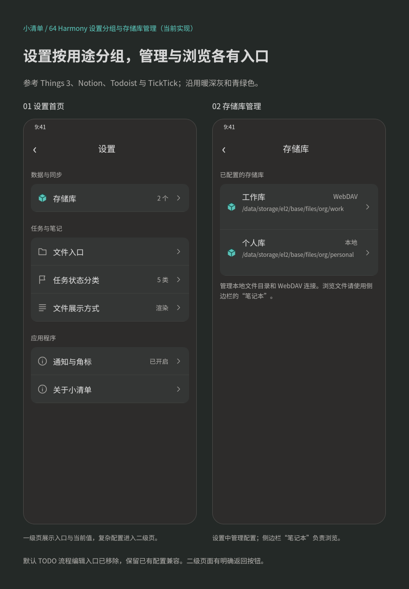
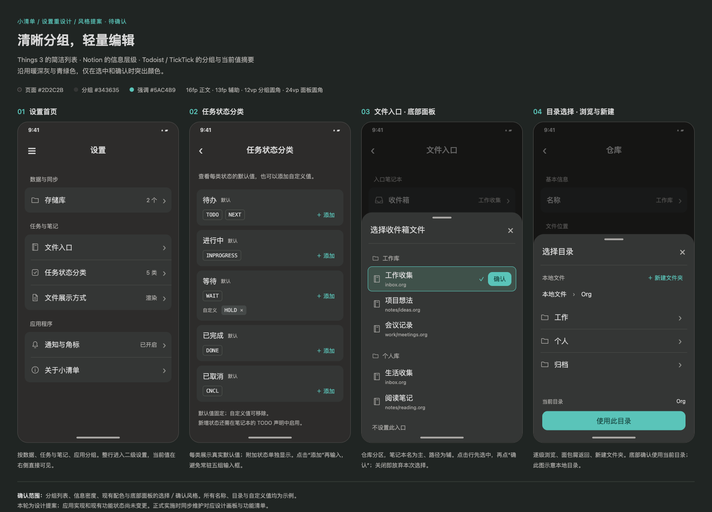
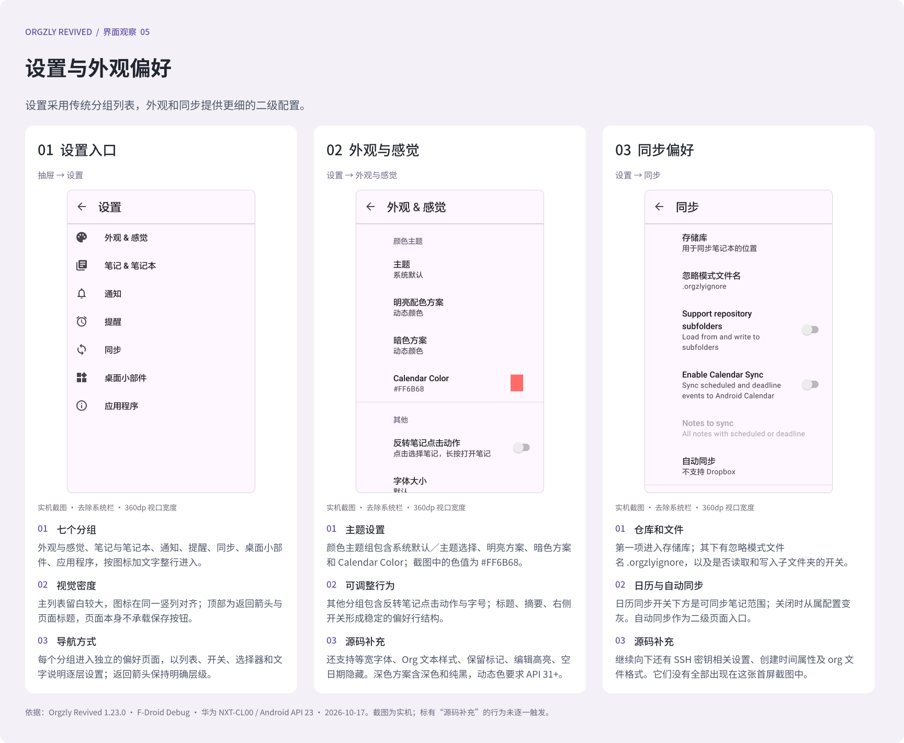
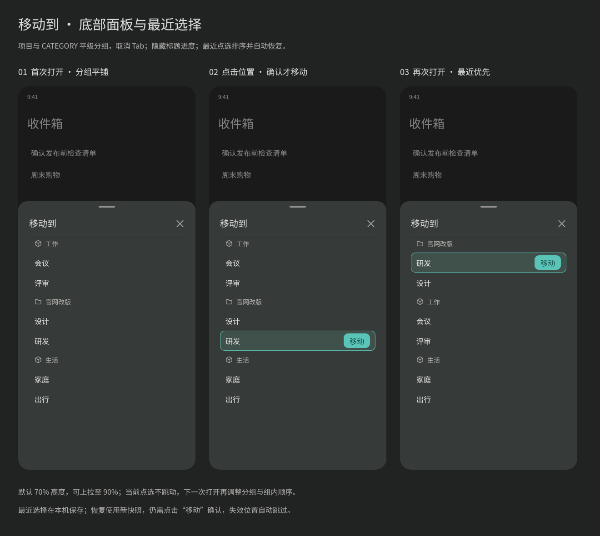

#+TITLE: 设置界面风格调研与重设计提案
#+DATE: 2026-11-14
#+LANGUAGE: zh-CN
#+OPTIONS: author:nil toc:2

* 状态与实施范围

风格已确认并接入设置、状态分类、文件入口和仓库配置。侧边栏“笔记本”用于浏览，设置“存储库”用于管理；对应当前源文件见 [[file:设计文件索引.org][设计文件索引]]。原四屏提案图及其 HTML 保留为调研记录，不作为当前画板。应用已通过构建与交互逻辑检查，真机视觉和外部目录授权仍待独立验收。

；

* 参考应用与证据

调研使用公开设置截图及官方帮助说明，截图属于不同历史版本；它们用于观察布局，不作为最新版功能或实时排行榜的依据。补充选取 Todoist、TickTick 两款主流任务管理应用。

| 应用 | 已查看的界面与来源 | 可用于本项目的设计 |
|-
| Notion | [[https://nicklafferty.com/blog/notion-dark-mode/][移动端深色设置截图]]；[[https://www.notion.com/help/account-settings][官方账户与偏好说明]] | 分组标题、主次文字和低饱和分隔线建立层级；说明紧邻所解释的设置。 |
| Things 3 | [[https://chiaseacc.com/things-3/][第三方文章中的 iPad 设置弹层截图]]；[[https://culturedcode.com/things/support/articles/2803583][官方日历设置说明]]；[[https://thesweetsetup.com/things-3-8-for-ios-debuts-new-dark-mode/][深色界面评测截图]] | 设置入口保持简短，图标、标题、箭头统一对齐，细节进入下一层。iPad 弹层仅参考列表结构。 |
| Todoist | [[https://www.makeuseof.com/change-todoist-theme-color/][iOS 设置分组列表截图]]；[[https://www.todoist.com/zh-CN/help/todoist/features/turn-smart-date-recognition-on-or-off-63WfIr][官方设置操作说明]] | 圆角分组、行内分隔、右侧当前值与二级入口；确认动作清楚。 |
| TickTick | [[https://talk.tidbits.com/t/ticktick-provides-a-focused-daily-task-list-and-more/31705][设置与 Tab Bar 二级页截图所在评测讨论]]；[[https://tidbits.com/uploads/2025/08/TickTick-settings-scaled.jpg][截图原图]]；[[https://help.ticktick.com/][官方帮助中心]] | 按用途分区，相关选项归组，次级能力在独立页面展开。 |

项目现有参考可交叉查看 ，文件选择的选择／确认样式参考 。

* 已确认的风格

采用 Things 3 的简洁列表结构，结合 Notion 的文字层级和 Todoist、TickTick 的分组方式。沿用项目暖深灰背景与青绿色强调色，使用单色线框图标。设置首页显示分组入口与必要的当前值；复杂编辑进入独立页面，文件和目录选择从底部展开。

| 项目 | 建议 |
|-
| 页面与分组背景 | 沿用现有 #2D2C2B 与 #343635，以轻微明度差区分层级。 |
| 强调与选中 | 沿用 #5AC4B9；选中行使用“移动到”的 #3F514A 底色、细描边与明确选中标记。 |
| 字号 | 正文 16fp，辅助文字 13fp，分组标题 13fp；状态值使用等宽字体。 |
| 间距与触控 | 页面左右 16vp，分组间距 24–28vp；设置行约 56vp，文件两行内容约 60vp，触控区域至少 44vp。 |
| 圆角 | 分组 12vp，选中行 10vp，底部面板顶部 24vp；复用现有样式而统一细节。 |
| 长名称与大字体 | 标题优先展示，摘要必要时换行；行高允许增长，确认动作保持可达。 |

* 设置的信息组织

| 首页分组 | 入口 | 摘要与承载方式 |
|-
| 数据与同步 | 存储库 | 显示仓库数量，进入现有仓库列表和仓库设置。 |
| 任务与笔记 | 文件入口 | 二级页展示收件箱、某天、备忘当前绑定的笔记本。 |
| 任务与笔记 | 任务状态分类 | 独立页直接显示五类默认值和自定义值。 |
| 任务与笔记 | 文件展示方式 | 当前值为渲染或原文，使用紧凑选择器。 |
| 应用程序 | 通知与角标 | 显示当前授权状态，进入现有系统管理流程。 |
| 应用程序 | 关于小清单 | 承载现有应用说明。 |

默认 TODO 流程的编辑框和恢复默认按钮从配置界面移除。已有全局配置的兼容、默认来源仍遵循 Core 的配置规则；移除设置入口时不能顺带清空用户原有配置。预览中不新增主题、账户、订阅或其他尚未交付的功能入口。

* 任务状态分类

默认值依据 [[file:../core/数据模型.org::*任务运行状态分类][Core 任务运行状态分类]]，每类明确展示：

| 分类 | 默认状态值 |
|-
| 待办 | ~TODO~ 、 ~NEXT~ |
| 进行中 | ~INPROGRESS~ |
| 等待 | ~WAIT~ |
| 已完成 | ~DONE~ |
| 已取消 | ~CNCL~ |

每类以独立分组显示默认状态标签及“添加”入口，自定义标签与默认标签分行。默认值只读，自定义值可移除。点击添加后才显示输入，重复或非法值保留草稿并显示具体原因。添加状态分类仅设置映射，仍由笔记本的有效 TODO 声明决定是否识别为任务；界面用一句简短说明交代这一点。

预览中的 ~HOLD~ 仅为等待分类的自定义值示例。实现通过 Core 只读接口获取固定映射，宿主不重新定义领域规则。

* 文件入口的底部面板

- 从收件箱、某天或备忘配置行打开同一款底部面板，标题随入口变化。
- 仓库作为分区标题；每行以笔记本名字为主，文件相对路径为辅，无标题时回退到文件名。同名文件仍由仓库与路径区分。
- 初次打开标记已保存的绑定；点选其他行只更新面板内的选择，选中行出现与“移动到”一致的底色、描边和右侧“确认”。
- 点击“确认”才保存并关闭；下滑、返回或关闭按钮放弃本次选择，不改变原绑定。
- “不设置此入口”也作为可选目标，选中后确认才清除；不会点一下就删除绑定。
- 面板固定顶部标题，列表独立滚动；长列表可上划扩展高度，确认动作随当前选中行显示。
- 未配置仓库、空仓库、读取失败、原目标失效分别显示可理解的说明。失败保留选择，可重试，不跨仓库回退到同名文件。

* 地址与目录选择

本地 Org 文件目录已通过底部面板选择，提供应用文件快捷入口、逐级进入、上一级返回和新建文件夹。底部“使用此目录”确认当前目录，取消不修改仓库配置；系统外部目录授权尚未接入。

WebDAV 服务器地址、用户名与密码继续直接编辑并可测试连接。本轮目录浏览与新建仅覆盖本地应用可访问范围，未接入远端目录浏览与新建。

* 实施与验收记录

| 范围 | 当前结果 |
|-
| 设置与仓库风格 | 已接入分组列表、二级页与统一字段组件，设计画板和功能清单同步更新。 |
| 导航分工 | 侧边栏“笔记本”浏览文件，设置“存储库”管理配置，仓库分区使用明确管理按钮。 |
| 状态与兼容 | 默认映射来自 Core，支持附加值编辑；移除 TODO 流程编辑入口并保留旧配置。 |
| 文件与目录选择 | 文件点选后确认保存；本地目录支持浏览、新建与确认更新草稿。 |
| 构建与逻辑检查 | 已通过无告警构建及选择确认、失败恢复、配置保留、通知状态更新检查。 |
| 后续验收 | 真机视觉与触控仍待验收；系统外部目录授权与 WebDAV 远端目录浏览尚未接入。 |

* 预览生成源

下面的 HTML 仅用于生成本提案的四屏视觉预览，不是应用页面实现。示例名称、路径与自定义状态均为占位数据。

#+begin_src html :exports none
<!doctype html><html lang="zh-CN"><meta charset="UTF-8"><title>小清单 · 设置界面风格提案</title><body>

小清单 / 设置重设计 / 风格提案 · 待确认
<h1>清晰分组，轻量编辑</h1>
Things 3 的简洁列表 · Notion 的信息层级 · Todoist / TickTick 的分组与当前值摘要 沿用暖深灰与青绿色，仅在选中和确认时突出颜色。

<i class="dot" style="background:#2d2c2b;border:1px solid #666"></i>页面 #2D2C2B<i class="dot" style="background:#343635"></i>分组 #343635<i class="dot" style="background:#5ac4b9"></i>强调 #5AC4B916fp 正文 · 13fp 辅助 · 12vp 分组圆角 · 24vp 面板圆角

01设置首页

9:41▴  ▰
<header>☰<strong>设置</strong></header><main>
数据与同步

<svg viewBox="0 0 24 24" fill="none" stroke="currentColor" stroke-width="1.5" stroke-linecap="round" stroke-linejoin="round"><path d="M3 6h6l2 2h10v11H3z"/></svg>
存储库
2 个<b class="chevron">›</b>

任务与笔记

<svg viewBox="0 0 24 24" fill="none" stroke="currentColor" stroke-width="1.5" stroke-linecap="round" stroke-linejoin="round"><path d="M5 3h14v18H5zM8 3v18M11 7h5"/></svg>
文件入口
<b class="chevron">›</b>

<svg viewBox="0 0 24 24" fill="none" stroke="currentColor" stroke-width="1.5" stroke-linecap="round" stroke-linejoin="round"><rect x="4" y="4" width="16" height="16" rx="3"/><path d="m8 12 3 3 5-6"/></svg>
任务状态分类
5 类<b class="chevron">›</b>

<svg viewBox="0 0 24 24" fill="none" stroke="currentColor" stroke-width="1.5" stroke-linecap="round" stroke-linejoin="round"><path d="M6 3h8l4 4v14H6zM14 3v5h5M9 12h6M9 16h6"/></svg>
文件展示方式
渲染<b class="chevron">›</b>

应用程序

<svg viewBox="0 0 24 24" fill="none" stroke="currentColor" stroke-width="1.5" stroke-linecap="round" stroke-linejoin="round"><path d="M5 17h14l-2-3V9a5 5 0 0 0-10 0v5zM10 21h4"/></svg>
通知与角标
已开启<b class="chevron">›</b>

<svg viewBox="0 0 24 24" fill="none" stroke="currentColor" stroke-width="1.5" stroke-linecap="round" stroke-linejoin="round"><circle cx="12" cy="12" r="9"/><path d="M12 10v7M12 6v1"/></svg>
关于小清单
<b class="chevron">›</b>

</main>

按数据、任务与笔记、应用分组。整行进入二级设置，当前值在右侧直接可见。

02任务状态分类

9:41▴  ▰
<header>‹<strong>任务状态分类</strong></header><main class="state-main">
查看每类状态的默认值，也可以添加自定义值。

待办默认

TODONEXT<button class="add" aria-label="为待办添加状态">＋ 添加</button>

进行中默认

INPROGRESS<button class="add" aria-label="为进行中添加状态">＋ 添加</button>

等待默认

WAIT<button class="add" aria-label="为等待添加状态">＋ 添加</button>

自定义HOLD ×

已完成默认

DONE<button class="add" aria-label="为已完成添加状态">＋ 添加</button>

已取消默认

CNCL<button class="add" aria-label="为已取消添加状态">＋ 添加</button>

默认值固定；自定义值可移除。 新增状态还需在笔记本的 TODO 声明中启用。
</main>

每类展示真实默认值；附加状态单独显示。点击“添加”再输入，避免常驻五组输入框。

03文件入口 · 底部面板

9:41▴  ▰
<header>‹<strong>文件入口</strong></header><main>
入口笔记本

<svg viewBox="0 0 24 24" fill="none" stroke="currentColor" stroke-width="1.5" stroke-linecap="round" stroke-linejoin="round"><path d="m5 4-3 11v5h20v-5L19 4zM2 15h6l2 3h4l2-3h6"/></svg>
收件箱
工作收集<b class="chevron">›</b>

<svg viewBox="0 0 24 24" fill="none" stroke="currentColor" stroke-width="1.5" stroke-linecap="round" stroke-linejoin="round"><path d="M3 6h18v4H3zM5 10v11h14V10M9 14h6"/></svg>
某天
未来计划<b class="chevron">›</b>

<svg viewBox="0 0 24 24" fill="none" stroke="currentColor" stroke-width="1.5" stroke-linecap="round" stroke-linejoin="round"><path d="M6 3h12v18H6zM9 7h6M9 11h6M9 15h4"/></svg>
备忘
生活备忘<b class="chevron">›</b>

</main>

<section class="sheet">

选择收件箱文件×

<svg viewBox="0 0 24 24" fill="none" stroke="currentColor" stroke-width="1.5" stroke-linecap="round" stroke-linejoin="round"><path d="M3 6h6l2 2h10v11H3z"/></svg>工作库

<svg viewBox="0 0 24 24" fill="none" stroke="currentColor" stroke-width="1.5" stroke-linecap="round" stroke-linejoin="round"><path d="M5 3h14v18H5zM8 3v18M11 7h5"/></svg>
工作收集<small>inbox.org</small>
✓<button class=confirm>确认</button>

<svg viewBox="0 0 24 24" fill="none" stroke="currentColor" stroke-width="1.5" stroke-linecap="round" stroke-linejoin="round"><path d="M5 3h14v18H5zM8 3v18M11 7h5"/></svg>
项目想法<small>notes/ideas.org</small>

<svg viewBox="0 0 24 24" fill="none" stroke="currentColor" stroke-width="1.5" stroke-linecap="round" stroke-linejoin="round"><path d="M5 3h14v18H5zM8 3v18M11 7h5"/></svg>
会议记录<small>work/meetings.org</small>

<svg viewBox="0 0 24 24" fill="none" stroke="currentColor" stroke-width="1.5" stroke-linecap="round" stroke-linejoin="round"><path d="M3 6h6l2 2h10v11H3z"/></svg>个人库

<svg viewBox="0 0 24 24" fill="none" stroke="currentColor" stroke-width="1.5" stroke-linecap="round" stroke-linejoin="round"><path d="M5 3h14v18H5zM8 3v18M11 7h5"/></svg>
生活收集<small>inbox.org</small>

<svg viewBox="0 0 24 24" fill="none" stroke="currentColor" stroke-width="1.5" stroke-linecap="round" stroke-linejoin="round"><path d="M5 3h14v18H5zM8 3v18M11 7h5"/></svg>
阅读笔记<small>notes/reading.org</small>

不设置此入口

</section>

仓库分区，笔记本名为主、路径为辅。点击行先选中，再点“确认”；关闭即放弃本次选择。

04目录选择 · 浏览与新建

9:41▴  ▰
<header>‹<strong>仓库</strong></header><main>
基本信息

名称
工作库<b class="chevron">›</b>

文件位置

<svg viewBox="0 0 24 24" fill="none" stroke="currentColor" stroke-width="1.5" stroke-linecap="round" stroke-linejoin="round"><path d="M3 6h6l2 2h10v11H3z"/></svg>
Org 文件目录
Org / 工作<b class="chevron">›</b>

</main>

<section class="sheet directory">

选择目录×

本地文件<button class="text-button">＋ 新建文件夹</button>

本地文件 › Org

<svg viewBox="0 0 24 24" fill="none" stroke="currentColor" stroke-width="1.5" stroke-linecap="round" stroke-linejoin="round"><path d="M3 6h6l2 2h10v11H3z"/></svg>
工作
<b class="chevron">›</b>

<svg viewBox="0 0 24 24" fill="none" stroke="currentColor" stroke-width="1.5" stroke-linecap="round" stroke-linejoin="round"><path d="M3 6h6l2 2h10v11H3z"/></svg>
个人
<b class="chevron">›</b>

<svg viewBox="0 0 24 24" fill="none" stroke="currentColor" stroke-width="1.5" stroke-linecap="round" stroke-linejoin="round"><path d="M3 6h6l2 2h10v11H3z"/></svg>
归档
<b class="chevron">›</b>

当前目录Org
<button class="primary">使用此目录</button>
</section>

逐级浏览、面包屑返回、新建文件夹。底部确认使用当前目录；此图示意本地目录。

<strong>确认范围：</strong>分组列表、信息密度、现有配色与底部面板的选择／确认风格。所有名称、目录与自定义值均为示例。 本轮为设计提案；应用实现和现有功能状态尚未变更。正式实施时同步维护对应设计画板与功能清单。

</body></html>
#+end_src
