#+TITLE: 设计文件索引与协作规则
#+STARTUP: show2levels hidestars
#+OPTIONS: author:nil date:nil toc:nil
#+LANGUAGE: zh-CN

* 设计入口与维护规则

设计源文件按独立功能与交互流程拆分，目录分为当前实现、规范、参考与历史。每个画板只有一个权威源文件；同一功能的正常、空态、错误态和详细交互保留在同一文件中，避免一次功能修改涉及多份重复主稿。跨功能浏览通过本文与 [[file:../../design/previews/][设计预览]] 完成，不再维护可编辑的汇总文件。

- 修改前从下表定位功能文件，只保存本次涉及的文件；同一文件仍需协调并行编辑，二进制文件发生冲突时按画板核对后人工整合，不直接用一侧覆盖另一侧。
- 文件名按稳定的功能名称维护，不以旧画板编号作为唯一标识。原画板名称与编号保留用于追溯；编号重复时以文件路径和页名区分。
- 当前实现中的“Harmony 当前实现”页维护页面与共享控件的实现样例；同文件的“任务编辑交互”页维护完整操作步骤，两者职责不同。修改同一交互时核对两个页面，避免说明与实现样例失配。
- 视觉样式、图标与变量的权威来源是 [[file:../../design/规范/视觉规范.fig][视觉规范]]；业务场景的公共菜单原件维护于 [[file:../../design/当前实现/公共弹出菜单.fig][公共弹出菜单]]。规范样例与业务画板各自保留适用范围，不把业务样例当作新的通用规范。
- 页面布局、入口位置或交互范围改变时，同步修改对应源文件、相关预览、 [[file:UI导航设计.org][UI 导航设计]] 与 [[file:../手机应用功能清单.org][手机应用功能清单]]；专项交互文档按实际变化同步。仅调整设计文件组织不改变手机功能状态。
- 新增功能只新增对应的独立文件并更新本文；历史画板在历史目录保存，参考资料不表示当前交付能力。预览沿用已有路径，按受影响画板更新，不因其他功能修改而整体重新导出。

* 公共组件依赖

每个文件携带自身引用的图片、变量和组件。跨文件组件引用在迁移时保留必要的本地依赖快照，集中在“依赖快照（只读，原件见设计文件索引）”页，顶层容器已锁定；实例保留组件关系与覆盖值。这些快照用于独立打开文件，不是第二份可编辑原件，也不会自动跟随其他文件更新。

| 使用文件 | 本地依赖 | 权威原件 |
|-
| [[file:../../design/当前实现/共享标签筛选.fig][共享标签筛选]] | 共享标签筛选控件（折叠、展开与无标签胶囊） | [[file:../../design/规范/视觉规范.fig][视觉规范]] |
| [[file:../../design/当前实现/重复任务编辑.fig][重复任务编辑]] | 菜单/内容自适应、图标/菜单重复 | [[file:../../design/规范/视觉规范.fig][视觉规范]] |
| [[file:../../design/当前实现/今天时间安排.fig][今天时间安排]] | 共享任务展开卡片组件实例；锁定快照用于独立打开，实例覆盖日期、优先级与当前更多入口 | [[file:../../design/当前实现/共享任务卡片.fig][共享任务卡片]] |

修改公共原件后，先检查上表中的使用文件，只在实例确实需要新样式时同步刷新对应快照并核对实例覆盖值与预览；新增使用关系同时更新此表。不要在业务文件中直接解锁修改快照来定义公共样式，也不要为了同步规范而无差别重存所有文件。

* 画板分配

迁移后的 52 个独立文件包含全部 78 个原顶层画板，其中当前实现 44 个文件、历史 6 个文件、参考与规范各 1 个文件。原有约 1.6 万个内容节点、42 个变量与 27 份图片资源保留；未被画板引用的 8 份图片随参考资料保存。画板在各自页面内平移到原点附近，内部排版与相对位置保持原样。

旧总文件已由下表的独立源文件取代。迁移前版本可从 Git 历史获取，不在工作区保留第二份汇总主稿。

** 当前实现

| 源文件 | 页面 | 画板 |
|-
| [[file:../../design/当前实现/导航与侧边栏.fig][导航与侧边栏]] | Harmony 当前实现 | 09 Harmony 顶部任务入口；侧边栏入口含项目均重设一级路径；深层逐层返回，今天与收件箱互返，其他一级页按收件箱数量返回；一级页标题图标、文字与计数徽标均可打开侧边栏；今天红色徽标统计计划日期已到的未完成习惯与当天／过期截止任务的并集，灰色数字保留今天总数 |
| [[file:../../design/当前实现/设置.fig][设置]] | Harmony 当前实现 | 64 Harmony 设置分组与存储库管理（当前实现）；列表末尾直接添加入口、不同步状态、? 帮助弹窗 |
| [[file:../../design/当前实现/文件入口配置.fig][文件入口配置]] | Harmony 当前实现 | 10 Harmony 文件入口配置；仓库分区、文件缩进与行内确认对齐移动到 |
| [[file:../../design/当前实现/下拉同步与底部设置.fig][下拉同步与底部设置]] | Harmony 当前实现 | 15 Harmony 下拉同步与底部设置 |
| [[file:../../design/当前实现/文件只读阅读.fig][文件只读阅读]] | Harmony 当前实现 | 16 Harmony 文件只读阅读 |
| [[file:../../design/当前实现/文件展示配置与任务详情.fig][文件展示配置与任务详情]] | Harmony 当前实现 | 17 Harmony 文件展示配置；设置行旁的渲染／原文勾选菜单 |
| [[file:../../design/当前实现/任务与备忘编辑.fig][任务与备忘编辑]] | Harmony 当前实现 | 18 Harmony 备忘编辑（任务改用共享原位卡片） |
| [[file:../../design/当前实现/标题链接.fig][标题链接]] | Harmony 当前实现 | 19 Harmony 标题链接；16vp 协议图标、32vp 背景与 44vp 点击区域、原生自适应协议菜单与独立滚动、菜单取消与地址选择、链接多行排版、长按编辑及文档内跳转 |
| [[file:../../design/当前实现/快速捕捉与系统入口.fig][快速捕捉与系统入口]] | Harmony 当前实现 | 20 Harmony 快速捕捉与系统入口 |
| [[file:../../design/当前实现/标题计数进度.fig][标题计数进度]] | Harmony 当前实现 | 22 Harmony 标题计数进度（任务列表与原位卡片） |
| [[file:../../design/当前实现/地图应用选择.fig][地图应用选择]] | Harmony 当前实现 | 23 Harmony 地图应用选择 |
| [[file:../../design/当前实现/共享标签筛选.fig][共享标签筛选]] | Harmony 当前实现 | 24 Harmony 共享标签筛选（32vp 紧凑行高、2vp 标签间距、精确测量后依次换行与常驻无标签） |
| [[file:../../design/当前实现/备忘卡片列表.fig][备忘卡片列表]] | Harmony 当前实现 | 25 Harmony 备忘卡片列表 |
| [[file:../../design/当前实现/分享地点与地址更新.fig][分享地点与地址更新]] | Harmony 当前实现 | 26 Harmony 分享地点与地址更新（当前实现，创建与更新均返回收件箱） |
| [[file:../../design/当前实现/收件箱最近三天.fig][收件箱最近三天]] | Harmony 当前实现 | 28 Harmony 收件箱最近三天；原收件箱与近期分组左右均为 12vp；近期分类与项目统一复用今天页项目式 TaskRegion，辅助色小标题、灰底、圆角与细描边，日期区域保持透明，最近新增使用时钟加号图标，创建日期不在任务行重复，未规划区域纵向占位不变 |
| [[file:../../design/当前实现/收件箱最近三天.fig][收件箱最近三天]] | Harmony 当前实现 | 收件箱首次读取与最近新增整段显示；无缓存时不渲染近期整段，同批快照齐备并完成主列表测量后再显示前置留白、分隔栏和记录；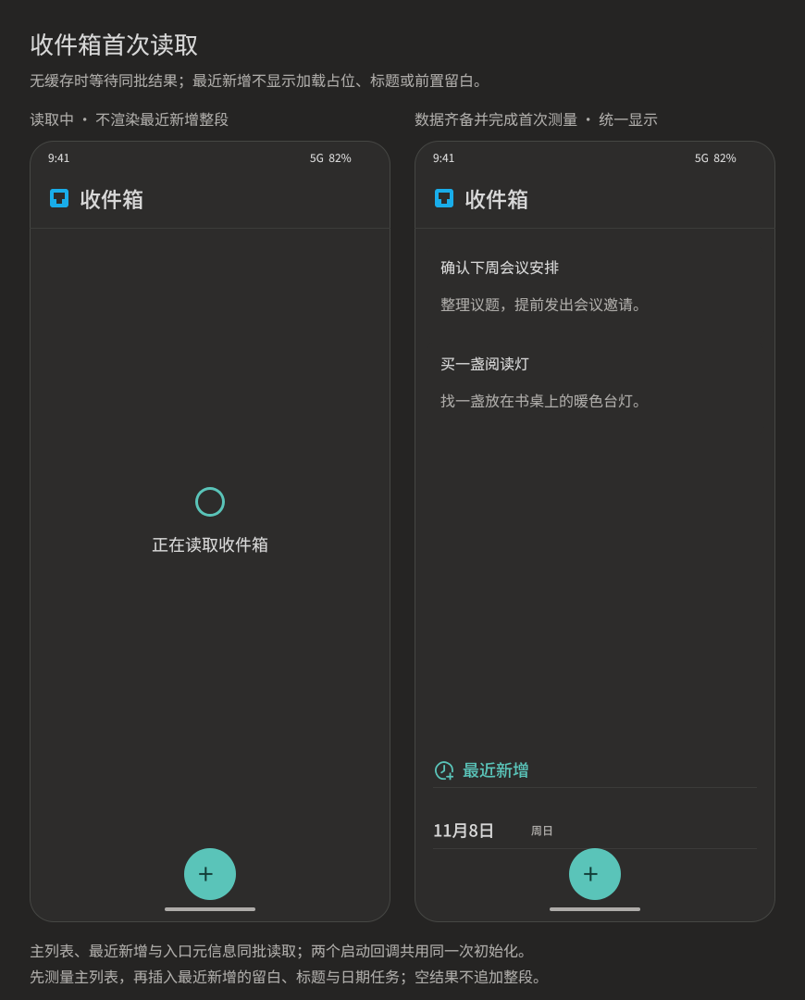 |
| [[file:../../design/当前实现/同步方向图标.fig][同步方向图标]] | Harmony 当前实现 | 29 Harmony 同步方向图标规范 |
| [[file:../../design/当前实现/同步日志与详情.fig][同步日志与详情]] | Harmony 当前实现 | 30 Harmony 同步日志单行标题与同步详情（当前实现） |
| [[file:../../design/当前实现/收件箱左滑操作.fig][收件箱左滑操作]] | Harmony 当前实现 | 31 Harmony 收件箱左滑操作（当前实现）；移动、将来、备忘、删除、项目、多选六项，项目由独立开关控制，主列表与最近新增右滑均设置 SCHEDULED |
| [[file:../../design/当前实现/仓库图标与通知样式.fig][仓库图标与通知样式]] | Harmony 当前实现 | 32 Harmony 仓库图标与通知单句样式（当前实现） |
| [[file:../../design/当前实现/桌面备忘卡片.fig][桌面备忘卡片]] | Harmony 当前实现 | 35 Harmony 桌面备忘卡片；新增与条目使用完整路径直接进入编辑页，返回时加载列表 |
| [[file:../../design/当前实现/共享任务卡片.fig][共享任务卡片]] | Harmony 当前实现 | 36 Harmony 共享任务卡片（当前实现）；补充 ，长标题向下换行、进度紧随末尾、头部控件保持首行位置；展开卡片标题行右侧复用收起态正文／列表标记的 14vp 槽位，上箭头保留 32vp 点击区域，展开前后顶部位置不位移；含独立 RightSwipe 的整体平移、220ms 回弹和外部回调三个阶段；TaskEditor 无右滑处理，今天统一设置 SCHEDULED，以及 TaskContentEditor 区块差异更新规范 |
| [[file:../../design/当前实现/共享任务卡片.fig][共享任务卡片]] | Harmony 当前实现 | 63 Harmony 正文分块与只读一致性（当前实现），见 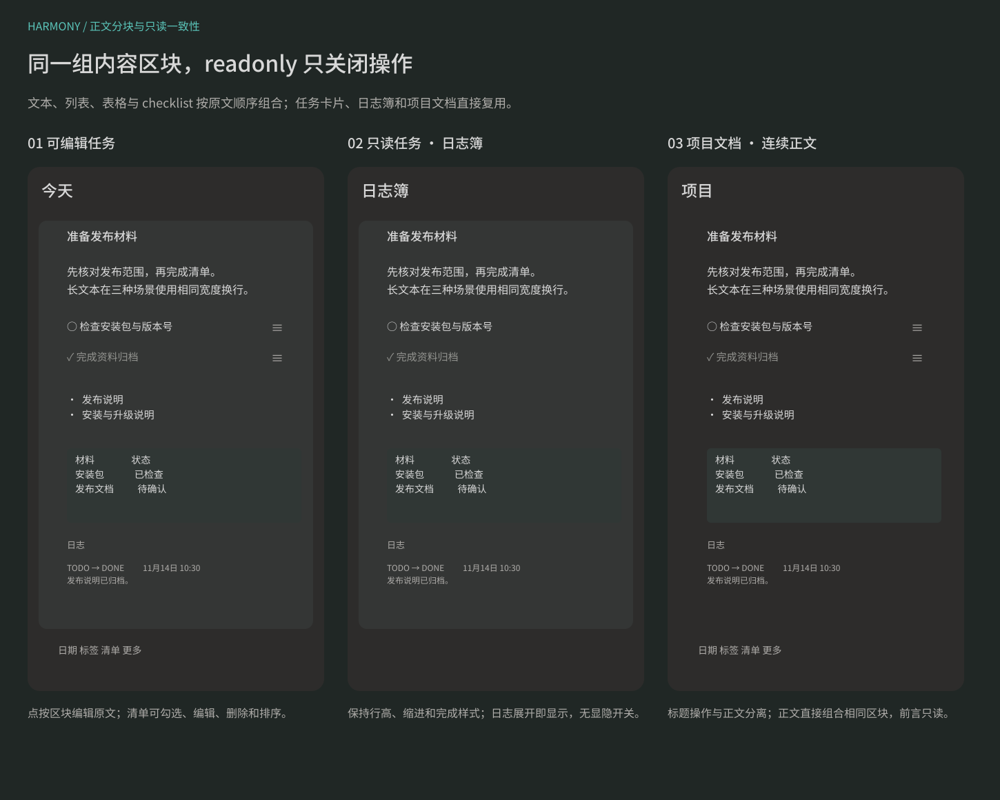 |
| [[file:../../design/当前实现/共享任务卡片.fig][共享任务卡片]] | 任务编辑交互 | 01 点击任务原位展开；36 Harmony 当前画板包含今天页除 checkbox 外整行内容与留白的点击范围 |
| [[file:../../design/当前实现/共享任务卡片.fig][共享任务卡片]] | 任务编辑交互 | 02 标题与备注编辑 |
| [[file:../../design/当前实现/共享任务卡片.fig][共享任务卡片]] | 任务编辑交互 | 03 已有属性展示 · Things 布局 |
| [[file:../../design/当前实现/共享任务卡片.fig][共享任务卡片]] | 任务编辑交互 | 04 修改提交与收起 |
| [[file:../../design/当前实现/键盘与属性入口.fig][键盘与属性入口]] | Harmony 当前实现 | 37 Harmony 键盘与属性入口（当前实现） |
| [[file:../../design/当前实现/键盘与属性入口.fig][键盘与属性入口]] | 任务编辑交互 | 05 键盘与属性入口 |
| [[file:../../design/当前实现/日期与月历.fig][日期与月历]] | Harmony 当前实现 | 38 Harmony 日期与月历（当前实现） |
| [[file:../../design/当前实现/日期与月历.fig][日期与时间编辑]] | Harmony 当前实现 | 63 Harmony 日期与时间编辑（当前实现）；新分配、已有时间范围、时间子面板与截止时间；选日即时高亮，保留原纵向布局，仅压缩间距与月历行高，一屏显示、无需滑动 |
| [[file:../../design/当前实现/日期与月历.fig][日期与月历]] | 任务编辑交互 | 06 计划日期设置 |
| [[file:../../design/当前实现/日期与月历.fig][日期与月历]] | 任务编辑交互 | 07 截止日期设置 |
| [[file:../../design/当前实现/日期与月历.fig][日期与月历]] | 任务编辑交互 | 08 月历与月份切换 |
| [[file:../../design/当前实现/日期与月历.fig][日期与月历]] | 任务编辑交互 | 09 快捷日期选择 |
| [[file:../../design/当前实现/日期与月历.fig][日期与月历]] | 任务编辑交互 | 10 右滑快速改期 |
| [[file:../../design/当前实现/标签编辑.fig][标签编辑]] | Harmony 当前实现 | 39 Harmony 标签选择（当前实现） |
| [[file:../../design/当前实现/标签编辑.fig][标签编辑]] | Harmony 当前实现 | 40 Harmony 新建标签（当前实现） |
| [[file:../../design/当前实现/标签编辑.fig][标签编辑]] | 任务编辑交互 | 11 已有标签查看 |
| [[file:../../design/当前实现/标签编辑.fig][标签编辑]] | 任务编辑交互 | 12 标签添加与移除 |
| [[file:../../design/当前实现/标签编辑.fig][标签编辑]] | 任务编辑交互 | 13 新建并添加标签 |
| [[file:../../design/当前实现/检查清单.fig][检查清单]] | Harmony 当前实现 | 41 Harmony 检查清单状态（当前实现） |
| [[file:../../design/当前实现/检查清单.fig][检查清单]] | Harmony 当前实现 | 42 Harmony 检查清单删除（当前实现） |
| [[file:../../design/当前实现/检查清单.fig][检查清单]] | Harmony 当前实现 | 49 Harmony 检查清单排序（当前实现） |
| [[file:../../design/当前实现/检查清单.fig][检查清单]] | 任务编辑交互 | 14 清单条目添加与编辑 |
| [[file:../../design/当前实现/检查清单.fig][检查清单]] | 任务编辑交互 | 15 清单完成状态 |
| [[file:../../design/当前实现/检查清单.fig][检查清单]] | 任务编辑交互 | 16 清单条目左滑删除 |
| [[file:../../design/当前实现/仓库配置.fig][仓库配置]] | Harmony 当前实现 | 13 Harmony 仓库配置；直接添加与明确添加按钮、不同步／WebDAV 选择、按同步方式显示连接参数、目录选择与维护 |
| [[file:../../design/当前实现/存储库列表与空态.fig][存储库列表与空态]] | Harmony 当前实现 | 27 Harmony 存储库紧凑分区（02 列表、03 空态与配置标签）；工具栏与无仓库空态添加入口 |
| [[file:../../design/当前实现/通知监控与滚动.fig][通知监控与滚动]] | Harmony 当前实现 | 34 Harmony 通知监控与随内容滚动（当前实现） |
| [[file:../../design/当前实现/仓库重置与冲突入口.fig][仓库重置与冲突入口]] | Harmony 当前实现 | 44 Harmony 仓库重置与文件冲突入口（当前实现） |
| [[file:../../design/当前实现/随时分类布局.fig][随时分类布局]] | Harmony 当前实现 | 45 Harmony 随时分类布局（当前实现）；分类内项目分组，普通任务和各项目独立预览三条，剩余入口为左对齐任务状态框的 12fp 灰字“还显示 N 个”（40vp 整行可点），区内按优先级、创建时间倒序排列 |
| [[file:../../design/当前实现/展开卡片下拉同步.fig][展开卡片下拉同步]] | Harmony 当前实现 | 46 Harmony 展开卡片下拉同步（当前实现） |
| [[file:../../design/当前实现/文档冲突处理.fig][文档冲突处理]] | Harmony 当前实现 | 47 Harmony 文档内冲突卡片（当前实现） |
| [[file:../../design/当前实现/收件箱记录合并.fig][收件箱记录合并]] | Harmony 当前实现 | 48 Harmony 收件箱记录合并（当前实现）；同步批量浮层与完整选择圆圈，批量按钮等分全部可用宽度、最小宽 56vp，移除顶部完成及首选摘要 |
| [[file:../../design/当前实现/重复任务编辑.fig][重复任务编辑]] | Harmony 当前实现 | 50 Harmony 重复任务编辑（当前实现） |
| [[file:../../design/当前实现/项目分类与任务来源.fig][项目分类与任务来源]] | Harmony 当前实现 | 51 Harmony 项目分类与任务来源（当前实现） |
| [[file:../../design/当前实现/任务状态分类.fig][任务状态分类]] | Harmony 当前实现 | 52 Harmony 任务状态分类（当前实现）；分类、状态标签和 + 同行，不足时换行 |
| [[file:../../design/当前实现/任务列表共享操作.fig][任务列表共享操作]] | Harmony 当前实现 | 54 Harmony 任务列表共享操作控件（当前实现）；最近新增、今天、计划、随时、某天左滑统一删除，右滑统一设置 SCHEDULED；收件箱主列表保留移动等整理操作，并由独立开关启用项目转换；批量浮层采用左上条数、右上关闭和下方无底色操作按钮，批量按钮等分全部可用宽度、最小宽 56vp |
| [[file:../../design/当前实现/任务列表共享操作.fig][任务列表共享操作]] | Harmony 当前实现 | 67 Harmony 项目创建紧凑布局（当前实现）；独立左滑开关，位置一行选择库与 Region（CATEGORY）并默认有效值，项目名独立一行、控件同高对齐；文件名默认收起，Region 下拉支持独立新建，失败保留输入；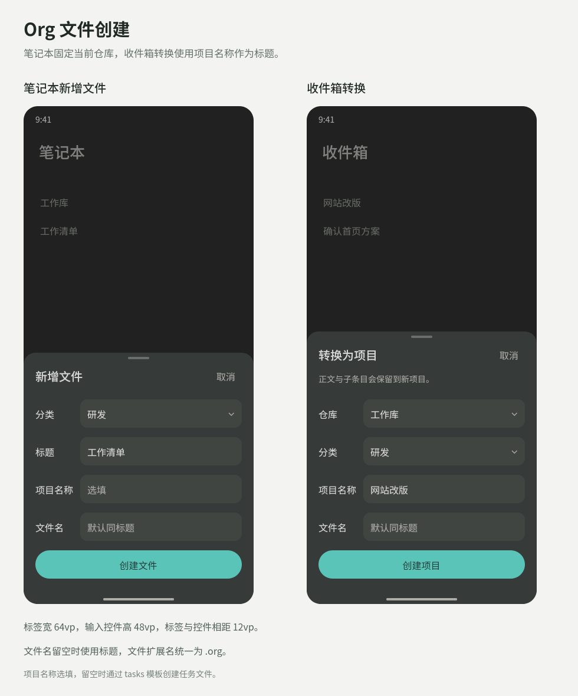；66 号旧版保留于历史布局页 |
| [[file:../../design/当前实现/公共弹出菜单.fig][公共弹出菜单]] | Harmony 当前实现 | 55 Harmony 公共弹出菜单（当前实现） |
| [[file:../../design/当前实现/任务日期显示策略.fig][任务日期显示策略]] | Harmony 当前实现 | 57 Harmony 任务日期显示策略（当前实现） |
| [[file:../../design/当前实现/任务优先级.fig][任务优先级]] | Harmony 当前实现 | 56 Harmony 任务优先级 · 交互主稿（当前实现） |
| [[file:../../design/当前实现/任务优先级.fig][任务优先级]] | Harmony 当前实现 | 56 Harmony 任务优先级 · 补充状态（当前实现，已移除独立详情示例） |
| [[file:../../design/当前实现/移动到平级分类.fig][移动到平级分类]] | Harmony 当前实现 | 58 Harmony 移动到平级分类（当前实现）；灰色分类图标、分区留白与文字对齐，点击项目分区标记选择根位置并在标题行确认，移除独立的项目开头条目 |
| [[file:../../design/当前实现/任务展开日志.fig][任务展开日志]] | Harmony 当前实现 | 68 Harmony 任务备注与日志分区（当前实现）；默认展开、打开日志及日志簿只读三态，59 号旧布局保留于历史布局59页 |
| [[file:../../design/当前实现/退后台同步实况窗.fig][退后台同步实况窗]] | Harmony 当前实现 | 60 Harmony 退后台同步实况窗（当前实现） |
| [[file:../../design/当前实现/分类与项目平级任务分组.fig][分类与项目平级任务分组]] | Harmony 当前实现 | 61 Harmony 分类与项目平级任务分组（当前实现）；最近新增分类与项目统一使用 TaskRegion；计划按日使用项目式日程区块；今天日程采用日历图标、文字与分割线，时间列位于 checkbox 前，任务按时刻排序且分组不增加背景，分割线至任务留白与普通 Region 一致；日志簿普通标题点击展开／收起，链接和状态框保留独立动作 |
| [[file:../../design/当前实现/分类与项目平级任务分组.fig][分类与项目平级任务分组]] | Harmony 当前实现 | 计划加载与缓存确认（当前实现）；加载阶段以“全部”保留 52vp 单行筛选条，缓存与后台确认复用日期、区域和任务行，成员变化读取当前快照；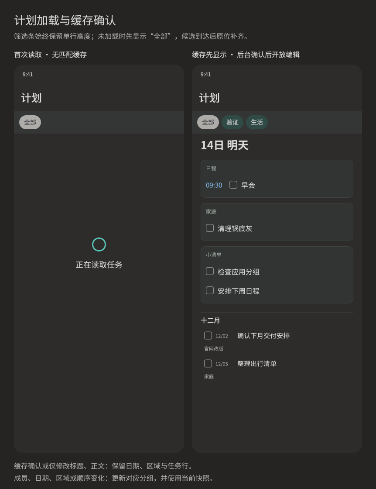 |
| [[file:../../design/当前实现/项目文档阅读.fig][项目文档阅读]] | Harmony 当前实现 | 65 Harmony 项目详情层级与空行（当前实现）；标题统一 Region . Project，文件头按源顺序以 10fp 双列属性行显示，名称列固定 96vp、值列对齐，FILETAGS 为中性只读小标签，CATEGORY 与 TAGS 仅选中后高亮、按并集筛选 |
| [[file:../../design/当前实现/今天时间安排.fig][今天时间安排]] | Harmony 当前实现 | 65 Harmony 今天时间安排（当前实现）；新增“今天分区与项目排序（当前实现）”画板，包含两级分区排序面板、项目拖动与确认保存／恢复默认状态，普通任务固定在项目下方；固定置顶且不参加排序的日程为日历图标、文字与分割线，任务分组无额外背景，时间位于 checkbox 前且通过 timeDisplay 选择来源，当天时刻与过期习惯时刻，无时刻习惯留原分类，分割线至任务留白与普通 Region 一致，通过外层 TaskSwipeEditor 接入 TaskEditor、右滑设置 SCHEDULED 并隐藏来源 |

项目文档阅读采用已确认的 A 方案：二级及更深正文的细竖线按实测高度收尾，一级正文不画线；子级每层缩进 8vp 且最多 16vp，单空行紧密换行，两个及以上空白行固定增加 12vp 段距。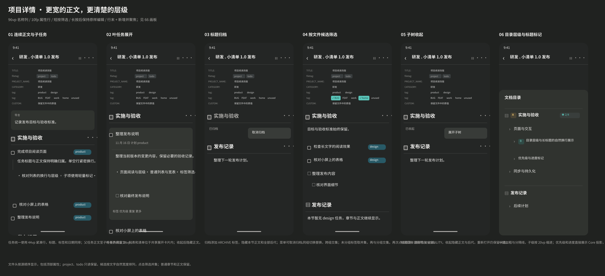 展示宽版连续正文、叶任务卡片展开、标题归档、文件头配置区与目录层级；目录以一级分隔线、分级字号与每层 20vp 缩进强化层级，优先级和进度使用 Core 投影与共享标记；普通一级标题增加图标与下划线，正文至子任务留出 24vp，左右边距为 12vp，无子节点任务正文仅在卡片展开区出现。收起／展开通过通用 VISIBILITY 属性持久化，当前画板增加子树收起状态；标签只隐藏任务并保留所有章节与父节点，整棵控件树以稳定身份和可见性切换保留。任务收起状态统一使用 44vp 共享紧凑行，移除控件 documentMode 与独立多行布局，标签、进度、日期同排；普通段落继续沿用既有空行规则，区块长按菜单继续可用；文字、普通列表、checkbox 清单和表格均可拷贝、编辑、删除整块，只读仅拷贝，链接操作优先。导言采用轻底色、12vp 圆角、16vp 内边距和 12fp 标签，无正文时隐藏，保持只读拷贝。正文装饰线不遮挡交互，内部链接通过页面处理器定位章节；状态、清单勾选、日志、目录和刷新继续沿用既有交互。原 62 号四态画板保存在同文件的“历史方案62”页。

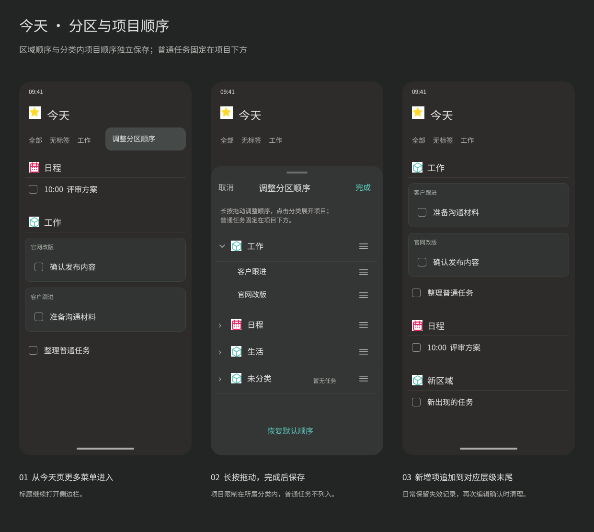 对应同源文件新增画板，展示更多入口、两级排序面板与确认后的页面顺序；日程固定置顶且不列入排序、候选排除配置的特殊文件、拖动手柄不被滚动条覆盖，普通任务固定在分类内项目下方，保存之外的新项追加末尾，失效记录留待再次编辑确认清理。

今天时间安排已接入共享 ~TaskEditor~ ，顶部显式使用 ~regionAreaPolicy=None~ 关闭收起与展开的分类、项目来源，时刻由通用 ~timeDisplay~ 策略展示；状态框、优先级和其余操作沿用共享布局。[[file:今天时间安排设计.org][方案]]、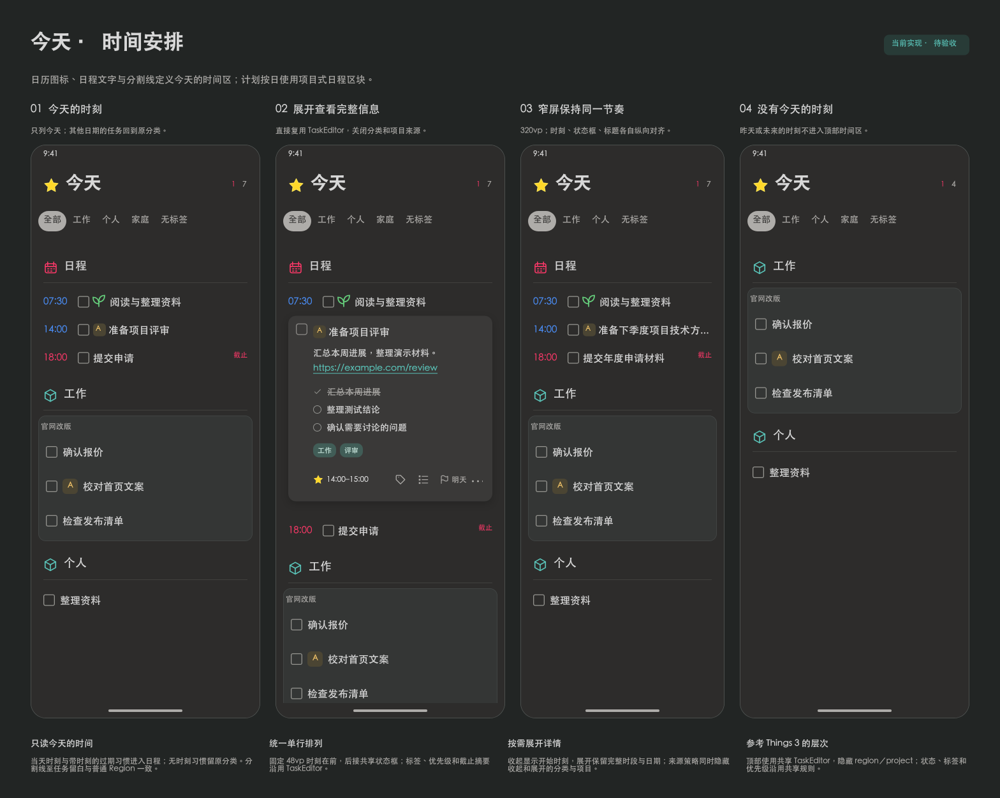 与 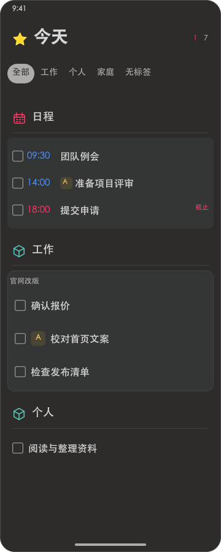 对应同一源文件，构建与自动化检查通过，设备验收待完成。

** 规范

| 源文件 | 页面 | 画板 |
|-
| [[file:../../design/规范/视觉规范.fig][视觉规范]] | 设计规范 | 小清单设计规范 v1（已确认） |

** 参考

| 源文件 | 页面 | 画板 |
|-
| [[file:../../design/参考/Orgzly参考.fig][Orgzly参考]] | Orgzly 参考资料（不代表当前实现） | 00 界面细节总览 |
| [[file:../../design/参考/Orgzly参考.fig][Orgzly参考]] | Orgzly 参考资料（不代表当前实现） | 01 存储库与层级导航 |
| [[file:../../design/参考/Orgzly参考.fig][Orgzly参考]] | Orgzly 参考资料（不代表当前实现） | 02 笔记详情与字段编辑 |
| [[file:../../design/参考/Orgzly参考.fig][Orgzly参考]] | Orgzly 参考资料（不代表当前实现） | 04 批量与滑动操作 |
| [[file:../../design/参考/Orgzly参考.fig][Orgzly参考]] | Orgzly 参考资料（不代表当前实现） | 05 设置与外观偏好 |
| [[file:../../design/参考/Orgzly参考.fig][Orgzly参考]] | Orgzly 参考资料（不代表当前实现） | 06 仓库配置 |

** 已确认的方案对比记录

| 源文件 | 页面 | 画板 |
|-
| [[file:../../design/历史/项目详情层级与空行对比.fig][项目详情层级与空行]] | 待确认设计 | 65 Harmony 项目详情层级与空行（待确认） |

[[file:项目详情层级与空行提案.org][项目详情设计]] 中的 A 已于 2026-11-14 确认并接入。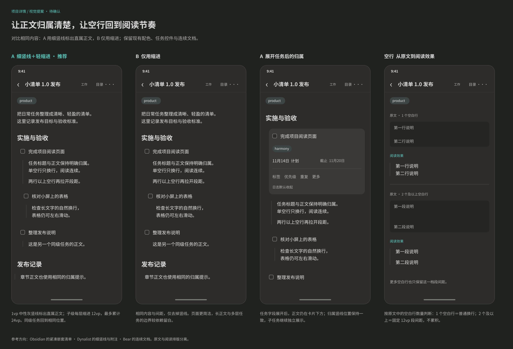 与原提案源文件保留作为调研记录；交付状态以“当前实现”页的 65 号画板为准。

** 调研与已确认风格

[[file:设置界面风格提案.org][设置界面风格调研]] 记录 Notion、Things 3、Todoist 与 TickTick 的参考来源及已确认的分组列表方向。当前实现以“设置”“文件入口配置”“任务状态分类”“仓库配置”源文件为准；原四屏提案图保留作为调研记录。侧边栏统一显示“笔记本”，仓库标题只作分区，管理按钮明确进入配置。

** 历史

| 源文件 | 页面 | 画板 |
|-
| [[file:../../design/当前实现/项目文档阅读.fig][项目文档阅读]] | 历史方案62 | 62 Harmony 项目文档式阅读改版（历史方案，已由65替代） |
| [[file:../../design/历史/今天分类布局.fig][今天分类布局]] | Harmony 当前实现 | 11 Harmony 今天分类布局（历史布局，原位编辑见36号） |
| [[file:../../design/历史/共享任务项与日期状态.fig][共享任务项与日期状态]] | Harmony 当前实现 | 23 Harmony 共享任务项与日期状态（历史布局，原位编辑见36号） |
| [[file:../../design/历史/日志簿事件时间线.fig][日志簿事件时间线]] | Harmony 当前实现 | 56 Harmony 日志簿事件时间线（历史实现，见61画板） |
| [[file:../../design/历史/项目文档阅读旧方案.fig][项目文档阅读旧方案]] | Harmony 当前实现 | 60 Harmony 项目文档阅读（历史方案，已由62替代） |
| [[file:../../design/历史/项目文档阅读旧方案.fig][项目文档阅读旧方案]] | Harmony 当前实现 | 60 Harmony 项目全文展开（历史方案，已由62替代） |
| [[file:../../design/历史/任务更多菜单对比.fig][任务更多菜单对比]] | 待确认设计 | 52 Harmony 任务更多菜单（当前规范） |
| [[file:../../design/历史/删除图标配色对比.fig][删除图标配色对比]] | 待确认设计 | 53 Harmony 删除图标统一红色对比（已实施） |

* 任务备注与日志分区

[[file:../../design/当前实现/任务展开日志.fig][任务展开日志]] 的“Harmony 当前实现”页维护“68 Harmony 任务备注与日志分区（当前实现）”画板；59 号旧画板保留于“历史布局59”页。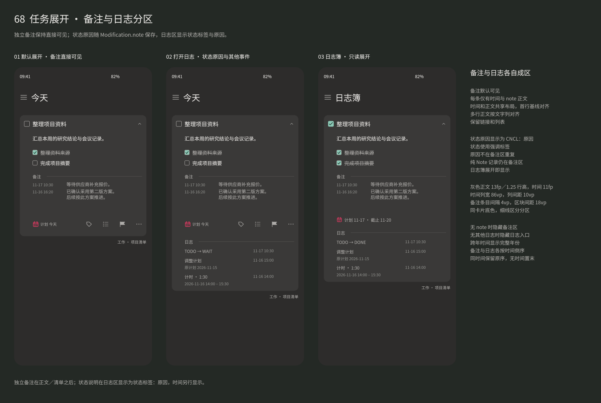 展示默认展开、打开日志及日志簿只读展开。备注位于正文／清单之后、操作栏之前，备注与日志各按记录时间倒序，同时间稳定、无时间置末；每条备注只显示前置时间与 note 内容，时间和正文通过同一 Grid 布局按首行基线对齐，正文使用辅助灰色，13fp、行高 1.25、条目间隔 4vp，多行正文保持在消息列内；其他日志位于操作栏下方，不显示 note。已接入共享任务编辑器，仅调整显示，复用现有日志结构，不修改 Org 原文。 模拟器实际显示见 [[file:备注布局模拟器验收.org][备注布局模拟器截图验收]]，包含日期、跨年时间、多行文字及计划／截止日期。

* 项目创建紧凑布局（待确认）

[[file:项目创建紧凑布局提案.org][项目创建紧凑布局提案]] 对应 [[file:../../design/当前实现/任务列表共享操作.fig][任务列表共享操作]] 的“布局确认”页及“67 项目创建紧凑布局（待确认）”画板。位置以“存储库 · Region”同排，组合控件与项目名输入框左右对齐；文件名默认收起，展开后才输入。见  。本稿尚未接入应用布局。

| [[file:../../design/当前实现/项目文档阅读.fig][项目文档阅读]] | Harmony 当前实现 | 66 Harmony 项目属性长按编辑（当前实现）；整区长按原位编辑、统一取消／保存、保持阅读态对齐的透明输入、TAGS 与 FILETAGS 行末加号原位新增、删除标记及保护标签，属性更新通过元信息订阅接入；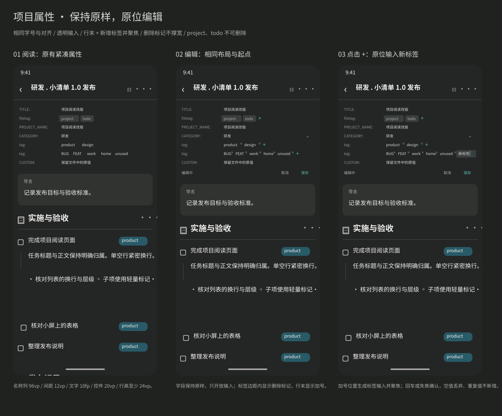 |
