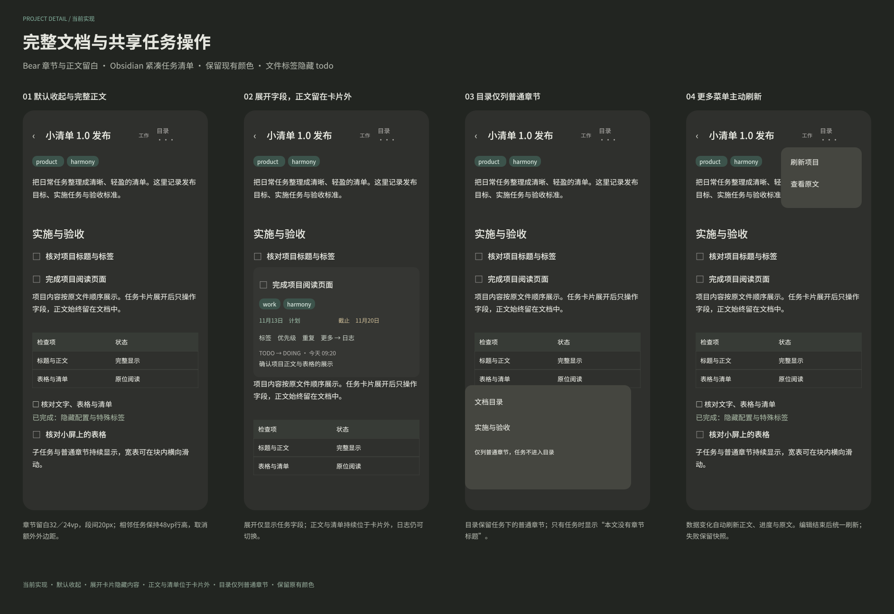

#+TITLE: 设计文件索引与协作规则
#+STARTUP: show2levels hidestars
#+OPTIONS: author:nil date:nil toc:nil
#+LANGUAGE: zh-CN

* 设计入口与维护规则

设计源文件按独立功能与交互流程拆分，目录分为当前实现、规范、参考与历史。每个画板只有一个权威源文件；同一功能的正常、空态、错误态和详细交互保留在同一文件中，避免一次功能修改涉及多份重复主稿。跨功能浏览通过本文与 [[file:../../design/previews/][设计预览]] 完成，不再维护可编辑的汇总文件。

- 修改前从下表定位功能文件，只保存本次涉及的文件；同一文件仍需协调并行编辑，二进制文件发生冲突时按画板核对后人工整合，不直接用一侧覆盖另一侧。
- 文件名按稳定的功能名称维护，不以旧画板编号作为唯一标识。原画板名称与编号保留用于追溯；编号重复时以文件路径和页名区分。
- 当前实现中的“Harmony 当前实现”页维护页面与共享控件的实现样例；同文件的“任务编辑交互”页维护完整操作步骤，两者职责不同。修改同一交互时核对两个页面，避免说明与实现样例失配。
- 视觉样式、图标与变量的权威来源是 [[file:../../design/规范/视觉规范.fig][视觉规范]]；业务场景的公共菜单原件维护于 [[file:../../design/当前实现/公共弹出菜单.fig][公共弹出菜单]]。规范样例与业务画板各自保留适用范围，不把业务样例当作新的通用规范。
- 页面布局、入口位置或交互范围改变时，同步修改对应源文件、相关预览、 [[file:UI导航设计.org][UI 导航设计]] 与 [[file:../手机应用功能清单.org][手机应用功能清单]]；专项交互文档按实际变化同步。仅调整设计文件组织不改变手机功能状态。
- 新增功能只新增对应的独立文件并更新本文；历史画板在历史目录保存，参考资料不表示当前交付能力。预览沿用已有路径，按受影响画板更新，不因其他功能修改而整体重新导出。

* 公共组件依赖

每个文件携带自身引用的图片、变量和组件。跨文件组件引用在迁移时保留必要的本地依赖快照，集中在“依赖快照（只读，原件见设计文件索引）”页，顶层容器已锁定；实例保留组件关系与覆盖值。这些快照用于独立打开文件，不是第二份可编辑原件，也不会自动跟随其他文件更新。

| 使用文件 | 本地依赖 | 权威原件 |
|-
| [[file:../../design/当前实现/共享标签筛选.fig][共享标签筛选]] | 共享菜单/标签筛选 | [[file:../../design/当前实现/公共弹出菜单.fig][公共弹出菜单]] |
| [[file:../../design/当前实现/重复任务编辑.fig][重复任务编辑]] | 菜单/内容自适应、图标/菜单重复 | [[file:../../design/规范/视觉规范.fig][视觉规范]] |

修改公共原件后，先检查上表中的使用文件，只在实例确实需要新样式时同步刷新对应快照并核对实例覆盖值与预览；新增使用关系同时更新此表。不要在业务文件中直接解锁修改快照来定义公共样式，也不要为了同步规范而无差别重存所有文件。

* 画板分配

迁移后的 52 个独立文件包含全部 78 个原顶层画板，其中当前实现 44 个文件、历史 6 个文件、参考与规范各 1 个文件。原有约 1.6 万个内容节点、42 个变量与 27 份图片资源保留；未被画板引用的 8 份图片随参考资料保存。画板在各自页面内平移到原点附近，内部排版与相对位置保持原样。

旧总文件已由下表的独立源文件取代。迁移前版本可从 Git 历史获取，不在工作区保留第二份汇总主稿。

** 当前实现

| 源文件 | 页面 | 画板 |
|-
| [[file:../../design/当前实现/导航与侧边栏.fig][导航与侧边栏]] | Harmony 当前实现 | 09 Harmony 顶部任务入口 |
| [[file:../../design/当前实现/文件入口配置.fig][文件入口配置]] | Harmony 当前实现 | 10 Harmony 文件入口配置 |
| [[file:../../design/当前实现/下拉同步与底部设置.fig][下拉同步与底部设置]] | Harmony 当前实现 | 15 Harmony 下拉同步与底部设置 |
| [[file:../../design/当前实现/文件只读阅读.fig][文件只读阅读]] | Harmony 当前实现 | 16 Harmony 文件只读阅读 |
| [[file:../../design/当前实现/文件展示配置与任务详情.fig][文件展示配置与任务详情]] | Harmony 当前实现 | 17 Harmony 文件展示配置与任务详情 |
| [[file:../../design/当前实现/任务与备忘编辑.fig][任务与备忘编辑]] | Harmony 当前实现 | 18 Harmony 任务与备忘编辑 |
| [[file:../../design/当前实现/标题链接.fig][标题链接]] | Harmony 当前实现 | 19 Harmony 标题链接 |
| [[file:../../design/当前实现/快速捕捉与系统入口.fig][快速捕捉与系统入口]] | Harmony 当前实现 | 20 Harmony 快速捕捉与系统入口 |
| [[file:../../design/当前实现/标题计数进度.fig][标题计数进度]] | Harmony 当前实现 | 22 Harmony 标题计数进度 |
| [[file:../../design/当前实现/地图应用选择.fig][地图应用选择]] | Harmony 当前实现 | 23 Harmony 地图应用选择 |
| [[file:../../design/当前实现/共享标签筛选.fig][共享标签筛选]] | Harmony 当前实现 | 24 Harmony 共享标签筛选 |
| [[file:../../design/当前实现/备忘卡片列表.fig][备忘卡片列表]] | Harmony 当前实现 | 25 Harmony 备忘卡片列表 |
| [[file:../../design/当前实现/分享地点与地址更新.fig][分享地点与地址更新]] | Harmony 当前实现 | 26 Harmony 分享地点与地址更新（当前实现） |
| [[file:../../design/当前实现/收件箱最近三天.fig][收件箱最近三天]] | Harmony 当前实现 | 28 Harmony 收件箱最近三天 |
| [[file:../../design/当前实现/同步方向图标.fig][同步方向图标]] | Harmony 当前实现 | 29 Harmony 同步方向图标规范 |
| [[file:../../design/当前实现/同步日志与详情.fig][同步日志与详情]] | Harmony 当前实现 | 30 Harmony 同步日志单行标题与同步详情（当前实现） |
| [[file:../../design/当前实现/收件箱左滑操作.fig][收件箱左滑操作]] | Harmony 当前实现 | 31 Harmony 收件箱左滑操作（当前实现） |
| [[file:../../design/当前实现/仓库图标与通知样式.fig][仓库图标与通知样式]] | Harmony 当前实现 | 32 Harmony 仓库图标与通知单句样式（当前实现） |
| [[file:../../design/当前实现/桌面备忘卡片.fig][桌面备忘卡片]] | Harmony 当前实现 | 35 Harmony 桌面备忘卡片 |
| [[file:../../design/当前实现/共享任务卡片.fig][共享任务卡片]] | Harmony 当前实现 | 36 Harmony 共享任务卡片（当前实现） |
| [[file:../../design/当前实现/共享任务卡片.fig][共享任务卡片]] | 任务编辑交互 | 01 点击任务原位展开；36 Harmony 当前画板包含今天页除 checkbox 外整行内容与留白的点击范围 |
| [[file:../../design/当前实现/共享任务卡片.fig][共享任务卡片]] | 任务编辑交互 | 02 标题与备注编辑 |
| [[file:../../design/当前实现/共享任务卡片.fig][共享任务卡片]] | 任务编辑交互 | 03 已有属性展示 · Things 布局 |
| [[file:../../design/当前实现/共享任务卡片.fig][共享任务卡片]] | 任务编辑交互 | 04 修改提交与收起 |
| [[file:../../design/当前实现/键盘与属性入口.fig][键盘与属性入口]] | Harmony 当前实现 | 37 Harmony 键盘与属性入口（当前实现） |
| [[file:../../design/当前实现/键盘与属性入口.fig][键盘与属性入口]] | 任务编辑交互 | 05 键盘与属性入口 |
| [[file:../../design/当前实现/日期与月历.fig][日期与月历]] | Harmony 当前实现 | 38 Harmony 日期与月历（当前实现） |
| [[file:../../design/当前实现/日期与月历.fig][日期与时间编辑]] | Harmony 当前实现 | 63 Harmony 日期与时间编辑（当前实现）；新分配、已有时间范围、时间子面板与截止时间 |
| [[file:../../design/当前实现/日期与月历.fig][日期与月历]] | 任务编辑交互 | 06 计划日期设置 |
| [[file:../../design/当前实现/日期与月历.fig][日期与月历]] | 任务编辑交互 | 07 截止日期设置 |
| [[file:../../design/当前实现/日期与月历.fig][日期与月历]] | 任务编辑交互 | 08 月历与月份切换 |
| [[file:../../design/当前实现/日期与月历.fig][日期与月历]] | 任务编辑交互 | 09 快捷日期选择 |
| [[file:../../design/当前实现/日期与月历.fig][日期与月历]] | 任务编辑交互 | 10 右滑快速改期 |
| [[file:../../design/当前实现/标签编辑.fig][标签编辑]] | Harmony 当前实现 | 39 Harmony 标签选择（当前实现） |
| [[file:../../design/当前实现/标签编辑.fig][标签编辑]] | Harmony 当前实现 | 40 Harmony 新建标签（当前实现） |
| [[file:../../design/当前实现/标签编辑.fig][标签编辑]] | 任务编辑交互 | 11 已有标签查看 |
| [[file:../../design/当前实现/标签编辑.fig][标签编辑]] | 任务编辑交互 | 12 标签添加与移除 |
| [[file:../../design/当前实现/标签编辑.fig][标签编辑]] | 任务编辑交互 | 13 新建并添加标签 |
| [[file:../../design/当前实现/检查清单.fig][检查清单]] | Harmony 当前实现 | 41 Harmony 检查清单状态（当前实现） |
| [[file:../../design/当前实现/检查清单.fig][检查清单]] | Harmony 当前实现 | 42 Harmony 检查清单删除（当前实现） |
| [[file:../../design/当前实现/检查清单.fig][检查清单]] | Harmony 当前实现 | 49 Harmony 检查清单排序（当前实现） |
| [[file:../../design/当前实现/检查清单.fig][检查清单]] | 任务编辑交互 | 14 清单条目添加与编辑 |
| [[file:../../design/当前实现/检查清单.fig][检查清单]] | 任务编辑交互 | 15 清单完成状态 |
| [[file:../../design/当前实现/检查清单.fig][检查清单]] | 任务编辑交互 | 16 清单条目左滑删除 |
| [[file:../../design/当前实现/仓库配置.fig][仓库配置]] | Harmony 当前实现 | 13 Harmony 仓库配置 |
| [[file:../../design/当前实现/存储库列表与空态.fig][存储库列表与空态]] | Harmony 当前实现 | 27 Harmony 存储库紧凑分区（02 列表、03 空态与配置标签） |
| [[file:../../design/当前实现/通知监控与滚动.fig][通知监控与滚动]] | Harmony 当前实现 | 34 Harmony 通知监控与随内容滚动（当前实现） |
| [[file:../../design/当前实现/仓库重置与冲突入口.fig][仓库重置与冲突入口]] | Harmony 当前实现 | 44 Harmony 仓库重置与文件冲突入口（当前实现） |
| [[file:../../design/当前实现/随时分类布局.fig][随时分类布局]] | Harmony 当前实现 | 45 Harmony 随时分类布局（当前实现） |
| [[file:../../design/当前实现/展开卡片下拉同步.fig][展开卡片下拉同步]] | Harmony 当前实现 | 46 Harmony 展开卡片下拉同步（当前实现） |
| [[file:../../design/当前实现/文档冲突处理.fig][文档冲突处理]] | Harmony 当前实现 | 47 Harmony 文档内冲突卡片（当前实现） |
| [[file:../../design/当前实现/收件箱记录合并.fig][收件箱记录合并]] | Harmony 当前实现 | 48 Harmony 收件箱记录合并（当前实现） |
| [[file:../../design/当前实现/重复任务编辑.fig][重复任务编辑]] | Harmony 当前实现 | 50 Harmony 重复任务编辑（当前实现） |
| [[file:../../design/当前实现/项目分类与任务来源.fig][项目分类与任务来源]] | Harmony 当前实现 | 51 Harmony 项目分类与任务来源（当前实现） |
| [[file:../../design/当前实现/任务状态分类.fig][任务状态分类]] | Harmony 当前实现 | 52 Harmony 任务状态分类（当前实现） |
| [[file:../../design/当前实现/任务列表共享操作.fig][任务列表共享操作]] | Harmony 当前实现 | 54 Harmony 任务列表共享操作控件（当前实现） |
| [[file:../../design/当前实现/公共弹出菜单.fig][公共弹出菜单]] | Harmony 当前实现 | 55 Harmony 公共弹出菜单（当前实现） |
| [[file:../../design/当前实现/任务日期显示策略.fig][任务日期显示策略]] | Harmony 当前实现 | 57 Harmony 任务日期显示策略（当前实现） |
| [[file:../../design/当前实现/任务优先级.fig][任务优先级]] | Harmony 当前实现 | 56 Harmony 任务优先级 · 交互主稿（当前实现） |
| [[file:../../design/当前实现/任务优先级.fig][任务优先级]] | Harmony 当前实现 | 56 Harmony 任务优先级 · 补充状态（当前实现） |
| [[file:../../design/当前实现/移动到平级分类.fig][移动到平级分类]] | Harmony 当前实现 | 58 Harmony 移动到平级分类（当前实现） |
| [[file:../../design/当前实现/任务展开日志.fig][任务展开日志]] | Harmony 当前实现 | 59 Harmony 任务展开日志（当前实现） |
| [[file:../../design/当前实现/退后台同步实况窗.fig][退后台同步实况窗]] | Harmony 当前实现 | 60 Harmony 退后台同步实况窗（当前实现） |
| [[file:../../design/当前实现/分类与项目平级任务分组.fig][分类与项目平级任务分组]] | Harmony 当前实现 | 61 Harmony 分类与项目平级任务分组（当前实现） |
| [[file:../../design/当前实现/项目文档阅读.fig][项目文档阅读]] | Harmony 当前实现 | 62 Harmony 项目文档式阅读改版（当前实现） |

项目文档阅读画板已同步状态方框的完成／重新打开交互，以及数据变化后自动刷新、编辑失败保留状态和草稿的规则； 与当前源文件一致。

** 规范

| 源文件 | 页面 | 画板 |
|-
| [[file:../../design/规范/视觉规范.fig][视觉规范]] | 设计规范 | 小清单设计规范 v1（已确认） |

** 参考

| 源文件 | 页面 | 画板 |
|-
| [[file:../../design/参考/Orgzly参考.fig][Orgzly参考]] | Orgzly 参考资料（不代表当前实现） | 00 界面细节总览 |
| [[file:../../design/参考/Orgzly参考.fig][Orgzly参考]] | Orgzly 参考资料（不代表当前实现） | 01 存储库与层级导航 |
| [[file:../../design/参考/Orgzly参考.fig][Orgzly参考]] | Orgzly 参考资料（不代表当前实现） | 02 笔记详情与字段编辑 |
| [[file:../../design/参考/Orgzly参考.fig][Orgzly参考]] | Orgzly 参考资料（不代表当前实现） | 04 批量与滑动操作 |
| [[file:../../design/参考/Orgzly参考.fig][Orgzly参考]] | Orgzly 参考资料（不代表当前实现） | 05 设置与外观偏好 |
| [[file:../../design/参考/Orgzly参考.fig][Orgzly参考]] | Orgzly 参考资料（不代表当前实现） | 06 仓库配置 |

** 历史

| 源文件 | 页面 | 画板 |
|-
| [[file:../../design/历史/今天分类布局.fig][今天分类布局]] | Harmony 当前实现 | 11 Harmony 今天分类布局（历史布局，原位编辑见36号） |
| [[file:../../design/历史/共享任务项与日期状态.fig][共享任务项与日期状态]] | Harmony 当前实现 | 23 Harmony 共享任务项与日期状态（历史布局，原位编辑见36号） |
| [[file:../../design/历史/日志簿事件时间线.fig][日志簿事件时间线]] | Harmony 当前实现 | 56 Harmony 日志簿事件时间线（历史实现，见61画板） |
| [[file:../../design/历史/项目文档阅读旧方案.fig][项目文档阅读旧方案]] | Harmony 当前实现 | 60 Harmony 项目文档阅读（历史方案，已由62替代） |
| [[file:../../design/历史/项目文档阅读旧方案.fig][项目文档阅读旧方案]] | Harmony 当前实现 | 60 Harmony 项目全文展开（历史方案，已由62替代） |
| [[file:../../design/历史/任务更多菜单对比.fig][任务更多菜单对比]] | 待确认设计 | 52 Harmony 任务更多菜单（当前规范） |
| [[file:../../design/历史/删除图标配色对比.fig][删除图标配色对比]] | 待确认设计 | 53 Harmony 删除图标统一红色对比（已实施） |
