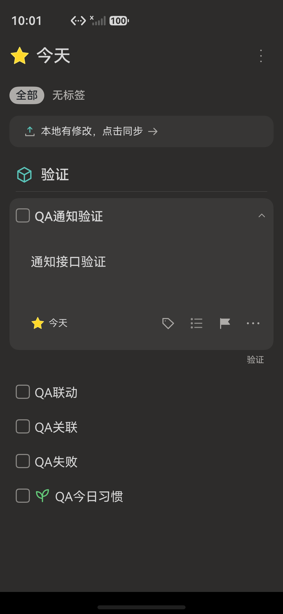
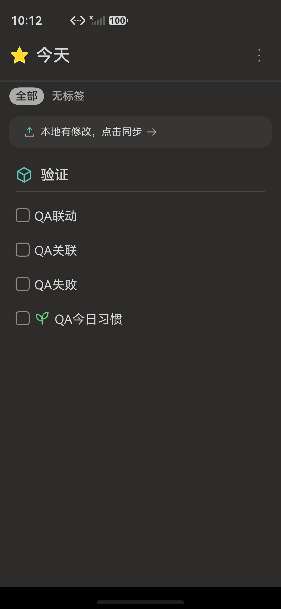
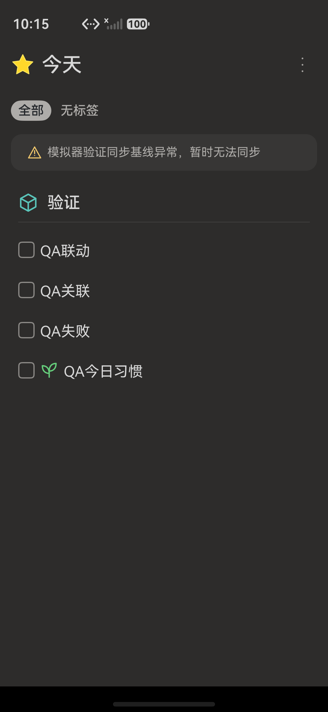

#+TITLE: 通知文件状态模拟器验收
#+LANGUAGE: zh-CN
#+OPTIONS: author:nil date:nil toc:nil

* 范围与环境

2026-11-19 在专用 HarmonyOS 模拟器与独立仓库完成文件状态推送和通知增量验收。使用独立本地 WebDAV 服务与临时 APP 内嵌 HTTP 服务，界面和 HTTP 共用活动 Workspace；未接触个人远端仓库。仓库为 ~notification-data-qa-1795053265739~ 。

首次注册零业务文件扫描、未读取路径不产生通知由 Rust 文件访问计数测试验证；正常 APP 启动仍会为真实页面查询与启动同步读取必要文件，不能把这些业务读取计作通知扫描。

* 已验证结果

| 场景 | 实际结果 |
|-
| 初始基线 | 隔离仓库首次上传完成，今天页正常加载且没有待同步通知 |
| HTTP 外部修改 | 同批修改任务标题与正文后，当前展开卡片立即显示“QA通知验证”和“通知接口验证”，出现唯一待同步提示；未重开页面 |
| 界面修改 | 点击该任务 checkbox 后，HTTP 查询确认状态为 ~DONE~ ，任务从今天页移出，其他任务保留 |
| Core 拒绝非法状态 | 使用有效文件版本提交文件未配置的 TODO 状态，返回输入错误，前后文件版本一致 |
| 点击提示同步 | 点击共享同步提示后，远端任务标题、正文与状态得到确认，当前页待同步提示消失 |
| 主索引删除 | 停止 APP 后删除隔离仓库主索引，正常启动后自动从副本恢复；恢复文件与已保存有效副本一致，格式为 version 3 |
| 双副本损坏 | 两份索引同时写入无效内容，启动后共享通知显示“模拟器验证同步基线异常，暂时无法同步”；保留业务内容，同步没有写入远端 |

索引故障注入用于验证控制元数据保护，不替代 HTTP 外部更新或界面交互验收。验收后恢复有效主索引与副本，并已验证本次 APP 临时 HTTP 会话关闭。最终清理只移除本次创建的端口转发与独立 WebDAV 服务。

* 截图

- 
- 
- 

* 自动验证与已知基线问题

Rust workspace 全部通过，另有 59 项合并场景通过；通知与角标的 16 项宿主专项通过。Debug 正式包与模拟器数据准备包构建成功，无编译告警。Org 文档经行内边界检查和 emacsclient 的 Org AST 验证。

扩展运行后台同步与 DataSetManager 回归时实际有 16 项既有失败；原记录将失败汇总行重复计数为 17 项。在隔离的未修改 HEAD 中复跑得到完全相同的失败集合，原因包括 EntryAbility 测试替身缺少提醒服务，以及数据集仍按旧提交完成语义断言。

2026-11-19 后续修复了上述回归：测试按受理、提交完成及定向错误分别核对，保留成功版本、排队路径、失败回滚及过期位置拒绝的断言。产品代码未改动，后台同步、数据集、通知与角标合计 99 项全部通过，无警告；不影响前述模拟器结果与环境限制。

* 后续复核的环境变化

正式 Debug 包构建完成后复核期间，模拟器配置被其他验收切换到 ~loading-profile-small~ ，该目录不存在，当前会话因此显示读取错误，临时 HTTP 初始化也失败。此前本次独立仓库的通知、同步及基线故障验证已有真实截图和接口结果；诊断包还记录了 5 个文件列举成功、变更文件上传成功和同步 succeeded。诊断日志已从产品代码移除，随后正式包无告警构建成功。

未覆盖其他验收的配置，也未为完成本次复核重置其仓库；保留上述环境变化作为最终复核的限制。
