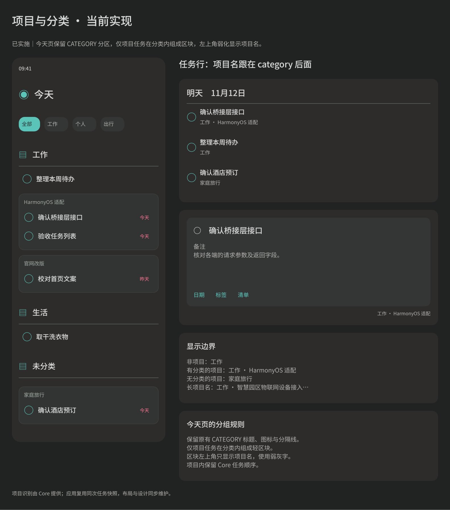
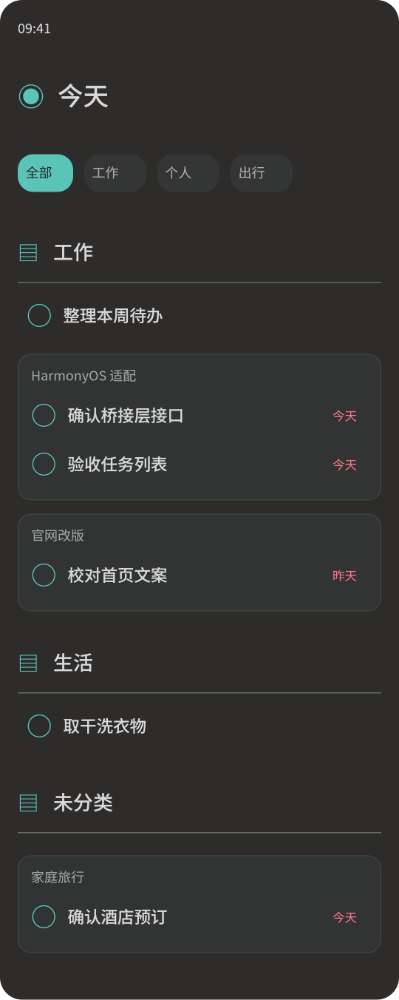

#+TITLE: 项目分类布局设计
#+STARTUP: show2levels hidestars
#+OPTIONS: author:nil date:nil toc:nil
#+LANGUAGE: zh-CN

* 状态与设计稿

本文定义已确认并实施的布局。设计维护于 [[file:../../design/Orgzly界面细节.fig][界面图谱]] 的“Harmony 当前实现”页，画板为“51 Harmony 项目分类与任务来源（当前实现）”。 同时展示今天页与通用任务行； 单独展示弱角标布局。

项目标记与名称由 Core 的文件元信息和任务 ~project()~ 方法提供，定义见 [[file:../core/接口文档.org::*文件与任务的项目名称][文件与任务的项目名称]]。界面直接消费项目名称，不解析文件标签或属性。

* 任务行的分类与项目名

已有 CATEGORY 来源文本的位置，项目任务在分类后追加项目名，以中点分隔，例如“工作 · HarmonyOS 适配”。非项目任务仍显示“工作”；没有分类但有项目名时显示“家庭旅行”，不显示多余中点。

| 位置 | 展示方式 |
|-
| 计划页、收件箱最近新增等已有分类副标题的折叠任务行 | 标题下方显示“分类 · 项目名”，12vp，沿用次要文字色。 |
| 原地展开卡片底部的来源行 | 右对齐显示同一组合，11vp，沿用现有位置与间距。没有分类和项目名时继续使用原文件名回退。 |
| 今天页折叠任务行 | 分类由原有分区标题说明，项目名由分类内项目区块的左上角角标说明，不在每条任务下重复显示同一分类与项目。展开卡片仍显示来源。 |

分类和项目名保持单行。两者同时存在时分类最多占该行可用宽度的 40%，项目名使用其余空间，超长部分末尾省略；没有项目名时分类使用完整宽度。标题、日期、标签、进度与持续天数继续使用各自区域，不因项目名称加高任务行。读屏文本使用完整分类与项目名。

来源文字不增加点击、编辑、折叠或跳转行为。项目名与分类相同仍展示两段，以保留两种信息的含义。

* 今天页在分类分区内组织项目

保留现有 CATEGORY 分区作为第一层，包括分类图标、18vp 分类标题、标题下通栏细线、分区顺序和普通任务行。仅将项目任务在所属分类区域内按项目名组织为轻区块；普通任务直接排列，不加区块。

#+begin_example
工作  ────────────────────────
  ○ 整理本周待办

  ┌ HarmonyOS 适配 ────────────┐
  │ ○ 确认桥接层接口           │
  │ ○ 验收任务列表             │
  └───────────────────────────┘

  ┌ 官网改版 ──────────────────┐
  │ ○ 校对首页文案             │
  └───────────────────────────┘

生活  ────────────────────────
  ○ 取干洗衣物

未分类  ──────────────────────
  ┌ 家庭旅行 ──────────────────┐
  │ ○ 确认酒店预订             │
  └───────────────────────────┘
#+end_example

项目区块使用 12vp 圆角、略高于页面背景的深灰底色和低对比度细描边，与相邻任务或项目间隔约 12vp。区块左上角距边缘约 12vp，仅显示项目名，使用 12vp 常规字重和弱灰色，强调程度低于任务标题。分类已由外层标题说明，项目角标不重复显示分类。

单任务项目仍使用项目区块。没有分类的项目放在原有“未分类”区域，其项目名仍只出现在区块角标。长项目名保持单行并末尾省略，读屏使用完整名称。区块只组织展示，不新增收起、跳转或整块点击行为；任务标题、状态和日期继续使用原有任务行。

分类保持既有排序，未分类置末。分类内以 Core 返回顺序遍历，普通任务保留相对顺序；遇到某项目的第一条任务时放入该项目区块，同项目后续任务汇入该区块，区块内部保留原相对顺序。项目区块不另按名称排序，尽量保持当前列表的顺序。分类和项目名都完全相同的任务进入同一区块，任务身份与来源仍保留，不合并记录。

标签筛选继续只作用于已加载快照，筛选后移除空项目区块和空分类区域，不重发查询。今天页的基础日期范围、任务计数和查询过滤保持既有含义。本次仅扩展今天页的项目组织；随时页继续使用原有 CATEGORY 分区。任务行其他位置的“分类 · 项目名”来源展示沿用前述方案。

* 实施与验证

整体保留今天页现有 CATEGORY 分区与普通任务表现，仅在分类区域内为项目任务增加区块，并在左上角弱化显示项目名。

共享任务控件、今天页的展示分组、项目名称访问方法与对应回归已同步实施；Core 负责项目识别，宿主只消费名称快照。项目区块仅在今天页启用，其他页面沿用现有分组。
