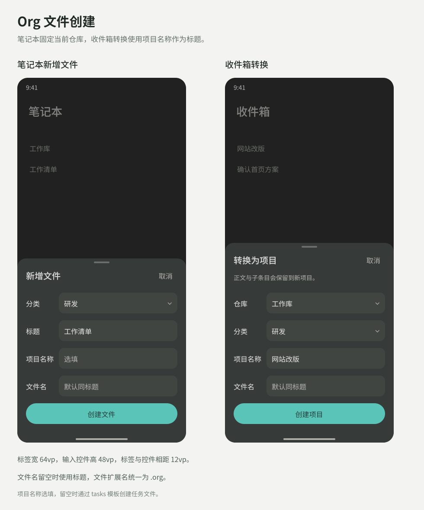

#+TITLE: 项目创建紧凑布局
#+STARTUP: show2levels
#+LANGUAGE: zh-CN

* 状态

用户已确认本布局，现为应用当前实现。设计源维护于 [[file:../../design/当前实现/任务列表共享操作.fig][任务列表共享操作]] 的“Harmony 当前实现”页，画板为“67 Harmony 项目创建紧凑布局（当前实现）”；见  。66 号画板移至“历史布局”页保留。

* 表单布局

- 笔记本新增文件锁定菜单所属仓库，显示分类、标题、项目名称和文件名。
- 收件箱转换显示仓库、分类、项目名称和文件名。标题输入由打开参数隐藏，项目名称预填源记录标题。
- 每项独占一行。标签列宽 64vp，两列相距 12vp，选择与输入控件高 48vp。
- 项目名称选填，留空使用任务文件模板。文件名输入提示“默认同标题”，留空时用有效标题生成文件名。
- 分类支持从下拉菜单另建名称。转换时优先使用有效的源分类，切换仓库后使用本库首个可用分类。
