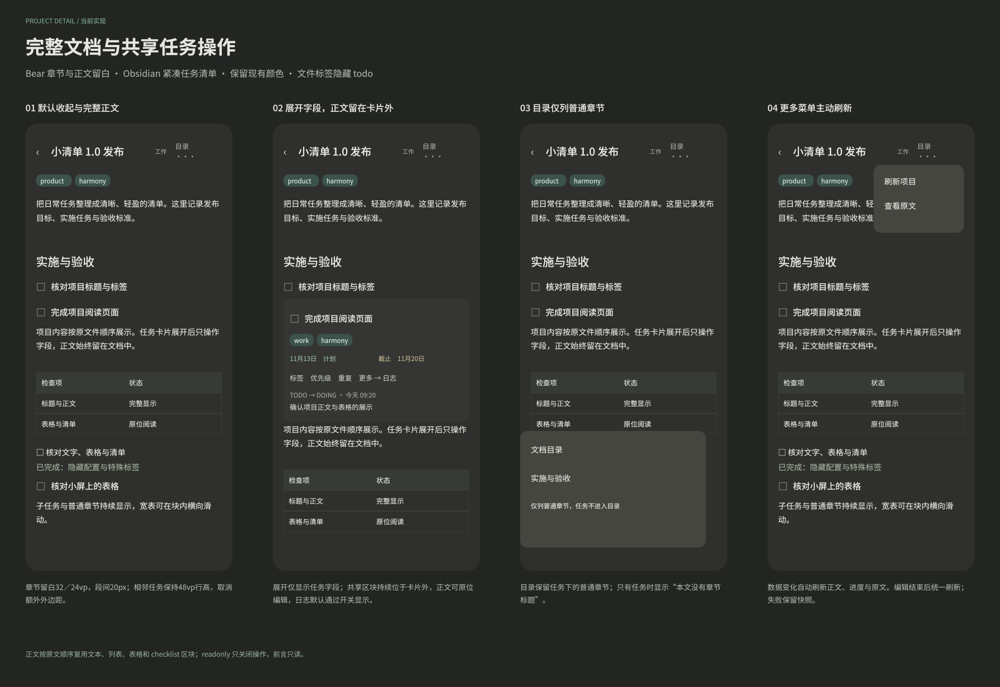

#+TITLE: 项目文档式阅读改版
#+DATE: 2026-11-13
#+STARTUP: show2levels hidestars
#+OPTIONS: author:nil date:nil toc:nil
#+LANGUAGE: zh-CN

* 当前实现与设计稿

当前方案采用原生任务控件与连续文档正文，具体交互与 Core 边界统一见 [[file:项目页面设计.org][项目页面设计]]。设计维护于 [[file:../../design/当前实现/项目文档阅读.fig][项目文档阅读]] 的“Harmony 当前实现”页，画板为“62 Harmony 项目文档式阅读改版（当前实现）”； 展示默认收起、任务字段展开、章节目录和主动刷新入口。真机视觉效果仍待验收。

* 设计要点

- 项目名固定显示在标题栏，所属分类以小字号跟随；正文不重复项目大标题。
- 页首只显示文件标签胶囊，隐藏其他头部配置、属性与文件信息；特殊标签来自 Core 接口，展示时统一隐藏，文件标签中的底层标记 ~todo~ 也不显示。
- 布局采用 Bear 的章节与正文留白、Obsidian 的紧凑任务清单，保留现有颜色。章节上留白为 32／24vp、下留白为 8vp，正文段落间距为 20px；相邻收起任务取消外层额外留白，保留 48vp 最小行高。正文列表项上下间距为 4px，嵌套列表不叠加整段留白；正文首尾 margin 纳入嵌入 WebView 的高度测量。
- 前言、普通标题、全部任务与子任务保持文件顺序，文字、表格与 checkbox 直接进入文档流；PROPERTIES 与 LOGBOOK 不在正文渲染。
- 任务标题复用共享任务控件，默认收起，点击后展开操作字段；共享参数 ~contentHidden~ 默认关闭，项目页启用以隐藏卡片内正文、备注占位和检查清单。项目 checkbox 列表独立放在卡片外，收起与展开均持续显示，支持勾选、文本编辑、删除和新增，并沿用 Core 版本校验；任务展开后通过“更多 → 日志”查看或收起日志，默认收起。普通标题使用专门的章节控件。
- 更多菜单提供主动刷新与完整原文，下拉沿用仓库同步；目录仅列普通章节，排除全部有效 TODO 状态节点，但保留任务下的无状态章节；只有任务时显示章节空态。任务卡片显隐不影响下方正文与后代节点。

* 实现与验收边界

Core 提供同版本文档分段、完整节点路径与特殊标签列表，宿主只组装布局。任务修改继续经过现有版本校验与 Core 操作组；原文阅读和布局变化不改写文件。手机功能状态记录于 [[file:../手机应用功能清单.org][手机应用功能清单]]，页面导航记录于 [[file:UI导航设计.org][UI 导航设计]]。

正文直接复用 ~TaskTextBlock~ 、 ~TaskListBlock~ 、 ~TaskTableBlock~ 与 ~TaskChecklistBlock~ ，由 Core 的 ~DocumentSection.blocks~ 按原文顺序组合； ~readonly~ 只关闭操作并保持相同阅读布局。前言只读，节点区块可原位编辑，保存仅修改当前区块，已有清单操作继续沿用 Core 的版本校验。
