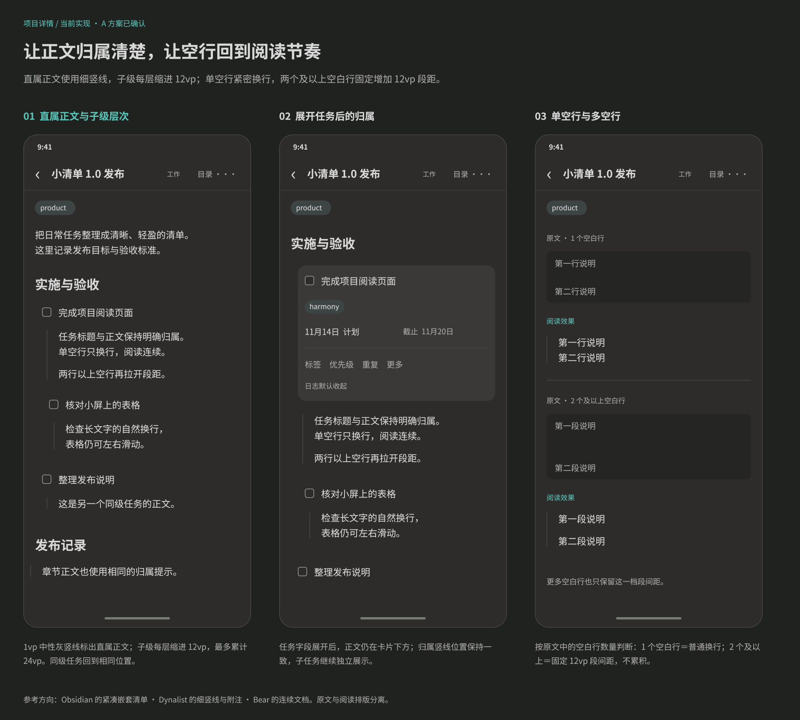
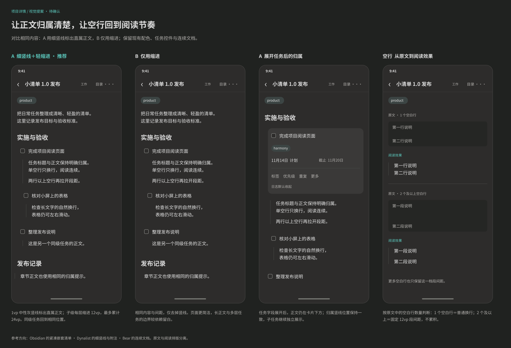

#+TITLE: 项目详情层级与空行提案
#+DATE: 2026-11-14
#+STARTUP: show2levels hidestars
#+OPTIONS: author:nil date:nil toc:nil
#+LANGUAGE: zh-CN

* 已确认方案与交付状态

用户已于 2026-11-14 确认 A 方案及空行规则，现已接入项目详情。当前设计维护于 [[file:../../design/当前实现/项目文档阅读.fig][项目文档阅读]] 的“Harmony 当前实现”页，画板为“65 Harmony 项目详情层级与空行（当前实现）”； 展示正文归属、任务展开和空行排版。真机视觉效果待验收。

；[[file:../../design/历史/项目详情层级与空行对比.fig][打开原对比设计源文件]]。

原提案画板为“65 Harmony 项目详情层级与空行（待确认）”，页面为“待确认设计”。四屏分别展示方案 A、方案 B、方案 A 的任务字段展开状态，以及单空行／多空行的原文与阅读效果。

已确认采用 A：正文前置细竖线，子任务使用轻缩进；空行使用紧密换行与固定段间距两档。

* 参考应用与分析

调研日期为 2026-11-14。依据官方公开页面、官方示意图及浏览器显示的嵌套清单分析视觉组织方式，未进行手机实装测试。以下尺寸与空行规则是本项目提案，不是参考产品的参数或语法。

| 参考来源 | 可观察的组织方式 | 本页采用方式 |
|-
| [[https://help.obsidian.md/Editing+and+formatting/Basic+formatting+syntax][Obsidian：Nesting lists、Paragraphs 与 Line breaks]] | 普通列表和任务列表通过缩进表达子级；同级内容回到相同左边界。换行与段落分开描述，页面目录使用细线辅助分组。 | 子任务层级保持稳定左边界；正文换行和段落使用不同节奏。Org 的单空行紧密换行规则单独定义，不照搬 Markdown 默认语义。 |
| [[https://dynalist.io/][Dynalist 官方首页示意图]]、[[https://dynalist.io/features][Features 的 Note 与 Checklist]] | 层级条目与任务状态共存，附注依附具体条目，正文不会全部占据相同的根左边界。 | 任务标题与直属正文形成视觉单元，子任务仍保留自己的标题与状态入口。 |
| [[https://bear.app/][Bear 官方 iPhone 界面]] | 单栏正文连续排布，图片、表格和文字位于同一阅读面；以字号与留白区分信息。 | 保留连续文档与现有深色配色，竖线保持中性、轻量；正文不增加卡片底色。 |

仅用缩进在短内容中很干净；当正文较长、含表格或后面紧接子任务时，归属边界仍较依赖读者推断。因此 A 用短竖线补充正文边界，B 保留相同内容、缩进与间距，仅去掉竖线，便于直接比较。

* 层级视觉规则

** 方案 A：细竖线与轻缩进，已采用

- 任务状态方框和标题保留原有共享控件。任务直属正文左边界与标题文字对齐，竖线位于正文左侧 20vp，接近状态方框的中心线。
- 普通章节的直属正文相对标题缩进 12vp，竖线位于标题左边界。文件前言没有所属标题，保持根位置且不加归属竖线。
- 竖线使用 1vp、现有分隔线色 #494B48；仅覆盖当前标题的直属正文组，上下各收 3vp。不贯穿下一条任务或章节，不将后代任务包进父任务的正文竖线。
- 子标题与子任务按完整逻辑路径每层缩进 12vp，最多累计 24vp；同级任务回到同一位置。深层结构仍可通过既有目录与完整路径定位，避免持续压缩正文宽度。
- 当前正文组包含的文字、普通列表、表格和 checklist 使用同一归属边界。引用保持其原有语义样式，归属竖线不使用强调色，以便区分。
- 展开任务字段后，正文继续在操作卡下方显示，正文左边界和归属竖线位置保持一致。状态方框、链接、清单勾选与正文编辑沿用当前交互。

** 方案 B：仅用缩进，未采用

与 A 使用完全相同的内容、标题位置、正文位置与段落间距，去掉所有归属竖线。优点是视觉元素少；缺点是正文跨越多个屏幕或存在连续子任务时，归属识别弱于 A。

* 单空行与多空行

按两段普通文字之间实际存在的空白行数量判断。一次回车只是换行；在两行文字之间留出一个完整空白行，需要两次换行。

| 原文情况 | 项目详情阅读效果 |
|-
| 无空白行，只有一次普通换行 | 保留正常换行，不插入额外留白。 |
| 1 个完整空白行，即两次换行 | 展示为相邻文字行，只保留正常行距；不显示额外空白行，不叠加默认段落 margin。 |
| 2 个或更多完整空白行，即至少三次换行 | 形成段落分隔，在正常行距外增加固定 12vp；更多空白行不继续累积高度。 |
| 正文组开头或结尾的空白行 | 不形成空白占位，不与标题、任务行或章节自身的结构留白叠加。 |

预览正文为 16fp、26vp 行高。段落分隔额外增加 12vp，标题自身的结构间距保持独立。单空行不会把两个词句拼接成一行，也不会造成一个完整空白行的高度。

单空行原文示例：

#+begin_example
第一行说明

第二行说明
#+end_example

两行文字在阅读时紧密相邻。两空行原文示例：

#+begin_example
第一段说明

第二段说明
#+end_example

两段之间增加 12vp。源码、示例、表格内部、引用内部与列表自身的结构不通过此规则压缩，保持对应区块语义与专用排版。原文阅读和保存继续保留原文件全部空行，只改变项目正文的阅读效果。

* 当前链路与实施边界

ProjectDocumentView 按完整路径每层缩进 12vp，最多 24vp；正文外层添加归属缩进与覆盖式细竖线，前言不加竖线。竖线不参与内容尺寸计算且不拦截交互，展开操作卡后位置保持一致。

Core 的 ContentBlock 增加普通段落标记 paragraph 与前置完整空白行数 blank_lines_before；Rust、C++ 快照、TS 声明与 wrapper 使用同一投影，宿主不解析 Org。段落边界由无损语法节点与原字节位置生成，不将分隔空行并入可编辑 source。

TaskDocumentContent 显式向 TaskContentBlocks、TaskBlockView 和 OrgContentView 传递 projectReading。相邻普通段落按 blankLinesBefore 选择 0 或 12vp 外间距，结构区块之间保留 12vp，首段间距为 0；嵌入 WebView 使用 16px／26px、去除顶层段落 margin 和 40vp 最小高度，代码、引用与列表内部排版保留。其他页面仍使用共享控件的默认模式。原位编辑、清单操作、阅读状态与 WebView 高度测量继续沿用共享链路。

* 确认与后续验收

已确认 A 的归属样式，以及“1 个空白行紧密换行、2 个及以上固定增加 12vp”的阅读规则。

验收范围：同级／子级任务、无正文标题、文件前言、深层与长标题、任务展开／收起、正文跨区块与宽表、1／2／多空行、首尾空行，以及代码／示例空白保留；完成或编辑任务后，原文未涉及的字节保持不变。已完成 Core 空行边界与字节保真测试、Harmony 快照透传校验、共享区块和项目阅读回归、Debug 编译与当前画板导出；编译日志未发现告警。真机效果待验收。
