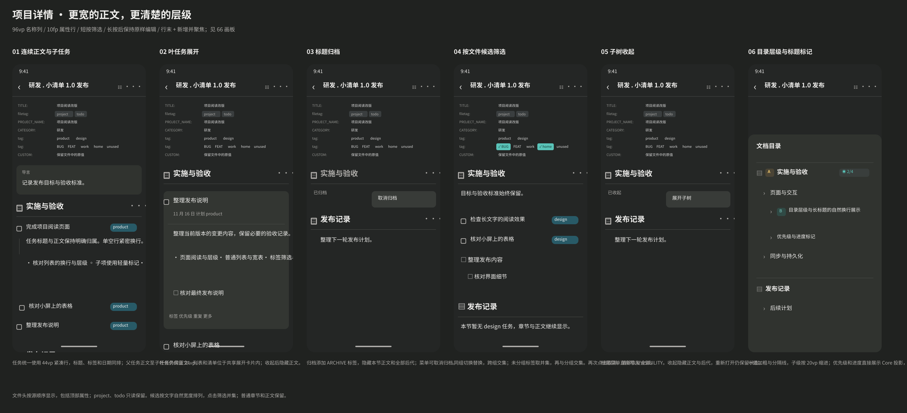
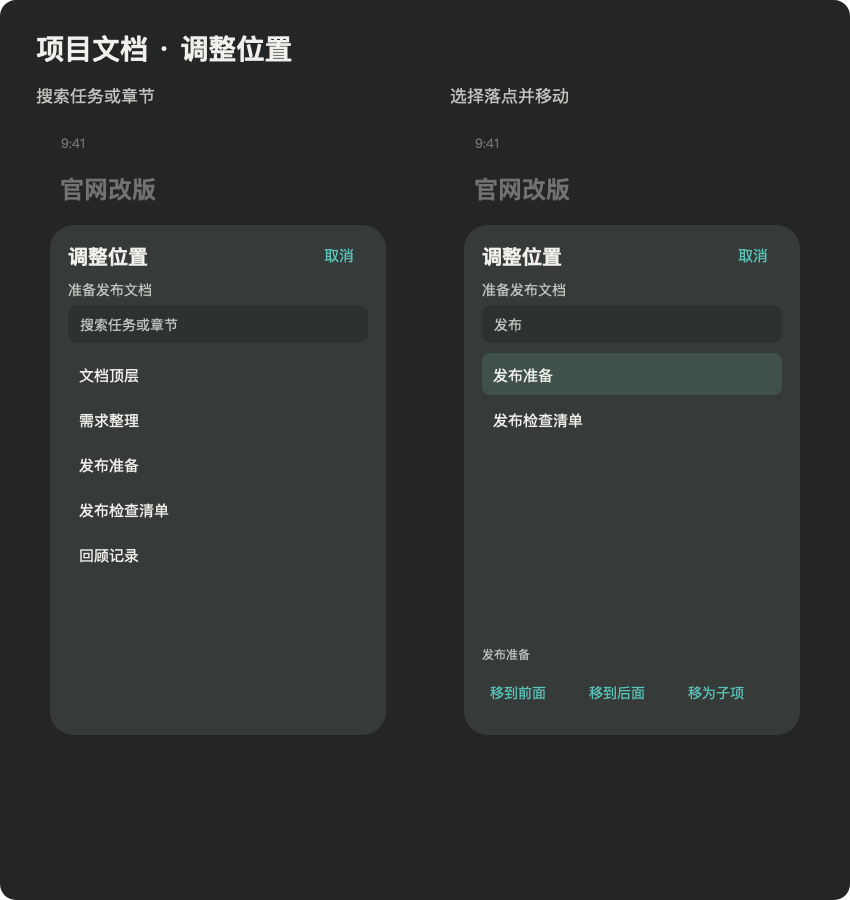

#+TITLE: 项目页面设计
#+STARTUP: show2levels hidestars
#+OPTIONS: author:nil date:nil toc:nil
#+LANGUAGE: zh-CN

* 范围与设计入口

一个项目对应一个真实 Org 文件。项目页以连续文档呈现导言、普通章节、任务、子任务及各自直属正文，保持源顺序。项目身份和名称来自 Core 文件元信息，不在宿主解析 FILETAGS 或属性。项目判定及名称回退见 [[file:../core/接口文档.org::*文件与任务的项目名称][Core 接口]]。

设计源为 [[file:../../design/当前实现/项目文档阅读.fig][项目文档阅读]] 的当前实现页；布局使用“65 Harmony 项目详情层级与空行”，属性区域使用“66 Harmony 项目属性长按编辑”。布局预览见 ，设计资源归属见 [[file:设计文件索引.org][设计文件索引]]。

* 项目身份与入口

侧边栏项目名称、单任务来源中的项目名和笔记本项目文件均使用真实 Core 仓库 ID 与相对路径打开项目，同名文件互相隔离。分组中的分类／项目标题只展示，不响应导航。项目入口先保存当前编辑，失败保留输入和页面。

侧边栏使用 ~PageNavigator.openPrimary~ 建立一级路径；任务来源和笔记本使用 ~pushPage~ 保留父路径。文件页从导航路径读取深度。一级标题可打开侧边栏，子路径显示返回按钮。历史备份同样使用文件页的只读展示。返回、路径恢复与侧边栏规则统一见 [[file:UI导航设计.org::*统一页面路径与返回规则][导航设计]]。

点击 ~TaskEditor~ 底部的项目来源时，页面先保存草稿，再传递任务最新的完整路径。文档载入后展开通往目标的折叠祖先，将任务滚入可见区域。任务行使用强调色闪亮一次，再恢复原底色。定位按仓库、文件、标题层级及同名标题次序匹配。 [[file:../../design/当前实现/项目文档阅读.fig][Org 文件导航画板]]

侧边栏直接消费应用级共享项目元信息，分类／项目按共享 RegionOrder 排列。进度由 ~taskStateCounts~ 提供，全部数量之和为总数，仅 Done 分类计入完成量，取消计入总量。项目行使用 44vp 高度、22vp 圆形进度及 16fp 项目名；不另建查询或项目管理页面。

* 顶部工具栏与文件头

标题以同字号、单行显示“Region . Project”，没有分类时只显示项目名。工具栏提供目录和更多菜单。阅读模式菜单依次提供“任务／章节／刷新／原文”，原文模式提供“文档／刷新”。各项均配图标。主动刷新先保存编辑，失败保留草稿。下拉通过共享入口启动仓库同步。

文件头与正文共用一个 Scroll。首次布局完成后跳过文件头，从导言开始；用户向上滚动可回看配置区。已有阅读偏移（包括 0）优先，不因后续正文高度变化反复跳转。

文件头按 Core 源顺序显示 TITLE、PROJECT_NAME、CATEGORY、FILETAGS、TAGS 及其他声明。阅读和编辑均使用 16fp 常规文字、22vp 行高，名称列 96vp、列间距 12vp；控件高 32vp，属性行至少 36vp。未知字段只读。FILETAGS 展示原有内部标签，不改变文件身份。

CATEGORY 和 TAGS 短按筛选，标签按文字自然宽度排列，选中高亮；普通候选隐藏 Core 特殊标签及 todo，文件头数据仍保留。多标签整体取并集，同一互斥组内切换替换。匹配交给 Core 查询，不在页面重新解释查询语言。

* 文件头长按编辑

整个属性区长按进入原位编辑，字段名、顺序和双列起点保持；支持 TITLE、PROJECT_NAME、CATEGORY、FILETAGS 和 TAGS。区域末尾统一取消／保存，不弹出逐字段编辑面板。长按不同时触发筛选，编辑期间不筛选。CATEGORY 从共享分类候选选择或新建，候选按真实仓库与文件范围排除配置的特殊用途文件。

TAGS 与 FILETAGS 每条声明独立支持行末加号新增、回车或失焦确认，标签上显示删除标记；原有 project／todo 不可删除。未知属性继续只读。保存以进入编辑时冻结的文件版本批量提交已改字段；外部更新推进确认元信息但不覆盖草稿，旧版本拒绝保存，不静默改 ID 或重复提交。接口见 [[file:../core/文件头属性编辑设计.org][文件头属性编辑设计]]。

* 连续文档与任务操作

导言为首个标题前的可见正文，使用轻底色、12vp 圆角、16vp 内边距和 12fp“导言”标签；为空时隐藏。导言只读，支持长按拷贝。普通章节由 ~OrgHeadingView~ 展示，不提供任务状态方框；一级标题有图标与通栏底线，一级至三级字号为 22／20／18fp。

有效 TODO 节点复用共享 ~TaskEditor~ 的 44vp 紧凑行，收起标题单行省略，优先级、进度、标签和日期同排。点击展开标题、状态、优先级、计划、截止、重复及标签操作；状态方框直接完成或恢复，目标状态由 Core 的 Done／Todo 分类决定。项目不使用专用 documentMode。

普通章节和父任务的直属正文连续显示；父任务通过 ~contentHidden~ 将正文留在卡片外，叶任务正文与清单仅在共享卡片展开区显示。任务来源区域隐藏。正文按 Core blocks 顺序组合文字、普通列表、表格和 checkbox，排除真实 PROPERTIES／LOGBOOK，源码和示例内同名字面内容保留。日志由共享任务日志入口显示，不在正文重复渲染。

文字、普通列表、checkbox 清单和表格共用区块长按菜单：拷贝、编辑、删除。只读仅拷贝；长按链接优先链接菜单，清单勾选和单项编辑独立保留。所有编辑提交 Core 结构化操作，区块 ID 与冻结版本共同校验，未涉及字节保持不变。

* 层级与空行

页面左右边距 12vp，不限制正文最大宽度。子级按完整逻辑路径每层缩进 8vp，最多 16vp；普通章节正文缩进 8vp，任务正文缩进 28vp，与标题文字对齐。普通章节上留白为 20／16vp、下留白 8vp；常驻正文至子任务留 24vp。

一级直属正文不画线；二级及更深直属正文使用 1vp 中性灰线，按实际正文高度上下各收 3vp，只覆盖本组正文，不延续至留白或下一标题，不拦截触摸。导言无线。任务线位于正文左侧 20vp，普通章节线与标题左边界对齐。

正文 16px／26px。一个完整空白行只保留紧密换行；两个及以上额外增加固定 12vp 段距，首尾不叠加空位。结构区块之间保留 12vp；代码、引用和列表内部保持专用语义。Core 提供 ~paragraph~ 与 ~blankLinesBefore~ ，宿主不解析 Org 或改写源空行。checkbox 子级缩进 8vp，普通／嵌套列表标记缩进为 24／20px。

* 目录、折叠与筛选

目录只列普通章节，排除全部有效 TODO 状态节点，保留任务下无状态章节；没有普通章节时显示“本文没有章节标题”。一级采用图标、18fp 粗体和通栏分隔，二级 16fp，三级及更深 14fp；每层缩进 20vp，最多 80vp。显式优先级和进度来自 Core，整行定位对应稳定节点，不按文字匹配或打开目录中的外部链接。

普通标题支持通过自身 ARCHIVE 标签归档，隐藏直属正文与后代，保留灰色标题和提示。标题菜单通过通用 ~PROPERTY~ 修改项写入 ~:VISIBILITY: folded~ 以收起子树。从菜单或“已收起”提示展开时，通过同一修改项删除标题自身的 ~:VISIBILITY:~ 属性。

筛选只隐藏未命中任务，保留普通章节、正文和命中任务的祖先；未命中父任务可作为层级路径。全量控件树和稳定键保持，清除筛选恢复原实例；归档和显式折叠优先隐藏后代。

* 结构编辑

普通 Org 标题在界面上称为“章节”。有效 TODO 节点显示为任务。单项新增直接落到目标父节点的第一个位置。单条移动和直属子项排序都在独立弹窗中完成。

“项目结构编辑（当前实现）”页维护日常操作与位置调整。[[file:../../design/当前实现/项目文档阅读.fig][设计源文件]]、

** 新增入口与插入位置

| 入口 | 界面操作 | 保存位置 |
|------+----------+----------|
| 右上角“更多 → 任务／章节” | 分别打开“添加任务”或“添加章节” | 文件头与导言之后，原第一个一级标题之前 |
| 章节行的“⋯ → 任务／章节” | 分别打开“添加任务”或“添加章节” | 章节的直属正文之后，原第一个直属子节点之前 |

工具栏右侧提供“文档目录”和“更多”，各使用 48vp 点击区域。窄屏优先缩略项目标题。空项目同样从“更多”开始新增。原文模式仅提供阅读操作。切换结构操作前先保存当前行内输入，保存失败时保留当前编辑。

章节标题行左滑显示“任务”“章节”“移动”。行尾菜单也提供“排序”“收起／展开”“归档／恢复”。任务可通过左滑或展开卡片的“更多”打开“移动”。有多个直属子节点的任务可从行尾或更多菜单打开“排序”。

“添加任务”和“添加章节”分别打开对应的全宽底部面板，仅需输入标题。面板顶部圆角 28vp，内容内边距 20vp。标题和“取消／保存”固定在面板顶部，键盘展开时仍可操作。输入框下显示落点路径，例如“小清单 1.0 发布 › 顶层首位”，或“实施与验收 › 子节点首位”。章节保存为普通标题，任务默认使用当前文件有效的待办状态。日期、标签和正文在新建后的任务卡片中编辑。

标题为空时停用“保存”。提交期间显示“正在保存”，成功后关闭面板、滚动定位并短暂高亮新行。新行被筛选或折叠遮住时，当前文档显示“已添加”，并提供“清除筛选并定位”或“展开父项并定位”。失败信息出现在面板内，标题和类型保留。文件版本变化后重新确认父节点，供用户核对位置后再次保存。

** 父节点内排序

直属子节点存在可移动落点时，行菜单显示“排序”。面板顶部固定父节点名称和“完成”，长列表在面板内滚动。章节与任务按完整文件顺序混排，以图标区分类型，当前阅读筛选隐藏的节点标为“筛选隐藏”。每行至少 44vp，右侧提供 44vp 的拖动热区。文件包含受保护冲突时显示提示，合法落点由 Core 判定。

从手柄按住后拖动，原位置保留占位，合法位置显示插入线。接近列表上下边缘时自动滚动，可落到同级首尾。短按手柄打开带图标的“上移／下移／置顶／置底”菜单，只显示当前可用的动作。移动章节或任务时，其正文与后代一起移动。释放在原位或组外即取消本次移动。

每次有效落位提交一次。提交期间暂停再次排序，成功后使用 Core 确认的顺序。失败时恢复提交前的顺序并显示原因。文件版本冲突时更新同级列表，由用户重新选择落点。“完成”关闭面板并恢复打开前的阅读位置。

** 调整位置

点击任务或章节的“移动”打开居中弹窗。输入标题或路径可筛选当前文件的任务和章节。选中目标后，可将来源移到目标之前、之后或移为第一个子项。选择“文档顶层”可移到顶层开头或末尾。选择列表排除来源及其后代。取消关闭弹窗，确认后提交单条移动，正文和子树一并移动。提交失败保留弹窗，文件版本变化时可重新读取后再选位置。

** 数据与保存

项目 DataSet 提交即时新增和排序。新增使用 ~TaskCreation~ 主动省略 ~TaskPosition.after~ 以插入首位，根位置使用空标题路径。排序使用 ~TaskMovement~ ，依赖完整快照里的父项、前一兄弟和文件版本，包含筛选隐藏项。Core 严格检查移动来源和落点。成功以带 ~operationId~ 的确认事件为准，新行使用 Core 返回的身份定位。

位置调整复用项目 DataSet 的 ~commitStructure~ ，提交单个移动编辑及打开弹窗时取得的文件版本。Core 按任务身份解析来源、父项和前一兄弟节点，校验层级及冲突保护，然后由 DataSet 根据确认事件更新阅读页。

位置和状态语义见 [[file:../core/接口文档.org::*统一任务操作组执行][统一任务操作组]]。

* 数据加载与运行中刷新

每次打开创建独立无缓存 DataManager，以全局 Manager 为 parent 共享 categories。本地只查询当前文件的 tasks、matches、metadata，合为一次批量订阅；tasks 的首次 fullFiles 初始化导言、分段、原文及链接索引。每个查询持有自己的订阅，完整文件不进入 DataSet 或磁盘缓存。

单任务／章节控件直接取得 ~taskSource(rowId)~ 并注册 Monitor，字段和正文变化定向更新当前控件。页面不遍历整批任务分发刷新。容器仅在成员、源顺序、层级、任务类别和 ARCHIVE／VISIBILITY 变化时归并结构，同文件移动根据 Core 身份映射保留稳定行、来源及其他章节实例。

来源指针随文件版本推进，即使可见内容相同也持有最新操作上下文。正文会话开始读取最新来源，进入编辑后冻结版本，保存失败保留草稿；编辑期间积累的章节和结构变化在会话结束后应用。

同步、reset 或磁盘外部失效，以及事件不完整／版本不连续时，由管理器合并查询并一次性交付恢复用完整文件。普通任务修改不重读全文。任务事件不含完整链接目标，内部跳转前可按需确认索引，保留文档会话与控件键。原文表示最近一次完整读取的源文本，宿主不以渲染快照拼造 Org 字节。

切换原文保留文档实例、阅读位置和展开状态。显式刷新建立新会话、重新绑定 DataSet 并恢复偏移；读取失败保留当前快照。页面隐藏后的旧回调不得覆盖当前文档。完整契约见 [[file:页面数据集设计.org][页面数据集设计]]。

* Core 与宿主边界

~document_sections()~ 基于 orgize 无损树返回有序 ~DocumentSection { path, html, blocks, linkTargets }~ 。前言 path 为空，其余按完整路径关联同版本节点；直属正文不含规划行和后代标题，受保护冲突子树不进入分段。

Rust bridge 在工作线程生成投影，C++ 透传，ArkTS 仅组合原生任务／普通标题与安全 HTML。所有语义、查询匹配、版本校验、关联修改和保真写回由 Core 负责；普通文件和历史阅读继续使用通用预览。
