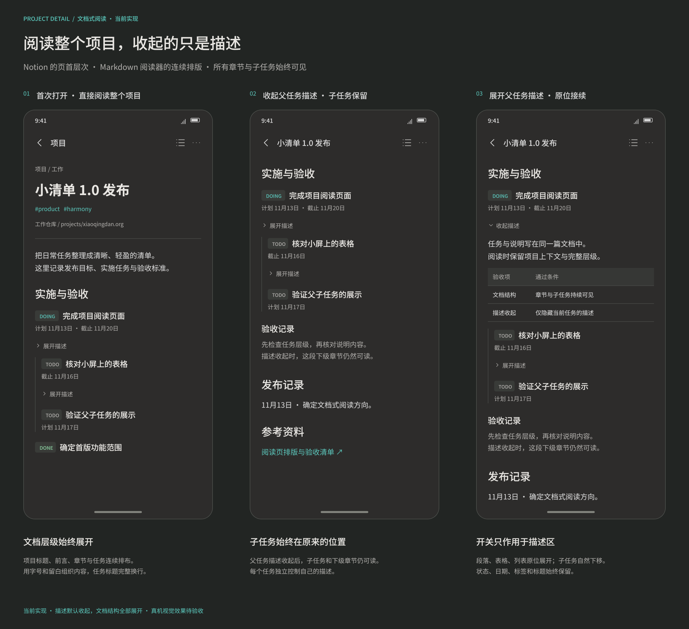
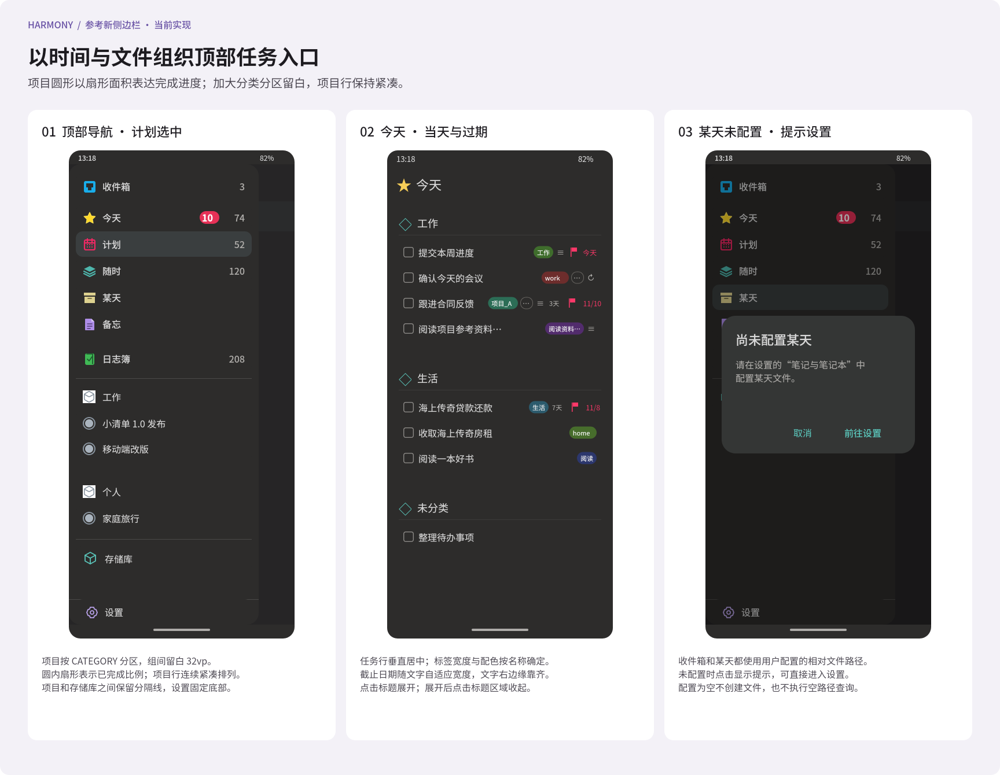

#+TITLE: 项目页面设计
#+DATE: 2026-11-13
#+STARTUP: show2levels hidestars
#+OPTIONS: author:nil date:nil toc:nil
#+LANGUAGE: zh-CN

* 目标与状态

项目页将一个项目文件呈现为一篇可阅读的完整文档。文件前言、普通标题、段落、表格、任务及其子内容按原文件顺序排列；任务直属描述默认收起，任务标题与子任务始终可见；展开描述后仍是文档中的文字、表格与清单，不切换为表单或任务卡片。普通节点和文字没有折叠入口。

本文改版已确认并接入手机，真机视觉效果仍待验收。当前方案见 [[file:项目文档式阅读改版.org][文档式阅读改版]] ，设计维护于 [[file:../../design/Orgzly界面细节.fig][界面图谱]] 的“Harmony 当前实现”页，画板为“62 Harmony 项目文档式阅读改版（当前实现）”。 展示首次打开、父任务描述收起和展开。原“60”系列画板保留为历史方案，不能作为当前折叠行为的依据。项目编辑方式另行确定。

* Markdown 编辑界面调研与选择

调研日期为 2026-11-13。完整调研、候选筛选依据、8 款手机应用与桌面对照，以及 Notion 专项核对见 [[file:项目页面调研.org][项目页面的文档界面调研]]。以下结论来自官方产品介绍及其中的界面，不代表已在手机实装测试；借鉴视觉组织方式，数据仍使用 Org 文件，不转换为 Markdown。

| 参考 | 观察 | 本页取舍 |
|-
| [[https://bear.app/][Bear]] 的 iPhone 界面 | 单栏笔记以大标题开篇，段落、行内标签、图片和轻量表格连成正文，工具较少。 | 作为主要视觉参考：采用单一文档底色、大标题、舒展的中文行距、轻量标签与表格。 |
| [[https://ia.net/writer][iA Writer]] | 突出文字与留白，减少工具干扰；写作与 Preview 分离。 | 借鉴克制工具栏与阅读留白；本次只确定阅读页，不引入写作模式或聚焦时淡化其他段落。 |
| [[https://ulysses.app/zh/][Ulysses]] 的 iPhone 界面 | 中文长段落在单一阅读面上连续排布，依靠行距和段落间距维持可读性；官方介绍强调低干扰界面。 | 借鉴中文长文阅读节奏；不按任务分割成独立卡片，不将正文拆成多个入口。 |
| [[https://www.notion.com/help/columns-headings-and-dividers][Notion]] 的普通标题、Toggle 与手机单栏规则 | 普通标题和 Toggle 是不同内容类型，Toggle 原位展开其子内容，手机将多栏排为单栏。 | 借鉴内容原位展开；开关位于任务描述区域，只收起直属正文，普通节点与子任务不折叠。 |
| [[https://www.craft.do/zh-CN/write][Craft]] 的内容块与任务嵌入文档 | 文字、清单与任务保持上下文，页面仍是可阅读的文档。 | 借鉴任务与说明共存；展开正文不显示块边框、任务卡片或编辑表单。 |

选择 Bear / Craft 式单栏文档作为主体，任务描述原位展开借鉴 Notion Toggle，沿用应用深灰和青绿色主题。项目身份、章节层级与任务状态使用字号、留白和小标记表达。折叠只解决任务细节过长的问题，展开后的内容回到文档流中。

* 项目身份与入口

一个项目对应一个真实文件。项目识别与名称直接消费 Core 的项目元信息，规则见 [[file:../core/接口文档.org::*文件与任务的项目名称][文件与任务的项目名称]]，界面不解析标签或自行推断项目。

侧边栏项目名称、已有任务来源中的项目名，以及存储库中的项目文件提供项目阅读入口；入口先结束已有原位编辑，保存失败时保留草稿和当前页面。任务分组的项目／分类标题只展示，不响应点击或跳转；单条任务来源中的项目名称点击区至少 48vp。跨仓库或不同路径的同名项目分别打开实际文件，不以项目名匹配或合并。普通分类文字不增加项目跳转。

存储库入口由 Core 的项目身份区分项目页与普通文件页；历史备份仍按历史文件阅读，不当作当前项目。侧边栏保持现有入口、图标和顺序不变，在日志簿之后、存储库之前增加当前项目导航项；不新增项目管理接口或项目列表页面。

** 侧边栏当前项目列表（已实现）

项目列表位于日志簿下方既有分隔线之后，按文件级 CATEGORY 分区；项目列表与存储库之间新增一条分隔线，只有存在项目时显示，空列表保留原有导航。每个分区采用 40vp 分类标题行，左侧 22vp 灰蓝线框图标，右侧为分类名；分区之间留白 32vp。分类按首次出现顺序排列，组内沿用 Core 的文件顺序；缺失或空 CATEGORY 统一显示“未分类”并置末。分类标题仅展示，不折叠或跳转。

项目行参考用户提供的紧凑侧边栏：44vp 高、左右内边距 12vp、22vp 圆形进度与项目名间隔 12vp。圆形进度采用灰蓝外圈与圆内扇形填充，扇形从十二点方向顺时针表示 Core 已完成数／总数，0% 与空项目只显示外圈，100% 填满内圆；项目行连续排列，不增加额外行间缝隙，分类标题与首个项目间留 4vp；行尾不再重复显示分数，辅助功能仍读取完整项目名与已完成／总任务数。名称 16fp、中等字重，过长时单行省略。项目名直接消费 Core 的名称，未命名项目保留占位名称，同名项目按仓库 ID 与相对路径保持独立。

所有分类、项目项与存储库位于同一 Scroll 中，设置固定在底部；点击项目行直接进入既有项目全文页，项目详情按真实文件身份读取完整快照。页面不增加项目管理按钮或项目列表二级路由。

项目列表已加入 AppShell 现有导航批次，作为第五项任务查询之后的 ~FileQuery { isProject: true }~ ，文件筛选与忽略规则由 Core 求值；三个配置文件入口查询仍在同一批次中，通知由既有统一入口追加。宿主直接显示 File 结果，不新增 Project 查询或独立文件请求。进度读取 ~taskStateCounts~ 数组：全部 ~count~ 之和作为总任务数，仅 ~category = Done~ 的项计入已完成数；取消状态计入总数。统计包含所有层级有效 TODO 任务，不含无状态标题与受保护的冲突子树，空项目辅助功能计数为 0/0。项目页重新打开同一仓库与相对路径的完整文件快照。

* 页面骨架

** 顶部工具栏

工具栏高 64vp，提供返回、标题、目录和更多操作。初始标题为“项目”；正文大标题离开视口后，工具栏显示项目名，长名可省略，正文大标题始终完整换行。系统返回先关闭目录或菜单，再返回来源页面。

更多菜单只提供“展开全部描述”“收起全部描述”“查看原文”。前两项仅改变任务描述状态，没有普通章节的展开或收起操作。原文用于查看包括文件声明在内的完整 Org 源码；它是只读入口，不代表确定了项目编辑方式。

** 随正文滚动的页首

页首先显示弱化的“项目 · 分类”，再显示完整项目名和文件标签。项目名为空时显示“未命名项目”，分类缺失时不补造分类；标签完整换行。仓库名称、相对路径和实际文件标题列为轻量信息行，值过长时换行或在路径断点换行，允许复制。项目名与文件 TITLE 相同时不重复显示文件标题。

文件属性使用无外框的键值行紧接身份区展示，所有有效值直接可见；无值的可选字段隐藏。只有同次文件快照提供的修改时间和大小才显示，不用当前时间代替。项目页不虚构项目级状态、负责人、截止日期或完成百分比。用户在文件中写入的自定义属性照常显示。

页首下用一条弱分隔线进入原文件前言与正文。没有封面图、任务总数卡、摘要仪表盘、任务筛选 Tab 或固定新增按钮。项目名与文件标题的页首展示不移除正文中恰好同名的真实标题。

** 文档正文

整个页面只有一个纵向阅读区域。文件前言、普通标题、任务、完成与取消记录全部按源文件顺序保留，不按日期、状态或分类重排，不使用任务查询结果替代文件全文，也不忽略不参与任务扫描的普通节点。

普通标题直接排版为各级标题，正文始终可见，不绘制折叠箭头，不把标题做成可点击容器。普通段落、表格、属性、drawer 和日志也不单独折叠。文档超出屏幕时通过自然滚动阅读，不截断成摘要，不显示“查看全部正文”。

* 任务描述的折叠与展开

任务由 Core 的有效 TODO 状态语义识别，包含待办、进行中、等待、已完成和取消。所有任务、普通标题与子任务始终可见；任务标题不提供子树折叠，普通 checkbox 列表不当作任务标题。

| 状态 | 展示与行为 |
|-
| 初次打开 | 所有标题和子任务展开；有直属正文的任务默认收起描述，标题、状态、优先级、标签与关键日期保持可见。 |
| 点击“展开描述／收起描述” | 只控制当前任务的直属正文；开关位于标题和日期下方，不绑定任务标题。 |
| 展开描述 | 段落、引用、列表、表格、代码、属性与日志原位回到文档流中，后续节点自然下移。 |
| 收起父任务描述 | 子任务、普通下级标题及其正文仍完整可见，子任务自己的描述状态不变。 |
| 没有直属正文 | 不显示描述开关；仅有规划行或子任务也不显示开关。 |
| 展开全部／收起全部描述 | 对当前文件各任务的直属描述生效，不隐藏任何标题或子任务。 |

描述范围由 Core 的直属正文边界提供，结束于第一个下级标题之前。标题附近的状态、优先级、标签与计划／截止日期不进入折叠区；直属正文中的属性和日志随该描述显隐。描述开关的触摸区至少高 48vp，文字为 12fp，支持键盘聚焦与原生展开语义。长任务标题完整换行，已完成和取消仅弱化自身标题。

任务外层共用文档背景。后代节点用弱竖线与浅缩进提示归属，前两层每层缩进 12vp，此后不再累计；深层仍使用标题字号和目录层级辅助定位。描述状态属于当前阅读会话，不写入原文件。

* 文档元素与手机排版

| 元素 | 设计约定 |
|-
| 阅读宽度 | 390vp 画板左右各 24vp；宽屏最大 740vp 居中。320vp 窄屏左右各 16vp；系统字号放大时仍换行。 |
| 项目名 | 28fp，中等偏粗字重，约 1.35 倍行距，上下留白 16–24vp。 |
| 普通章节 | 一至三级约 22／20／18fp，之后保持至少 17fp；章节前 28vp、标题后 12vp，正文不逐级大幅右移。 |
| 任务标题 | 17fp，中等字重，至少 1.5 倍行距；状态为 11–12fp 的低饱和度小标记。 |
| 段落 | 16fp，1.75 倍行距，段间距 12vp；不首行缩进，不限制行数。 |
| 标签与日期 | 12–13fp，灰绿标签与辅助色日期；状态同时有文字，不只靠颜色。 |
| 无序／有序列表 | 保留原顺序与嵌套，标记采用悬挂缩进，长项完整换行；checkbox 显示原有状态，不在本页修改。 |
| 表格 | 表头轻底色、行间细分隔；默认完整显示所有行，单元格适度换行；宽表单独横向滚动，并有溢出提示，页面本身不横向滚动。 |
| 引用 | 细青绿色左线与辅助文字，按实际内容撑高。 |
| 代码／示例 | 低对比深底、等宽字体与可选语言名，保留所有行；长行在块内横向滚动，无固定高度或纵向内滚动。 |
| 属性与日志 | 在原所属位置连续展示完整键值或日志文字，不使用 disclosure；仅在它们属于任务直属描述且该描述收起时隐藏。 |
| 链接 | 沿用支持协议与外部应用打开规则；暂不支持的链接保留可读描述与既有禁用样式。 |

背景使用应用已有的深灰，正文使用主文字色，辅助信息使用辅助色，链接和引用使用强调色。图稿中的层级、行距和轻量表格优先于装饰，不能通过颜色高亮代替文档结构。

* 目录与阅读位置

目录从工具栏打开底部面板，列出所有普通标题和任务标题，所有层级的标题始终可见。面板内的层级缩进只表达位置；没有章节折叠三角，也没有另一个树形浏览器。长标题完整换行，当前章节以小型青绿标记提示。

点击任意目录项只定位对应标题，不展开任务祖先，也不改变目标或其他任务的描述状态。关闭面板后正文保留定位结果。重名标题使用当前文件版本内的唯一锚点，不能按文字匹配。

同一会话返回页面时恢复阅读锚点及描述展开状态。同步或文件版本改变后，只有 Core 提供可重定位身份时才恢复相应节点；无法确认的节点恢复默认描述收起，不把旧字节偏移套到新内容。切换项目清空前一个项目的目录和展开状态；新的独立打开使用默认描述收起。目录空态显示“本文没有章节标题”。

* 完整性与异常状态

- 无任务的项目仍显示前言、普通章节、表格等全部内容，不显示“暂无任务”替代文档。
- 空文件保留真实项目身份与来源，正文显示“项目还没有内容”；不创建模板或补造任务。
- 长段落、长标题、多层任务与长表格不省略内容；只有任务描述开关可以隐藏对应直属正文，不能隐藏子标题与子任务。
- 文件已删除、仓库不可用或读取失败时显示对应说明与重试；切换文件后迟到响应不覆盖新页面。
- 内容在同步后变化时刷新同一版本的全文与元信息；失败保留可读快照并说明未能更新，不用半份新数据替换旧文档。
- 原文入口以只读等宽文本显示全部源字节对应内容，包含配置声明、未知关键字与未专门渲染的块；返回后恢复文档位置。附件加载不在本次范围，未知内容至少以安全的字面文本保留，不执行脚本或外部资源。

* 实现衔接与范围

~ProjectDetail~ 已接入独立项目路由，复用 ~OrgFilePreviewView~ 的目录、原文展示与固定 Web 视口。Core 通过 ~render_document_html()~ 提供文件头语义、任务分类、完整正文与同版本锚点，bridge 在工作线程内生成快照；ArkTS 只依据语义 HTML 排版，不解析 Org。普通 ~FileDetail~ 和历史备份继续使用既有通用阅读版式。

描述展开状态与阅读锚点保存在当前页面会话中，切换原文或读取相同版本时恢复；文件版本变化时清空旧状态，重新使用描述默认收起。刷新失败保留上次完整快照并显示可重试说明，迟到读取不覆盖新文件。工具栏随正文大标题滚出视口切换为项目名。

项目区块分组按真实仓库和文件身份隔离，不把同名项目合并成一个入口。分组中的分类与项目名称仅展示；侧边栏及单条任务来源中的项目名称接入真实文件。项目详情页只展示项目文档正文与描述折叠，不因文件带冲突而跳转；Core 的文档渲染排除受保护的冲突子树，完整原文仍保留真实文件字节。冲突处理继续从既有通知入口进入。

设计稿沿用现有“Harmony 当前实现”页的“09 Harmony 顶部任务入口”画板，预览见 ；空项目时不增加任何行，保持现有侧边栏。[[file:UI导航设计.org][UI 导航设计]] 与 [[file:../手机应用功能清单.org][手机应用功能清单]] 记录当前已实现方案。项目编辑、正文修改、任务状态操作、新增／删除、自动摘要及项目总览继续留待另行设计。

* 验收场景

1. 打开含前言、普通节点、任务、表格和完成记录的项目：全部标题、任务与子任务立即可见，各任务直属描述默认收起，原文件顺序不变。
2. 展开父任务描述：文字和表格原位出现；收起后子任务及普通下级章节仍完整显示。
3. 展开子任务描述后切换父任务描述：子任务描述状态不变，标题和元信息持续可读。
4. 没有直属正文、只有子任务或规划行的任务不显示描述开关。
5. 批量收起描述：不隐藏任何标题或子任务；目录定位仅改变位置，不改变描述状态。
6. 窄屏、大字号与深层任务：完整换行，缩进累计不超过 24vp，宽表和代码仅在块内横向滚动。
7. 同版本刷新或切换原文后恢复描述状态和阅读位置；不同版本或不同项目不复用失效锚点。
