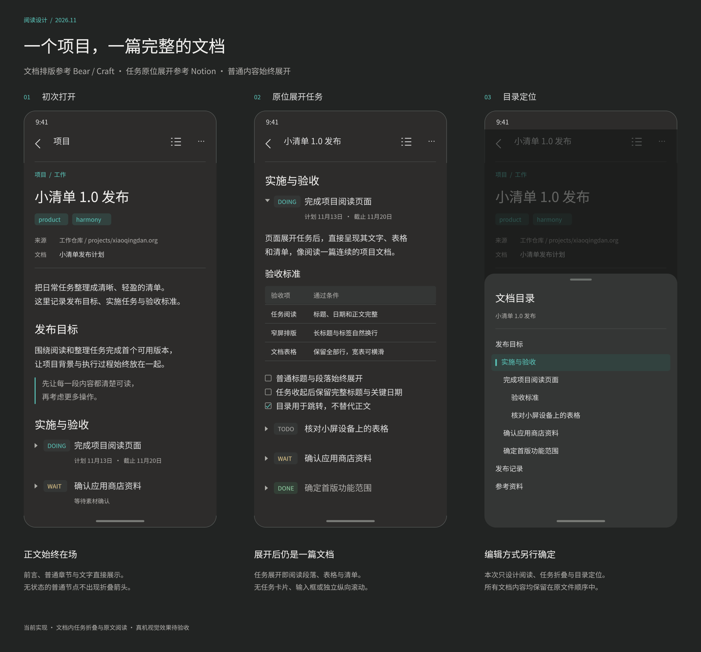
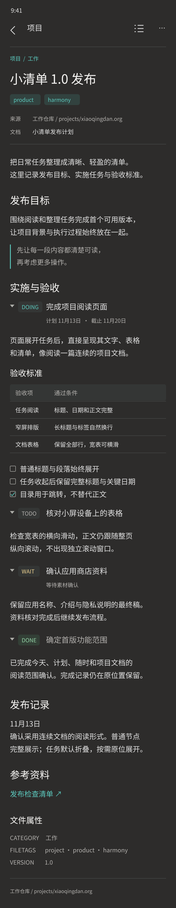

#+TITLE: 项目页面的文档界面调研
#+DATE: 2026-11-13
#+STARTUP: show2levels hidestars
#+OPTIONS: author:nil date:nil toc:nil
#+LANGUAGE: zh-CN

* 结论与范围

本文保留首次调研时的观察与候选结论。当前已实施的 [[file:项目文档式阅读改版.org][文档式阅读改版]] 将折叠范围限定为任务直属描述，开关移到标题下方；全部子任务与普通下级章节始终展开。下文提到的任务子树折叠与标题前的三角属于历史方案。

推荐采用 Bear / Craft 式单栏连续文档，结合 Notion Toggle 的原位展开表达：项目身份与轻量属性在页首，文件内容顺序不变，普通节点直接展示，任务默认折叠。展开任务以后，文字、表格、清单等接在原位置继续排版。折叠标记放在任务标题前，避免使用行尾跳转箭头暗示另一个详情页面。具体方案和预览见 [[file:项目页面设计.org][项目页面设计]]。

本轮只确定阅读展示；项目编辑方式另行决定。调研不把某个应用的整套工作区、数据库或写作流程移植到项目页。

调研包含 8 款有手机界面资料的产品：Bear、Obsidian、Joplin、iA Writer、Ulysses、Notion、Craft、UpNote；另外比较 VS Code 的官方 Markdown 预览与目录，以及第三方资料中的 Typora 原位渲染。依据是 2026-11-13 实际访问的官方产品页、官方说明和官方界面图片，没有将宣传页面当作真机实测，也没有实际登录或编辑这些产品中的私人内容。

* 候选筛选与“排名靠前”的依据

[[https://zapier.com/blog/best-note-taking-apps/][Zapier：The 7 best note-taking apps in 2026]] 的页面署期为 2025-12-11，推荐列表包括 OneNote、Apple Notes、Google Keep、Notion、Obsidian、Joplin 和 Evernote；其中 Notion、Obsidian、Joplin 与本项目的结构化文档关系最直接，因此进一步核对官方资料。

[[https://unmarkdown.com/blog/best-markdown-editors-2026][Unmarkdown：Best Markdown Editors for Mac, Windows, iPad, and Android (2026)]] 的页面署期为 2026-02-25，对比 Obsidian、Typora、VS Code、iA Writer、Bear、Ulysses、Zettlr、MarkText 和 Ghostwriter。本轮优先核对其中有手机展示资料的 Obsidian、iA Writer、Bear、Ulysses，并保留 Typora 与 VS Code 作为桌面排版对照。

这两份资料是推荐与比较文章，不是统一的下载量或市场份额排行榜。Unmarkdown 同时销售相关产品，具有商业立场，仅用于发现候选，不采用其中“最好”、价格、用户规模等断言。最终界面选择依据为官方界面与本项目需求的匹配程度，不按搜索结果顺序、搜索生成摘要或厂商自称排名评分。

* 产品逐项比较

| 产品与核对资料 | 页面与正文组织 | 与本项目相关的观察 | 设计取舍 |
|-
| [[https://bear.app/][Bear]]，官方 iPhone 展示图 | 大标题下直接接正文，行内标签、图片和表格都属于同一篇笔记。 | 手机上正文占主要面积，标题与段落层次明确；表格使用克制的表头和网格。 | 作为主要排版参考：大标题、舒展行距、轻量标签和表格，沿用应用自身深灰主题。 |
| [[https://obsidian.md/mobile][Obsidian Mobile]]，官方手机／平板界面 | 移动端延续文件笔记、路径、标题、链接和正文；同时保留命令、标签页与插件入口。 | 强调一个文件承载完整内容；手机与平板的工具密度、布局不能混为一谈。 | 借鉴真实文件与连续内容的关系，收敛顶部工具；图谱、插件和多标签页不进入项目页。 |
| [[https://joplinapp.org/cn/][Joplin]]，官方中文桌面／手机对照图 | 同一笔记中并排呈现标题、checkbox 清单、表格、链接和图片；手机上转为单栏。 | 手机示例的表格会出现明显窄列换行，说明直接把桌面宽表塞进手机会影响阅读。 | 保留文档元素连续性；宽表允许块内横向滚动，设列宽下限，不强行把所有列压进屏幕。 |
| [[https://ia.net/writer][iA Writer]]，官方产品说明 | 少量界面工具，把写作、格式与 Preview 区分；Focus Mode 可淡化当前段落以外的文字。 | 工具越克制，内容越容易成为视觉主体；聚焦写作与全文阅读是不同目的。 | 借鉴低干扰工具栏与留白；全文阅读不淡化其他段落，不在本次确定写作模式。 |
| [[https://ulysses.app/zh/][Ulysses]]，官方中文 iPhone 图与介绍 | 长篇中文内容按段落连续排布，文库与写作项目负责外层组织。 | 字号、行距与段间距能支持长文阅读，不需要每段套容器。 | 借鉴中文长文的阅读节奏；保持 Org 文件顺序，不引入 sheet 拆分或写作目标面板。 |
| [[https://www.notion.com/product/projects][Notion Projects]] 与官方页面／移动端说明 | 项目数据库承担结构化管理，每个任务可有自己的页面；普通页面混合标题、段落、表格和 Toggle。 | 原位 Toggle 能收纳丰富子内容；官方说明手机不保留多栏，改为单栏。数据库项目视图与全文文档是不同组织方式。 | 借鉴项目页首属性和原位展开；本项目的任务展开留在当前文档，不进入数据库记录页。 |
| [[https://www.craft.do/zh-CN/write][Craft 写作]] 与 [[https://www.craft.do/zh-CN][官方首页]] | 由内容块组成文档，正文可以组合文字、清单、图片等；官方明确强调将任务直接嵌入文档。 | 任务与说明保留上下文关系，页面仍可看起来是一篇文档，而非待办列表集合。 | 借鉴正文与任务共存及细致的章节间距；内容块边界不变成可见卡片边框或多个详情入口。 |
| [[https://getupnote.com/][UpNote]]，官方手机编辑图与功能说明 | 单篇笔记连续呈现标题、图片、待办与引用；另有 Collapsible Section。 | “文档中有折叠区段”与“整个文档变为大纲”可以分开设计。 | 借鉴原位收纳与连续正文；折叠范围由本项目限定为任务，普通章节始终展开。 |

** 桌面 Markdown 对照

[[https://code.visualstudio.com/docs/languages/markdown][VS Code 官方 Markdown 文档]] 将源文编辑、Markdown preview 和标题 Outline 分别说明；目录用于查看结构并跳转标题。对于手机项目阅读，可以借鉴“目录辅助定位”的分工，但源文／预览并列会压缩阅读宽度，所以项目默认只展示一个渲染视图，原文为独立只读入口。

Typora 在前述 Unmarkdown 比较中以“原位渲染、表格直接显示为表格”出现。其官网和帮助站在本轮访问中未能完成加载，因此这里只记录二手资料中的桌面思路，不声称验证了官网当前界面，更不将其当作存在手机版本的依据。这个思路与本页“展开后直接看到文字与表格”一致，但不足以单独决定手机布局。

** 可直接复核的官方界面资料

- [[https://bear.app/images/home/hero_iphone@2x.jpg][Bear 的官方 iPhone 界面]]：查看单栏标题、标签、正文与表格的连续关系。
- [[https://ulysses.app/assets/start/zh/hero-mobile@2x.png][Ulysses 的官方中文手机界面]]：查看中文段落行距与长文阅读面。
- [[https://joplinapp.org/images/home-top-img-cn-2x.png][Joplin 的官方中文界面对照]]：查看手机表格窄列换行与桌面表格的区别。
- [[https://getupnote.com/static/images/editor_mobile@2x.png][UpNote 的官方手机界面]]：查看标题、待办和引用如何位于同一笔记。

上述图片作为调研来源链接，不作为本应用的设计资产。Notion 的交互约定以其官方帮助说明为据，Craft 的任务与文档关系以其官方页面的内容和演示为据。

* Notion 的专项核对

** 普通标题与 Toggle 的区别

[[https://www.notion.com/help/columns-headings-and-dividers][Notion：Format your page]] 分别介绍 Headings 与 Toggle heading，后者可以展开或隐藏标题下的内容。这说明折叠是明确添加到特定内容上的行为，不需要让所有普通标题都成为折叠节点。

同一说明也明确写到 Toggle 需要手动开关，不能据此推断它已经提供批量展开／收起或默认状态设置。本项目“任务默认折叠”和“展开／收起全部任务”是本页自行确定的阅读规则，不是直接复制 Notion 的已有设置。

本页采用任务标题前的小三角表示折叠，展开后正文继续向下排版。普通标题不留空三角占位，不因层级深就变为可折叠节点。点真实链接只打开链接，不同时切换任务。

** 手机单栏

[[https://www.notion.com/help/notion-for-mobile][Notion：Notion for mobile]] 在移动端与桌面差异中说明手机没有多栏，原有多栏变为单栏；同时没有 hover 状态。页面格式说明也指出手机把右侧列内容放在左侧列内容后面。

因此项目页使用一条纵向文档流。目录放在按需打开的底部面板，工具点击区至少 48vp；折叠按钮不依赖鼠标悬停才出现。所有说明、任务与表格保持源文件的实际顺序，不照搬桌面数据库的多栏面板。

** 表格与数据库

Notion 的格式说明将 Simple tables 与数据库区分：简单表格服务于内容矩阵，数据库提供筛选、排序和类型属性。项目页中的 Org 表格优先按文档表格展示；不自动变成数据库，不附带筛选工具条、看板或分页。

[[https://www.notion.com/product/projects][Notion Projects]] 的项目管理页面展示数据库、时间线、进度、任务页面等完整管理能力。这些能力需要额外的领域数据和产品决策；本页只借鉴身份与属性层次，不从任务数量推导一个未经定义的“项目进度”，不补造负责人或项目截止时间。

* 对本项目的选择

| 设计问题 | 调研启发 | 本页决定 |
|-
| 打开项目第一眼看到什么 | Bear 的笔记大标题、Notion 的项目身份与属性 | 完整项目名、标签、来源与真实属性，随后直接进入前言；页首与正文一起滚动。 |
| 如何保持文档感 | Bear、Craft、Ulysses 的连续内容 | 使用同一底色、正文宽度和排版规则，普通标题与任务展开正文共享文档流。 |
| 任务默认如何收纳 | Notion Toggle、UpNote Collapsible Section | 只有任务默认折叠，标题前出现轻量三角；状态、完整标题和关键日期保持可见。 |
| 展开后看到什么 | Notion 的丰富子内容、Craft 的任务嵌入文档 | 直接显示文字、表格、清单、属性、日志；不进入新页面，不变成编辑表单。 |
| 长内容如何处理 | Ulysses 的长段落、Joplin 手机表格 | 一次纵向阅读，段落不限行；宽表和代码块局部横向滚动。 |
| 目录承担什么职责 | Notion 目录与 VS Code Outline 的定位分工 | 按需打开面板并跳转；需要时展开任务祖先，普通标题不折叠。 |
| 如何呈现深层节点 | 多栏与窄屏冲突、Org 可任意嵌套 | 标题字号与轻量标记表达层级，避免不断右移导致正文和表格变窄。 |
| 选择哪种编辑器 | 多个产品有不同编辑模式 | 此次不确定项目编辑方式，只交付阅读设计。 |

不推荐直接照搬任何一款应用的整个界面：Bear 的标签管理、Obsidian 的插件工作区、Notion 的项目数据库、Craft 的文档组织各有自己的目标。本页只组合能够支持“一整个文件读起来像文档”的部分。

* 对候选稿的修订

1. 保留 Bear 式大标题与单栏排版，结合 Craft 的任务与文档共存方式，明确所有内容按源文件顺序展示。
2. 任务折叠标记改为标题前的小三角，提供文档内展开语义；去掉行尾容易被理解为跳转的箭头。
3. 项目页首只显示实际存在的属性；属性完整可读，不照搬庞大的数据库属性面板。
4. 普通标题、段落、表格、drawer 与日志自身不折叠；位于任务内部时只随所属任务子树一起显隐。
5. 每个展开任务直接融入文档，不用卡片边框、独立底色或编辑工具条区分。
6. 目录、任务折叠与原文阅读作为此次阅读设计范围，项目编辑保持待定。

* 后续评审关注点

先评审  与 ，确认页首信息密度、任务收起时标题层次、展开后表格与段落衔接，以及目录面板是否仍让正文保持主体地位。该界面现已确认并实施，当前交付状态见 [[file:项目页面设计.org][项目页面设计]]；本文保留调研时的观察与取舍。
