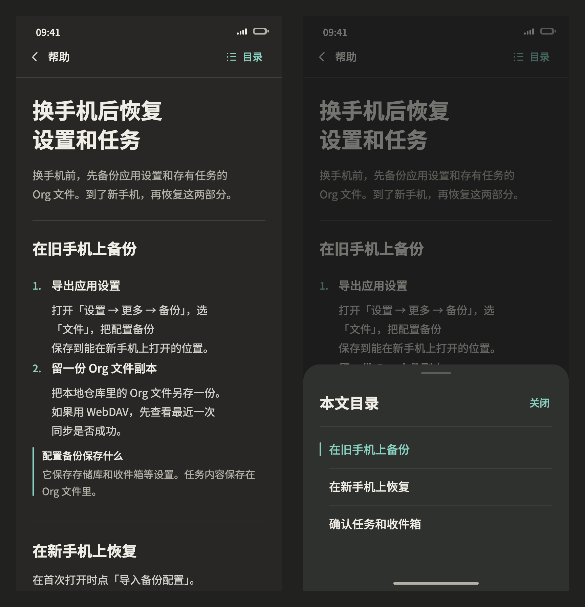

#+TITLE: 我的待办帮助中心文档设计
#+STARTUP: show2levels
#+LANGUAGE: zh-CN
#+OPTIONS: author:nil date:nil toc:2

* 范围

本文定义 HarmonyOS 手机端「我的待办」帮助中心的目录、文章结构、首批内容和阅读展示。现有「新手引导」项目负责带用户动手，帮助中心负责随查随用。从「设置 → 应用程序 → 帮助中心」打开。实际操作与交付状态见 [[file:手机应用功能设计.org][手机应用功能设计]]。

* Things 3 iPhone 参考

| 文档层级 | Things 3 的做法 | 我的待办的做法 |
|-
| 首页 | 搜索框和常见查询在前，按入门、基础操作、Things Cloud、进阶功能、技巧和排障浏览。 | 按手机用户要做的事分类，把高频问题放到首页。同步专题使用项目支持的 WebDAV。 |
| 操作文章 | 一段摘要交代结果，长文列目录，分节给出步骤，必要时按设备切换，末尾附问答及相关文章。 | 一篇解决一个主要问题，使用手机当前界面名称，说明操作后可看到的结果。 |
| 使用指南 | 单独用收件箱、日期、项目和每日回顾串起一套工作方法。 | 用「从收件箱整理到今天」串起录入、安排和回顾，并指向现有新手引导。 |
| 故障排查 | 先按症状给检查步骤，仍无法解决时列出应提供的信息并指向支持入口。 | 先做可逆的检查，给出结果对应的下一步。需要反馈时列出可脱敏提供的信息。 |

参考 [[https://culturedcode.com/things/support/][帮助首页]]、[[https://culturedcode.com/things/support/articles/2803564/][重复任务文章的 iPhone 步骤]]、[[https://culturedcode.com/things/guide/][Getting Productive with Things]]、[[https://culturedcode.com/things/support/articles/2803590/][同步排障]] 和 [[https://culturedcode.com/things/support/articles/2803553/][iPhone 教程入口]]。

* 首页与目录

首页依次提供文章搜索、常见问题、主题目录。首批常见问题为「为什么今天找不到任务」「换手机怎么恢复」「WebDAV 同步失败怎么办」「删除的任务怎么找回」。搜索使用标题、摘要和关键词，结果显示文章标题、所在分类和摘要。一个问题由一篇文章维护，首页、其他分类和应用内提示都可以链接到同一篇。

| 一级目录 | 回答的问题 | 文章范围 |
|-
| 快速开始 | 第一次打开应该做什么？ | 建立第一个存储库，接入已有 Org 文件，设置收件箱，记录并处理第一条任务，使用新手引导。 |
| 任务与日程 | 任务该放在哪里，什么时候会出现？ | 视图选择、日常整理、计划／截止／提醒、重复与习惯、自定义任务状态与流程、标签、手势和多选。 |
| 笔记本与项目 | 我的内容放在哪里，如何整理？ | 存储库与笔记本、区域（分类）与项目的关系、普通任务与项目任务、收件箱／某天／备忘文件入口、原文与文档视图。 |
| WebDAV 同步 | 怎样在设备间使用同一批文件？ | 接入和首次同步、手动与自动同步、过滤目录、查看同步日志、处理冲突。 |
| 数据备份与恢复 | 如何换机、找回数据或清理配置？ | 配置与 Org 文件分别备份、换机验证、废纸篓归位与永久清除、移除存储库与两种重置。 |
| 故障排查 | 我看到的结果和预期不同，接下来查什么？ | 任务没出现、收件箱无法新增、目录不可用、同步不动、提醒没响，以及反馈所需的信息。 |

高级 Org 用法按主题链接到对应文章。首批先在任务状态、重复规则和任务可见性文章中解释必要的 Org 语义。文件头声明、归档、习惯和文件内自动化有独立使用场景时，再扩成专题。

* 首批文章与必须覆盖的内容

优先完成第一条任务、任务可见性、WebDAV 首次同步和数据恢复相关内容。下面的文章标题可直接用于首页和搜索结果。

| 分类 | 首批文章 | 必须覆盖 |
|-
| 快速开始 | 建立存储库并记下第一条待办 | 区分「初始化新仓库」「新增远程仓库」「导入备份配置」。初次上手走本地路径，从创建存储库到打开收件箱、记录任务、安排到今天，说明在笔记本中如何确认写入目标。关联新手引导项目。 |
| 笔记本与项目 | 把已有 Org 文件加进来 | 将 ~.org~ 文件放进应用可访问的仓库目录，再到笔记本确认。说明仓库、文件、Org 标题和任务的存放关系，给出原文与文档的切换入口。 |
| 笔记本与项目 | 区域、项目和任务是什么关系 | 用一个区域内有多个项目和普通任务的例子，说明区域对应文件分类、每个项目对应一个 Org 文件、任务是文件中的待办标题。覆盖无分类、同名项目、项目改分类、收件箱转项目和从任务跳到项目。 |
| 笔记本与项目 | 设置收件箱、某天和备忘 | 「设置 → 文件入口」中按仓库和文件路径确认目标。区分还没配置仓库、还没绑定、原文件已失效三种状态。解释快速捕捉保存到哪个文件，以及移动到某天或备忘后去哪里找。 |
| 任务与日程 | 从收件箱整理到今天 | 用一组真实操作串起收件箱、今天、计划、等待、随时、某天、备忘和日志簿。用对照表列出各视图何时使用、什么记录会出现，以及任务完成或改期后去哪看。 |
| 任务与日程 | 设置计划、截止和提醒 | 用同一例子展示三者可独立设置，解释提前预警和系统日历提醒。说明如何修改和清除，如何确认日期出现在任务上、提醒已登记在本机。 |
| 任务与日程 | 设置重复任务与习惯 | 从任务「更多 → 重复…」开始，说明定期、完成后两种界面选项及错过日期的处理。展示完成后原任务如何推进日期并恢复待办，解释检查清单及提醒的后续变化，另说明习惯任务在视图中的区别。 |
| 任务与日程 | 自定义任务状态与流程 | 从一个自定义等待状态入手，演示如何在 Org 文件声明状态、在任务标题使用它、在手机设置映射状态类别，再到「等待」验证。写清未映射时的默认归类，以及状态未被识别时先检查文件声明。 |
| WebDAV 同步 | 连接 WebDAV 并完成首次同步 | 给出 HTTPS 地址、账号、密码和「测试连接」入口，解释测试与实际同步各自的结果。启用已有本地仓库前先说明同路径采用远端 Org 文件、本机独有文件上传、被替换而未保留的本地任务进入废纸篓。提醒先保留本地文件副本，并说明同步完成后如何查看历史。 |
| WebDAV 同步 | 查看同步历史与处理冲突 | 说明手动下拉与「本地有修改，点击同步」，解释日志中的上传、下载、无变化、失败和冲突。通过一条冲突说明如何比较候选、应用或丢弃，以及文件变化后如何重新读取。 |
| 数据备份与恢复 | 换手机后恢复设置和任务 | 分两条线说明 ~.orgtasks~ 保存配置、Org 文件保存正文和任务。分别给出本地仓库迁移与 WebDAV 恢复步骤，说明密码与设备权限在新机重新配置。恢复后以笔记本文件、收件箱绑定、代表性任务和最近同步结果确认。 |
| 数据备份与恢复 | 找回误删的任务 | 从「废纸篓」左滑「归位」，说明默认保留 30 天、原文件或父节点不存在时的提示和处理、永久清除的后果。另链接到仓库移除和重置说明，避免把文件级操作当成任务删除。 |
| 数据备份与恢复 | 移除仓库、重置设置与重置仓库 | 对照列明入口、清除内容、保留内容和操作前的备份办法。重点写清「设置 → 更多 → 重置」清空配置并保留磁盘文件，仓库页的「重置」清空该仓库本地内容和同步状态。补充停用 WebDAV 后重新启用的首次同步行为。 |
| 故障排查 | 为什么今天找不到任务 | 从当前筛选、分组和任务状态查起，再检查计划／截止日期、笔记本原文、TODO 声明、文件绑定及扫描忽略规则。给出每步找到或找不到时的下一步。 |
| 故障排查 | WebDAV 同步失败怎么办 | 从仓库是否启用、测试连接和最近一条同步记录入手，按目录不可用、认证、过滤、冲突或基线异常跳到对应处理。说明如何核对本地保留的文件和待同步状态。 |
| 故障排查 | 提醒为什么没有响 | 检查任务是否仍未完成、提醒是否已过期或已登记，确认本机提醒开关、日历授权和系统日历通知，必要时查看「提醒操作日志」。解释「已登记」只确认已创建系统事件。 |

后续补充分享与快速捕捉、标签和优先级、清单与多选、桌面卡片与角标，以及 Org 文件中的目录、文件头和链接用法。涉及提醒、语音或文件权限等系统差异时，在对应文章内写明适用条件。

** 区域、项目和任务的示例

用「工作」作为区域，放入「官网改版」「活动筹备」两个项目和普通任务「报销差旅费」。「官网改版」对应一份 Org 文件，「确认首页文案」是该文件中的任务。「报销差旅费」放在同样归为「工作」的普通任务文件中。今天和随时按区域展示符合各自条件的任务，普通任务直接列在区域内，项目任务在该区域内按项目分组。

区域来自文件的 ~CATEGORY~ ，用户看到的是「分类」。没有分类的文件归入「未分类」。项目由仓库和文件路径区分，两个同名项目可以各自打开。文章用「收件箱 → 左滑 → 项目」演示多步骤事项如何变成项目，用项目文件顶部的分类字段演示如何变更归属，再从通用任务卡片的项目来源跳回项目和对应任务。 [[file:harmony/项目页面设计.org][项目页面设计]] · [[file:harmony/项目分类布局设计.org][项目分类布局设计]]

** 自定义任务状态的示例

在 Org 文件的 TODO 声明中加入 ~HOLD~ ，用它标记「等同事确认首页文案」。再到「设置 → 任务状态分类」的「等待」分组添加 ~HOLD~ ，打开「等待」确认任务出现。

文件的有效 TODO 声明决定哪些状态词可用于任务。未明确归类的自定义状态按分隔符 ~|~ 的位置归为待办或完成，手机设置中的分类映射决定已识别状态在应用中如何归类。排查时先核对文件是否声明了这个状态，再核对它在手机设置中的分类。 [[file:harmony/配置项设计.org::*任务状态分类设置][任务状态分类设置]] · [[file:core/数据模型.org::*任务运行状态分类][任务运行状态分类]]

* 单篇写法与维护

| 顺序 | 内容 |
|-
| 标题和摘要 | 用用户会搜索的动作或症状当标题。开头直接说明结果或第一个检查点。 |
| 开始前 | 只列会影响结果的条件，例如已有 Org 文件、WebDAV 账号、系统权限，或即将覆盖文件时要保存的副本。 |
| 操作步骤 | 从可识别的页面出发，使用当前可见按钮名称。每步包含一个操作和可确认的结果，较长文章加节目录。 |
| 结果和分支 | 明确数据去了哪里、什么会发生变化。排障文按症状或错误分支写，每个分支以恢复、复查或进一步诊断结束。 |
| 相关帮助 | 链接到下一步真正会用到的文章。反馈信息优先包括应用和系统版本、复现步骤与错误文本，必要时附脱敏后的记录。 |

面向用户的随包文档保存在 ~app-docs/zh-CN/~ 和 ~app-docs/en/~ 。每种语言以 ~index.org~ 维护主题和文章目录，使用相同的 ~help-<article-id>.org~ 文件名、主题标识和定位锚点。以 Org 的 ~#+TITLE:~ 、 ~#+DESCRIPTION:~ 和 ~#+KEYWORDS:~ 提供标题、摘要及搜索词，例如「换机、迁移、备份」或「没响、日历权限」。 ~#+HELP_TOPIC:~ 指定主题， ~#+HELP_FREQUENT: yes~ 将文章收进首页常见问题。长文章中需要直接定位的段落使用稳定的 ~CUSTOM_ID~ 。

页面入口和后果以手机应用功能设计及专项设计为依据。涉及数据保留和覆盖时，逐一核对配置备份、首次同步、废纸篓与清理的边界。示例采用虚构的仓库与任务，并复核中文界面菜单、确认按钮和成功后的可见结果。未实现的行为留在设计文档。

内容依据见 [[file:手机应用功能设计.org][手机应用功能设计]]、[[file:harmony/配置项设计.org::*配置备份与恢复][配置备份与恢复]]、[[file:harmony/冲突解决界面设计.org][冲突解决界面设计]]、[[file:core/目录结构设计.org::*任务扫描忽略规则][任务扫描忽略规则]] 和 [[file:harmony/任务提醒设计.org][任务提醒设计]]。

* 与应用内提示的关系

新手引导承担实践，帮助文章承担随查随用。「建立存储库并记下第一条待办」提供和新手引导相衔接的文字步骤。设置分组的「?」就地解释字段。「文件入口」可打开入口选择说明，「任务提醒」可从排障入口直接定位「检查系统登记」。WebDAV 排障可从帮助首页进入。反馈渠道属于后续接入设计。

* 手机端阅读展示

参考 Obsidian 阅读视图的连续正文，以及 Marked 2 对源文和阅读版式的独立处理。帮助文章用标题、段落、留白和链接组织阅读。 [[https://obsidian.md/help/edit-and-read][Obsidian 阅读视图]] · [[https://marked2app.com/][Marked 2]]

 · [[file:../design/当前实现/帮助文章阅读.fig][可编辑画板]]

** 页面与导航

首页和分类页沿用设置的原生分组列表。首页顶部是文章搜索，其次是高频问题和主题目录。点主题进入文章列表，点搜索结果直接打开文章。搜索框、结果和列表位置随返回恢复。

文章页用原生工具栏承载返回和「目录」，正文占据下方单列阅读区。正文从文章标题和摘要开始，有多个主要小节时提供目录入口，复用文档目录底部面板。点小节直接滚到对应标题，关闭目录后继续阅读。把相关帮助放在实际需要跳转的段落或文末。文章内打开另一篇后，返回恢复上一篇的阅读位置。从设置打开的文章，返回时回到对应设置页面。

例如，从「任务提醒」设置进入「提醒为什么没有响」，直接定位「检查系统登记」。用户看完仍可从目录查看「检查系统通知」等小节。

** Org 内容的手机排版

采用应用暖深灰背景，正文保持连续单栏。文章标题 32fp、行高 43fp，小节标题 22fp、行高 32fp，正文 16fp、行高 28fp，页面两侧各留 24vp。段落间留 14–18vp，主要章节间留 28–32vp，必要时用细分隔线。文字跟随系统字号，标题和列表自然换行。强调色用于链接和目录当前位置。正文连续纵向滚动，表格与代码块需要横移时只滚动该区块。目录、图片和链接都有可读名称。见 [[file:harmony/视觉设计规范.org][视觉设计规范]]。

| Org 内容 | 手机里的呈现 |
|-
| 文件标题与摘要 | 标题在正文顶部完整显示一次。摘要用短段落说明操作结果或排查起点。分类和关键词用于导航与搜索。 |
| 章节标题 | 保留标题文字和层级，正文连续展开。目录列主要小节和必要的子节，使用稳定段落锚点定位。 |
| 有序列表与无序列表 | 操作步骤保留编号，条件和检查项用普通项目符号。Org 清单项按普通列表项显示其文字与缩进。 |
| 引用与操作前说明 | 用带左边线的引用块显示短说明。涉及覆盖、重置或清除时，把「操作前」和具体后果放在相关步骤之前。 |
| 表格 | 表头清晰，单元格可换行。字段多的表格在本区块横向滚动。 |
| 行内代码、示例和源代码块 | 行内代码用等宽文字。示例和代码块保留空格、换行，支持复制整段。 |
| 截图与图注 | 操作位置难以由按钮名称说明时插入截图，随正文宽度缩放。点图查看大图并可缩放，关闭后回到原位置。替代文字描述要看的控件，必要时加图注。 |
| 链接 | 同篇链接定位到章节，相关文章在帮助中心内打开，应用页面链接打开指定界面，外部网页交给系统浏览器。 |

** 独立的只读渲染引擎

在 Core 中独立定义只读文章渲染，复用 orgize 语法树及公共安全 HTML 输出。输入是单篇 UTF-8 Org，输出是只读 HTML 片段和包含标题、层级与锚点的目录。渲染只消费文章排版节点，包括标题、正文、列表、表格、引用、示例、图片引用和链接。

字段和任务信息从展示中省略，涵盖属性与日志抽屉、标签、优先级、TODO 状态、进度标记、计划／截止／完成时间、提醒和清单勾选状态。带任务语义的标题按普通标题排版，只保留标题正文和下属内容。归档与折叠属性不影响文章内容可见性。 ~CUSTOM_ID~ 仅为目录和文章链接提供定位。示例块和代码块保留字面内容，便于阅读其中明确演示的 Org 写法。渲染结果只提供文章阅读交互，包含滚动、文本选择、目录定位、图片查看和链接点击。

** 应用内页面链接

沿用应用已有的 ~orgtasks~ 协议，以 ~orgtasks://page/<页面标识>~ 表示应用内页面目标。帮助文章例如这样提供任务提醒设置的直达入口。

#+begin_example
[[orgtasks://page/task-reminders][前往任务提醒设置]]
#+end_example

渲染引擎保留链接文字和目标。用户点按后，Harmony 宿主将稳定页面标识映射为现有 ~PageRoute~ ，调用导航管理器 ~PageNavigator.shared.pushPage~ 打开目标，系统返回恢复文章位置。 ~task-reminders~ 和 ~file-entries~ 分别对应设置页的「任务提醒」和「文件入口」分区， ~help-center~ 打开帮助首页。页面标识由应用维护，内部路由名和参数由映射决定。无法识别的目标留在当前文章并给出提示，正文同时写清菜单路径。首版从应用内帮助阅读器分发 ~page~ 链接，现有对外快速捕捉入口使用 ~orgtasks://capture~ 。见 [[file:harmony/UI导航设计.org::*帮助中心阅读][帮助中心阅读]]。

** 发布方式与实现边界

构建分别生成中文和英文搜索索引，打包对应的 UTF-8 Org、图片和索引。帮助中心和「关于」跟随应用界面语言。打开文章时由 Core 在工作线程解析和渲染当前语言的 Org。搜索使用该语言的标题、摘要、分类和关键词。阅读、搜索和段落定位均可离线使用。

「关于」从设置打开本语言的 ~about.org~ 并复用文章阅读页。文档包括应用简介、版本与构建号、开发者、数据与隐私、帮助与反馈、源代码和许可。构建从 ~AppScope/app.json5~ 读取 ~versionName~ 和 ~versionCode~ ，替换关于文档的版本占位符。

Harmony bridge 提供接收随包字节的只读渲染入口。手机端使用现有 Web 阅读视口承载独立的文章样式，宿主管理标题、目录、返回、截图资源和链接分发。应用随包资源与用户仓库生命周期独立。首次打开的耗时以真机测量为准。见 [[file:core/接口文档.org::*整篇只读渲染][现有 Core 阅读投影]]、[[file:harmony/UI导航设计.org::*帮助中心阅读][帮助中心阅读]]。
