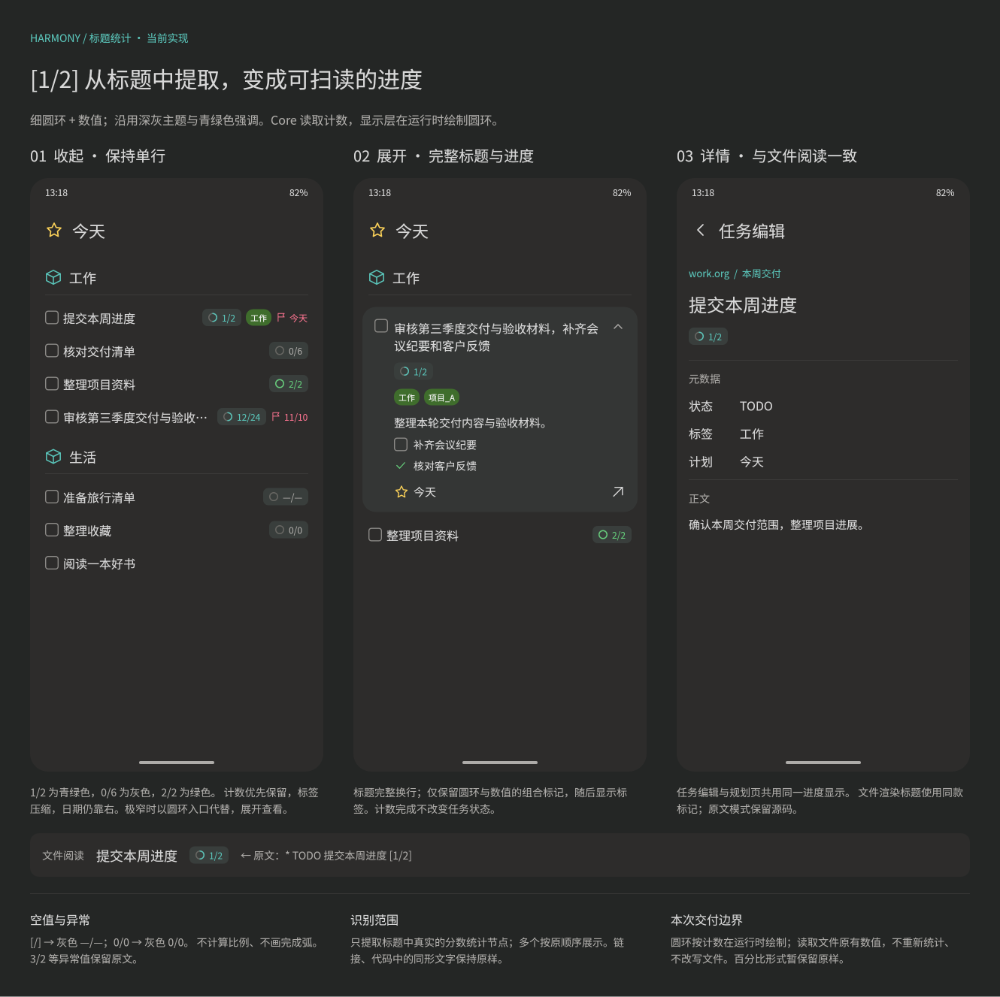

#+TITLE: 手机应用功能清单
#+DATE: 2026-10-18
#+STARTUP: showall

本文按“主体特性 → 功能细节”两层组织。勾选表示已实现，未勾选表示未实现；已有部分能力的功能拆成独立细节分别记录。每个主体特性的计数由 Org-mode 根据其下的 checkbox 更新。

未实现不代表已经纳入开发排期。配置与保存边界见 [[file:harmony/配置项设计.org][配置项设计]]。本清单只记录手机应用能力，修改用户可见功能时同步更新。

* AI 单任务字段生成 [0/3]

以下为设计阶段能力，尚未实现；后续设计统一维护于 [[file:AI接入设计.org][AI 接入设计]]。

- [ ] 针对一个已有任务发起 AI 重新生成，可补充要求，自动评估标题、备注、检查清单、标签、优先级、状态、计划时间和截止时间。
- [ ] 展示字段前后差异，支持调整、放弃部分建议和重新生成，确认后统一保存；任务已变化时拒绝覆盖。
- [ ] 配置模型连接与安全保存凭据，提供生成进度、取消和失败反馈。

* 应用标识 [2/2]

- [X] 桌面入口与启动窗口使用应用主色勾选卡片图标；背景铺满画布、核心图形等比放大约 14.3%，消除外部透明留白，桌面视觉尺寸待真机复核；另保留同规格层级卡片设计资产，详见 [[file:harmony/应用图标设计.org][应用图标设计]]。

- [X] 应用显示名统一为“小清单”，桌面名称、应用信息、分享面板与小艺意图展示文案一致；工程和应用身份保持原值。

* 项目任务展示 [2/2]

项目布局已接入，见 [[file:harmony/项目分类布局设计.org][项目分类布局设计]]。

- [X] 在任务已有分类来源文字后显示项目名，例如“工作 · HarmonyOS 适配”。项目文件名称优先读取文件头 ~#+PROJECT_NAME:~ ，缺失时读取顶部属性 drawer 或 ~#+PROPERTY:~ 提供的同名文件默认属性，再缺失时使用 ~TITLE~ ；显式空名称显示“未命名项目”。
- [X] 今天与随时的第一层使用 ~CategoryRegion~ ，保留 22vp 分类图标、18fp 标题与细分隔线；内嵌项目，以及收件箱最近新增、计划和日志簿的按日分类／项目区域，共用 ~TaskRegion~ 的原项目分组样式：12fp 辅助色标题、灰底、12vp 圆角和细描边，上间距 12vp。~TaskRegion~ 业务参数仅有 ~category: string | null~ 与 ~project: TaskRegionData | null~ ，任务经内容槽传入；项目值只影响标题，分组中的项目／分类标题及留白仅展示，不响应点击或跳转；背景、圆角与留白在控件内固定定义。TaskRegion 不显示图标，普通任务在今天分类下直接排列。

* 项目文档阅读 [6/6]

项目文档渲染优化已接入，真机视觉效果仍待验收；设计与预览见 [[file:harmony/项目页面设计.org][项目页面设计]] 与 [[file:harmony/项目文档式阅读改版.org][文档式阅读改版]]。

- [X] 从侧边栏项目名称、任务来源中的项目名或项目文件进入独立项目页，按文件顺序显示前言、普通标题、全部任务与子任务。
- [X] 项目名固定在标题栏，所属分类以小字号跟随；文件标签以标签胶囊显示，隐藏其他文件头配置、属性和文件信息。
- [X] 正文、文字、表格、checkbox、属性和日志连续显示；任务标题复用共享任务行，可展开标题、状态、优先级、规划、重复与标签操作，卡片内不重复备注、清单和日志。
- [X] 普通标题使用专门的章节控件；文件、章节、任务及标签窗口隐藏 Core 提供的特殊标签，保留原有标签数据。
- [X] 更多菜单支持“刷新项目”和只读完整原文，下拉可启动同步；失败保留当前快照，编辑保存失败不刷新。
- [X] 目录定位全部标题；切换原文保留文档位置与卡片状态，同版本刷新保留实例，新版本清除失效坐标；支持空项目、宽表和深层章节。

* 导航与工作区 [13/13]

- [X] 默认进入“今天”，展示当天、过期以及进入 Org-mode deadline 预警期的未完成任务；列表仍显示实际截止日期。今天页收起行和展开卡片右滑直接切换进行中状态：进行中切回待办，其他未完成任务切到进行中，使用文件有效配置中的目标状态；成功后保留展开状态并更新透明黄色底。保存草稿失败、状态已变化、缺少目标状态或快照失效时不提交，输入和清单触摸／拖动期间不触发；左滑不切换状态；随时、计划和收件箱最近新增右滑分配计划时间。
- [X] 抽屉顶部按参考图提供收件箱、今天、计划、随时、某天、备忘与日志簿，使用彩色图标、选中背景和真实计数。
- [X] 侧边栏顶部不提供搜索或关闭按钮；导航项整体滚动，文件浏览与管理合并为单一“存储库”入口，不提供新增入口，设置固定在底部；存储库与设置使用统一的彩色入口图标。
- [X] 在日志簿之后、存储库之前按文件 CATEGORY 分区显示项目，分类使用线框图标，项目使用左侧圆内扇形进度与名称，44vp 项目行连续排列，分类标题与首项留 4vp，分区间留白 32vp；项目列表与存储库之间有分隔线，空项目列表零占位。分类标题只展示，缺失或空 CATEGORY 归末尾“未分类”，同名项目按仓库与路径隔离。长项目名省略且保留完整辅助功能说明，未命名项目有占位名称；完成比例复用 Core 完整任务树状态计数，取消只计总数，空项目显示中性圆环。所有项目与存储库一起滚动，设置固定底部，点击项目直接进入全文阅读。设计见 [[file:harmony/项目页面设计.org][项目页面设计]]。
- [X] 页面工具栏不显示展开侧边栏按钮；仅一级页面的标题图标或文字可打开侧边栏，顶部空白不响应；带返回按钮的二级页面标题只展示，不打开侧边栏。
- [X] 侧边栏不显示分类过滤列表、分类计数或多选控件。
- [X] 收件箱入口位于今天上方，抽屉计数与列表包含配置文件中的全部标题，包括无 TODO、已完成和取消记录；复用共享 ~TaskListItem~ ，任务状态、标题、标签、日期、正文提示与展开卡片和任务界面一致，点击标题原地展开编辑，卡片外或系统返回收起；保存后刷新最新任务快照。底部中央“+”打开快速捕捉；文字输入期间隐藏，结束输入或收起卡片后恢复，卡片仍展开时点击会先保存并收起，保存失败保留草稿且不打开捕捉；抽屉、移动浮层和多选期间继续隐藏。保留下拉同步，刷新后列表采用最新快照。
- [X] 切换主入口时替换当前路由，避免返回栈持续累积。
- [X] 选择功能、点击空白处或外部遮罩、系统返回时收起侧边栏。
- [X] 存储库名称同行右侧提供显示与同步日志两个图标；点击日志图标进入对应仓库的独立同步日志页面。
- [X] 收件箱收起行和展开卡片均可左滑，按 enable 标志显示移动、分配、截止、将来、备忘、删除、多选，不收入“更多”；每项 48 × 44vp，使用图标与短文字、统一深灰连体圆角底，最右侧多选采用 Things 3 iPhone 风格的蓝底白色，删除使用错误色；展开时整卡平移、正文不重排，按钮垂直居中，收回菜单保持展开。右滑与其他任务页共用直接手势，在条目旁打开移动位置浮层，不露出工具栏、按钮或提示栏；左滑菜单独立配置，过宽时横向滚动。浮层默认向下、空间不足自动调整；通过共享 ~MoveToTarget~ 组件展示，普通文件的 CATEGORY 与项目文件的项目名作为平级 Tab，项目目标只归项目；同名项目与 CATEGORY 保留独立 Tab，项目带文件夹图标，未命名项目有占位名称。目标最多显示四行后滚动。单点目标仅选中并显示行尾“移动”，点击按钮后才移动到首个子节点；切换 Tab 清除选择，点击浮层外关闭。版本冲突后刷新重试会重新读取源和目标，源消失时关闭浮层，源版本变化时清除旧选择。浮层移除某天、备忘与删除按钮；这三项由左滑菜单接入既有 Core 操作，删除需确认。侧滑动作先等待原位编辑保存，再读取源任务最新快照；修改任务后移动、整理或删除不沿用旧文件版本，失败不继续提交。普通目标由 Core 排除收件箱和某天文件；某天入口设置 TODO 并移除根规划信息，备忘入口清除根状态、优先级与规划信息。见 [[file:harmony/UI导航设计.org::*收件箱目标托盘][交互设计]]。
- [X] 在现有收件箱列表后直接追加最近 3 天具有创建时间的任务与备忘，按创建日期分组，日期内按 CATEGORY 和项目组成同级区块，项目任务只归项目、其他任务按分类合并；区块按首条记录位置出现、内部保留原顺序，不跨日期合并，未命名项目与项目内完成记录也保留。日期标题参考计划界面；原列表所在未规划区域至少占可用列表高度的 3/4，即使任务很少或为空也保留；后接“最近新增”分隔栏和独立底色，两区域整体滚动，上方不增加“待规划”标题。追加记录排除当前收件箱文件，包含已完成记录并复用共享任务展示控件；TaskRegion 直接由原生列表承载，修复仅显示日期、分组任务空白的问题；任务行参考计划页面，标题前显示任务自身日期，分组后以 ~regionAreaPolicy=None~ 隐藏重复分类／项目区域，外层左右边距统一为 20vp，展开卡片沿用共享样式；已完成使用透明底方框内的白色勾号，保留透明底方框， ~Cancel~ 分类的已取消任务（默认 ~CNCL~ ）使用灰色标题和单条删除线，实际删除后不保留记录。左滑菜单的转换为备忘与删除操作使用图标按钮，保留无障碍名称和点击区域。最近三天按今天、昨天和前天的创建日期匹配，使用既有查询表达式；详情返回与操作后刷新，页面持续停留时每分钟更新日期窗口。见 [[file:harmony/UI导航设计.org::*收件箱最近三天][交互设计]]。

- [X] 页面任务、文件入口状态和通知在同一次读取中刷新；收件箱本页与最近新增、侧边栏全部计数使用同一数据快照，避免刷新中展示不同版本。原位编辑重读卡片也同批更新通知，添加标签后立即显示本地修改同步提示，无需收起卡片。

* 本地存储库 [8/12]

- [X] 修改和删除已有存储库配置，支持自定义名称，留空使用当前仓库名；配置页标题为“仓库”，移除保存按钮，修改后返回自动保存；应用内暂不提供新增存储库入口。
- [X] 配置应用可访问的 Org 文件绝对目录。
- [X] 递归读取本地子目录中的 ~.org~ 文件，排除根目录的 ~.sync~ 控制目录。
- [X] 校验本地目录，并由 core 初始化或读取仓库身份。
- [X] 通过仓库 ID 与相对路径隔离不同存储库的同名文件。
- [X] 在已保存存储库的配置页内提供删除入口，确认后移除配置与密码，保留本地和远端文件。
- [X] 存储库文件列表默认隐藏命中配置忽略规则的文件，通过该仓库名称右侧的显示图标独立切换完整文件清单，不影响其他仓库。
- [ ] 使用系统目录选择器浏览目录并保存访问授权。
- [ ] 配置是否扫描子目录。
- [ ] 配置忽略文件名与忽略规则。
- [ ] 检测或切换非 UTF-8 文件编码。

- [X] 仓库配置页提供“重置本地目录”，确认后清空全部本地内容与同步状态，保留仓库身份、配置、密码及远端文件。

* WebDAV 同步 [27/30]

- [X] 为每个存储库配置 WebDAV 启用状态、HTTPS 地址、用户名和密码。
- [X] 配置 WebDAV 同步过滤目录；默认过滤目录由 Rust 提供，当前包含 ~archive~ 。
- [X] 将真实密码保存到 Asset Store，Preferences 仅保存同名空值占位。
- [ ] 在应用内新增 WebDAV 存储库并创建本地文件目录；当前暂不提供新增入口。
- [X] 关闭 WebDAV 后继续使用本地目录浏览。
- [X] 列举远端当前目录，下载和条件写入 ~.org~ 文件。
- [X] 同步时下载根目录 ~.orgzlyignore~ 并立即应用；“随时”等任务列表、导航计数与文件入口选择排除命中文件。无效远端配置或本地独立修改明确报错并保留本地规则。
- [X] 在标题下方显示 2vp 细进度线；进度平滑变化，切换页面仍可见，成功或部分失败后刷新当前列表，隐藏页面恢复可见时重新检查数据变化，成功不提示。
- [X] 今天、收件箱、计划、随时、某天、备忘、日志簿、存储库页面均可下拉执行文件同步，复用统一控件；加载中、空列表和未配置文件状态也可下拉。任务卡片展开时仍可下拉，触发后先保存并收起，再执行同步；保存失败保留输入和错误，保存期间连续下拉不重复执行；保存完成后以 Wait 提交请求，已有同步时按顺序排队，立即释放入口状态，滚动、编辑和导航不等待同步完成；“本地有修改，点击同步”使用相同策略。侧边栏不提供执行同步入口；失败仅在当前可见页面显示一次 toast，说明读取或同步失败，不请求日历权限或写入日历。
- [X] 快速捕捉从收件箱“+”或外部入口离线保存标题到配置收件箱，并登记待上传意图。
- [X] 后续同步上传待处理文件，成功并保存同步历史后确认消费写入意图。
- [X] 执行失败时保留本地文件和待上传意图；任务内容竞争保留为 CONFLICT 候选并随完整结果上传，不阻止后续同步。
- [X] 递归同步 WebDAV 子目录，按过滤目录与远端版本条件处理。
- [X] 保存前独立测试 WebDAV 认证与目录访问，显示结果；不保存配置或执行文件同步。
- [ ] 导入或管理受信任证书及客户端证书。
- [ ] 配置额外 HTTP 认证参数。
- [X] 首次同步按空基线合并，单端文件创建或下载，两端内容按文件内节点合并；后续以 remote_base 的已确认实际远端状态判断本地变化。
- [X] 单仓库同步以可恢复事务统一提交工作文件、基线、冲突快照、历史和 outbox；执行失败或取消不推进本地状态，已成功远端请求由重试协调。远端整文件删除覆盖本地修改，远端修改覆盖本地整文件删除。
- [X] 同步日志记录本轮触发原因，区分应用启动、退到后台与手动同步；列表标题显示原因，展开后与完整时间一同展示。旧日志明确显示“未记录触发原因”，复用正在执行的会话时保持最初原因。
- [X] 同步日志页面标题栏显示“仓库名称 · 同步日志”，只读取对应仓库；独立日志项采用紧凑单行，标题呈现上传／下载数量或旧日志已有的具体错误，日期固定在最右侧；数据不全时使用合理的状态标题。行首图标区分执行成功、失败及取消／中断，方向图标区分无变化、下载、上传及双向传输。冲突不算执行失败，冲突采用弱提示，数量固定为当次历史结果；所有日志点击后原地展开，再次点击收起；展示完整时间、全部文件状态与已有错误，包含新增、删除、无变化、更新、合并、冲突及本地上传。移除独立详情页面；点击有备份文件只读打开当次内容，只有远端删除备份显示右箭头并提供阅读，其他历史文件不可点击。默认隐藏普通无变化记录，保留失败及待处理冲突，标题栏眼睛开关可显示全部；无历史与筛选空态分别提示，支持下拉重新读取，同一记录的方向或冲突状态变化立即更新。
- [X] 所有可触发同步的页面在同步区域上方、与同步区域平级的位置统一展示 Core 待关注事件，无通知时零占位，卡片放在列表内容中随正文滚动。全部通知共用圆角卡片，消息为 13vp 单句、32vp 行高、零行间距，文字与标题对齐，上方无分隔线；前后小图标与水平箭头紧跟文字，点击整行按仓库身份与文件路径进入冲突解决页；通知仅由 Rust 查询通知接口提供，依据当前文件的 CONFLICT 容器生成，每文件一条，不维护历史解决状态；Core 通知监控转发同步／解决结果的更新，正文与通知统一响应更新回调，触发同步不直接刷新。读取失败保留最近快照。
- [X] 远端删除文件在同步目录保留删除前备份，可从日志展开项只读查看；旧日志缺少备份时明确不可阅读。
- [X] 解决冲突页共享全文阅读与逐点预览，更多菜单确认后可一次丢弃全部冲突点；最后一点移除容器并清除文件标记，版本过期或失败不覆盖新内容。
- [X] 冲突容器及其后代不进入任何任务查询、分类计数和移动目标，普通编辑不能修改、删除、移动或向其中插入内容。
- [X] 本地任一仓库文件与基线 hash 不同，生成唯一“本地有修改，点击同步”提示；点击普通同步，重启后可重新发现，恢复基线或同步确认后消失。
- [X] 自动合并独立修改；同字段或结构竞争保留远端与本地候选，文件末尾统一保存带 CONFLICT 与 ARCHIVE 标签的容器，冲突点收纳为其直接子节点。

- [X] 存储库文件标题后显示醒目的“冲突”标签，采用 12vp 中等字重、红色文字、深红底色及细边框，长标题先省略以保留标签。仓库入口传配置仓库 ID，与通知入口统一进入逐点解决页；普通文件继续使用 Core 仓库 ID 打开阅读页。

- [X] 冲突解决页为包含全部差异卡片的连续滚动文档；卡片标明新增、修改或删除，操作按钮位于卡片内部，底部左右按钮和横向滑动只定位卡片；新增和修改显示完整候选，删除显示当前待删子树，修改前后差异后续设计。见 [[file:harmony/冲突解决界面设计.org][界面设计]]。
- [X] 全部冲突同时展示；无法定位的卡片放在最近仍匹配的父节点下，无父级或旧材料缺少祖先信息时放在文档根部。展示位置不作为提交目标；从卡片打开树形目标面板，选择后点击卡片操作提交。
- [X] 冲突材料与主树分离，由 Core 提供候选 HTML 和主树展示锚点；定位不改变快照，选择目标只计算投影；卡片操作单次点击提交，版本过期或失败不覆盖新内容。
- [X] 冲突解决页显示已应用后的剩余冲突，全部处理后保留最终阅读；预览编辑期间不改变搜索、任务列表、同步提示或通知。

* 笔记本浏览 [10/16]

- [X] 在单一“存储库”页面一个仓库一个分区，名称位于带青绿色线框图标的分组标题，下方采用与今天一致的通栏细线；文件项为 56vp 紧凑双行，TITLE 单行省略，无标题时回退相对路径。收件箱、某天、备忘用途标签紧跟文件标题，按已配置的仓库与路径共同匹配，支持多标签并列；点击仓库名打开对应配置。空仓库与读取失败保留仓库标题，在各自区内分别用辅助色和错误色提示；仓库名称右侧依次放置隐藏文件显示切换与历史时钟形同步日志图标，图形为 20vp、按钮为 40×48vp、紧邻排列，分别作用于对应仓库；按钮与名称点击独立，窄屏名称省略且保留按钮，不提供新增或搜索入口。
- [X] 每个文件提供有效 TODO 元信息，整篇阅读按文件或全局配置识别状态，自定义完成状态按完成类型着色。
- [X] 整篇阅读按真实标题层级呈现笔记，包括无 TODO 状态的标题和完整正文。
- [X] 展开或折叠单个子树；工具栏更多菜单与底部目录均可一次展开或折叠全部章节。目录按标题层级展示，标记当前章节，点击后展开父章节并跳转；重复标题分别定位，无章节时显示空提示。
- [X] 只读阅读采用 Obsidian 阅读视图式连续文档排版，显示仓库与相对路径、文件前言和全部正文；近白色多级标题、宽松行距，弱化状态、标签和日期。长清单完整换行，表格与代码块独立横向滚动，引用与 drawer 分层展示；原文模式无目录入口，嵌入任务正文保持卡片版式，冲突页复用全文预览。
- [X] 文件展示方式可在“设置 → 笔记与笔记本”中配置为渲染或原文，默认整篇渲染；文件页不显示切换/只读行，不重复文档标题，也不提供新增和编辑操作。
- [X] 打开空白 Org 文件。
- [X] 显示读取中、读取失败和无笔记本的状态，并提供重试或配置入口。
- [ ] 配置笔记本排序方式和列表详情字段。
- [ ] 配置默认折叠状态。
- [ ] 配置正文摘要、日期、继承标签的显示方式和正文行数。
- [ ] 单独折叠列表中每条笔记的正文摘要。
- [ ] 将文件前言作为独立笔记展示，并配置显示方式。
- [X] 文件列表显示有效 TODO 任务数、文件大小与本地最后修改时间，任务数汇总 Core 提供的状态计数，包含所有层级及完成、取消记录，不计无状态标题和冲突子树。
- [ ] 展示每个文件的同步、待上传状态。

- [X] 普通文件、历史备份与冲突解决复用完整文件预览控件；普通阅读支持原文／渲染、目录、折叠与空文件展示，冲突页固定渲染连续文档及全部操作卡片。

* 笔记详情与编辑 [25/30]

- [X] 今天、计划、随时、某天和收件箱复用原位编辑卡片；外部跳转保留独立任务编辑页；日志簿使用原位只读展开，继续提供完整正文、日志阅读及确认删除。
- [X] 备忘列表进入独立“备忘编辑”页；新增与编辑页均在工具栏下显示共享通知，返回页面时刷新且保留编辑草稿，保存与删除期间禁用通知跳转；标题与返回按钮同排，右侧提供紧凑删除图标，标题与正文可直接编辑，返回时保存并在删除前确认；无正文时明确提示，不展示来源、元数据或独立日志，字数总计固定在右下角。
- [X] 收件箱记录通过右滑打开的位置浮层移动为目标下的第一个子节点，或经确认删除；普通移动保留原有内容和创建时间。整理到配置的备忘文件时，移除根条目的任务状态、优先级及 ~SCHEDULED~ 、 ~DEADLINE~ 、 ~CLOSED~ 规划信息，保留正文、标签、创建时间和子条目。旧规划页面及路由已删除。
- [X] 任务与备忘内容各自提取共享组件，由独立编辑页消费。
- [X] 显示来源文件与父标题面包屑，点击来源打开所属笔记本。
- [X] 显示标题、TODO 状态、优先级、计划日期、截止日期和标签；优先级在循环／习惯图标之后、标题之前以字母色块展示，颜色由 Core 分类决定；展开后点击色块，或通过更多菜单、详情元数据行使用紧凑标签式单选，支持选择与清除，更多菜单移除“设为最重要”，优先级入口使用递减横线图标；色块与循环／习惯图标间距为 6vp，与标题间距为 4vp，收起、展开编辑与只读展开一致。候选取自文件或 SETUPFILE 配置，均未声明时默认提供 A/B/C；无显式值时不显示色块，按优先级排序使用文件默认值（无声明则为 B）；今天页同一分类内的普通任务、每个项目内部独立按有效优先级排序，同值保留源顺序，分类与项目区块位置稳定；见 [[file:harmony/任务优先级界面设计.org][优先级交互]]。任务行持续天数仅从有效且早于今天的计划日期计算，没有有效计划日期时隐藏；正文渲染 Org 富文本、表格、列表与代码块。
- [X] 显示自身与继承标签。
- [X] 分别展开或收起元数据和正文。
- [X] 展开任务卡片与任务详情按类型紧凑显示日志：状态变更、笔记、完成说明、计划／截止日期调整、移动和计时各有对应排版，保留附注富文本与自定义记录；摘要、附注和时间采用 12／13／11fp 辅助灰色，记录间隔 6vp，空日志不占空间。日志按原文顺序显示，任务卡片默认隐藏，通过“更多 → 日志”及睁眼／带斜线眼睛图标切换，重新展开任务恢复隐藏；日志与正文内容区域对齐，向右内缩 27vp。单条显示由共享组件统一维护，可编辑卡片与日志簿、任务详情共同复用。见 [[file:harmony/UI导航设计.org::*展开任务的结构化日志][日志设计]]。
- [X] 复制标题、字段值及正文渲染中的文本。
- [X] 修改已有任务和无 TODO 标题的标题与正文，支持清空正文；点击保存或返回提交，失败保留输入，文件版本冲突不自动覆盖。收件箱记录从目标托盘的编辑图标进入。
- [X] 从任务或备忘编辑页确认删除当前标题及完整子树。
- [X] 展开卡片标题默认显示链接描述等可读文字，点击普通标题进入原文编辑，保存成功恢复渲染，失败保留草稿；备注排除标题后的规划行，带重复窗口的计划日期不混入备注，修改或清空备注保留原规划信息。
- [X] 原位设置、修改、清除计划与截止日期；月历固定六行、支持跨年浏览、今天与明天快捷选择、已有日期高亮及右滑快速改期，两个日期互不覆盖，修改日期保留原时刻、重复器及预警。
- [X] 编辑重复任务：展开卡片底部“更多 → 重复…”或点击已有蓝色规则摘要，任务详情元数据也可进入。参照 Things 3 iPhone 的取消／保存、定期／完成后分段与分组字段，分别修改计划和截止的重复间隔、单位、下次日期及错过日期后的推进方式；支持停止当前规则并保留日期，取消不落盘，失败与版本冲突保留草稿。已有时刻的任务支持按小时重复；重复窗口、预警和其他字段由 Core 保留。见 [[file:harmony/UI导航设计.org::*重复任务编辑][交互与范围]] 。
- [X] 点击已有标签或底部图标打开标签窗口，外框尺寸保持不变，内部以换行胶囊展示已选标签与分组候选；候选直接来自当前任务的 Core 配置，同组只能选择一个，未分组标签可多选，其他文件标签不混入。支持立即添加／移除及新建并添加到任务；继承标签显示来源且不可在当前任务取消，不能同时选择其同组另一项；没有配置时仍可查看已有标签并新建，不提供下拉搜索。
- [X] 原位编辑的标题和备注按字段保护输入，外部变化更新其他字段；保存时只以卡片输入覆盖对应字段，保留其他外部修改。节点被删除时直接结束会话并移除卡片，不提交旧草稿；读取失败保留卡片。当前身份依赖标题路径，外部改名或移动使身份失效时同样结束原会话；移动后由数据变更事件关闭源卡片，保存前先发现源任务不存在时也自动关闭，不停留在“任务已删除”提示。
- [X] 添加和原位编辑独立 checkbox 清单条目，失焦保存、连续输入、勾选完成／恢复及左滑点按删除；保留条目位置，清空后保留添加入口，不改变任务自身完成状态。编辑清单文字期间文件版本变化时，保留原快照与输入并暂停提交，重新载入后继续，防止旧条目 ID 指向其他记录；本次清单文字成功保存后的快照可正常更新。
- [X] 检查清单右侧常显三横线手柄，长按上下拖动排序；仅调整同一列表内的同级顺序，移动父项携带嵌套内容，完成状态保持不变。拖动浮层与占位按实际行高计算，靠近边缘滚动；保存失败恢复顺序、版本变化不覆盖，无障碍激活手柄可选择上移／下移。见 [[file:harmony/检查清单排序交互方案.org][交互方案与三态界面]] 。
- [X] 清单完成状态切换及增删条目时，同步更新标题中已有的执行进度（如 ~[1/2]~ ）；由 Core 保存并广播数据更新事件，卡片与列表根据事件读取新进度，不在界面计算。
- [X] 标题、备注与清单文字失焦保存，其他操作完成立即修改；保存后先更新卡片快照、文件版本与清单条目 ID，再执行下一次修改，事件延迟时连续编辑也不沿用旧版本；写入已成功但重读失败时暂停后续写入，恢复读取后继续，不重复保存。编辑与阅读复用自然高度卡片，聚焦不改变内部布局；键盘出现由外层列表避让，结束输入保留展开态。切换任务前保存，版本冲突或失败保留输入，不自动覆盖。
- [X] 点击任务行前部 checkbox 完成待办任务或重新打开已完成、已取消任务，分别使用 Core 提供的第一个有效 ~Done~ 或 ~Todo~ 分类状态；重新打开清除自身 ~CLOSED~ ，保留历史日志、说明和已有日期，按进入／离开标记决定是否新增状态日志；状态变化日志按 Org 的 TODO 关键词标记、文件或 SETUP 设置及继承的 LOGGING 属性触发，无日志配置时不新增日志或关闭时间；单独配置日志抽屉不启用记录；提交期间防重复点击，失败或版本冲突保留内容并显示原因，成功刷新列表。
- [X] 完成任务时执行条目自身 ~TRIGGER~ 配置的文件内联动，支持状态、日期、标签、优先级与属性；不支持的动作静默跳过，失败整组回滚，成功后刷新任务与日期。 关联任务行即使未展开也由同次数据事件更新，共用一次任务与通知读取，保留当前文字草稿；列表重排仍等待会话结束，离开页面后的旧结果不回写。完整范围见 [[file:core/TRIGGER触发器设计.org][实现状态]] 。
- [X] 某天页面的收起任务行和展开卡片右滑移动，复用收件箱的位置浮层、目标分组与单点选中后确认；先保存草稿并读取最新源快照，提交时校验源与目标版本，失败保留浮层，取消不修改内容。
- [ ] 多选笔记并批量移动、删除、设置日期或标签。
- [X] 通过共享左滑菜单、选择行与批量操作栏按页面显式启用每项能力；单条 enable 与批量 enableBulk 两组标志独立且默认关闭，菜单共用图标和按钮样式；当前收件箱启用移动、分配计划日期、截止日期、将来、备忘、删除、多选及独立开关控制的合并，日志簿开放左滑删除和多选，点击多选或长按进入后，批量支持确认删除与恢复为待办；恢复按各文件有效流程取首个待办状态，一次提交全部所选任务，缺少目标状态或版本失效时不部分恢复，失败保留选择并提示，成功刷新并从日志簿移除；选择期间保留源版本，底部预留操作栏空间，恢复由独立的 ~enableBulkRestore~ 开关控制，其他任务页与最近新增关闭批量入口；备忘保留原有独立左滑删除控件。仅收件箱支持合并记录：左滑点击蓝色“多选”或长按进入选择并选中当前记录；普通态移除顶部“多选”按钮与空选择入口，清理旧独立选择展示；直接在原收件箱列表的原任务行上追加右侧蓝色序号圆圈和柔和选中底色，保留标题、状态、计数、标签、日期及内容提示，行高与列表位置保持一致；整行点按只切换选择，右上角“完成”退出。底部深色操作栏显示条数、首选记录标题与“完成”出口，菜单复用左滑的图上文下样式；通过 ~enableBulkMove~ 、 ~enableBulkSchedule~ 、 ~enableBulkDeadline~ 、 ~enableBulkSomeday~ 、 ~enableBulkMemo~ 、 ~enableBulkDelete~ 独立启用移动、分配、截止、将来、备忘及经确认删除，提交时再次检查开关；另有 ~enableMerge~ 控制的合并入口，至少选中两条才可执行；菜单过宽可横向滚动；全部所选记录按选择顺序转换为列表，标题为“合并: 第一条选择的记录标题”，子记录转为嵌套列表。点击合并后在原列表直接完成并展示结果，不增加主记录选择、预览、确认或新页面。删除与修改通过一组普通操作提交，携带源版本并防止重复执行；失败保留选择，版本变化不覆盖新内容。见 [[file:harmony/记录合并交互方案.org][交互与操作顺序说明]]。
- [ ] 通过左右滑动打开快捷菜单并定制菜单按钮。
- [ ] 反转点击与长按的作用。
- [ ] 配置始终显示的元数据字段集合。
- [X] 正文中的 Org drawer 可独立折叠；LOGBOOK 提取到独立“日志”区域，默认收起，正文不重复日志。
- [ ] 结构化展示时间、重复器及任务进度。
- [X] 标题中的分数计数以圆环和数值展示，覆盖任务列表、展开卡片、任务编辑与文件渲染标题；展开和详情只保留圆环与数值，不重复“已完成”说明。圆环按已有计数动态绘制，空计数与零总数保持中性，计数完成不改变 TODO 状态。见  。

* 文件入口与任务新增 [4/16]

应用内通过收件箱底部中央悬浮“+”进入“记一条”，原完整新增页面及路由已删除；快速捕捉只收集标题，交付情况见快速捕捉分组。备忘列表底部中央悬浮“+”进入基础编辑页，新建无 TODO 状态的标题与正文；下列完整任务表单能力按当前手机交付范围标记为未提供。

- [X] 在配置的备忘文件中新增无 TODO 状态的标题与正文，自动记录不可修改的创建时间，离线保存并登记待上传意图；未配置或文件失效时提示重新选择。空白新建页返回不写入，保存期间阻止重复提交，失败保留输入。
- [ ] 选择任务写入的目标存储库。
- [X] 通过应用内仓库分区列表选择收件箱、某天与备忘文件，使用 Core 文件清单并过滤 ~is_ignore~ 文件；显示已选状态、支持清除，仓库或文件失效时提示重新选择，不回退到其他目标。
- [ ] 填写任务标题、标签及 A/B/C 优先级。
- [ ] 使用系统日期选择器填写计划日期与截止日期。
- [ ] 清除已选择的日期和优先级。
- [ ] 使用目标文件有效初始状态追加任务，保留原有文件字节；无未完成状态时拒绝保存。
- [ ] 校验日期、标签、优先级及目标路径。
- [ ] 保存期间及成功后阻止重复提交，并显示保存结果。
- [X] 返回任务列表或笔记本以及完成下拉同步后加载最新数据。
- [ ] 配置默认状态、默认优先级和最低优先级。
- [ ] 配置新建任务时自动计划到今天。
- [ ] 配置前插、子节点或其他插入位置。
- [ ] 为新增笔记自动生成 Org ID 或创建时间属性。
- [ ] 填写具体时刻、时间范围和重复器。
- [X] “设置 → 笔记与笔记本 → 任务状态分类”支持为五类状态添加其他值及移除附加值，默认值只读；重复归属或非法值显示错误并保留输入。附加值以 ~CoreSettings~ 对象单独保存，全部前后台请求共用；文件与 SETUPFILE 可追加分类配置。
- [X] 外部设置保存全局默认 TODO 流程，默认值从 Rust 获取；支持文件 TODO/SEQ_TODO/TYP_TODO 覆盖、多套流程和空声明清空。

手机不再提供独立搜索页面和已保存查询入口；任务读取由固定任务视图完成。

* 任务视图 [13/14]

独立日程页没有导航入口，旧页面与路由已删除；以下能力由今天、计划、随时、某天、备忘和日志簿提供。

- [X] 展示具有计划或截止日期的未完成笔记。
- [X] 今天同时包含当天与过期任务，红色徽标展示过期数，灰色数字显示总数。
- [X] 今天、计划、随时和某天使用共享任务列表项；有 TODO 状态显示完成状态框，无状态记录显示减少内部留白的独立笔记图标，与完成状态框保持 18vp 占位及相近视觉尺寸；今天与随时按文件 CATEGORY 合并分类区块，缺少分类时单列“未分类”，支持原位展开编辑并取消页面数量条。计划实际复用同一组件，点击标题原位展开，编辑内容、标签、日期入口与今天一致。
- [X] 共享任务项收起时保留紧凑标题、标签、正文／列表提示、重复标记与行尾截止摘要；展开按 Things 参考布局排列完整标题、备注、清单和标签，底部保留计划、标签、清单、截止入口，并在末尾提供“更多 → 优先级…／重复…”，有日志时追加固定文字“日志”及睁眼／带斜线眼睛图标，来源在卡片外右侧。无收起按钮，卡片外或系统返回收起；长标题、长标签换行，日期为今天使用黄色星形，未设日期保留图标。正文无内容时显示可编辑的备注提示；键盘展开时由外层列表滚动避让，卡片内排版保持不变，收件箱快速录入“+”在卡片编辑期间隐藏。继承标签和原日志仍由 Core 保留，列表不解析 Org。详见 [[file:harmony/UI导航设计.org::*任务列表共享布局][共享卡片交互]] 。
- [X] 计划排除全部习惯任务，页面与侧边栏计数共用 Core 查询；展示明天起的后续任务，保留普通循环任务，与今天按最早计划/截止日期互斥；明天起连续 7 天按日显示并保留空日期，本月剩余日期按区间显示，未来 180 天按月显示并保留空月份，更远日期按年份显示；折叠时通过创建／计划／截止／完成／不显示五种策略控制前部日期，分类／项目由 ~regionAreaPolicy~ 策略控制；计划按日分组隐藏日期，仅按日区域采用分类／项目平级分组，其他区域逐条显示来源，并选用较早的计划／截止日期，收件箱最近新增显示创建日期；字段缺失或无效时隐藏，不借用其他日期；重复任务根据 Core 按 Org-mode ~+Nunit~ 、 ~++Nunit~ 、 ~.+Nunit~ 及可选 ~/N~ 或 ~/Nunit~ 解析的计划／截止重复器，在标题前显示仅保留箭头的蓝色循环图标，去掉圆底与时钟；当前标题自身具有 ~STYLE=habit~ 属性的习惯任务改用绿色幼苗图标，优先于循环标志且不同时显示；“阅读RSS和资料”等带重复窗口的习惯仍正确识别，未设重复器也可识别，普通任务不占位。
- [X] 今天、随时、某天和备忘使用统一标签筛选条：默认“全部”，标签横向滚动，普通模式多选并集匹配，备忘按 TAGS 配置组内单选、组间交集，不提供级联，再次点击可取消；“…”提供“无标签”，选中后显示可取消胶囊。候选从本页全部任务的有效标签取得，过滤仅发生在展示层，保留源快照和全局计数；今天自动隐藏筛选后为空的分类。无匹配时仍可恢复全部，详情返回与同步刷新保留有效选择。
- [X] 计划页支持按分类（region，即 CATEGORY）或项目（project）筛选，整个筛选条互斥单选，切换任一项替换原条件，再点当前项或“全部”取消；候选横向滚动并始终保留完整计划范围，分类包括其项目任务，项目按仓库与文件定位，同名来源独立。筛选交给 Core，在同批查询内取得候选范围、选中结果和通知，不改变侧边栏计数；刷新保留有效选择，失效后恢复全部，快速切换忽略迟到结果。计划页的项目候选、按日区块标题及月年等区域的项目来源只显示项目名，不附带分类；未命名项目显示占位名，保留项目文档入口。见 [[file:harmony/UI导航设计.org::*计划页分类与项目筛选][计划筛选交互]]。
- [X] 今天、随时、某天和备忘顶部的“无标签”、任务“重复…”、文件阅读及冲突处理工具栏统一使用公共弹出菜单；直接测量实际文字节点，计入内边距、图标／选中标记和边框，短文字完整单行。文字左对齐、勾选靠右；没有选中项时不保留空勾选列，选中后按可见标记扩展宽度；字号缩放后重新布局，超长文字到达窗口上限后换行且保留图标和勾选。整行可点击，关闭后焦点返回各自入口。
- [X] 随时仅展示有效待办状态且没有计划日期、没有截止日期的任务，不包含普通标题与已完成任务；与今天复用 CATEGORY 分区布局，同名分类合并，无分类单列；筛选由 Core 查询执行。
- [X] 计划页按日区域、日志簿按日区域与收件箱最近新增每日区块共用分类／项目平级分组；同名分类与项目、同名不同文件项目保持独立，组内不重复显示来源。任务区域与今天内嵌项目使用同一个 ~TaskRegion~ ，小标题、灰底、圆角与留白一致；只提供可空的 ~category~ 与 ~project~ 两个业务参数，分类与项目分组标题（含标题留白）只展示名称，不绑定点击与跳转；日志簿与最近新增的平铺项目标题显示“分类 · 项目名”，计划页与今天分类内项目只显示项目名。日志簿保留逐任务侧滑、多选和只读展开。通用任务项支持 ~regionAreaPolicy~ 的 ~None~ 、 ~Category~ 、 ~Project~ 和 ~CategoryProject~ 四种策略，同时控制折叠和展开区域；见 [[file:harmony/UI导航设计.org::*来源区域策略与平级分组复用][共享分组设计]]。
- [X] 日志簿由 Core 以 ~i.done~ 仅查询 ~Done~ 分类任务，每个任务只按完成时间显示一次，去除创建事件和“创建／完成”提示行。近期按日、更早按月／年分组；月、年区域不合并分类或项目，逐条按完成日期和时刻倒序，显示自身日期与来源；按日区域中分类与项目平级分组，项目任务只归项目、普通任务按分类合并，分组任务以 ~regionAreaPolicy=None~ 隐藏重复来源。缺失完成时间放入“时间未记录”，不借用创建时间。任务直接复用通用 ~TaskListItem~ 原位只读展开，保留正文、清单、标签、日期与默认隐藏的共享日志阅读，通过底部“更多 → 日志”及睁眼／带斜线眼睛图标切换，日志与正文内容区域对齐；显隐复用单条阅读组件，避免重复加载闪烁；状态框可恢复待办，左滑删除与多选批量删除继续经确认、Core 版本校验和刷新；页面无总数行，下拉同步保持可用。
- [X] 某天通过 Core 任务查询展示所选仓库配置文件中具有有效待办状态的任务，不包含普通标题与已完成任务，侧边栏计数复用相同条件；某天下方的备忘入口按配置文件展示全部标题记录，未配置时提示设置；日志簿只展示完成任务的完成时间线。
- [X] 备忘使用固定两行卡片，不支持展开或图片缩略图；头部不显示总数。标题下接入共享标签筛选条，候选合并条目有效标签与 Core 提供的文件头标签配置，保留未使用候选；支持 ~#+TAGS: { iOS(i) Android(a) }~ 互斥组，每组单选、组间交集，未分组标签按并集匹配；快捷键不作为标签名称，未分配候选不补赋给任务，支持“全部”和“无标签”，刷新保留有效选择。通知区域与首条备忘保留 12vp 间距，仅由备忘页面处理。第一行显示标题，第二行按修改日期（缺失时用创建日期）、标签与 Core 提供的首行正文排列，忽略正文头部空行，溢出截断；点击卡片直接编辑，左滑只提供经确认的删除，成功刷新、失败保留。任务修改时间由 Core 读取条目自身 ~LAST_MODIFIED~ 属性，缺失时为空；按修改时间倒序排序，缺失值置末；底部中央悬浮“+”新增备忘，抽屉展开时隐藏，列表末尾保留滚动留白。
- [X] 显示标题、状态、优先级、来源文件及日期。
- [ ] 按重复器展开后续发生日期。

* 系统日历同步 [0/12]

定时同步作业及其日历写入入口已移除，当前手机没有日历同步入口；已有系统日历事件保留。以下为待重新接入的功能。

- [ ] 配置目标日历名称，并创建或选择应用日历。
- [ ] 提供日历同步触发方式；文件同步与日历写入分别控制。
- [ ] 手动同步时请求日历读写权限。
- [ ] 将具有计划或截止日期的笔记写入系统日历。
- [ ] 增量创建、更新或跳过未变化的事件。
- [ ] 源笔记消失时删除已关联的日历事件。
- [ ] 展示笔记数量、目标日历和新增、更新、删除及错误统计。
- [ ] 本地读取失败或后台仓库同步失败时不启动日历删除同步。
- [ ] 独立启用或停用日历同步。
- [ ] 配置日历颜色。
- [ ] 配置日历提醒开关、提醒时间和提醒规则。
- [ ] 保留源任务具体时刻与时间范围后写入日历。

* 自动同步 [4/8]

- [X] 主界面首次加载成功且处于前台后自动同步一次，使用 Reuse 复用已有会话；不等待网络完成、不申请后台任务或发布同步通知，恢复前台及路由切换不重复触发。
- [X] 主界面退到后台时，查询 Core 判定的 WebDAV 仓库本地变化；有变化自动执行一轮文件同步，无变化或只有本地仓库时跳过。退后台使用 Reject 拒绝重复启动，快速反复切换不重复执行，已有会话继续受到后台保护；失败保留修改，下次退后台重新检查。
- [X] 退后台文件同步申请数据传输后台任务，系统实况窗胶囊展示同步状态和百分比，展开显示当前文件进度；结束后释放后台任务。更新节流且串行，通知更新失败不影响文件同步；仅使用已有通知授权，不在后台请求权限。系统胶囊实际外观与设备权限行为待真机验收。
- [X] 移除定时同步作业、后台扩展、同步间隔配置与保存校验；升级启动时取消旧版持久化同步作业，清理失败时下次启动重试。
- [ ] 启用或停用退出自动同步。
- [ ] 新建、修改或删除笔记后立即自动同步。
- [ ] 每次从后台恢复前台时自动同步。
- [ ] 监听存储库变化并自动同步。

* 外观与内容呈现 [5/13]

- [X] 统一深灰界面、工具栏、图标与列表样式；移除手动刷新按钮，列表改为下拉刷新；收件箱与备忘底部中央提供强调色圆形“+”，分别快速录入任务与新增备忘，抽屉打开时隐藏，列表留出底部空间。
- [X] 按 Core 的 ~TaskStateCategory~ 展示待办、进行中、等待、已完成与已取消：空框、空方框与整行透明黄色底、框内暂停线、透明底方框内白勾，以及方框和标题的中划线；分类由全局与文件配置共同决定，详情显示分类名称与实际状态值。
- [X] 任务状态通过单色图形区分，笔记图标保留原色；全 App 采用侧边栏的深灰配色，系统栏、弹窗、输入框与按钮文字同步适配。
- [X] 使用中文界面文案。
- [ ] 跟随系统主题或手动切换浅色、深色、纯黑主题。
- [ ] 使用动态配色或自定义主题颜色。
- [ ] 配置应用字号、正文等宽字体与列表密度。
- [X] 文件阅读页渲染 Org 富文本，标题和 drawer 可折叠，表格及代码块可横向滚动。属性 drawer 展示解析后的属性名与追加合并值，普通 drawer 内部渲染格式、链接及列表；不把 drawer 内容计入卡片备注和正文提示。文件元数据按属性提供，渲染正文不显示配置关键字声明（含项目名、未知关键字、表格公式与 Babel 调用）；源码、示例与普通段落中的字面文本保留，原文模式仍展示完整源码；多行文件标题按空格合并。
- [ ] 配置标记显示与编辑高亮。
- [ ] 显示内嵌图片，并配置缩放及宽度。
- [X] 解析并显示文件标题、任务标题及正文中的 Org 外部链接，点击网页、邮件、电话与地址链接交给系统应用；坐标地址使用 ~geo:~ URI，文字地址使用 ~addr:~ URI（例如 ~[[addr:北京市朝阳区][北京市朝阳区]]~ ）并在点击时转换为地图搜索；底部地图选择菜单显示当前搜索或坐标摘要；地址搜索时高德地图图标和名称置灰并提示“不支持地址搜索”，点击只提示原因且不关闭菜单，花瓣地图仍可选择；坐标链接中两款地图均可选择；点击已支持的标题链接不触发行导航或折叠；已支持链接用强调色实线下划线，未支持链接用辅助文字色虚线下划线。
- [ ] 解析文件、Org ID 和自定义链接，并配置相对、绝对链接根目录。
- [ ] 配置强制英文界面。
- [ ] 配置保持屏幕常亮。

* 提醒、通知与桌面卡片 [4/12]

- [X] 桌面应用图标显示设备提示计数，按收件箱记录数、收件箱之外截止日期为当天及以前的未完成任务数、冲突文件数相加；截止查询按 Core 仓库 ID 与相对路径排除收件箱，避免重复计数，其他仓库的同名文件保留。提前预警任务与同步提示不计入，三项来自同一次 Core 批量查询。前台启动、数据变更、配置保存及跨日刷新，快速捕捉／分享创建和后台同步后单次刷新；总数为零清除角标，失败保留原数字。主界面首次显示后检查通知授权，未请求时自动请求一次，拒绝后不重复弹窗；设置 → 应用程序提供“通知与角标”状态及系统设置入口，技术失败可重试，快速捕捉、分享与后台不请求授权。后台执行时间受系统调度控制；需允许小清单通知并开启桌面角标，关闭通知时即使计数写入成功也不会显示。已在真机验证数字角标显示。
- [ ] 为计划、截止及事件时间提供应用自身的提醒。
- [ ] 配置每日提醒时间、闹钟标签和闹钟行为。
- [ ] 稍后提醒，并配置推迟时间和类型。
- [ ] 配置通知声音、振动及其他系统支持的通知行为。
- [ ] 显示常驻通知和通知栏快捷新增、同步入口。
- [ ] 显示同步失败通知。
- [X] 提供 Harmony 桌面捕捉卡片，包含文字与语音入口；具体范围见下方“快速捕捉”分组。
- [X] 提供 Harmony 桌面备忘录卡片，使用 ~2*4~ 服务卡片展示配置备忘文件中最近三条标题；应用主色深色标题栏占高度四分之一，列表使用应用主色竖线与深色分隔线，异步数据到达及内容变化后正常重绘。点击标题栏进入备忘列表，“+”进入新增备忘页，具体条目按 Core 记录身份打开对应编辑页；打开时读取最新快照，目标失效时提示，编辑返回列表且不重复打开；创建、转正式卡片、重新可见及系统刷新时读取最新本地内容，区分加载中、空文件、未配置、目标失效与读取失败。
- [X] 长按桌面备忘卡片可从系统菜单进入“编辑”，预览并单选“全部备忘”或一个标签；点击“确定”仅保存和更新当前卡片，返回取消未确认修改。每张卡片独立保存选择，筛选与修改时间排序由 Core 查询完成；缺失身份、文件失效或保存失败时显示原因，移除卡片清理其设置。
- [ ] 配置卡片主题、透明度、字号、来源和更新频率。
- [ ] 在卡片中完成笔记或调用捕获模板。

* 捕获、分享与其他同步方式 [1/8]

- [ ] 定义捕获模板并展开生成笔记。
- [X] 接收系统分享的文字和链接，整理为唯一标题并确认保存到收件箱。
- [ ] 从地图应用分享地点后进入独立分享捕捉界面，不复用快速捕捉；在其中选择创建任务或更新已有任务地址，地址解析失败时可保存原始链接；交互设计见 [[file:harmony/UI导航设计.org::*独立分享捕捉界面（设计提案）][独立分享捕捉界面设计提案]]。
- [ ] 配置默认分享笔记本和共享文字插入位置。
- [ ] 将共享链接转换为 Org 链接。
- [ ] 配置并同步 Git 存储库。
- [ ] 生成、配置或查看 SSH 密钥。
- [ ] 配置 Dropbox 授权并同步存储库。

* 设置、维护与数据可靠性 [5/14]

- [X] 将全局文件展示、TODO 默认流程与状态分类设置和单个存储库表单分开；设置页不提供同步间隔或后台调度。
- [X] 设置保存前重新读取其他配置，避免覆盖其他页面的更新。
- [X] 提供应用说明页面；设置首页各入口只显示图标、名称和箭头，不显示描述；设置字段修改后自动保存，不提供保存或子页面工具栏返回按钮；未配置提示中的“前往设置”导航继续保留。
- [ ] 导入或导出应用设置。
- [ ] 导入参考应用的示例笔记本。
- [ ] 提供应用内日志浏览、日志开关、构建版本和更新记录。
- [ ] 提供清空本地数据库的维护入口。
- [ ] 配置新增内容的空行、标签列及缩进格式。
- [X] 完成任务时，如有未完成子任务（含更深层后代）则拒绝；子任务全部完成后允许完成父任务。恢复子任务时同步恢复已完成的父任务及祖先，保留已有历史，按配置清理关闭时间并记录状态日志；失败时整体不写入。
- [X] 完成重复任务后按重复器推进原日期并恢复待办状态；按有效日志配置维护 ~LOGBOOK~ 和 ~LAST_REPEAT~ ，无配置时保留旧日志且不新增记录。
- [ ] 统一宿主配置 ID 与 core 的 ~.sync/id~ ，并处理已有凭据绑定。
- [ ] 将 ~lastSyncTime~ 与 ~calendar_sync_state~ 从配置 Preferences 隔离到独立状态存储。
- [ ] 仅在需要时读写对应仓库凭据，并提供凭据写入失败恢复。
- [ ] 在全应用范围协调活动同步与配置修改、删除。

* 快速捕捉 [12/15]

入口与交互见 [[file:harmony/UI导航设计.org::*快速捕捉][快速捕捉设计]] ，收件箱与草稿持久化见 [[file:harmony/配置项设计.org::*快速捕捉与草稿][快速捕捉与草稿]] 。小艺语音仍报告应用无法操作，尚未通过实际分发验收；须按官方接入流程确认能力申请、测试账号权限和“已切换至真机模式”状态。负一屏展示及真实口述转写仍待端到端验证。地址和时间实体识别已完成宿主接入，兼容直接时间对象和数组包装；已在中国大陆真机验证“明天晚上和老婆宝吃完饭”能提取明天日期并写入计划，模糊时段不补具体钟点。华为官方声明该能力不支持模拟器，其余识别场景仍待真机验收。

- [X] 从收件箱底部中央“+”在当前页面打开录入面板，自动聚焦标题，键盘展开时输入框与保存按钮保持可见；或从外部平台入口进入快速捕捉窗口，使用一个输入框保存到文件入口选择的收件箱；保存时尝试用华为 Natural Language Kit 提取地址和时间，完整输入保留为标题，地址写入正文链接，首个有效日期时间设为 ~SCHEDULED~ ，模糊时段只保留日期；未识别到、服务异常或设备不支持时仍保存标题，不增加表单字段；保存时自动在新任务属性中记录本地创建时间，使用精确到分钟的 ~CREATED~ 非活动时间戳，草稿不生成时间，已有记录不回填；收件箱保存后自动刷新并显示新记录，取消时保留当前标题。
- [X] 直接复用所选收件箱的仓库与文件，不提供独立捕捉目标；目标缺失、删除或被忽略时拒绝保存并提示重新选择。
- [X] 只提供 ~1*2~ 最小服务卡片，仅显示“记一条”“说一句”，并用于上滑图标展开；沿用原有背景色与双胶囊按钮布局，仅统一根容器的系统圆角裁切并移除独立描边，修正负一屏卡片边缘。
- [ ] 在实际负一屏宿主固定并验证同一捕捉卡片。
- [X] 注册长按应用图标的文字与语音捕捉快捷操作；“记一条”使用纸笔图标，“说一句”使用麦克风图标，均为透明底单色圆角线条，提供浅色与深色菜单资源。
- [X] 接入语音转标题，支持完成、取消、授权失败与服务不可用时继续打字。
- [X] 接收系统分享的文字或链接，确认后保存唯一标题。
- [X] 注册小艺前台捕捉意图，只传标题并打开确认界面。
- [ ] 完成小艺语音调试权限与真机模式接入，验证系统实际分发捕捉意图并完成录入；本地意图调试成功不替代此验收。
- [X] 外部标题参数与应用链接进入统一捕捉确认界面。
- [X] 保留未保存草稿并自动恢复最近内容；新请求不覆盖旧标题；保存期间防止重复提交。

- [X] 文字与语音共用底部轻量面板，只显示标题和保存；面板从底部滑入并在关闭时滑出，点击面板外恢复来源状态。
- [ ] 面板外透显来源界面，并仅使用底部弹出转场；2026-11-06 模拟器仍显示系统模糊壁纸，并叠加整窗缩放动画。
- [X] 首屏与输入不等待 Core；页面显示后后台初始化，点击保存时等待初始化完成。
- [X] 语音入口自动录音；保存时等待最后的转写结果再提交，不提供录入方式切换。
