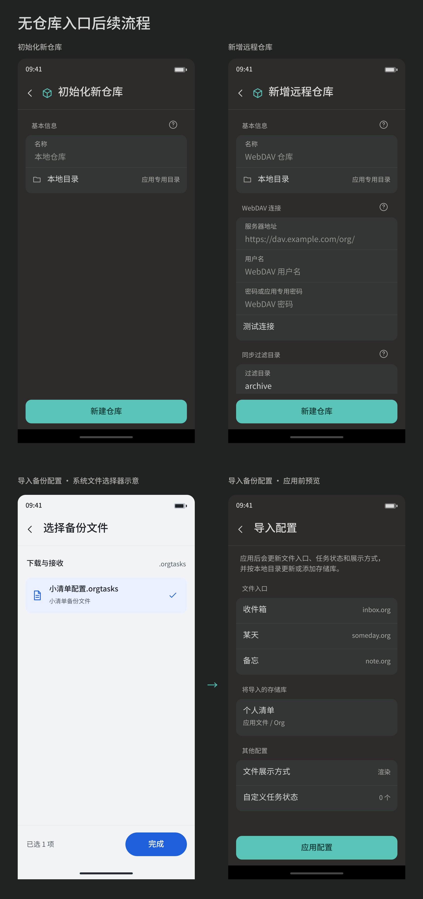
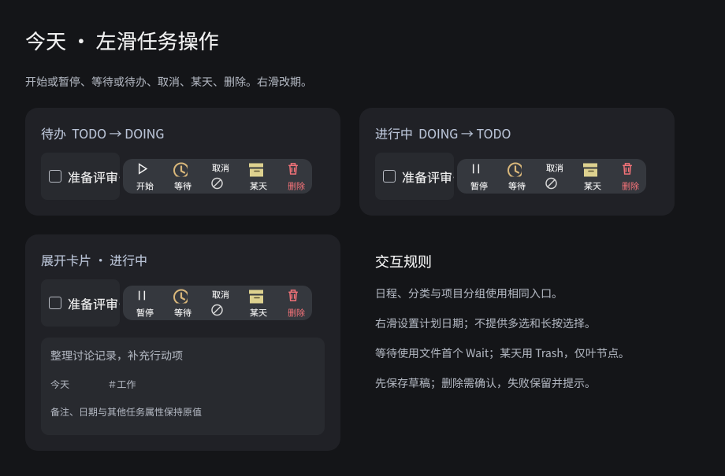
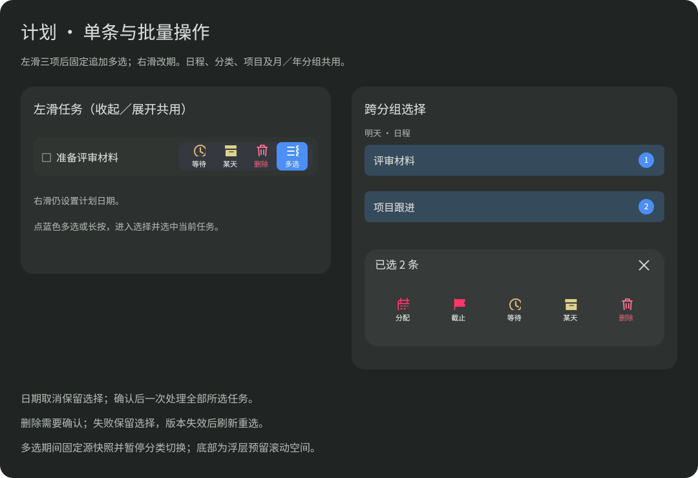
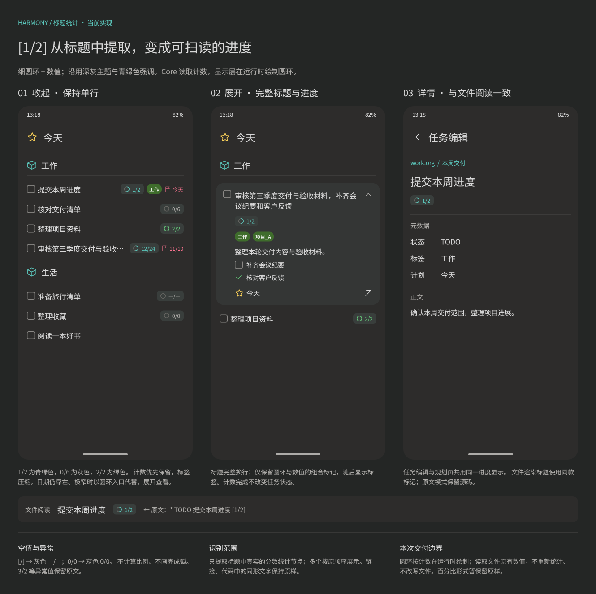

#+TITLE: 手机应用功能设计
#+STARTUP: show2levels
#+LANGUAGE: zh-CN

本文维护手机端的当前功能契约及尚未实现的设计扩展。普通条目描述当前能力；标注“设计扩展，尚未实现”的条目保留需求边界，不代表已交付或已排期。界面布局和交互以 [[file:harmony/UI导航设计.org][UI 导航设计]] 及对应专项设计为准，配置与保存边界见 [[file:harmony/配置项设计.org][配置项设计]]。

* 页面导航与统一返回

- 统一页面路径保存当前页面、参数与层级，支持深层跳转与逐层返回。
- 侧边栏入口（含项目）均重设为一级页面，清除旧路径；项目从任务来源和笔记本打开时保留父页面。
- 今天与收件箱互相返回；其他一级页面在收件箱有记录时返回收件箱，否则返回今天；数量变化自动跟随数据订阅。
- 系统返回与页面返回按钮共用导航规则，优先处理抽屉、面板、选择与编辑保存，保存失败保留草稿。

* 废纸篓与系统仓库

- 启动创建应用私有系统仓库和随包废纸篓文件；笔记本可见，仓库管理与普通文件目标选择隐藏，设置不显示该库。
- 原任务和备忘删除改为移入废纸篓，备份字段统一为 ~SOURCE_~ 前缀，暂存并恢复 ID，复制缺失的祖先标签且在恢复时清除复制项；保留原文、状态、创建时间及来源；仅允许叶节点，有子记录时错误返回，整组保持不变。
- 今天、计划、随时、日志簿、最近新增、角标和地址选择排除系统废纸篓。
- 侧边栏和笔记本提供废纸篓页面，按删除时间倒序分组，来源仅展示原分类与项目，以中点分隔，不显示文件名或路径，复用 DataSet 缓存、版本和外部更新。
- 废纸篓右滑无动作，左滑归位、永久清除、多选，支持单次批量归位和清除；清除需确认，取消不提交。
- 原位恢复成功移走废纸篓记录；原仓库、文件或父节点不可用时保留并提示，前一兄弟缺失时插入父节点第一个位置；不隐式创建文件或父节点。
- 设置保留天数，默认 30 天，可保存 1 至 3650 天；打开废纸篓或笔记本时按删除时间清理过期记录，时间缺失者保留。

* AI 单任务字段生成

以下为设计阶段能力，尚未实现；后续设计统一维护于 [[file:AI接入设计.org][AI 接入设计]]。

- （设计扩展，尚未实现）针对一个已有任务发起 AI 重新生成，可补充要求，自动评估标题、备注、检查清单、标签、优先级、状态、计划时间和截止时间。
- （设计扩展，尚未实现）展示字段前后差异，支持调整、放弃部分建议和重新生成，确认后统一保存；任务已变化时拒绝覆盖。
- （设计扩展，尚未实现）配置模型连接与安全保存凭据，提供生成进度、取消和失败反馈。

* 应用标识

- 桌面入口与启动窗口使用应用主色勾选卡片图标；背景铺满画布、核心图形等比放大约 14.3%，消除外部透明留白，桌面视觉尺寸待真机复核；另保留同规格层级卡片设计资产，详见 [[file:harmony/应用图标设计.org][应用图标设计]]。

- 应用显示名统一为“小清单”，桌面名称、应用信息、分享面板与小艺意图展示文案一致；工程和应用身份保持原值。

* 项目任务展示

项目布局已接入，见 [[file:harmony/项目分类布局设计.org][项目分类布局设计]]。

- 在任务已有分类来源文字后显示项目名，例如“工作 · HarmonyOS 适配”。项目文件名称优先读取文件头 ~#+PROJECT_NAME:~ ，缺失时读取顶部属性 drawer 或 ~#+PROPERTY:~ 提供的同名文件默认属性，再缺失时使用 ~TITLE~ ；显式空名称显示“未命名项目”。
- 今天与随时的第一层使用 ~CategoryRegion~ ，保留 22vp 分类图标、18fp 标题与细分隔线；内嵌项目，以及收件箱最近新增、计划和日志簿的按日分类／项目区域，共用 ~TaskRegion~ 的原项目分组样式：12fp 辅助色标题、灰底、12vp 圆角和细描边，上间距 12vp。 ~TaskRegion~ 业务参数仅有 ~category: string | null~ 与 ~project: TaskRegionData | null~ ，任务经内容槽传入；项目值只影响标题，分组中的项目／分类标题及留白仅展示，不响应点击或跳转；背景、圆角与留白在控件内固定定义。TaskRegion 不显示图标，普通任务在今天分类下直接排列。

* 项目文档阅读

- 从侧边栏项目名称、任务来源中的项目名或项目文件进入独立项目页，按文件顺序显示前言、普通标题、全部任务与子任务。
- 点击展开任务卡片底部的项目名，打开项目并将该任务滚入屏幕。目标任务闪亮一次。
- 标题栏以同字号单行显示“Region . Project”，缺少分类时仅显示项目名；文件头配置与正文共用滚动，首次打开默认跳过配置区并从导言开始阅读，向上滑动可回看文件头信息；按源顺序以 16fp 双列属性行显示，名称列固定 96vp、列间距 12vp、长名称列内换行，值起点一致；整个属性区长按进入原位编辑，可编辑字段原地输入并统一保存／取消，未知 PROPERTY 只读；TAGS 与 FILETAGS 使用行末 ~+~ 原位新增并聚焦输入，回车或失焦确认；标签在原有边距内显示删除标记，文件原有 project、todo 保留不可删除；CATEGORY 编辑候选排除配置的收件箱、某天、备忘及系统废纸篓文件，仍被普通文件使用的同名分类保留；CATEGORY 可点击筛选，TAGS 以 ~tag: A B C~ 形式显示并支持点击增减，按钮按文字自然宽度排列，未选中为普通文字色、透明底且无描边，选中高亮，多个标签按并集匹配，不提供清除筛选按钮；任务正文隐藏 ~todo~ 与内部用途标签，文件头 FILETAGS 阅读态只读，编辑态保留 project、todo，保留文件数据。布局参考 Bear 的正文留白与 Obsidian 的紧凑任务清单：章节上留白为 20／16vp、下留白为 8vp，正文 16px／26px，按原空白行数量区分正常换行与固定 12vp 段距，相邻收起任务统一使用共享 44vp 紧凑行，标题单行省略，标签与日期在同一行内排布；嵌套正文列表减少重复间距，正文包装内部的段落与首尾默认留白归零，沿用现有颜色。
- 普通章节及带子节点任务的正文、文字、表格与 checkbox 连续显示，正文隐藏真实的 PROPERTIES 和 LOGBOOK；项目正文中单个空白行显示为紧密换行，两个及以上固定增加 12vp，首尾不留空白占位，源文件内容保持不变。任务标题复用共享紧凑行，删除控件 documentMode 参数和多行专用分支，默认收起，点击后可展开标题、状态、优先级、规划、重复与标签操作。共享控件增加 ~contentHidden~ 参数，项目页仅对带子节点的任务启用，卡片内不显示正文、备注占位与检查清单；这类任务通过 ~bodyOnly~ 常驻显示卡片外正文，段落、混排条目、清单排序和保存流程与卡片内编辑一致；叶任务正文与清单恢复在共享任务卡片展开区显示，支持勾选、文本编辑、删除和新增并沿用 Core 版本校验。任务展开后可通过“更多 → 日志”查看或收起日志，默认收起。
- 普通标题使用专门的章节控件；文件、章节、任务及标签窗口隐藏 Core 提供的特殊标签，保留原有标签数据。
- 项目任务的收起行和展开卡片的标题区支持双向滑动。左滑显示开始／暂停、等待／待办、某天和删除，状态操作按文件配置显示，删除需要确认。菜单关闭时右滑设置计划日期。正文保留阅读、编辑和宽表横向滚动，纵向滚动可收起菜单。
- 更多菜单使用带图标的“刷新”和“原文”，下拉可启动同步。刷新失败保留当前快照。
- 目录通过一级图标、通栏分隔线、分级字号与每层 20vp 缩进区分层级；按 Core 的显式优先级和标题进度投影显示共享标记，整行可定位，长标题自然换行；仅列普通章节，排除全部有效 TODO 状态节点（含自定义、完成与取消状态），保留任务下的无状态章节；只有任务时显示“本文没有章节标题”。按完整路径定位章节；切换原文保留文档位置与卡片状态，任务增量保留实例，显式刷新重建阅读会话并恢复滚动偏移；支持空项目、宽表和深层章节。
- 项目任务的状态方框支持直接完成与重新打开，沿用文件自定义 TODO 状态和版本校验；所有修改通过 Core 修改接口提交，失败保留原状态与草稿。被任务扫描规则忽略但可从存储库打开的项目仍可操作。
- 项目候选标签点击加入、再次点击取消，同一互斥组内切换替换选择，所选标签整体取并集；CATEGORY 同样可点击切换，文件头按源顺序紧凑跟随正文滚动，FILETAGS 单行展示，未知 PROPERTY 只读；匹配交给 Core 查询，仅隐藏未命中的任务并保留章节、正文和祖先路径。
- 项目详情的标题下显示共享本地修改与冲突通知，文件头属性、任务或正文保存后自动更新，切换原文继续可见；恢复远端基线或同步后自动清除，通知显隐保留文档阅读位置与草稿。

项目清单在编辑会话内连续新增、勾选、编辑和删除后显示当前快照；标题统计导致条目位置 ID 变化时不保留旧条目，不需要手动刷新。

** 项目结构编辑

- 项目右上角“更多”的“任务”和“章节”分别打开对应的录入面板，保存到导言后的首位。章节行菜单中的同名入口保存到章节直属子节点首位。面板显示落点路径，键盘展开时可使用顶部保存按钮，保存后定位到新项。
- 有多个直属子节点的任务可打开排序面板，面板显示直属节点标题，标题内的分数进度以独立徽章呈现。长按手柄时标题行跟随手指移动，插入线指示落位，松手后立即预览新的同级顺序。点击“保存”一次提交全部调整，点击“放弃”丢弃本次全部调整。
- 任务卡片“更多”中的“移动”打开居中弹窗，可搜索同文件中的目标并移到其前面、后面、首个子项或文档顶层首尾。
- 章节统一通过“重构”移动和调整顺序。章节可从左滑或行尾菜单进入“重构”，任务可从左滑进入。列表布局完成后自动定位并闪烁高亮来源行两次。也可从项目“更多 → 重构”进入。页内排序隐藏导言、属性和节点正文，展示标题与独立的分数进度徽章，点击父节点左侧箭头可折叠或展开子节点，折叠状态仅在本次重构中生效。长按手柄逐条移动，拖到任务或章节的行中央成为最后一个子节点，拖到上下缘成为同级节点。底部提示显示目标和落位关系。正文和折叠的后代随节点移动。可连续拖动编辑草稿，点击“保存”统一提交或点击“放弃”恢复原顺序。见 [[file:harmony/项目页面设计.org::*结构编辑][项目结构编辑]] 。

** 项目详情层级与空行

- 二级及更深标题／任务的直属正文前置 1vp 中性灰竖线，一级节点正文不画线，只覆盖本组正文且不拦截点击；任务正文缩进 28vp 并与标题文字对齐，普通章节正文缩进 8vp，前言无竖线。子级每层缩进 8vp、最多 16vp，checkbox 子项每层缩进 8vp，普通列表标记缩进 24px、嵌套列表缩进 20px；同级对齐，任务字段展开后正文与竖线保持位置。竖线按实测正文高度上下各收 3vp，末尾分隔留白、下一标题与同级任务不带线。
- 项目正文中单个空白行显示为紧密换行，两个及以上固定增加 12vp 段距，首尾不叠加空白占位。代码、引用等内部空白保持自身语义；Core 提供段落与空行投影，原文及局部编辑外围字节保留。

- 文字、普通列表、checkbox 清单与表格支持长按区块菜单，沿用链接菜单样式并用短暂描边标出范围。拷贝整块 Org 原文，编辑整块原文，删除整块；只读区块仅提供拷贝，长按链接优先显示链接菜单。清单勾选和单项编辑独立保留，输入期间不打开整块菜单；旧快照或草稿保存失败时阻止修改。

** OrgFileDetail 界面调优

- 一级普通标题采用图标、标题与底部通栏分隔线，右侧提供章节操作菜单。
- 正文取消 740vp 宽度上限，页面左右边距缩小到 12vp，使用全部可用宽度。
- 普通列表保留原有有序、无序及嵌套结构，优化标记色、悬挂缩进与条目留白，描述列表突出术语。
- 常驻正文与后续子任务之间保留 24vp 空隙，归属竖线仅覆盖正文。
- 无子节点的任务默认隐藏正文与清单，展开后显示在共享任务卡片内部。
- 普通标题支持归档与取消归档，写入或移除自身 ARCHIVE 标签；归档后隐藏直属正文及后代，保留灰色标题与“已归档”提示。
- 普通标题菜单支持“收起／展开”。收起时写入 ~:VISIBILITY: folded~ ，隐藏正文与后代并显示“已收起”。通过菜单或点击提示展开时，删除标题自身的 ~:VISIBILITY:~ 属性。
- 标签候选读取文件 TAGS 元信息，支持单选和“全部”，通过 Core 查询取得任务命中身份，仅隐藏未命中任务；普通章节与正文完整保留，任务所有祖先继续显示，未命中父任务仅显示标题作为层级路径。全量控件树与稳定节点身份始终保留，通过可见性切换筛选，清除时复用正文与任务控件；筛选失败可重试。

项目任务现已统一使用共享紧凑行，控件参数及多行分支已删除；旧 TaskInlineService 读写类没有生产调用，已移除其页面模式分支，当前任务修改和快照更新统一经过 DataSet。

* 导航与工作区

- 默认进入“今天”，展示当天、过期以及进入 Org-mode deadline 预警期的未完成任务，并按状态分类排除等待任务；普通列表、优先级列表、侧边栏今天灰色计数与红色徽标同步排除，等待任务继续在等待页展示；列表仍显示实际截止日期。今天、随时、计划、某天及收件箱最近新增的任务共用右滑表现：整张任务随手指向右平移，松手后回弹；超过 48vp 才在 220ms 回弹完成后执行页面动作，短滑或取消只归位，回弹期间不重复触发。今天页日程、普通任务、项目任务的收起行和展开卡片均右滑设置计划日期（SCHEDULED），与随时、计划、收件箱主列表和最近新增一致。 ~TaskEditor~ 不识别滑动手势或 Action 枚举，提供具体任务操作接口；任务列表的左右滑统一由 ~TaskSwipeItem~ 处理，内部复用 ~RightSwipe~ 的跟手与回弹，移除原有独立右滑适配层；收件箱主列表和日志簿通过菜单／内容插槽保留页面专属交互，某天页同样右滑设置计划日期（SCHEDULED）。日期与移动入口复用卡片的编辑控制器，保存草稿失败、快照失效或任务移除时不继续执行，输入和清单触摸／拖动期间不触发；卡片离开后丢弃动作。
- 抽屉顶部按参考图提供收件箱、今天、计划、等待、随时、某天、备忘与日志簿，使用彩色图标、选中背景和真实计数。
- 侧边栏顶部不提供搜索或关闭按钮；导航项整体滚动，文件浏览使用单一“笔记本”入口，设置内的“存储库”管理仓库并提供新增入口，设置固定在底部；笔记本与设置使用统一的彩色入口图标。今天、计划、等待、随时、某天、备忘和日志簿的纵向列表，以及任务左滑菜单滚动时不显示浮现滚动条；废纸篓与等待页在任务列表、加载中和空态下均隐藏滚动条，共享通知空态保留滚动能力。
- 在日志簿之后、笔记本之前按文件 CATEGORY 分区显示项目，分类使用线框图标，项目使用左侧圆内扇形进度与名称，44vp 项目行连续排列，分类标题与首项留 4vp，分区间留白 32vp；项目列表与笔记本之间有分隔线，空项目列表零占位。分类标题只展示，缺失或空 CATEGORY 归末尾“未分类”，同名项目按仓库与路径隔离。长项目名省略且保留完整辅助功能说明，未命名项目有占位名称；完成比例复用 Core 完整任务树状态计数，取消只计总数，空项目显示中性圆环。所有项目与笔记本一起滚动，设置固定底部，点击项目直接进入全文阅读。设计见 [[file:harmony/项目页面设计.org][项目页面设计]]。
- 页面工具栏不显示展开侧边栏按钮；一级页面的标题图标、文字（含链接显示文字）或计数徽标均可打开侧边栏，顶部空白不响应；忙碌时禁用，打开前保存当前编辑，保存失败保留草稿；带返回按钮的二级页面标题只展示，不打开侧边栏。
- 侧边栏不显示分类过滤列表、分类计数或多选控件。
- 收件箱及最近新增、今天、计划、等待、随时、某天、备忘、日志簿、废纸篓和笔记本文件清单统一复用应用级共享数据；页面切换直接使用已加载快照，离开页面不中断后台更新，导航计数与侧边栏保持一致；文件详情、项目详情及同步日志继续按需读取，外部修改和同步后自动刷新，抽屉开合不再控制正文刷新。
- 修改先合并到 DataSet 覆盖快照并立即显示，界面不等待 Core 提交；同一文件的连续修改按文件排队，前一次确认后移除对应覆盖、推进文件修改时间与版本并继续提交后续修改；不同文件可同时提交。同步等待前序查询和修改完成，同步期间新查询在结束后继续。缓存保存与退后台继续等待全部在途编辑和事件归并。
- 侧边栏计数、文件入口与项目通过统一数据管理对象自动更新；打开时先显示只读缓存，随后补齐全部项目，缓存项目较少或为空时也能显示新增项目。外部修改及同步后自动刷新，失败保留最近成功结果，不需要重开页面。
- 收件箱入口位于今天上方，抽屉计数与列表包含配置文件中的全部标题，包括无 TODO、已完成和取消记录；复用共享 ~TaskEditor~ ，任务状态、标题、标签、日期、正文提示与展开卡片和任务界面一致，点击标题原地展开编辑，卡片外或系统返回收起；保存后刷新最新任务快照。底部中央“+”打开快速捕捉；文字输入期间隐藏，结束输入或收起卡片后恢复，卡片仍展开时点击会先保存并收起，保存失败保留草稿且不打开捕捉；抽屉、移动浮层和多选期间继续隐藏。保留下拉同步，刷新后列表采用最新快照。
- 切换侧边栏入口时重设单节点页面路径并清空旧导航栈，项目入口同样作为一级页面。
- 选择功能、点击空白处或外部遮罩、系统返回时收起侧边栏。
- 删除、清除、重置、覆盖和放弃修改使用系统确认框。弹窗说明涉及的内容和后果，取消按钮默认聚焦，确认按钮用错误色显示具体动作。返回或点击遮罩即取消。
- 笔记本仓库分区右侧提供隐藏文件显示切换和更多菜单。带图标的“设置”和“历史”分别打开当前仓库的设置和同步日志。“新增文件”在当前仓库创建文档。
- 收件箱主列表左滑“项目”先保存并收起编辑，再打开转换表单。仓库、分类、项目名称和文件名分行显示，标题由项目名称生成，项目名称留空时用原记录标题和任务文件模板。分类支持选择或新建，文件名提示“默认同标题”。文件创建和原记录完整子树迁移在同一操作组提交。重名或写入失败时保留表单与输入，成功后收件箱与侧边栏自动更新。交互详见 [[file:harmony/UI导航设计.org::*收件箱草稿转换为项目][收件箱草稿转换为项目]]。
- 统一左滑与批量操作规划已接入：收件箱单条为移动、取消、某天、备忘、项目、删除，批量为移动、取消、某天、备忘、合并、删除；最近新增和今天单条为开始／暂停、等待／待办、取消、某天、删除，无批量；等待单条为开始／暂停、等待／待办、取消、某天、删除，无批量；计划和随时单条为开始／暂停、等待／待办、取消、某天、删除。计划批量为分配、截止、某天、删除，随时批量为分配、截止、取消、某天、删除；某天单条和批量均为归位、删除；日志簿单条和批量均仅删除。支持批量的页面追加多选入口；随时与某天接入共享选择、确认、失败保留及返回退出流程。等待／待办共用一个状态 Action，根据状态显示“等待”或“待办”；取消使用各文件首个有效的取消状态，保留任务位置，并沿用 Core 的状态日志、触发器和重复规则。批量取消中任一文件缺少取消状态时整组保留，并提示检查 TODO 流程。归位表示放回原来的位置；某天归位回原位置，位置失效保留来源记录。详见 [[file:harmony/UI导航设计.org::*任务左滑与批量编辑共享控件][操作矩阵]]。
- 左滑与批量菜单的移动只用向右箭头；移动、等待、取消、合并、分配、截止、某天、备忘、项目、待办和归位统一灰色圆角线性图标，画布、线宽与并排视觉尺寸协调。菜单专用资源与导航、日期字段的彩色资源独立维护；删除沿用现有错误色图标，多选保留蓝底白色。
- 收件箱行和展开卡片均可左滑，依次显示移动、取消、某天、备忘、项目、删除和多选。单条与批量“移动”共用底部面板。搜索框上方以只读任务卡片展示待移动任务，点按可展开查看详情。批量先显示两条，可查看其余任务。搜索支持位置、项目、分类与路径，结果显示文件和祖先标题，同名路径补充仓库或出现次序。搜索框下方显示最多四个最近成功使用的位置及默认折叠的全部分组。“我的任务”和项目根位置可直接选，项目的箭头展开内部位置，选中后在箭头右侧点击“移动”确认。根位置将记录插入文件头正文之后、原首个标题之前，章节位置将记录插入为首个直属子节点。见 [[file:harmony/UI导航设计.org::*收件箱目标托盘][交互设计]] 。
- 在现有收件箱列表后直接追加最近 3 天具有创建时间的任务与备忘，按创建日期分组，日期内按 CATEGORY 和项目组成同级区块，项目任务只归项目、其他任务按分类合并；区块按首条记录位置出现、内部保留原顺序，不跨日期合并，未命名项目与项目内完成记录也保留。日期标题采用 18fp 日期、12fp 星期和底部细线，保持 48vp 原行高；原列表所在未规划区域至少占可用列表高度的 3/4，即使任务很少或为空也保留；后接带 22vp 时钟加号图标、18fp 标题和底部细线的“最近新增”分隔栏，取消区域底色，两区域整体滚动并隐藏滚动条，上方不增加“待规划”标题。追加记录排除当前收件箱文件，包含已完成记录并复用共享任务展示控件；分类与项目分组统一使用今天页项目区块的 ~TaskRegion~ ，均采用 12fp 辅助色标题、灰底、12vp 圆角和细描边，不区分分类与项目的容器样式；任务行使用与今天页一致的 16fp 字号与 44vp 最小行高，创建日期仅在日期标题展示，移除每行重复的创建日期标签；分组后以 ~regionAreaPolicy=None~ 隐藏重复分类／项目区域，最近新增分组的外层左右边距与今天页统一为 12vp，原收件箱条目扩展为通栏后仅保留 12vp 左右边距，普通与多选态均不叠加分组边距，纵向排布保持不变；展开卡片沿用共享样式；已完成使用透明底方框内的白色勾号，保留透明底方框， ~Cancel~ 分类的已取消任务（默认 ~CNCL~ ）使用灰色标题和单条删除线，实际删除后不保留记录。左滑菜单的转换为备忘与删除操作使用图标按钮，保留无障碍名称和点击区域。最近三天按今天、昨天和前天的创建日期匹配，使用既有查询表达式；详情返回与操作后刷新，页面持续停留时每分钟更新日期窗口。见 [[file:harmony/UI导航设计.org::*收件箱最近三天][交互设计]]。

- 收件箱、今天、计划、等待、随时、某天、备忘和日志簿在没有用户仓库时统一显示“尚未配置仓库”。标题和侧边栏仍可导航。配置首个仓库后，当前页面恢复原有内容。
- 统一提示提供三个入口。“初始化新仓库”填写可选名称后在应用专用目录创建仓库和默认文件。“新增远程仓库”打开 WebDAV 表单，可测试连接，保存后同步。“导入备份配置”通过系统文件选择器打开 .orgtasks 文件，预览后点击“应用配置”。
- 已配置仓库且相应文件入口未设置时，收件箱、某天与备忘显示普通空态，通过提示进入文件入口设置。收件箱和备忘在目标文件可用后显示新增按钮。
- 收件箱空态提示使用 18fp 辅助色文字，在内容区域内水平、垂直居中；存在最近新增时在上方至少 3/4 可用高度的收件箱区域内居中，两部分均为空时在整页可用列表区域内居中。未配置与读取失败的说明和操作按钮同样居中排列。
- 页面任务与文件入口状态在同批读取中刷新，通知通过独立订阅推送；收件箱本页与最近新增、侧边栏全部计数使用同一数据快照，避免刷新中展示不同版本。通知另由应用级共享管理类消费 Core 首次快照及后续增删改，所有页面共享，仅内容变化更新展示。今天页编辑成功后显示本地修改同步提示，无需收起卡片或打开侧边栏；同步完成后按 Core 结果消失，失败不预造提示，通知变化保留当前阅读位置与编辑草稿。

* 本地存储库

- 修改和删除已有存储库配置，支持自定义名称，留空使用当前仓库名；已有配置页标题为“仓库”，修改后点击底部“确定”保存，返回放弃草稿；设置的存储库列表末尾、笔记本工具栏和空态直接进入“添加仓库”表单，同一表单复用基本信息和同步分组，最下方“新建仓库”提交，返回取消新建；同步方式提供“不同步”和“WebDAV”，仅 WebDAV 显示连接参数、测试连接与过滤目录，切换草稿保留当前输入，确认切换为本地才清除已保存的远端关联；名称在读取完成后可直接编辑。
- 在仓库配置的底部面板中浏览应用可访问的 Org 目录、返回上一级和新建文件夹；确认后更新草稿，已有仓库点击底部“确定”保存，新建点击底部“新建仓库”提交。原目录不可用或创建失败明确提示，取消不改变仓库配置。
- 可将 ~.org~ 文件直接复制到仓库根目录或子目录，在笔记本下拉刷新后即可浏览。Core 递归扫描，并跳过 ~.sync~ 控制目录。
- 新建默认使用应用专用目录，也可选择可访问的目录。Core 初始化或读取仓库身份。纯本地仓库用随包模板补齐收件箱、某天、备忘和默认任务文件。默认任务文件为 ~task.org~ ，标题和分类均为“我的任务”，保留同路径已有文件。已有关联保持原值，空缺入口只匹配该仓库可见文件的标题；有多个同标题候选时优先使用默认文件路径。
- 收件箱、某天和备忘模板都声明 ~TODO(t) INPROGRESS(p) WAIT(w@) | DONE(d!)~ 和独立的取消状态 ~| CNCL(c!)~ 。
- 通过仓库 ID 与相对路径隔离不同存储库的同名文件。
- 在已保存存储库的配置页内提供删除入口，确认后移除配置、密码及指向该仓库的文件入口，保留本地和远端文件。
- 存储库文件列表默认隐藏命中配置忽略规则的文件，通过该仓库名称右侧的显示图标独立切换完整文件清单，不影响其他仓库。
- （设计扩展，尚未实现）使用系统目录选择器浏览目录并保存访问授权。
- （设计扩展，尚未实现）配置是否扫描子目录。
- （设计扩展，尚未实现）配置忽略文件名与忽略规则。
- （设计扩展，尚未实现）检测或切换非 UTF-8 文件编码。

- 仓库配置页右上角提供“重置”，确认后清空全部本地内容与同步状态，保留仓库身份、配置、密码及远端文件。纯本地仓库清空后重新生成三个入口文件和默认任务文件，并修复因本次重置而失效的本仓库入口；初始化失败可在当前页面独立重试。启用 WebDAV 的仓库重置后自动同步该仓库；清空后同步失败时，可从当前页重试同步。

* WebDAV 同步

- 为每个存储库配置 WebDAV 启用状态、HTTPS 地址、用户名和密码。
- 配置 WebDAV 同步过滤目录；默认过滤目录由 Rust 提供，当前包含 ~archive~ 。
- 将真实密码保存到 Asset Store，Preferences 仅保存同名空值占位。
- 在应用内新增 WebDAV 存储库并创建应用管理的本地文件目录。保存配置后自动同步该仓库，成功后补齐缺失的模板文件（含默认任务文件 ~task.org~ ），并按标题绑定空缺入口；失败时可从当前页重试同步。
- 已有本地仓库启用 WebDAV 时，保存前弹出确认，提示首次同步采用远端同路径文件，以及被覆盖而未保留的本地任务会在同步提交后移入废纸篓。取消保留草稿。
- 已有 WebDAV 仓库切换为本地时弹出确认，清除本机保存的连接信息、同步基线、历史及待上传记录，保留本机及远端文件。重新开启后的首次同步采用远端的同路径 Org 文件，同时保留并上传本机独有文件。
- 列举远端当前目录，下载和条件写入 ~.org~ 文件。
- 同步时下载根目录 ~.orgzlyignore~ 并立即应用；“随时”等任务列表、导航计数与文件入口选择排除命中文件。无效远端配置或本地独立修改明确报错并保留本地规则。
- 在标题下方显示 2vp 细进度线；进度平滑变化，切换页面仍可见，成功或部分失败后刷新当前列表，隐藏页面恢复可见时重新检查数据变化，成功不提示。
- 今天、收件箱、计划、随时、某天、备忘、日志簿、存储库页面均可下拉执行文件同步，复用统一控件；加载中、空列表和未配置文件状态也可下拉。任务卡片展开时仍可下拉，触发后先保存并收起，再执行同步；保存失败保留输入和错误，保存期间连续下拉不重复执行；保存完成后以 Wait 提交请求，已有同步时按顺序排队，立即释放入口状态，滚动、编辑和导航不等待同步完成；“本地有修改，点击同步”使用相同策略。侧边栏不提供执行同步入口；失败仅在当前可见页面显示一次 toast，说明读取或同步失败，不请求日历权限或写入日历。
- 快速捕捉从收件箱“+”或外部入口离线保存标题到配置收件箱，并登记待上传意图。
- 后续同步上传待处理文件，成功并保存同步历史后确认消费写入意图。
- 执行失败时保留本地文件和待上传意图；任务内容竞争保留为 CONFLICT 候选并随完整结果上传，不阻止后续同步。
- 递归同步 WebDAV 子目录，按过滤目录与远端版本条件处理。
- 保存前独立测试 WebDAV 认证与目录访问，显示结果；不保存配置或执行文件同步。
- （设计扩展，尚未实现）导入或管理受信任证书及客户端证书。
- （设计扩展，尚未实现）配置额外 HTTP 认证参数。
- 首次同步中，单端文件上传或下载，同路径的 Org 文件采用远端原文，被替换的本地任务进入废纸篓。后续以已确认的共同祖先执行三方合并。
- 单仓库同步以可恢复事务统一提交工作文件、基线、冲突快照、历史和 outbox；执行失败或取消不推进本地状态，已成功远端请求由重试协调。远端整文件删除覆盖本地修改，远端修改覆盖本地整文件删除。
- 同步日志记录本轮原因，区分远端变化、本地变化、手动同步、新建仓库和重置仓库；列表标题显示对应原因，新建与重置的无变化记录默认可见，展开后与完整时间一同展示；启动检查后同步记录为远端变化，退后台检测本地修改后记录为本地变化。未记录原因时明确提示，复用正在执行的会话不改变其原因。
- 同步日志页面标题栏显示“仓库名称 · 同步日志”，只读取对应仓库；独立日志项采用紧凑单行，标题呈现上传／下载数量或旧日志已有的具体错误，日期固定在最右侧；数据不全时使用合理的状态标题。行首图标区分执行成功、失败及取消／中断，方向图标区分无变化、下载、上传及双向传输。冲突不算执行失败，冲突采用弱提示，数量固定为当次历史结果；所有日志点击后原地展开，再次点击收起；展示完整时间、全部文件状态与已有错误，包含新增、删除、无变化、更新、合并、冲突及本地上传。移除独立详情页面；点击有备份文件只读打开当次内容，只有远端删除备份显示右箭头并提供阅读，其他历史文件不可点击。默认隐藏普通无变化记录，保留失败及待处理冲突，标题栏眼睛开关可显示全部；无历史与筛选空态分别提示，支持下拉重新读取，同一记录的方向或冲突状态变化立即更新。
- 所有可触发同步的页面在同步区域上方、与同步区域平级的位置统一展示 Core 待关注事件，无通知时零占位，卡片放在列表内容中随正文滚动。全部通知共用圆角卡片，消息为 13vp 单句、32vp 行高、零行间距，文字与标题对齐，上方无分隔线；小图标与操作箭头紧跟文字。文件冲突通知按当前 CONFLICT 容器生成，每文件一条，点击进入对应冲突解决页。纯本地和 WebDAV 仓库的根目录缺失时，每个缺失目录显示一条通知，点击打开仓库设置，其他仓库继续加载。目录恢复并成功读取或移除旧配置后，提示自动消失。应用级 NotificationManager 消费 Core 通知快照与增删改，任务数据由各页管理对象维护。
- 远端删除文件在同步目录保留删除前备份，可从日志展开项只读查看；旧日志缺少备份时明确不可阅读。
- 解决冲突页共享全文阅读与逐点预览，更多菜单确认后可一次丢弃全部冲突点；最后一点移除容器并清除文件标记，版本过期或失败不覆盖新内容。
- 冲突容器及其后代不进入任何任务查询、分类计数和移动目标，普通编辑不能修改、删除、移动或向其中插入内容。
- 启用 WebDAV 且远端地址非空、已经建立远端基线的仓库文件与基线 hash 不同，生成唯一“本地有修改，点击同步”提示；点击普通同步，重启后通过正常读取逐步发现，未读取文件没有提示，恢复基线或同步确认后消失。纯本地仓库、系统仓库以及尚未建立远端基线的仓库不产生该提示，切换为本地后清理同步基线。
- 自动合并独立修改；同字段或结构竞争保留远端与本地候选，文件末尾统一保存带 CONFLICT 与 ARCHIVE 标签的容器，冲突点收纳为其直接子节点。

- 存储库文件标题后显示醒目的“冲突”标签，采用 12vp 中等字重、红色文字、深红底色及细边框，长标题先省略以保留标签。仓库入口传配置仓库 ID，与通知入口统一进入逐点解决页；普通文件继续使用 Core 仓库 ID 打开阅读页。

- 冲突解决页为包含全部差异卡片的连续滚动文档；卡片标明新增、修改或删除，操作按钮位于卡片内部，底部左右按钮和横向滑动只定位卡片；新增和修改显示完整候选，删除显示当前待删子树，修改前后差异后续设计。见 [[file:harmony/冲突解决界面设计.org][界面设计]]。
- 全部冲突同时展示；无法定位的卡片放在最近仍匹配的父节点下，无父级或旧材料缺少祖先信息时放在文档根部。展示位置不作为提交目标；从卡片打开树形目标面板，选择后点击卡片操作提交。
- 冲突材料与主树分离，由 Core 提供候选 HTML 和主树展示锚点；定位不改变快照，选择目标只计算投影；卡片操作单次点击提交，版本过期或失败不覆盖新内容。
- 冲突解决页显示已应用后的剩余冲突，全部处理后保留最终阅读；预览编辑期间不改变搜索、任务列表、同步提示或通知。

* 笔记本浏览

- 从笔记本打开废纸篓，头部返回箭头回到笔记本。从侧边栏进入废纸篓一级页面时，标题打开侧边栏。

- 在单一“存储库”页面一个仓库一个分区，名称位于带青绿色线框图标的分组标题，下方采用与今天一致的通栏细线；文件默认收起。概要单行显示标题、收件箱／某天／备忘／项目／冲突标签、最后修改时间和方向箭头。标签留出宽度，长标题自动省略。点按向下展开相对路径、任务数和大小，箭头翻转向上。整个笔记本同时最多展开一个文件，点按其他文件时自动收起上一个，再次点按已展开的文件可将其收起。中文路径以可读文字显示，文件仍按原始路径打开。空仓库与读取失败保留仓库标题，在各自区内分别用辅助色和错误色提示；仓库右侧的显示切换和更多按钮各使用 20vp 图标及 40×48vp 点击区域。窄屏优先省略仓库名称。工具栏与无仓库空态均可添加存储库。
- 在仓库的“更多”中选择带文件加号图标的“新增”，直接使用当前仓库。分类、标题、项目名称和文件名分行显示。填写项目名称创建项目，留空则使用任务文件模板。文件名提示“默认同标题”，留空时按标题生成 ~.org~ 文件。创建成功后留在笔记本，文件列表自动更新。重名或写入失败保留表单与输入。
- 每个文件提供有效 TODO 元信息，整篇阅读按文件或全局配置识别状态，自定义完成状态按完成类型着色。
- 整篇阅读按真实标题层级呈现笔记，包括无 TODO 状态的标题和完整正文。
- 章节可折叠子树，文档目录按标题层级展示，支持定位重名章节并展开目标的祖先。
- 普通文件与项目共用连续文档，支持文件头、正文、任务和结构编辑。侧边栏直接打开项目时可点击标题打开侧边栏。笔记本打开文件时显示返回按钮，根据导航路径回到父页。
- 笔记本文件行左滑显示“编辑”“改名”和“删除”。编辑打开文档详情，属性可在详情中手动编辑。改名在当前目录更新文件名，原文内容和标题保留，收件箱、某天和备忘的文件入口随路径更新。删除在笔记本内确认，说明删除范围和恢复限制，WebDAV 仓库额外提示远端影响。成功后文件行和相关任务自动移除。
- 普通文件与历史备份可在“设置 → 文件展示方式”中设置初始显示为渲染或原文，阅读时可通过更多菜单切换。文档详情的正文、原文、目录和结构变更预览均可滚动，隐藏滚动条。
- 打开空白 Org 文件。
- 显示读取中、读取失败和无笔记本的状态，并提供重试或配置入口。
- （设计扩展，尚未实现）配置笔记本排序方式和列表详情字段。
- （设计扩展，尚未实现）配置默认折叠状态。
- （设计扩展，尚未实现）配置正文摘要、日期、继承标签的显示方式和正文行数。
- （设计扩展，尚未实现）单独折叠列表中每条笔记的正文摘要。
- （设计扩展，尚未实现）将文件前言作为独立笔记展示，并配置显示方式。
- 文件列表显示有效 TODO 任务数、文件大小与本地最后修改时间，任务数汇总 Core 提供的状态计数，包含所有层级及完成、取消记录，不计无状态标题和冲突子树。
- （设计扩展，尚未实现）展示每个文件的同步、待上传状态。

- 历史备份沿用统一文件页的只读展示。冲突解决页渲染连续文档及全部操作卡片。

* 笔记详情与编辑

- 备忘列表进入独立“备忘编辑”页；新增与编辑页均在工具栏下订阅共享通知，通知变化保留编辑草稿，保存与删除期间禁用通知跳转；标题与返回按钮同排，头部标题编辑使用 16fp 正文字号，右侧提供紧凑删除图标，标题与正文可直接编辑，返回时保存并在删除前确认；无正文时明确提示，不展示来源、元数据或独立日志，字数总计固定在右下角。
- 收件箱记录通过左滑菜单“移动”打开的移动弹窗移动为目标下的第一个子节点，或经确认删除；普通移动保留原有内容和创建时间。整理到配置的备忘文件时，移除根条目的任务状态、优先级及 ~SCHEDULED~ 、 ~DEADLINE~ 、 ~CLOSED~ 规划信息，保留正文、标签、创建时间和子条目。旧规划页面及路由已删除。
- 任务阅读与编辑统一复用列表原位卡片，备忘继续由独立编辑页消费共享正文组件。
- 任务来源展示分类／项目，项目入口打开所属项目文档。
- 显示标题、TODO 状态、优先级、计划日期、截止日期和标签；优先级在循环／习惯图标之后、标题之前以字母色块展示，颜色由 Core 分类决定；展开后点击色块，或通过更多菜单使用紧凑标签式单选，支持选择与清除，更多菜单移除“设为最重要”，优先级入口使用递减横线图标；色块与循环／习惯图标间距为 6vp，与标题间距为 4vp，收起、展开编辑与只读展开一致。候选取自文件或 SETUPFILE 配置，均未声明时默认提供 A/B/C；无显式值时不显示色块，按优先级排序使用文件默认值（无声明则为 B）；今天页同一分类内的普通任务、每个项目内部独立按有效优先级排序，同值保留源顺序，分类与项目区块位置稳定；见 [[file:harmony/任务优先级界面设计.org][优先级交互]]。任务行持续天数仅从有效且早于今天的计划日期计算，没有有效计划日期时隐藏；正文渲染 Org 富文本、表格、列表与代码块。
- 显示自身与继承标签；特殊用途标记由 Core 统一过滤，包含 ~ATTACH~ ，修改普通标签时保留原附件标记。
- 任务卡片支持展开／收起；展开卡片标题行右侧常显 14vp 小型上箭头按钮，保留 32vp 点击区域，点击保存当前草稿并收起任务；水平滑动超过 8vp 时仅执行滑动，不触发展开；日志通过更多菜单独立切换显隐。
- 展开任务卡片时直接显示 LOGBOOK 备注与前置时间。状态附注附有新状态标签。日志区显示状态变更、计划／截止日期调整、移动和计时的摘要。独立 Note 和完成说明只占用备注区，未知记录保留原有展示。日志摘要与时间采用 12／11fp 辅助灰色，记录间隔 6vp，空日志不占空间。日志默认隐藏，通过“更多 → 日志”切换，重新展开恢复默认策略；日志簿展开时始终显示其他日志并隐藏开关。只有备注时不提供日志开关，两个区域均向右内缩 27vp，复用共享组件。见 [[file:harmony/UI导航设计.org::*展开任务的结构化日志][日志设计]]。
- 复制标题、字段值及正文渲染中的文本。
- 原位修改任务标题与备注；备忘独立编辑标题与正文，支持清空正文，返回时保存。失败保留输入，文件版本冲突不自动覆盖。
- 任务通过列表操作确认删除，备忘通过独立编辑页确认删除当前标题及完整子树。
- 展开卡片标题默认显示链接描述等可读文字，点击普通标题进入原文编辑，保存成功恢复渲染，失败保留草稿；备注默认显示 Core 的安全富文本和可点击链接，点击普通文字进入原文编辑，保存并重读成功恢复阅读，失败保留输入；备注排除标题后的规划行，带重复窗口的计划日期不混入备注，修改或清空备注保留原规划信息。
- 原位设置、修改、清除计划与截止日期及时刻；月历固定六行、支持跨年浏览、今天与明天快捷选择及已有日期高亮。参考 Things 3 手机端，月历下按需打开时间子面板，使用 24 小时时分滚轮及可选的同日结束时间；已有时间范围完整回显，展开卡片显示时刻。日期与时间先保留为草稿，点击“完成”返回修改，默认调用点统一提交；取消不产生确认结果，提交错误与重试由调用点处理；只清除时间保留日期，修改日期保留原时刻、重复器及预警，两个规划字段互不覆盖。批量只改日期时各自保留时间，明确设置或清除时间时统一应用；小时重复不能直接清除时刻。
- 日期浮层点击新日期或今天／明天后立即更新选中高亮，清除日期后取消高亮；保留原纵向布局与整行宽度，今天、明天及清除、完成仍分别上下排列，只压缩间距、内边距和月历行高。六行月历每行 40vp，操作按钮保留 44vp 点击高度，手机竖屏默认字号下一屏完整显示、无需滑动。

- 编辑重复任务：展开卡片底部“更多 → 重复…”或点击已有蓝色规则摘要。参照 Things 3 iPhone 的取消／保存、定期／完成后分段与分组字段，分别修改计划和截止的重复间隔、单位、下次日期及错过日期后的推进方式；支持停止当前规则并保留日期，取消不落盘，失败与版本冲突保留草稿。已有时刻的任务支持按小时重复；重复窗口、预警和其他字段由 Core 保留。见 [[file:harmony/UI导航设计.org::*重复任务编辑][交互与范围]] 。
- 点击已有标签或底部图标打开标签窗口，外框尺寸保持不变，内部以换行胶囊展示已选标签与分组候选；候选直接来自当前任务的 Core 配置，同组只能选择一个，未分组标签可多选，其他文件标签不混入。支持立即添加／移除及新建并添加到任务；继承标签显示来源且不可在当前任务取消，不能同时选择其同组另一项；没有配置时仍可查看已有标签并新建，不提供下拉搜索。
- 原位编辑的标题和备注按字段保护输入，外部变化更新其他字段；保存时只以卡片输入覆盖对应字段，保留其他外部修改。节点被删除时直接结束会话并移除卡片，不提交旧草稿；读取失败保留卡片。改名或移动后通过 Core 的前后身份映射保持稳定行和来源对象；离开当前查询范围时关闭源卡片。无法关联原记录或保存前确认源任务不存在时结束旧会话，不提交旧草稿。
- 添加和原位编辑独立 checkbox 清单条目，失焦保存、勾选完成／恢复及左滑点按删除；编辑时按回车或键盘“下一项”，保存当前条目并聚焦其下方的同级新行，有子项时新行放在子项之后。可连续录入，空白新行不写入文件；保留条目位置，清空后保留添加入口，不改变任务自身完成状态。编辑清单文字期间文件版本变化时，保留原快照与输入并暂停提交，重新载入后继续，防止旧条目 ID 指向其他记录；本次清单文字成功保存后的快照可正常更新。
- 检查清单右侧常显三横线手柄，长按上下拖动排序；仅调整同一列表内的同级顺序，移动父项携带嵌套内容，完成状态保持不变。拖动浮层与占位按实际行高计算，靠近边缘滚动；保存失败恢复顺序、版本变化不覆盖，无障碍激活手柄可选择上移／下移。见 [[file:harmony/检查清单排序交互设计.org][交互方案与三态界面]] 。
- 清单完成状态切换及增删条目时，同步更新标题中已有的执行进度（如 ~[1/2]~ ）；由 Core 保存并广播数据更新事件，卡片与列表根据事件读取新进度，不在界面计算。
- 标题、备注与清单文字失焦保存，其他操作完成立即修改；保存后先更新卡片快照、文件版本与清单条目 ID，再执行下一次修改，事件延迟时连续编辑也不沿用旧版本；写入已成功但重读失败时暂停后续写入，恢复读取后继续，不重复保存。编辑与阅读复用自然高度卡片，聚焦不改变内部布局；键盘出现由外层列表避让，结束输入保留展开态。切换任务前保存，版本冲突或失败保留输入，不自动覆盖。
- 点击任务行前部 checkbox 完成待办任务或重新打开已完成、已取消任务，分别使用 Core 提供的第一个有效 ~Done~ 或 ~Todo~ 分类状态；重新打开清除自身 ~CLOSED~ ，保留历史日志、说明和已有日期，按进入／离开标记决定是否新增状态日志；状态变化日志按 Org 的 TODO 关键词标记、文件或 SETUP 设置及继承的 LOGGING 属性触发，无日志配置时不新增日志或关闭时间；单独配置日志抽屉不启用记录；提交期间防重复点击，失败或版本冲突保留内容并显示原因，成功刷新列表。
- 完成任务时执行条目自身 ~TRIGGER~ 配置的文件内联动，支持状态、日期、标签、优先级与属性，以及 ~loki-scheduled-next!~ 、 ~loki-deadline-next!~ 的星期排程和 ~loki-spawn-next!~ 的自动创建后继兄弟任务（含 ~self loki-spawn-next!(today "+6m")~ 正向日期间隔），后继标题末尾数字自动递增并保留前导零，有效提醒按新旧计划的自然日差推进并保留原时分，完成来源的系统提醒取消、后继安排新提醒，新节点不生成或复制 ~ID~ 属性；不支持的动作静默跳过，失败整组回滚，成功后刷新任务与日期。 关联任务行即使未展开也由同次数据事件更新，任务数据与通知分别按事件更新，保留当前文字草稿；列表重排仍等待会话结束，离开页面后的旧结果不回写。完整范围见 [[file:core/TRIGGER触发器设计.org][实现状态]] 。
- 收件箱最近新增、今天、计划、等待、随时与某天的收起任务行和展开卡片均支持左滑删除，统一复用 ~TaskSwipeItem~ 与共享删除按钮；今天和计划的日程、分类与项目分组全部覆盖。点击后先保存草稿并等待数据集确认，再以最新标题与版本弹出确认；取消不删除且保留展开，版本变化需重新确认，失败恢复记录并提示，连续点击不重复提交。最近新增不增加多选入口，收件箱多选期间禁用其操作。某天右滑改为设置计划日期（SCHEDULED），与其他任务视图一致。
待办或等待切换为进行中，进行中切回待办，使用文件配置的有效状态（如 TODO 与 DOING／INPROGRESS）；其他状态或缺少目标状态不显示切换按钮。点击先保存草稿并核对最新状态，仅修改任务状态，沿用日志与触发器；提交中防重复，失败恢复并提示，展开时外部状态变化自动更新按钮。单条任务的移动、计划／截止日期、删除、某天与备忘同样调用编辑器的具体接口；单条与现有批量操作共用修改组合并入口，所选条目一次提交，版本冲突整组拒绝并保留当前列表与选择；日期、标签和重复窗口仅返回数据修改，调用点决定确认后一次处理或按变化连续处理；窗口不等待保存成功，取消与页面退出不产生确认操作；弹窗接口统一以 startXXX 命名，滑动控件只分发 Action，收件箱与日志簿共用该入口。见 [[file:harmony/UI导航设计.org::*任务左滑与批量编辑共享控件][交互设计]] 和 。
- 计划页左滑提供开始／暂停、等待／待办、取消、某天、删除，并在末尾固定追加多选，长按同样可选中当前任务；覆盖日程、分类、项目与月／年分组。底部批量按顺序提供分配计划日期、设置截止日期、某天、删除，复用共享选择控制器和专用日期／删除确认控件，一次经 DataSet 提交全部所选任务；日期取消保留选择且不写入，改期后按当前快照更新分组。多选期间固定源版本、暂停分类切换与布局重排，返回先退出窗口或选择；涉及移动的非叶节点或源版本失效时整组拒绝，失败保留选择并提示。右滑继续改期。见 [[file:harmony/UI导航设计.org::*任务左滑与批量编辑共享控件][共享交互]] 与 。
- （设计扩展，尚未实现）多选笔记并批量移动、删除、设置日期或标签。
- 通过共享左滑菜单、选择行与批量操作栏按页面声明功能；每个按钮对应 ~TaskOperation~ 枚举值， ~singleOperations~ 与 ~bulkOperations~ 两个独立数组控制单条与批量功能及各自顺序，默认均为空，移除原 enable 系列参数；菜单共用图标和按钮样式，“多选”固定在共享左滑条末尾且不可配置，空数组时仍显示，长按同样可进入选择；收件箱左滑依次提供移动、取消、某天、备忘、项目、删除、多选，横向滚动可查看超出部分。批量依次提供移动、取消、某天、备忘、合并、删除，收件箱、日志簿和废纸篓复用滑动控件默认菜单及共享选择控制器，不再传入页面执行回调；移动、某天、备忘、合并及日期 Action 的批量实现归共享控件，页面只配合选择与结果展示，移动、日期和删除／清除确认分别由专用控件管理；合并由 Core 返回操作组后统一通过 DataSet 提交；日志簿开放左滑删除和多选，点击多选或长按进入后，批量支持确认删除；恢复待办按各文件有效流程取首个待办状态，一次提交全部所选任务，缺少目标状态或版本失效时不部分恢复，失败保留选择并提示，成功刷新并从日志簿移除；选择期间保留源版本，底部预留操作栏空间，单条等待／待办由 ~TaskOperation.ToggleWait~ 控制，废纸篓原位恢复独立使用 ~TaskOperation.Restore~ ，永久清除使用 ~TaskOperation.Clear~ ，今天、等待与最近新增关闭批量入口，计划、随时和某天分别配置批量操作；备忘保留原有独立左滑删除控件。仅收件箱支持合并记录：左滑点击蓝色“多选”或长按进入选择并选中当前记录；普通态移除顶部“多选”按钮与空选择入口，清理旧独立选择展示；直接在原收件箱列表的原任务行上追加右侧蓝色序号圆圈和柔和选中底色，保留标题、状态、计数、标签、日期及内容提示，行高与列表位置保持一致；整行点按只切换选择，任务行限制在列表可视宽度内，右侧选择圆圈固定留位，长标题不会将其挤入裁切区域；顶部移除“完成”按钮。底部深色浮层左上角显示已选条数，右上角关闭按钮退出多选，标题与关闭样式沿用日期弹窗；移除首选摘要和文字“完成”，操作按钮复用左滑的图上文下样式，去掉按钮条底色并等宽铺满操作区；通过 ~bulkOperations~ 按顺序启用移动、取消、某天、备忘、合并及经确认删除，提交时再次检查操作列表；另有 ~TaskOperation.Merge~ 控制的合并入口，至少选中两条才可执行；批量按钮按数量等分浮层内容区的全部可用宽度，图标和标签在各自区域居中；按钮最小宽 56vp，操作过多时横向滚动；全部所选记录按选择顺序转换为列表，标题为“合并: 第一条选择的记录标题”，子记录转为嵌套列表。点击合并后在原列表直接完成并展示结果，不增加主记录选择、预览、确认或新页面。删除与修改通过一组普通操作提交，携带源版本并防止重复执行；失败保留选择，版本变化不覆盖新内容。见 [[file:harmony/记录合并交互设计.org][交互与操作顺序说明]]。
- （设计扩展，尚未实现）通过左右滑动打开快捷菜单并定制菜单按钮。
- （设计扩展，尚未实现）反转点击与长按的作用。
- （设计扩展，尚未实现）配置始终显示的元数据字段集合。
- 正文中的 Org drawer 可独立折叠；LOGBOOK 提取到独立“日志”区域，默认收起，正文不重复日志。
- （设计扩展，尚未实现）结构化展示时间、重复器及任务进度。
- 标题中的分数计数以圆环和数值展示，覆盖任务列表、展开卡片与文件渲染标题；展开卡片的进度通过共享行内组件紧跟标题末尾并自然换行，checkbox、优先级和收起按钮固定与首行对齐，长标题只向下增长；展开卡片只保留圆环与数值，不重复“已完成”说明。圆环按已有计数动态绘制，空计数与零总数保持中性，计数完成不改变 TODO 状态。见  。

* 文件入口与任务新增

应用内通过收件箱底部中央悬浮“+”进入“记一条”，原完整新增页面及路由已删除；快速捕捉只收集标题，交付情况见快速捕捉分组。备忘列表底部中央悬浮“+”进入基础编辑页，新建无 TODO 状态的标题与正文；下列完整任务表单能力按当前手机交付范围标记为未提供。

- 在配置的备忘文件中新增无 TODO 状态的标题与正文，自动记录不可修改的创建时间，离线保存并登记待上传意图；未配置或文件失效时提示重新选择。空白新建页返回不写入，保存期间阻止重复提交，失败保留输入。
- （设计扩展，尚未实现）选择任务写入的目标存储库。
- 通过底部面板按仓库分区选择收件箱、某天与备忘笔记本，主行显示名称、辅行显示路径；使用 Core 文件清单并过滤 ~is_ignore~ 文件。点选显示高亮与确认按钮，确认才保存，关闭取消；清除也需确认，失效目标不回退，失败保留选择可重试。
- （设计扩展，尚未实现）填写任务标题、标签及 A/B/C 优先级。
- （设计扩展，尚未实现）使用系统日期选择器填写计划日期与截止日期。
- （设计扩展，尚未实现）清除已选择的日期和优先级。
- （设计扩展，尚未实现）使用目标文件有效初始状态追加任务，保留原有文件字节；无未完成状态时拒绝保存。
- （设计扩展，尚未实现）校验日期、标签、优先级及目标路径。
- （设计扩展，尚未实现）保存期间及成功后阻止重复提交，并显示保存结果。
- 返回任务列表或笔记本以及完成下拉同步后加载最新数据。
- （设计扩展，尚未实现）配置默认状态、默认优先级和最低优先级。
- （设计扩展，尚未实现）配置新建任务时自动计划到今天。
- （设计扩展，尚未实现）配置前插、子节点或其他插入位置。
- （设计扩展，尚未实现）为新增笔记自动生成 Org ID 或创建时间属性。
- （设计扩展，尚未实现）填写具体时刻、时间范围和重复器。
- “设置 → 任务状态分类”明确展示待办 TODO / NEXT、进行中 INPROGRESS、等待 WAIT、完成 DONE、取消 CNCL；默认值只读，可按需添加和移除自定义值；重复归属或非法值显示错误并保留输入。附加值以 ~CoreSettings~ 对象单独保存，全部前后台请求共用；文件与 SETUPFILE 可追加分类配置。
- 手机设置移除默认 TODO 流程编辑与恢复按钮；已有全局默认保持兼容，文件内 TODO/SEQ_TODO/TYP_TODO 覆盖、多套流程和空声明清空继续生效。

手机不再提供独立搜索页面和已保存查询入口；任务读取由固定任务视图完成。

* 任务视图

独立日程页没有导航入口，旧页面与路由已删除；以下能力由今天、计划、等待、随时、某天、备忘和日志簿提供。

- 展示具有计划或截止日期的未完成笔记。
- 今天同时包含当天与过期任务，侧边栏“今天”的红色徽标统计实际 SCHEDULED 为今天或已过期的未完成习惯任务，以及实际 DEADLINE 为今天或已过期的未完成任务；同一任务只计一次，完成、取消与无任务状态的记录不计入，普通任务仅 SCHEDULED 过期或截止日期仍在提前预警期不计入。习惯任务的计划日期必须已到，未来、未设置或无效计划日期不因习惯身份计入；灰色数字仍显示今天列表总数，红色徽标为零时隐藏。收起行点击普通标题、截止摘要、提示图标或留白可展开，无状态笔记图标也可展开。点击链接文字或图标直接跳转，checkbox 独立修改状态。展开后的字段编辑、链接菜单与右滑手势沿用原有交互。
- 今天、计划、等待、随时和某天使用共享任务列表项；有 TODO 状态显示完成状态框，无状态记录显示减少内部留白的独立笔记图标，与完成状态框保持 18vp 占位及相近视觉尺寸；今天与随时按文件 CATEGORY 合并分类区块，缺少分类时单列“未分类”，支持原位展开编辑并取消页面数量条。计划实际复用同一组件，点击标题原位展开，编辑内容、标签、日期入口与今天一致。
- 共享任务项收起时保留紧凑标题、标签、正文／列表提示、重复标记与行尾截止摘要；展开按 Things 参考布局排列完整标题、备注、清单和标签，底部保留计划、标签、清单、截止入口，并在末尾提供“更多 → 优先级…／重复…”，有日志时追加固定文字“日志”及睁眼／带斜线眼睛图标，来源在卡片外右侧。标题行右侧的收起按钮使用与收起态正文／列表标记相同的 14vp 槽位和垂直位置，保留 32vp 点击区域；卡片外或系统返回也可收起；长标题、长标签换行，日期为今天使用黄色星形，未设日期保留图标。正文无内容时显示可编辑的备注提示；键盘展开时由外层列表滚动避让，卡片内排版保持不变，收件箱快速录入“+”在卡片编辑期间隐藏。继承标签和原日志仍由 Core 保留，列表不解析 Org。详见 [[file:harmony/UI导航设计.org::*任务列表共享布局][共享卡片交互]] 。
- 计划排除全部习惯任务，页面与侧边栏计数共用 Core 查询；展示明天起的后续任务，保留普通循环任务，与今天按最早计划/截止日期互斥；明天起连续 7 天按日显示并保留空日期，本月剩余日期按区间显示，未来 180 天按月显示并保留空月份，更远日期按年份显示；按日区域在日期标题下增加与项目相同的“日程”区块（辅助色小标题、灰底、圆角与细描边），带具体时刻的计划／截止任务按开始时刻排序并从分类／项目区块移除；折叠时通过创建／计划／截止／完成／不显示五种策略控制前部日期，分类／项目由 ~regionAreaPolicy~ 策略控制；计划按日分组隐藏日期，仅按日区域采用分类／项目平级分组，其他区域逐条显示来源，并选用较早的计划／截止日期，收件箱最近新增只在日期标题显示创建日期；字段缺失或无效时隐藏，不借用其他日期；重复任务根据 Core 按 Org-mode ~+Nunit~ 、 ~++Nunit~ 、 ~.+Nunit~ 及可选 ~/N~ 或 ~/Nunit~ 解析的计划／截止重复器，在标题前显示仅保留箭头的蓝色循环图标，去掉圆底与时钟；当前标题自身具有 ~STYLE=habit~ 属性的习惯任务改用绿色幼苗图标，优先于循环标志且不同时显示；“阅读RSS和资料”等带重复窗口的习惯仍正确识别，未设重复器也可识别，普通任务不占位。共享 TaskEditor 默认在收起行对计划日期为本地当天的任务显示 20vp 黄色星标，复用今天入口图标，位于日期及循环／习惯标记之前；收起行的宽度预算同步预留；展开标题前隐藏星标、循环箭头与习惯幼苗标记。今天页与日志簿通过 todayFlag 关闭全部前置星标，其他界面的收起行开启；仅截止日期为今天不触发。
- 今天、等待、随时、某天和备忘使用统一共享标签筛选控件：默认“全部”和常驻“无标签”胶囊，标签放不下时不支持横向滑动，首行末尾显示展开箭头，展开后候选按原顺序逐个排布，当前行放不下时顺延到下一行，不前移已选项或用短标签补空；行高 32vp、标签间距 2vp、左右内边距各 8vp，多行之间不额外留空，标签宽度保留原生测量精度以避免累计取整导致提前换行，再次点击恢复单行并保留当前选择；普通模式多选并集匹配，备忘按 TAGS 配置组内单选、组间交集，不提供级联，再次点击可取消。候选从本页全部任务的有效标签取得，过滤仅发生在展示层，保留源快照和全局计数；今天自动隐藏筛选后为空的分类。无匹配时仍可恢复全部，详情返回与同步刷新保留有效选择。
- 今天页顶部在“全部”后固定显示“进行中”。未选中时使用与进行中任务相同的半透明黄色底，选中时与普通标签一样使用蓝底深色文字。点击后仅显示状态归为进行中的任务，包含自定义状态，同时应用已选标签条件。日程和分类／项目任务都参与筛选。再次点击取消进行中筛选，点击“全部”清空所有筛选条件。
- 计划页通过独立控件 ~RegionProjectFilter~ 按分类（region，即 CATEGORY）或项目（project）筛选；候选使用纯文字标签式胶囊，不显示图标；region 使用青绿底，project 使用雾蓝底，选中后加亮同色底并使用深色文字，“全部”保留中性灰；默认单行，放不下时通过固定在首行最右侧的小箭头展开全部候选，再点箭头恢复单行；箭头随状态向下／向上，展开后也不随候选换行，不显示展开／收起文字；不使用横向滑动，收起后保留当前选中项，保留分类／项目与展开状态的无障碍说明。整个筛选条互斥单选，切换任一项替换原条件，再点当前项或“全部”取消；候选始终保留完整计划范围，分类包括其项目任务，项目按仓库与文件定位，同名来源独立。筛选交给 Core，在同批查询内取得候选范围与选中结果，通知由独立订阅推送，不改变侧边栏计数；刷新保留有效选择，失效后恢复全部，快速切换忽略迟到结果。计划页的项目候选、按日区块标题及月年等区域的项目来源只显示项目名，不附带分类；未命名项目显示占位名，保留项目文档入口。见 [[file:harmony/UI导航设计.org::*计划页分类与项目筛选][计划筛选交互]]。
- 任务“重复…”、文件阅读及冲突处理工具栏统一使用公共弹出菜单；直接测量实际文字节点，计入内边距、图标／选中标记和边框，短文字完整单行。文字左对齐、勾选靠右；没有选中项时不保留空勾选列，选中后按可见标记扩展宽度；字号缩放后重新布局，超长文字到达窗口上限后换行且保留图标和勾选。整行可点击，关闭后焦点返回各自入口。标签筛选的“无标签”使用共享控件中的常驻胶囊，不进入菜单。
- 今天页支持“更多 → 排序”：日程固定置顶且不参与排序，分类可调整位置，展开分类后可在本分类内拖动项目；普通任务不参加排序，固定在项目下方。有效但暂无今日任务的分类与项目仍列入面板；排序候选排除已配置的收件箱、某天与备忘文件，同名普通文件按仓库隔离。内外排序列表关闭滚动条，避免遮住右侧拖动手柄。完成后保存到本机，取消保留原配置，恢复默认需完成确认；保存失败保留草稿。新增未登记项排在对应层级末尾，日常刷新保留暂时失效记录，仅再次编辑确认时清理真正失效项，重启后恢复自定义顺序。
- 侧边栏“计划”下方提供“等待”入口，以 ~i.wait o.priority .o.created~ 集中展示状态 category 为 ~Wait~ 的任务，包含映射到该分类的自定义状态及带计划／截止日期的任务；页面与计数使用同一 Core 条件。完整复用随时的分类和项目分组、每区域三条预览与独立展开、标签筛选、原位编辑、左右滑操作、下拉同步及缓存恢复，阅读位置独立保存。 左滑按顺序提供开始／暂停、等待／待办、取消、某天、删除；恢复只将 TODO 改为有效待办状态，保留日期与其他字段，不进入进行中状态；本页不提供批量操作。
- 随时仅展示有效待办状态且没有计划日期、没有截止日期的任务，不包含普通标题与已完成任务；与今天复用 CATEGORY 分区布局，同名分类合并，无分类单列，分类内普通任务在前、项目以灰底圆角区块分组，同名项目按仓库和文件隔离。普通任务区域与每个项目区域各默认最多三条，超过三条时以 12fp 灰色小字显示“还显示 N 个”，文字与本区域任务状态框左侧对齐，整行可点击；剩余数量按标签筛选后的本区域未展示任务计算，点击保存当前编辑后一次展开本区域全部任务，其他区域保持原状；标签筛选后再截取预览，完整快照与计数不变。区内任务由 Core 按有效优先级从高到低、创建时间从新到旧排序，同级缺少创建时间的任务放在末尾；筛选与排序由 Core 查询执行。
- 计划页按日区域先展示与项目相同的“日程”区块（辅助色小标题、灰底、圆角与细描边），按时刻排序后从分类／项目任务中移除；其余计划按日区域、日志簿按日区域与收件箱最近新增每日区块共用分类／项目平级分组；同名分类与项目、同名不同文件项目保持独立，组内不重复显示来源。计划和日志簿任务区域与今天内嵌项目使用同一个 ~TaskRegion~ ，收件箱最近新增采用独立原生分组，小标题、灰底、圆角与留白一致；只提供可空的 ~category~ 与 ~project~ 两个业务参数，分类与项目分组标题（含标题留白）只展示名称，不绑定点击与跳转；日志簿的平铺项目标题显示“分类 · 项目名”，最近新增的独立项目标题仅显示项目名，计划页与今天分类内项目只显示项目名。日志簿保留逐任务侧滑、多选和只读展开。通用任务项支持 ~regionAreaPolicy~ 的 ~None~ 、 ~Category~ 、 ~Project~ 和 ~CategoryProject~ 四种策略，同时控制折叠和展开区域；见 [[file:harmony/UI导航设计.org::*来源区域策略与平级分组复用][共享分组设计]]。
- 日志簿及侧边栏计数由 Core 以 ~it.done~ 查询 ~Done~ 与 ~Cancel~ 分类任务，每个任务只按关闭时间显示一次，去除创建事件和“创建／完成”提示行。近期按日、更早按月／年分组；月、年区域不合并分类或项目，逐条按关闭日期和时刻倒序，显示自身日期与来源；按日区域中分类与项目平级分组，项目任务只归项目、普通任务按分类合并，分组任务以 ~regionAreaPolicy=None~ 隐藏重复来源。缺失关闭时间放入“时间未记录”，不借用创建时间。任务直接复用通用 ~TaskEditor~ 原位只读展开，保留正文、清单、标签、日期与始终显示的共享日志阅读，不提供日志显隐开关，日志与正文内容区域对齐；显隐复用单条阅读组件，避免重复加载闪烁；状态框可恢复待办，左滑删除与多选批量删除继续经确认、Core 版本校验和刷新；页面无总数行，下拉同步保持可用。
- 某天仅订阅配置文件的任务与入口元信息，启动读取范围限定该文件；再次进入先显示匹配的只读缓存，后台查询完成后更新并开放编辑；通过 Core 任务查询展示所选仓库配置文件中具有有效待办状态的任务，不包含普通标题与已完成任务，侧边栏计数复用相同条件；某天下方的备忘入口按配置文件展示全部标题记录，未配置时提示设置；日志簿展示完成与取消任务的关闭时间线。
- 备忘使用固定两行卡片，不支持展开或图片缩略图；头部不显示总数。标题下接入共享标签筛选条，候选合并条目有效标签与 Core 提供的文件头标签配置，保留未使用候选；支持 ~#+TAGS: { iOS(i) Android(a) }~ 互斥组，每组单选、组间交集，未分组标签按并集匹配；快捷键不作为标签名称，未分配候选不补赋给任务，支持“全部”和“无标签”，刷新保留有效选择。通知区域与首条备忘保留 12vp 间距，仅由备忘页面处理。第一行显示标题，第二行按修改日期（缺失时用创建日期）、标签与 Core 提供的首行正文排列，忽略正文头部空行，溢出截断；点击卡片直接编辑，左滑只提供经确认的删除，成功刷新、失败保留。任务修改时间由 Core 读取条目自身 ~LAST_MODIFIED~ 属性，缺失时为空；按修改时间倒序排序，缺失值置末；底部中央悬浮“+”新增备忘，抽屉展开时隐藏，列表末尾保留滚动留白。
- 显示标题、状态、优先级、来源文件及日期。
- （设计扩展，尚未实现）按重复器展开后续发生日期。
- 今天页日程区域固定置顶，不参与分区顺序调整；区域内排列日期属于今天且带具体时刻的计划／截止任务，以及带具体时刻的过期习惯任务；优先当天时刻，缺少时仅习惯任务可使用过期的计划／截止时刻，计划优先、截止补充。无时刻的过期习惯、普通任务的其他日期时刻和仅有未来时刻的习惯仍留原分类或项目，任务不重复；日程按时刻与同批 Core 优先级排序。今天的时间区前显示日历图标、“日程”文字和分割线，日程任务直接排列在页面底色上，不增加分组背景，移除任务组叠加的顶部留白，分割线至首条任务与普通 Region 一致，空时间区连同标题隐藏；顶部直接复用共享 ~TaskEditor~ ，以 ~regionAreaPolicy=None~ 同时隐藏收起和展开的分类、项目来源；状态、优先级、标签和操作沿用共享控件，时间列位于 checkbox 之前， ~timeDisplay~ 与 ~dateDisplay~ 独立选择来源，支持创建／计划／截止／完成／不显示，日程使用对应计划或截止的开始时刻，展开保留完整时段，使用截止时刻时行尾标注“截止”。标签筛选同时影响两部分，空时间区隐藏，跨天由管理类每分钟检查并刷新，编辑会话中的列表重排延后至会话结束。构建无告警且自动化检查通过，待设备验收。见 [[file:harmony/今天时间安排设计.org][今天时间安排设计]]。

* 系统日历同步

定时同步作业及其日历写入入口已移除，当前手机没有日历同步入口；已有系统日历事件保留。以下为待重新接入的功能。

- （设计扩展，尚未实现）配置目标日历名称，并创建或选择应用日历。
- （设计扩展，尚未实现）提供日历同步触发方式；文件同步与日历写入分别控制。
- （设计扩展，尚未实现）手动同步时请求日历读写权限。
- （设计扩展，尚未实现）将具有计划或截止日期的笔记写入系统日历。
- （设计扩展，尚未实现）增量创建、更新或跳过未变化的事件。
- （设计扩展，尚未实现）源笔记消失时删除已关联的日历事件。
- （设计扩展，尚未实现）展示笔记数量、目标日历和新增、更新、删除及错误统计。
- （设计扩展，尚未实现）本地读取失败或后台仓库同步失败时不启动日历删除同步。
- （设计扩展，尚未实现）独立启用或停用日历同步。
- （设计扩展，尚未实现）配置日历颜色。
- （设计扩展，尚未实现）配置日历提醒开关、提醒时间和提醒规则。
- （设计扩展，尚未实现）保留源任务具体时刻与时间范围后写入日历。

* 自动同步

- 主界面首次加载成功且处于前台后，一次取得各远端仓库的独立检查结果，确认未变化时跳过，将有变化、首次同步或无法依靠版本信息确认的仓库列表提交同步；检查不锁定文件、不生成同步日志，单仓库检查或同步失败不阻止其他仓库处理，错误沿用同步失败反馈。使用 Reuse 复用已有会话；不等待网络完成、不申请后台任务或发布同步通知，恢复前台及路由切换不重复触发。本地独有修改仍通过手动或退后台同步上传。
- 主界面退到后台时，先等待已提交的页面修改及待处理通知归并，只有共享通知包含“本地有修改，点击同步”且启用 WebDAV 时自动执行一轮文件同步；没有该通知或只有本地仓库时跳过，不额外查询本地变化。退后台使用 Reject 拒绝重复启动，快速反复切换不重复执行，已有会话继续受到后台保护；失败保留修改，下次退后台重新检查。
- 退后台文件同步申请数据传输后台任务，系统实况窗胶囊展示同步状态和百分比，展开显示当前文件进度；结束后释放后台任务。更新节流且串行，通知更新失败不影响文件同步；仅使用已有通知授权，不在后台请求权限。系统胶囊实际外观与设备权限行为待真机验收。
- 移除定时同步作业、后台扩展、同步间隔配置与保存校验；升级启动时取消旧版持久化同步作业，清理失败时下次启动重试。
- （设计扩展，尚未实现）启用或停用退出自动同步。
- （设计扩展，尚未实现）新建、修改或删除笔记后立即自动同步。
- （设计扩展，尚未实现）每次从后台恢复前台时自动同步。
- （设计扩展，尚未实现）监听存储库变化并自动同步。

* 外观与内容呈现

- 统一深灰界面、工具栏、图标与列表样式；移除手动刷新按钮，列表改为下拉刷新；收件箱与备忘底部中央分别通过强调色圆形加号和备忘加号按钮快速录入任务与新增备忘，抽屉打开时隐藏，列表留出底部空间。
- 按 Core 的 ~TaskStateCategory~ 展示待办、进行中、等待、已完成与已取消：空框、空方框与整行透明黄色底、框内暂停线、透明底方框内白勾，以及连续划过方框与标题的灰色删除线；分类由全局与文件配置共同决定，详情显示分类名称与实际状态值。
- 任务状态通过单色图形区分，笔记图标保留原色；全 App 采用侧边栏的深灰配色，系统栏、弹窗、输入框与按钮文字同步适配。
- 使用中文界面文案。
- （设计扩展，尚未实现）跟随系统主题或手动切换浅色、深色、纯黑主题。
- （设计扩展，尚未实现）使用动态配色或自定义主题颜色。
- （设计扩展，尚未实现）配置应用字号、正文等宽字体与列表密度。
- 文件阅读页渲染 Org 富文本，标题和 drawer 可折叠，表格及代码块可横向滚动。属性 drawer 展示解析后的属性名与追加合并值，普通 drawer 内部渲染格式、链接及列表；不把 drawer 内容计入卡片备注和正文提示。文件元数据按属性提供，渲染正文不显示配置关键字声明（含项目名、未知关键字、表格公式与 Babel 调用）；源码、示例与普通段落中的字面文本保留，原文模式仍展示完整源码；多行文件标题按空格合并。
- （设计扩展，尚未实现）配置标记显示与编辑高亮。
- （设计扩展，尚未实现）显示内嵌图片，并配置缩放及宽度。
- 解析并显示文件标题、任务标题、展开备注及正文中的 Org 外部链接，统一通过公共链接控件显示和跳转；支持正文、标题与日志中的 ~http://~ 、 ~https://~ 裸链接及尖括号链接，词首、末尾标点与括号边界遵循 Org，代码和逐字文本不转换；点击网页、邮件、电话与地址链接交给系统应用，打开失败提示原因，地图选择失败保留面板供重试；坐标地址使用 ~geo:~ URI，文字地址使用 ~addr:~ URI（例如 ~[[addr:北京市朝阳区][北京市朝阳区]]~ ）并在点击时转换为地图搜索；底部地图选择菜单显示当前搜索或坐标摘要；地址搜索时高德地图图标和名称置灰并提示“不支持地址搜索”，点击只提示原因且不关闭菜单，花瓣地图仍可选择；坐标链接中两款地图均可选择；点击已支持的标题链接不触发行导航或折叠；已支持链接用强调色实线下划线，未支持链接用辅助文字色虚线下划线。
- 任务链接随展开状态切换：展开且可写、快照有效时，标题与备注单击跳转，长按菜单选择“编辑”才进入编辑；收起时单击标题链接的文字或图标直接跳转，任务保持收起。收起后的旧编辑回调不可提交。长按菜单提供拷贝链接、拷贝标题，可编辑时追加编辑和删除；未支持打开的链接仍可编辑或删除。编辑在原位置展开标题和链接字段，协议通过地址框前的图标选择，菜单关闭不抢回焦点；“下一步”切换到地址，“完成”提交，中文组词期间的回车不提交，备注表单中的焦点切换与滚动不误入整段编辑。保存成功恢复阅读，标题链接改名后旧卡片退出刷新不误报失败；取消不写入，未改动不提交；删除连同显示文字移除，空标题按既有校验拒绝。重复网址按 Core 的具体链接位置区分，修改保留其他字节，版本变化或保存失败保留草稿；只读入口继续点击直接跳转。
- （设计扩展，尚未实现）解析文件、Org ID 和自定义链接，并配置相对、绝对链接根目录。
- （设计扩展，尚未实现）配置强制英文界面。
- （设计扩展，尚未实现）配置保持屏幕常亮。

* 提醒、通知与桌面卡片

- 桌面应用图标显示设备提示计数，按收件箱记录数、收件箱之外截止日期为当天及以前的未完成任务数、冲突文件数相加；截止查询按 Core 仓库 ID 与相对路径排除收件箱，避免重复计数，其他仓库的同名文件保留。提前预警任务与同步提示不计入；收件箱和截止任务复用应用级共享 DataSet，冲突数来自共享通知快照，不单独查询。前台启动、数据变更、配置保存及跨日刷新，快速捕捉／分享创建和后台同步后单次刷新；总数为零清除角标，失败保留原数字。主界面首次显示后检查通知授权，未请求时自动请求一次，拒绝后不重复弹窗；设置 → 应用程序提供“通知与角标”状态及系统设置入口，技术失败可重试，快速捕捉、分享与后台不请求授权。后台执行时间受系统调度控制；需允许小清单通知并开启桌面角标，关闭通知时即使计数写入成功也不会显示。已在真机验证数字角标显示。
- （设计扩展，尚未实现）为计划、截止及事件时间提供应用自身的提醒。
- （设计扩展，尚未实现）配置每日提醒时间、闹钟标签和闹钟行为。
- （设计扩展，尚未实现）稍后提醒，并配置推迟时间和类型。
- （设计扩展，尚未实现）配置通知声音、振动及其他系统支持的通知行为。
- （设计扩展，尚未实现）显示常驻通知和通知栏快捷新增、同步入口。
- （设计扩展，尚未实现）显示同步失败通知。
- 提供 Harmony 桌面捕捉卡片，包含文字与语音入口；具体范围见下方“快速捕捉”分组。
- 提供 Harmony 桌面备忘录卡片，使用 ~2*4~ 服务卡片展示配置备忘文件中最近三条标题；应用主色深色标题栏占高度四分之一，列表使用应用主色竖线与深色分隔线，异步数据到达及内容变化后正常重绘。点击标题栏进入备忘列表，“+”与具体条目通过统一导航路径直接加载新建或编辑页，跳过备忘列表中转；编辑页按 Core 记录身份读取最新快照，目标失效时显示原因并提供返回列表入口，返回时才加载备忘列表且不重复打开；创建、转正式卡片、重新可见及系统刷新时读取最新本地内容，区分加载中、空文件、未配置、目标失效与读取失败。
- 长按桌面备忘卡片可从系统菜单进入“编辑”，预览并单选“全部备忘”或一个标签；点击“确定”仅保存和更新当前卡片，返回取消未确认修改。每张卡片独立保存选择，筛选与修改时间排序由 Core 查询完成；缺失身份、文件失效或保存失败时显示原因，移除卡片清理其设置。
- （设计扩展，尚未实现）配置卡片主题、透明度、字号、来源和更新频率。
- （设计扩展，尚未实现）在卡片中完成笔记或调用捕获模板。

* 捕获、分享与其他同步方式

- （设计扩展，尚未实现）定义捕获模板并展开生成笔记。
- 接收系统分享的文字和链接，整理为唯一标题并确认保存到收件箱。
- （设计扩展，尚未实现）从地图应用分享地点后进入独立分享捕捉界面，不复用快速捕捉；在其中选择创建任务或更新已有任务地址，成功后均打开收件箱，导航失败只重试导航，不重复写入；地址解析失败时可保存原始链接。
- （设计扩展，尚未实现）配置默认分享笔记本和共享文字插入位置。
- （设计扩展，尚未实现）将共享链接转换为 Org 链接。
- （设计扩展，尚未实现）配置并同步 Git 存储库。
- （设计扩展，尚未实现）生成、配置或查看 SSH 密钥。
- （设计扩展，尚未实现）配置 Dropbox 授权并同步存储库。

* 设置、维护与数据可靠性

- 设置首页按数据与同步、任务与笔记、应用程序分组，提供存储库管理、文件入口、状态分类、文件展示和通知；仓库表单采用一致的分组风格，说明通过“?”按钮弹窗展示；设置页不提供同步间隔或后台调度。
- 设置保存前重新读取其他配置，避免覆盖其他页面的更新。
- 提供应用说明页面；设置行显示名称与当前值，二级页提供返回；状态增删后保存；文件展示方式使用设置行旁的勾选菜单，选择后保存，失败保持原值；文件入口确认后保存，已有仓库修改后点击底部“确定”保存，新建点击底部“新建仓库”提交。未配置提示中的“前往设置”直接进入文件入口。
- 任务状态分类以分类名称、状态标签和末尾 + 连续排布，仅宽度不足时换行；默认值只读，自定义标签带 × 并支持移除，点击 + 展开输入。
- 文件入口选择面板的仓库标题、灰色图标、留白、文件缩进和行内确认样式与“移动到”一致。
- WebDAV 测试连接单击执行且不显示跳转箭头；同步过滤目录继续使用 Core 已支持的目录排除能力，可恢复默认规则。

- 设置首页右上角“更多 → 备份”可选择“文件”或“分享”。备份为 UTF-8 YAML 文件，名称包含设备本地日期和时间。“分享”打开系统分享面板，可选择支持接收文件的应用。
- 可在无仓库提示中选择 .orgtasks 文件，也可在文件管理或华为备忘录附件的预览菜单中用小清单打开。点击“应用配置”后更新文件入口、存储库、状态分类与展示设置，然后返回导入来源页面或进入主窗口。新增 WebDAV 仓库需在本机补录密码并启用同步。
- 设置首页右上角“更多 → 重置”经确认后恢复默认设置并打开“今天”，用户仓库列表清空，磁盘目录和文件保留。导入备份或重新添加后才加载本地仓库。同机恢复可沿用匹配的 WebDAV 凭据。
- （设计扩展，尚未实现）导入参考应用的示例笔记本。
- （设计扩展，尚未实现）提供应用内日志浏览、日志开关、构建版本和更新记录。
- （设计扩展，尚未实现）提供清空本地数据库的维护入口。
- （设计扩展，尚未实现）配置新增内容的空行、标签列及缩进格式。
- 完成任务时，如有未完成子任务（含更深层后代）则拒绝；子任务全部完成后允许完成父任务。恢复子任务时同步恢复已完成的父任务及祖先，保留已有历史，按配置清理关闭时间并记录状态日志；失败时整体不写入。
- 完成重复任务后按重复器推进原日期并恢复待办状态；有 checkbox 时清空当前任务清单并更新标题统计；按有效日志配置维护 ~LOGBOOK~ 和 ~LAST_REPEAT~ ，无配置时保留旧日志且不新增记录。
- 完成已设置提醒的重复任务时，两者都有重复器时优先 DEADLINE，否则使用带重复器的 SCHEDULED 或 DEADLINE。推进日期后同次更新提醒：按相同自然日差移动并保留原时分，原来 10:00 的提醒推进后仍为 10:00，跨夏令时也保持；原提醒相对规划的日期差保留，按小时重复仍随本地小时推进。系统订阅取消旧提醒并安排新时间，普通任务完成后取消系统提醒；无效或缺失提醒不补建，失败整体回滚。
- （设计扩展，尚未实现）统一宿主配置 ID 与 core 的 ~.sync/id~ ，并处理已有凭据绑定。
- （设计扩展，尚未实现）将 ~lastSyncTime~ 与 ~calendar_sync_state~ 从配置 Preferences 隔离到独立状态存储。
- （设计扩展，尚未实现）仅在需要时读写对应仓库凭据，并提供凭据写入失败恢复。
- （设计扩展，尚未实现）在全应用范围协调活动同步与配置修改、删除。

* 快速捕捉

入口与交互见 [[file:harmony/UI导航设计.org::*快速捕捉][快速捕捉设计]] ，收件箱与草稿持久化见 [[file:harmony/配置项设计.org::*快速捕捉与草稿][快速捕捉与草稿]] 。小艺语音仍报告应用无法操作，尚未通过实际分发验收；须按官方接入流程确认能力申请、测试账号权限和“已切换至真机模式”状态。负一屏展示及真实口述转写仍待端到端验证。地址和时间实体识别已完成宿主接入，兼容直接时间对象和数组包装；已在中国大陆真机验证“明天晚上和老婆宝吃完饭”能提取明天日期并写入计划，模糊时段不补具体钟点。华为官方声明该能力不支持模拟器，其余识别场景仍待真机验收。

- 从收件箱底部中央“+”在当前页面打开录入面板，自动聚焦标题，键盘展开时输入框与保存按钮保持可见；或从外部平台入口进入快速捕捉窗口，使用一个输入框保存到文件入口选择的收件箱；保存时尝试用华为 Natural Language Kit 提取地址和时间，完整输入保留为标题，地址写入正文链接，首个有效日期时间设为 ~SCHEDULED~ ，模糊时段只保留日期；未识别到、服务异常或设备不支持时仍保存标题，不增加表单字段；保存时自动在新任务属性中记录本地创建时间，使用精确到分钟的 ~CREATED~ 非活动时间戳，草稿不生成时间，已有记录不回填；收件箱保存后自动刷新并显示新记录，取消时保留当前标题。
- 直接复用所选收件箱的仓库与文件，不提供独立捕捉目标；目标缺失、删除或被忽略时拒绝保存并提示重新选择。
- 地址和时间识别最多等待 3 秒，到时按完整标题及已取得的识别结果提交。保存成功后收起面板，系统角标在后台更新。保存失败时保留标题并显示错误，可再次保存。
- 只提供 ~1*2~ 最小服务卡片，仅显示“记一条”“说一句”，并用于上滑图标展开；沿用原有背景色与双胶囊按钮布局，仅统一根容器的系统圆角裁切并移除独立描边，修正负一屏卡片边缘。
- （设计扩展，尚未实现）在实际负一屏宿主固定并验证同一捕捉卡片。
- 注册长按应用图标的文字与语音捕捉快捷操作；“记一条”使用纸笔图标，“说一句”使用麦克风图标，均为透明底单色圆角线条，提供浅色与深色菜单资源。
- 接入语音转标题，支持完成、取消、授权失败与服务不可用时继续打字。
- 接收系统分享的文字或链接，确认后保存唯一标题。
- 注册小艺前台捕捉意图，只传标题并打开确认界面。
- （设计扩展，尚未实现）完成小艺语音调试权限与真机模式接入，验证系统实际分发捕捉意图并完成录入；本地意图调试成功不替代此验收。
- 外部标题参数与应用链接进入统一捕捉确认界面。
- 保留未保存草稿并自动恢复最近内容；新请求不覆盖旧标题；保存期间防止重复提交。

- 文字与语音共用底部轻量面板，只显示标题和保存；面板从底部滑入并在关闭时滑出，点击面板外恢复来源状态。
- （设计扩展，尚未实现）面板外透显来源界面，并仅使用底部弹出转场；2026-11-06 模拟器仍显示系统模糊壁纸，并叠加整窗缩放动画。
- 首屏与输入不等待 Core；页面显示后后台初始化，点击保存时等待初始化完成。
- 语音入口自动录音；保存时等待最后的转写结果再提交，不提供录入方式切换。

* 链接控件与文档内导航

- 标题与正文的链接显示网页、邮件、电话、坐标、地址或文档内部跳转图标；图标紧贴链接开头，长描述与 URL 支持换行；编辑时通过地址输入框左侧的协议图标选择，保留原始内容和未知协议。
- 可编辑与只读链接均单击跳转，无法打开时提示；只有长按菜单选择“编辑”才进入编辑。长按共用菜单，提供拷贝链接和拷贝标题，可编辑链接追加编辑和删除。长按抬手不跳转，滚动取消长按。
- 链接编辑中的标题、协议和地址切换保留草稿，协议菜单包含“地址”（ ~addr:~ ）和“应用”（ ~app:~ ）；地址框前保留 16vp 图标，背景框缩为 32vp，透明点击区域为 44vp，Web 编辑保持相同比例。标题与正文共用自适应文字和宽度的原生协议菜单，列表独立滚动，末尾的“地址”“应用”和“文档内部”可正常选择，点击外部或系统返回取消且保留草稿。输入点击不触发外层卡片结束编辑；保存失败或版本过期保留错误和输入。
- 标题链接编辑在输入框挂载后的布局帧请求焦点；暂不可聚焦时保留表单与草稿，取消或离开后撤销过期请求。
- 普通文档的内部链接支持 CUSTOM_ID、标题、专用目标和 NAME 命名元素，展开折叠祖先后定位。按标题跳转时忽略 ~[/]~ 、 ~[1/3]~ 等分数进度标记，进度变化后仍可用原链接定位。项目文档的目录和内部链接共用完整节点路径定位，按标题层级和出现次序区分重名节点，指向导言的链接滚动到导言区。章节标题、任务标题、正文、清单项、表格单元格和任务日志中的内部链接均可点击跳转，收起任务行的标题链接单击即可跳转。定位前保存当前编辑，保存失败时保留位置与草稿。隐藏页面、查看原文或刷新期间暂停内部跳转，等待保存期间隐藏文档或切换快照时取消旧定位。失效目标保留当前位置并提示。

- 显式链接支持 ~app:名称~ 和 ~app://名称~ 。设置中的“应用关联”按链接名称合并本机已保存的关联和当前任务引用中能匹配已配置目录项的应用。列表从顶部排列，名称省略 ~app:~ 前缀。已绑定项优先展示系统图标，读取不到时使用随包图标。未绑定项使用等宽占位图标，使名称与已绑定项对齐。选择面板显示候选应用图标。系统确认目标未安装时显示“未安装”。点任一行可从内置目录选择目标，点选即绑定或更换，已绑定项可用面板底部的次级文字按钮解除绑定。列表为空时居中显示“还没有应用关联”。点击任务中的应用链接时直接打开已绑定且可用的应用。未绑定或打开失败时提示原因，选择“前往设置”直接打开应用关联页。应用启动参数和图标随内置目录发布。目录包含银行应用，以及雪球、中金财富、动卡空间、南京银行、中行企业银行和极客时间。关联只保存在本机 Preferences，不参与 Org 文件同步。
- 绑定后， ~app:极客时间~ 打开极客时间首页。指定文章或课程时，可在任务中直接使用官网的 HTTPS 链接，例如 ~https://time.geekbang.org/column/article/967047~ 指向文章， ~https://time.geekbang.org/column/intro/100078401~ 指向课程介绍。

* 正文共享区块

- 任务原位编辑、日志簿只读展开与项目文档通过共享 TaskContentEditor 管理段落、普通列表、表格和检查清单，按区块差异更新；未变化正文保留原控件及阅读状态，文件版本推进不重载相同正文；属性与日志抽屉不作为正文展示，带重复窗口的习惯任务同样隐藏属性，其他普通抽屉及源码、示例中的同名字面内容保留；项目首个标题前的正文以带“导言”标签的轻底色分区展示，没有正文时隐藏，导言只读并支持长按拷贝；按 Core 提供的顺序展示，文本与表格不再与清单重新排序。只读保持相同字号、行高、缩进、换行和完成样式，只关闭编辑及清单操作；长清单文字完整换行。
- 清单项支持追加说明，正文按 Org 原顺序展示首段、说明、表格和子清单。链接可在文本位置添加，一级任务页点按内部链接时打开所属文件并定位。
- 项目内外的任务使用同一套正文编辑，包括段落、普通条目、checkbox 以及列表排序。点按段落原位输入，空正文显示“添加正文”。失焦保存，回车保存当前段并在其下方聚焦新段落。输入时顶部保留页面操作。留空结束时不会产生空段。
- 任务列表项首行使用单行输入，回车保存后进入下一条同级项，到达末项时打开同级新增行。每个列表末尾可追加条目。普通条目与 checkbox 条目可在同一列表内用手柄排序，移动父项时携带子项。
- 段落、普通列表、表格和检查清单支持长按浮层菜单，提供拷贝、编辑及删除。直属段落、普通列表和检查清单支持在下方新增段落或列表，新增列表直接显示未勾选圆圈和空白条目输入框。失焦提交，回车继续输入下一条。留空退出不创建列表，失败保留草稿。项目文件导言只读，节点正文复用同一组控件。
- 直属段落左滑可露出删除按钮，点按后删除该段落。
- 长按直属段落或列表并选择“移动…”，点同层区块之间的插入线完成移动。点列表下方的插入线可将段落移到整张列表之后。
- 日志显示支持默认开关与展开后始终显示两种策略；日志簿使用始终显示，空日志不占空间，其他任务视图继续通过“更多 → 日志”切换。
- 任务展开后直接显示备注区，包含前置时间与 LOGBOOK 的 note 富文本。状态附注在正文前带有新状态标签。备注与日志各按记录时间倒序，计时按开始时间，同时间保留原序，无时间记录置末。正文使用辅助灰色，13fp、行高 1.25，条目间隔 4vp，时间 11fp，通过同一富文本 Grid 布局按首行文字基线对齐，时间列宽 86vp、列间距 10vp，多行正文在消息列内换行，跨年保留年份，多行、链接及列表保持可读。仅调整展示，沿用现有数据结构与原文；见 [[file:harmony/设计文件索引.org::*任务备注与日志分区][备注与日志分区设计]]。

* 页面数据集与自动更新

- 各任务页通过独立 DataSet 读取和编辑，用户修改字段先显示再排队提交，Core 通知确认关联更新；每个 DataSet 管理自己的查询与变化事件，页面分别订阅相关数据集，DataSetManager 统一负责集合、底层订阅句柄、配置和缓存。
- 每个任务编辑器向稳定行 TaskDataSource 注册 Monitor，记录变化直接更新对应项；连续修改多个字段时，前项提交或确认不覆盖后续乐观值，内容未变化不重复刷新。改名保持来源绑定，真实删除后同名重建不承接旧编辑；文件版本静默推进，失败定向反馈并保留草稿。
- 普通任务页、侧边栏与角标共享 AppDataManager 的命名数据集与 app.json 缓存，切换页面和开合抽屉直接复用；项目页禁用磁盘缓存。打开先恢复上次内容，缓存阶段只读，首次查询完成后开放编辑；所有修改与通知处理完成后才缓存。
- 收件箱在组件即将出现时开始读取；计划页首次读取、空列表与失败时持续显示筛选条，未取得候选或宽度时先显示“全部”占位。计划沿用今天页的稳定分组方式，缓存确认与纯内容更新保留日期、区域和任务行，成员及日期变化时从当前快照更新布局。
- 收件箱首屏等待主列表、入口元信息与最近新增的同批快照齐备；没有缓存时不显示最近新增的加载文字、前置留白或分隔栏，主列表完成首次测量后再统一显示近期整段，空结果不追加分区。两个启动生命周期共用一次初始化，不因页面显示再刷新。

- 今天页 TaskEditor 直接通过传入的 DataSet 与任务 ID 读写和监听；内嵌字段编辑使用回调，不接触数据层。本地修改立即显示，确认内容相同时不重复刷新，实际关联变化只更新相关行；内容修改保留列表分组，今天／随时在进程内恢复切换前阅读位置。

- 所有 TaskEditor 创建入口统一显式传入 DataSet 与任务 ID，单任务通过 DataSet 的稳定行来源注册 Monitor，不再重复传入 task 或自行查询；任务页面消费 AppDataManager 集中定义和持有的 DataSetManager，每个 DataSet 持有独立查询和变化事件，编辑器按 ID 读取、修改和监听，项目文档使用完整文件内存 DataSet。

- 项目详情每次从完整文件构造全部任务的内存 DataSet，内嵌 TaskEditor 直接按稳定行 ID 读取、修改并订阅同一个 DataSet；不读写页面磁盘缓存。相同文件更新保留阅读位置，字段修改本地显示、异步确认，身份映射使用 Core 真实变化事件。

* 侧边栏计数与共享排序

- 废纸篓入口显示记录计数，与其他导航数据合并为一次查询批次；外部删除、恢复、清除后自动更新，缓存恢复与读取失败保留最近有效计数。
- 今天页配置的 Region、Project 顺序使用通用 RegionOrderService、RegionOrder 与 regionOrder 参数，侧边栏分类和项目应用相同顺序；仅保存成功后更新，不兼容旧参数，排序不触发额外 Core 查询。
- 侧边栏隐藏滚动条，内容仍可滚动，底部设置入口固定。

* 外部文件更新

- 同步和重置仓库后的文件增删改自动刷新受影响的页面数据；有限文件范围的无关数据集跳过刷新，相关数据集共用一次批量读取。页面不需要手动重开。
- 文件读取或提交后的冲突和待同步消息由 Core 文件服务更新并主动推送；通知首次发送缓存，后续发送增删改，页面与角标不主动查询通知。启动通知不全量扫描，未读取文件没有相关提示，正常搜索后逐步发现。
- 同步基线使用带校验的双副本索引，单份损坏或删除时可恢复；无法恢复时显示“同步基线异常，暂时无法同步”，阻止同步且保留本地内容，不自动重置。

* 任务日志备注

- 展开任务时按 ID 直接读取内存快照，默认隐藏的日志首次打开才创建阅读器，避免日志数量拖慢展开；日志已打开后收起保留内容与测量高度。

- 展开任务的更多菜单提供“备注…”入口，多行输入保存为独立 LOGBOOK 备注；右上角 X 关闭窗口，底部仅保留通栏“添加”按钮；关闭不新增备注，只读任务不提供入口。
- 所有 TaskEditor 状态修改入口继承文件与祖先的状态备注设置；填写后原因通过原 Modification 的可选 note 与状态一起保存，采用 Emacs 状态附注格式，日志区显示强调的状态标签及原因，不再另建独立备注，点击右上角 X 关闭输入后不添加备注并继续原状态操作，窗口内明确说明关闭含义，文件变化时拒绝覆盖。

验收文件恢复原始字节，临时接口已关闭。

* 任务属性提醒

- 任务只配置唯一提醒时间，与创建时间复用 Core 属性时间解析；通过 ~SetReminder~ 设置或清除，宿主不接触属性名，不新增次数、间隔、任务开关或 ID。
- 设置 → 应用程序 → 任务提醒提供本机总开关、事件持续时长输入和日历授权行；移除响铃秒数、事件间隔和额外同步按钮，说明收进标题“?”帮助；列表直接使用由全局数据管理器注册的唯一提醒 DataSet，仅展示带提醒时间的未完成任务，排除完成和取消状态，保留提醒时间已过的未完成记录；Core 统一筛选并按提醒时间排序，支持改期、清除，任务完成或恢复后实时移出或移入。
- 提醒查询支持 ~reminder~ / ~r~ 的条件比较、空值判断和排序，系统协调只消费未结束任务的确认快照，一个任务对应一个日历事件，不使用代理提醒的等待名额。
- 事件持续时长可在任务提醒设置中修改，默认 5 分钟，范围 1 至 1440 的整数，修改后合并自动保存，失败保留草稿和原确认值。日历事件优先使用 SCHEDULED，其次 DEADLINE，都没有时回退到提醒时间；两者都有时优先 SCHEDULED，日期无时刻按零点。按事件开始与提醒时间的分钟差配置提前或延后提醒，结束时间至少覆盖提醒后的配置时长。
- 最高显式优先级的日历标题显示“【重要】”，依据 Core 的最高优先级候选判断，不固定为 A，不修改任务标题或 Org 标签；保持普通日历事件以支持自定义提醒。
- 任务提醒设置提供“提醒操作日志”，查看本次运行最近 500 条系统提醒增删改记录，按最新在前显示任务、操作、提醒及事件起止时间、成功或失败和具体错误；触发原因区分启动同步、任务修改、设置变更、恢复同步和过期清理，改期展示新旧时间。日志只保留在内存，重启应用后清空；打开列表不发起同步或查询，空态无加载转盘，返回先回提醒设置。
- （设计扩展，尚未实现）在真机上验收系统日历的通知声音、锁屏、重启与应用退出后的交付；当前不使用代理提醒权益。

* 提醒显示与设置保存

- 提醒设置入口、任务菜单与任务标记统一使用灰色时钟；收起时位于今日星标后、循环标记前，展开标题隐藏，在底部日期入口上方的说明行前显示。是否显示仅取决于提醒时间，不依赖系统创建成功。
- 设置废纸篓与任务提醒统一为灰色图标，任务更多菜单中的备注、优先级、提醒、重复使用一致的灰色图标。
- 任务提醒与废纸篓修改后自动保存，不显示保存按钮；废纸篓数字输入合并保存，提醒开关即时保存，失焦和返回时刷新；写入失败保留草稿和原持久化值并提示。

- 系统日历事件在提醒时间过去 30 分钟且事件已结束后自动删除，任务提醒属性继续保留供界面显示已过期；应用退出期间不执行清理，下次启动或恢复前台补清理。完成、取消、清除提醒或关闭本机开关仍立即删除对应系统事件。
- 有提醒的任务展开后显示完整本地日期和时分，未来时间后显示转盘并异步检查系统登记状态，已过期时间直接显示“已过期”且不发起查询；成功显示“✓ 已登记”，失败显示具体原因并提供“重试”和“前往设置”。改期后检查新时间，收起或离开忽略旧请求结果。前往设置前保存当前编辑，保存失败或任务失效时不跳转。系统已登记不代表通知已经交付，系统日历通知权限需独立开启。
- 任务提醒通过 Calendar Kit 写入“小清单提醒”专用本地日历，申请读写本应用日程的权限，声音和响铃时长由系统日历控制。全局提醒管理器订阅应用共享的唯一提醒 DataSet，启动确认后做一次完整核对，后续按任务增删改维护；设置列表消费同一数据集，离开页面不关闭维护。事件中保存任务身份与内容指纹，重启遍历后恢复，不持久化 eventId 映射；来源或库存读取失败时保留已有事件。授权恢复与开关启用自动维护，没有重新安排按钮。

* 同步日志兼容读取

- 新同步独立保存摘要、逐文件记录和原文，不因旧日志原因字段或 JSON 损坏而拒绝执行；旧日志只读兼容，不要求重置仓库。
- 日志缺失字段显示未知，不伪造成功或零传输；不完整记录保留在列表，展开后展示读取诊断。旧应用启动／退后台原因仍可显示，路径或备份校验不足时拒绝打开对应原文。
